<p align="center">
  
</p>

<h1 align="center">도시는 더 이상 평면이 아니다</h1>

<p align="center">
  Multi-Sensor Fusion SLAM 기반 실내외 연속 측위 및 3차원 경로 탐색<br>
  건국대학교 학술공모전 성(誠) 분야 / Folded City
</p>

<p align="center">
  <a href="https://folded-city-atlas.vercel.app/">웹 지도</a> &nbsp; / &nbsp;
  <a href="docs/assets/mapping-demo-20261019/mapping_story.mp4">지도 생성 영상</a> &nbsp; / &nbsp;
  <a href="README_HISTORY.md">연구 과정</a> &nbsp; / &nbsp;
  <a href="https://github.com/subin11111/folded-city-atlas-public">공개 연구 저장소</a>
</p>

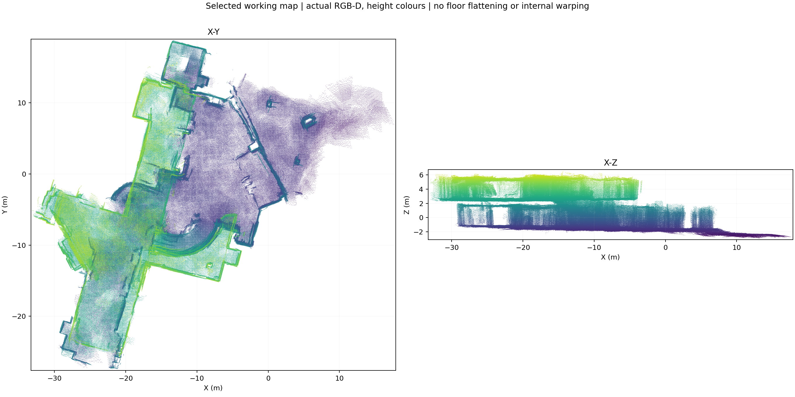

건물 앞에 도착했는데, 목적지로 들어가는 문은 다른 곳에 있다. 같은 좌표에서 한 층만 달라져도 전혀 다른 길이 된다. **Folded City는 건물의 위치뿐 아니라 출입구, 층, 계단과 복도의 연결을 지도에 담는 연구다.**

iPhone 16 Pro로 건국대학교 제1학생회관의 실외, 1층 로비, 메인 계단, 2층과 서브계단을 촬영했다. RGB 영상, LiDAR 깊이, ARKit의 카메라 자세 기록을 복원하고, 특징 대응과 기하 검사를 거쳐 여러 최적화 방법을 비교했다. 선택한 세션을 하나의 미터 좌표계에 배치한 뒤 층별 보행 격자에서 경로를 계산했다. 실제 사진으로 그 경로를 따라가는 웹 지도까지 연결했다.

연구의 중심은 **공간을 어떻게 측정하고, 서로 다른 관측을 어떻게 연결하며, 그 결과를 이동 가능한 지도로 바꾸는가**에 있다. 웹은 이 결과를 확인하고 사용하는 인터페이스다.

| 수집과 지도 | 규모 |
| --- | ---: |
| RGB-D 촬영본 | 5개 |
| 원본 RGB 프레임 | 2,875장 |
| 선택 지도에 사용한 포즈 | 2,251개 |
| 5 cm 복셀 통합 점군 | 3,493,208점 |
| 경로 탐색용 격자 | 48,767셀 |
| 등록 장소 | 13개 |

지도 제작과 경로 탐색에 휴대폰 현재 위치 및 헤딩 표시를 연결했다. 실외 위치는 정확도 기반 칼만 필터로 처리한다. 실내에서는 입구나 눈앞의 장소를 확인한 뒤 걸음, 중력 방향으로 투영한 각속도와 지도 보조 파티클 필터로 보행 위치를 추정한다. 층을 이동하면 도착한 층을 직접 확인한다. 실측 센서 재생에서 2층의 갱신 정체를 줄였으며, Safari 현장 정확도와는 구분해 평가했다.

배경지도는 전 세계를 이동할 수 있고, 교내 48개 건물의 3D 표현과 학생회관 실내 지도를 그 위에 연결했다. 전역 OSM 배경과 직접 구성한 공간 데이터의 범위를 나누어 관리한다. 배경지도 범위가 넓어져도 촬영하지 않은 건물의 실내 길찾기가 생기는 것은 아니다.

## 읽는 순서

[1. 동기](#problem) → [2. 개념설계](#concept) → [3. 기본설계](#architecture) → [4. 상세설계](#methods) → [5. 구현](#implementation) → [6. 결과](#results)

[현재 위치와 보정](#live-gnss) / [사용한 모델](#models) / [실행 방법](#running) / [자료 전체 목록](docs/EVIDENCE.md) / [연구 이력](README_HISTORY.md) / [참고문헌](#references)

<a id="problem"></a>

## 1. 동기

### 지도상의 도착과 실제 도착은 다르다

학생회관 2층에 보건실이 있다는 사실을 3학년이 되어서야 알았다. 오래 다닌 학교에서도 건물 이름을 아는 것과 그 안의 장소를 찾는 것은 달랐다. 건물 앞에서 끝나는 지도를 실제 목적지의 문 앞까지 이어 보고 싶었다.

연구의 출발점은 상허기념도서관이었다. 일반 자료실과 열람실은 같은 건물 안에 있지만 접근 동선이 분리되어 있다. 학생들이 자주 이용하는 열람실 쪽 보행로는 초행 방문자와 배달 기사에게 익숙하지 않다. 건물 중앙으로 안내받아도 목적지 입구까지 다시 돌아가야 할 수 있다.

이 문제는 지도의 수평 위치 오차만 줄여서는 해결되지 않는다. 건물의 어느 쪽에 있는지, 어느 층에 있는지, 어떤 문과 계단으로 연결되는지가 함께 필요하다. 차량이 다니지 못하는 통로와 실내에서는 차량 중심 로드뷰의 관측 범위도 제한된다.

본선 구현 대상은 제1학생회관으로 정했다. 실외 접근로, 넓은 로비, 유리 출입문, 두 계단, 서로 다른 층의 목적지가 한 공간에 있어 실내외 연결과 수직 이동을 함께 다룰 수 있었다.

이번에 만든 지도는 **한 건물의 로비, 두 계단과 2층 복도 일부**다. 보건실과 도서관은 연구의 동기이며 이번 목적지 비교 대상은 아니다. 아래 결과는 지도 관측의 내부 일관성과 경로 계산을 평가한다. 초행자의 도달 시간이나 성공률을 측정한 사용자 시험은 아직 없다.

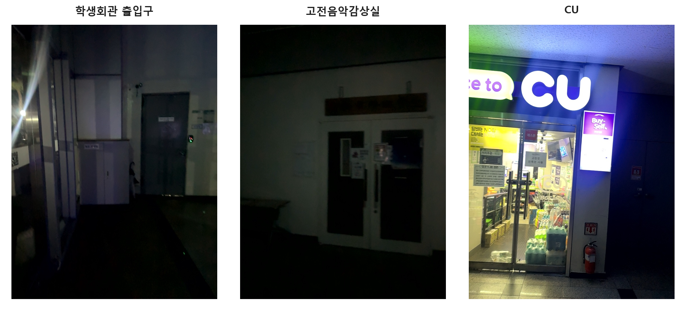

### 전체 파이프라인

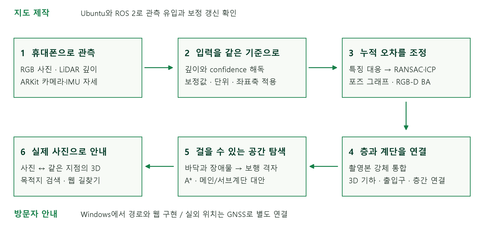

RGB-D 관측을 미터 좌표에 복원하고 재방문 대응과 표면 정합을 검사한다. 세션을 통합한 뒤 벽과 바닥에서 보행 공간을 구성해 경로를 계산하고, 실제 사진과 같은 위치의 3D 화면을 연결한다. 지도 제작 과정과 방문자의 현재 위치 처리는 별도로 구성했다.

### 연구 질문

1. RGB, 깊이와 자세 기록이 서로 다른 품질을 가질 때 어떤 관측을 지도에 사용할 것인가?
2. 반복되는 벽과 저조도 복도에서 재방문을 어떻게 확인하고 누적 오차를 조정할 것인가?
3. 층과 계단의 실제 높이 변화를 보존하면서 여러 촬영본을 어떻게 연결할 것인가?
4. 촬영자의 궤적과 별개로 목적지까지의 짧은 보행 경로를 어떻게 만들 것인가?

**좋은 위치 추정, 보기 좋은 표면, 올바른 공간 연결은 서로 다른 문제다.** 이 세 가지를 나누어 설계하고 마지막에 연결하는 것이 프로젝트의 기본 방향이다.

### 기존 방법과 이 연구의 위치

| 기존 방법 | 이미 다루는 것 | 이 연구에서 연결한 것 |
| --- | --- | --- |
| OSM Simple Indoor Tagging | 층, 방, 복도와 벽의 영역 및 연결 | 직접 수집한 RGB-D 기하에서 보행 공간을 구성하고 장소를 등록 |
| 영상 기반 VPS | 촬영 영상과 사전 시각 지도의 대응으로 위치 추정 | 방문자는 카메라를 켜지 않는 조건을 두고 입구 확인과 보행 추정으로 안내 |
| 기존 RGB-D SLAM | 이동 추정, 재방문 검색과 포즈 그래프 조정 | 저장 관측의 재검사, 구역별 보정 비교, 다섯 촬영본과 사진 안내의 통합 |

영역 기반 실내 경로나 A* 자체를 새로운 알고리즘으로 제안하는 연구는 아니다. 수집 당시의 센서 융합 SLAM, 후처리와 방문자의 위치 추정을 구분하고, 실제 관측에서 안내 가능한 공간으로 바꾸는 적용 과정을 다룬다. [OSM 실내 태깅](https://wiki.openstreetmap.org/wiki/Simple_Indoor_Tagging), [ARCore VPS](https://developers.google.com/ar/develop/geospatial), [RGB-D 및 LiDAR SLAM 원 논문](https://doi.org/10.1002/rob.21831)

<a id="concept"></a>

## 2. 개념설계

### 좌표에 공간 연결을 더한다

평면 지도에서 가까운 두 점이 실제로도 가깝게 이동할 수 있는 것은 아니다. 벽 반대편이거나 층이 다르면 출입문과 계단을 거쳐야 한다. 따라서 장소를 단순한 XYZ 표식이 아니라 건물, 층, 접근 지점과 연결 관계로 표현했다.

| 설계 대상 | 담아야 할 정보 | 산출물 |
| --- | --- | --- |
| 관측 | RGB, 깊이, 신뢰도, 보정값, 포즈와 시간 | 프레임별 RGB-D 기록 |
| 기하 | 카메라 이동과 벽, 바닥, 계단의 상대 배치 | 포즈와 통합 점군 |
| 장소 | 이름, 별칭, 층, 출입구와 근거 사진 | 장소 목록 |
| 이동 공간 | 바닥 후보, 장애물, 문과 층간 연결 | 보행 격자와 연결 그래프 |
| 안내 | 계산 경로, 진행 방향, 주변 실제 사진 | 3D 지도와 사진 길안내 |

카메라는 지도 제작에 사용한다. 지도를 보는 방문자에게 촬영을 계속 요구하는 방식은 현재 사용 흐름에 넣지 않았다. 장소를 검색하면 입구부터 목적지 접근 지점까지의 경로와 사진을 확인할 수 있다.

### 설계 과정

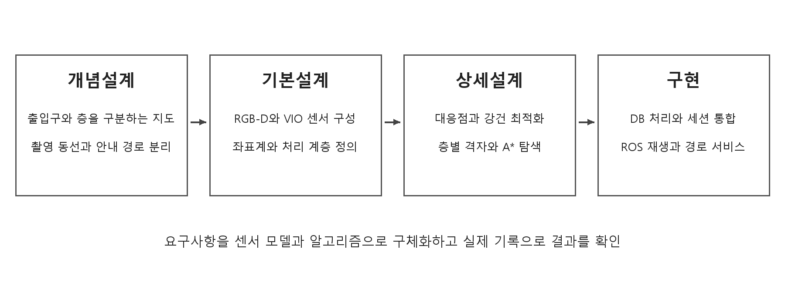

개념설계에서는 입구와 층 연결을 표현한다는 요구사항을 정했다. 기본설계에서는 센서와 좌표계, 지도 계층을 나눴다. 상세설계에서는 대응점 검사, 강건 최적화와 경로 탐색 방법을 구체화했다. 구현 단계에서는 수집 DB를 처리하고 실제 지도를 생성해 ROS와 웹에서 확인했다.

| 개념 설계 | 기본 설계 | 상세 설계 | 구현과 확인 |
| --- | --- | --- | --- |
| 건물 입구에서 목적지까지 연결 | 미터 단위 3D 기하와 층별 이동 공간 분리 | 깊이 지도의 스케일을 유지하고 층간 이동을 명시적 연결로 표현 | 점군, 보행 격자, 문과 두 계단의 연결을 따로 생성 |
| 별도 인프라를 적게 쓰는 수집 | 보유한 RGB 카메라, 근거리 LiDAR, ARKit 자세 활용 | 앱의 RGB-D 정합과 보정값을 읽어 센서 기준 및 시각을 통일 | 다섯 DB의 해독, 좌표 변환과 포즈 비교 |
| 반복 구조의 잘못된 연결 억제 | 영상 대응만으로 루프를 확정하지 않는 검사 구조 | SIFT/RootSIFT와 LoFTR 후보를 깊이, RANSAC, 양방향 ICP로 검사 | 잘못된 루프를 포함한 후보별 패치 잔차 비교 |
| 높이와 계단 구조 보존 | 관측 신뢰도에 따른 자유도 및 prior 선택 | 4DoF와 SE(3), Huber와 DCS, Z 전용 보정 비교 | 수치 수렴과 벽 및 바닥 정합을 별도 평가 |
| 촬영자의 우회를 따라가지 않는 안내 | 이동 공간에서 새 경로 계산 | 12cm 격자, 장애물 여유, 모서리 차단, A*와 연결 정책 | 같은 목적지에서 메인 계단과 서브계단 거리 비교 |
| 방문자는 카메라 없이 사용 | 실외 측위와 입구 확인, 실내 안내를 분리 | CV 칼만과 품질 게이트, 수동 입구 전환 | 실제 GNSS와 SLAM 대조, 큰 실내 편향의 범위 확인 |
| 다른 수집 장비와 로봇으로 확장 | 처리 기능을 ROS 2 노드와 토픽으로 분리 | 입력, 전처리, 제약 검사, 최적화와 점군 발행을 분리 | 기록을 순서대로 재생하며 rqt와 RViz에서 누적 지도 관찰 |

### SLAM 알고리즘과 지도 제작

이 연구에서는 **다중센서 융합 SLAM을 적용해 실내외 연결 지도를 만들고 다층 경로 탐색 시스템을 구성했다.** 카메라와 IMU를 결합한 VIO로 초기 이동을 추정하고, RGB-D 재방문 대응과 포즈 그래프 최적화로 누적 오차를 조정했다. 영상 특징과 LiDAR 깊이로 상대 자세를 재측정한 뒤, 보정한 자세로 관측을 다시 투영했다.

| 적용한 알고리즘과 처리 | 처리 코드 | 지도에 반영되는 결과 |
| --- | --- | --- |
| RGB-D와 보정값 해독 및 미터 단위 역투영 | [`export_rtabmap_db.py`](src/export_rtabmap_db.py) | 원본 관측의 색상 점군 |
| 재방문 상대 자세 재측정과 양방향 기하 검사 | [`revalidate_loop_constraints.py`](src/revalidate_loop_constraints.py), [`optimize_session.py`](src/optimize_session.py) | 깊이와 점군으로 지지되는 재방문 제약 |
| 강건 포즈 그래프와 재방문 RGB-D 번들 조정 | [`optimize_session.py`](src/optimize_session.py), [`rgbd_bundle_vectorized.py`](src/rgbd_bundle_vectorized.py) | 보정 자세와 후보별 관측 잔차 |
| 순차 관측 처리와 보정 점군 갱신 | [`slam_replay_core.py`](src/slam_replay_core.py), [`run_slam_replay.py`](src/run_slam_replay.py) | ROS 2 점군 및 처리 기록 |
| 선택 세션의 강체 통합 | [`assemble_selected_map.py`](src/assemble_selected_map.py) | 층과 두 계단을 연결한 공통 좌표 지도 |

SIFT와 RootSIFT로 재방문 대응을 찾고 RANSAC과 양방향 ICP로 같은 구조인지 검사했다. 강건 포즈 그래프 최적화와 RGB-D 번들 조정을 비교해 벽의 중복과 층 높이를 평가했다. 촬영자의 우회 궤적과 별개로 완성된 공간의 보행 격자에서 경로를 계산하고, 실제 사진을 지도와 같은 위치 및 방향으로 연결했다.

VIO의 초기 오도메트리와 저장 루프 후보는 입력으로 사용하고, RGB-D 기하 검사와 재최적화 결과를 비교했다. GNSS는 전역 배치와 실외 위치 처리에 사용했다. 단계별 입력과 수집 도구는 다음 개발환경 및 센서 구성에 정리했다.

<a id="architecture"></a>

## 3. 기본설계

### 3.1 장비와 개발환경

| 구분 | 사용 환경 |
| --- | --- |
| 수집 장비 | iPhone 16 Pro |
| 기록 앱 | RTAB-Map iOS, ARKit VIO 및 LiDAR 깊이 |
| 센서 처리 | Ubuntu, Python, NumPy, SciPy, OpenCV, Open3D |
| 노드 연결과 시각화 | ROS 2 Humble, rqt_graph, RViz |
| 학습 기반 대응 | Kornia LoFTR, PyTorch CPU 추론 |
| 동적 객체 마스크 실험 | Ultralytics YOLOv8n-seg |
| Gaussian 표시 실험 | gsplat, CUDA, RTX 5070 Laptop GPU |
| 웹 | JavaScript, Three.js 0.180.0, Python API |
| 배포 | GitHub, Vercel |

일반 처리, LoFTR 추론과 Gaussian GPU 학습은 서로 다른 실행 환경을 사용했다. 정확한 버전과 설정은 각 [실험 기록](docs/experiments/)에 남겼다.

### 3.2 센서별 역할

| 입력 | 제공하는 정보 | 처리에서 확인한 문제 |
| --- | --- | --- |
| RGB 카메라 | 질감, 문틀과 표지, 재방문 대응점 | 저조도, 흔들림, 반복 무늬 |
| LiDAR 깊이 | 가까운 표면까지의 거리와 미터 단위 구조 | 유리, 반사면, 먼 표면의 깊이 누락 |
| IMU를 사용하는 ARKit VIO | 프레임 사이 이동과 자세의 초기 추정 | 누적 드리프트와 추적 단절 |
| GNSS | 실외 지리 위치의 대략적인 기준 | 실내에서 오래된 위치 반복, 큰 보고 불확실성 |

IMU는 ARKit이 계산한 자세에 반영되어 있다. 이 DB에는 재적분에 필요한 별도 시각별 가속도와 자이로 원시 스트림이 없어 후처리에서 새로운 IMU 적분을 수행하지 않았다. 후처리 센서 결합은 RGB-D 관측과 저장 포즈를 중심으로 구성했다.

### 3.3 수집 범위

| 세션 | 촬영 범위 | RGB 프레임 | 선택 포즈 |
| --- | --- | ---: | ---: |
| `outside` | 실외 접근 구간 | 354 | 305 |
| `lobby` | 1층 로비 | 958 | 800 |
| `bridge_out1f` | 실외, 출입문, 로비 연결 | 134 | 86 |
| `floor2` | 로비 일부, 메인 계단, 2층 | 1,218 | 925 |
| `bridge_12_sub` | 서브계단과 양 층 승강장 | 211 | 135 |
| 합계 | | 2,875 | 2,251 |

촬영본 하나가 층 하나를 의미하지는 않는다. `floor2`에도 낮은 층과 계단 관측이 들어 있다. 세션 ID는 관측의 출처로, 층 ID는 공간의 구분으로 따로 관리한다.

원본 DB는 읽기 전용으로 열고 해시를 기록했다. `Node.pose`에는 저장 오도메트리, `Admin.opt_poses`에는 앱이 이미 최적화한 포즈가 있다. 이를 기준으로 원본 오도메트리, 앱 저장본과 새 후처리 결과를 비교했다.

### 3.4 좌표계와 보정값

깊이 영상의 픽셀을 카메라 내부 파라미터로 역투영한 뒤 광학 좌표계에서 노드 좌표계로, 다시 지도 좌표계로 변환한다.

$$
\mathbf{p}_{c}=d(u,v)K_d^{-1}[u,v,1]^\mathsf{T}
$$

$$
\mathbf{p}_{w}=T_{w,i}T_{i,c}\mathbf{p}_{c}
$$

여기서 $K_d$는 깊이 카메라 내부 파라미터, $T_{i,c}$는 저장된 광학 좌표 변환, $T_{w,i}$는 프레임 포즈다. RGB와 대응시켜 점에 색을 입힌다. 프레임별 보정값을 복원해 사용했으며 새로운 카메라와 IMU의 독립 캘리브레이션을 수행한 실험과는 구분된다.

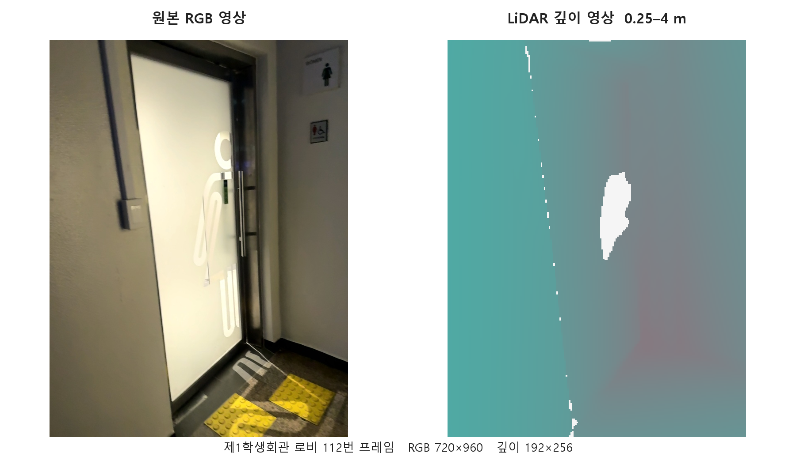

RGB는 720×960, 깊이는 192×256이다. 낮은 깊이 해상도로 작은 글자와 문틀까지 표현하기 어려워, 기하 지도와 실제 사진을 함께 사용하는 방향으로 설계했다.

### 3.5 GNSS를 어디까지 사용하는가

처음 두 세션의 GNSS 보고 정확도 중앙값은 실외 14.25 m, 로비 17.97 m였다. 실내에서는 같은 시각과 좌표가 반복되거나 오래된 값이 저장되었다. 이 정도의 정보로 문이나 층을 구분하기는 어렵다.

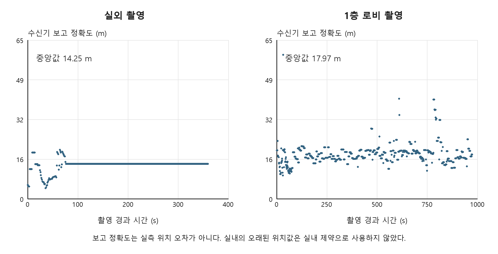

위 그래프는 수신기가 보고한 정확도이며 실측 위치 오차가 아니다. 세션 후처리 최적화에서는 GNSS factor를 넣지 않았고, 캠퍼스 배경에 배치하는 대략적인 지리 기준으로 사용했다. RTK 고정해를 얻은 데이터는 아니다. 방문자의 현재 위치를 처리하는 웹 칼만 필터는 이 지도 제작 최적화와 별도의 추정기다.

지리 좌표는 WGS84에서 ECEF를 거쳐 ENU로 변환한다. 실내 지도는 미터 단위를 유지한다. OSM 건물 외피에 맞추기 위해 지도를 축별로 늘이거나 줄이지 않는다.

<a id="methods"></a>

## 4. 상세설계

지도 제작에는 **수집 중 수행된 SLAM**과 **저장한 관측을 다시 계산한 후처리**가 이어진다. 먼저 카메라와 IMU로 초기 이동을 추정하고, RGB-D에서 재방문을 찾아 여러 자세를 조정한다. 그 결과를 입력으로 후처리에서 대응과 표면을 재검사하고 벽의 중복과 기울기를 줄였다. 마지막에는 보정한 자세로 같은 원본 깊이를 다시 투영했다.

### 수집 중 SLAM에서 실제로 처리된 것

LiDAR와 IMU를 받는다는 설명만으로는 지도 생성 과정을 알 수 없다. 이 수집 구성에서 초기 이동을 담당한 것은 카메라-IMU VIO다. LiDAR는 RGB와 정합된 깊이를 제공해 표면 복원과 재방문 상대 자세 계산에 사용된다. 아래의 GFTT·BRIEF는 RGB-D SLAM의 특징 처리이며, ARKit 내부의 특징 추적기 이름을 뜻하지 않는다.

| 순서 | 입력 | 알고리즘과 역할 | 다음 단계에 전달하는 것 |
| --- | --- | --- | --- |
| 1. 초기 이동 | RGB와 IMU | **Visual-Inertial Odometry**로 영상의 움직임과 관성 관측을 결합 | 프레임의 6자유도 자세와 연속 이동 관계 |
| 2. 영상 특징 | RGB | **GFTT**로 모서리를 찾고 **BRIEF** 기술자로 주변 패턴을 표현 | 특징 좌표, 기술자와 시각 단어 |
| 3. 재방문 후보 | 현재와 과거의 시각 단어 | **Bag of Words, TF-IDF와 Bayes 필터**로 다시 본 장소의 후보를 탐색 | 기하 검사를 수행할 과거 프레임 |
| 4. 상대 자세 검사 | 대응 픽셀과 깊이에서 복원한 3D 점 | **PnP-RANSAC**으로 3D 점이 상대 영상에 투영되는 관계를 추정하고 오대응을 분리 | 두 촬영 위치 사이 회전·이동과 루프 제약 |
| 5. 자세 최적화 | 연속 이동과 재방문 제약 | **포즈 그래프 최적화**로 여러 프레임의 자세를 함께 조정. 저장 설정은 GTSAM Gauss–Newton | `Admin.opt_poses`의 저장 최적화 자세 |
| 6. 지도 복원 | RGB, 깊이, 내부 파라미터와 자세 | **깊이 역투영과 좌표 변환**으로 각 관측을 같은 지도에 배치 | 색상 점군과 후처리 입력 |

다섯 DB의 `Info.parameters`에는 같은 특징·기하 검사 설정이 저장돼 있다. `Kp/DetectorStrategy=6`과 `Vis/FeatureType=6`은 GFTT/BRIEF, 최대 특징 수는 400개다. 시각 단어 검색은 `Kp/NndrRatio=0.8`, TF-IDF와 재방문 판정값 0.11을 사용하도록 설정돼 있다. 이 0.11은 측위 정확도나 장소가 맞을 확률을 뜻하는 성능 수치가 아니다.

상대 자세 계산은 `Vis/EstimationType=1`인 3D→2D PnP이며 재투영 기준 2 px, 최대 300회와 최소 25 inlier가 저장돼 있다. `Vis/PnPFlags=0`은 iterative PnP 설정이다. **뒤의 EPnP-RANSAC 후처리와 같은 실행으로 묶지 않는다.** 그래프 설정은 `Optimizer/Strategy=2`, `GTSAM/Optimizer=1`, 최대 10회이며, 영상 기하 정합의 BA 설정은 별도로 `Vis/BundleAdjustment=1`이다. 이 설정 목록은 당시 구성의 기록이고 모든 프레임의 분기·반복 횟수를 복원한 실행 로그는 아니다.

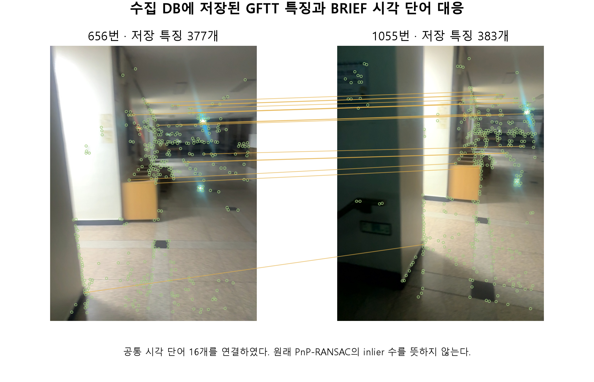

위 사진은 새로 검출해 꾸민 특징점이 아니라 **DB의 `Feature` 테이블에 저장된 점**이다. 656번에 377개, 1055번에 383개가 남아 있고 두 관측은 실제 `Link` 테이블의 재방문 연결로 이어져 있다. 선으로 연결한 16개는 현재 저장 사전에서 같은 시각 단어 ID를 가진 후보이며, 당시 PnP-RANSAC이 채택한 inlier 개수는 아니다. 뒤에서 다시 계산한 SIFT·RootSIFT의 87→38→35 대응과 구분한다.

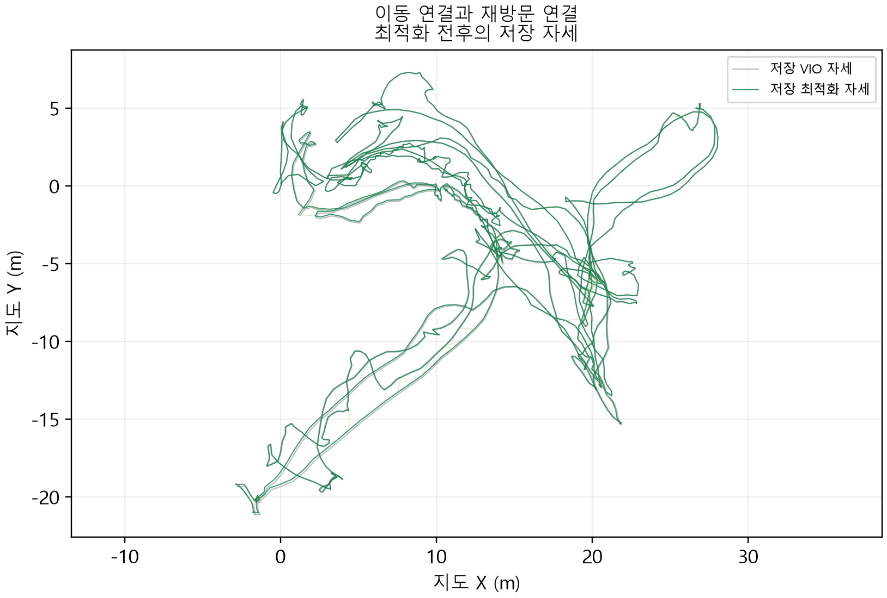

회색은 `Node.pose`, 녹색은 `Admin.opt_poses`다. 공통 1,215개 자세를 비교하며 이동 연결과 중복을 제거한 재방문 연결 66쌍을 표시했다. 지도 원점 차이를 없애려고 첫 공통 자세만 강체 정렬했으며 궤적 전체를 가장 잘 겹치도록 맞추지는 않았다. 이 그림은 저장 추정치 사이의 변화다. 이후 선택한 J04나 독립적으로 측량한 정답 궤적은 아니다.

수집 당시부터 자세 최적화가 있었으므로 원본 DB를 ‘최적화가 전혀 없는 점군’으로 부르지 않는다. 그럼에도 벽의 중복과 기울기가 남아, 다음 단계에서 특징 대응과 기하 제약을 다시 계산했다. [다섯 DB의 설정과 그림 계산 근거](docs/assets/slam-process-20261021/capture-pipeline.json) · [센서 입력 역할에 대한 개발자 설명](https://github.com/introlab/rtabmap/discussions/1155) · [설정값의 알고리즘 정의](https://github.com/introlab/rtabmap/blob/master/corelib/include/rtabmap/core/Parameters.h)

### 저장 관측을 다시 계산한 후처리

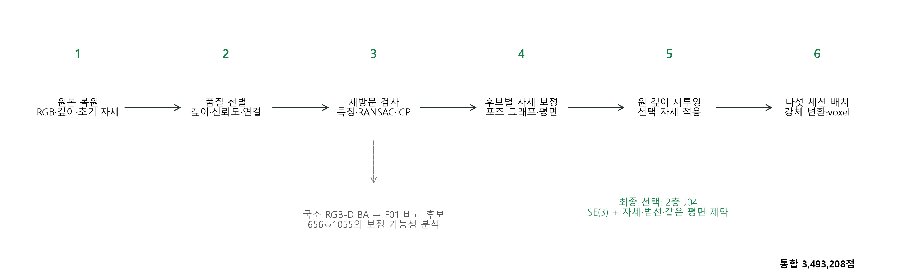

### 4.1 원본 RGB-D를 점군으로 복원하고 관측을 선별

한 프레임의 입력은 RGB, 깊이, confidence, 내부 파라미터와 카메라 변환, 저장 자세다. 기기의 카메라-IMU VIO가 계산한 오도메트리와 저장 최적화 포즈를 각각 읽어 비교 기준으로 삼았다. 이후의 상대 자세 검사와 후보별 보정은 이 관측을 입력으로 수행했다.

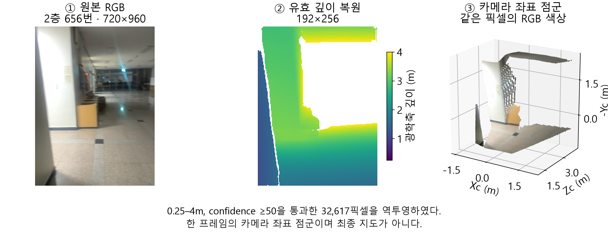

위 그림은 **2층 656번 한 프레임**이다. 4채널 PNG의 네 바이트를 little-endian float32로 해석해 깊이를 복원하고, 깊이 해상도에 맞게 축소한 초점거리와 주점으로 3차원 점을 구했다. 0.25–4m와 confidence 50 이상을 통과한 픽셀은 32,617개다. RGB를 같은 해상도로 맞춘 뒤 동일한 유효 픽셀에서 색을 가져왔다. 오른쪽은 아직 지도에 누적하지 않은 카메라 좌표의 점군이며 흰색 깊이 누락 영역을 통행 공간으로 해석하지 않았다.

이 카메라 점에 광학-노드 변환과 프레임의 지도 자세를 곱하면 지도 좌표의 점이 된다. 같은 깊이라도 프레임 자세가 달라지면 지도 속 벽의 위치가 달라진다. 따라서 점을 무조건 많이 쌓는 것보다, 어느 관측을 사용하고 어느 자세에 배치할지가 먼저다. [그림의 원본·수치와 계산 조건](docs/assets/slam-process-20261021/manifest.json)

DB 무결성, RGB와 깊이의 해독, 신뢰도, 보정값, 시간과 그래프 연결을 먼저 검사했다. 유효 깊이의 기본 범위는 0.25–4 m, confidence 기준은 50이다. 세션에 따라 깊이 경계와 고립 픽셀 조건을 비교했다.

품질이 낮은 프레임을 뺀 효과와 포즈 보정 효과를 구분하기 위해 같은 A/B 프레임 집합을 사용한 대조군을 만들었다.

| 비교군 | 포즈 | 깊이 처리 |
| --- | --- | --- |
| O00 | 앱 저장 포즈 | 기본 유효성 필터 |
| P00 | O00와 동일 | 세션별 전처리 |
| 최적화 후보 | 후처리 포즈 | P00와 동일 |

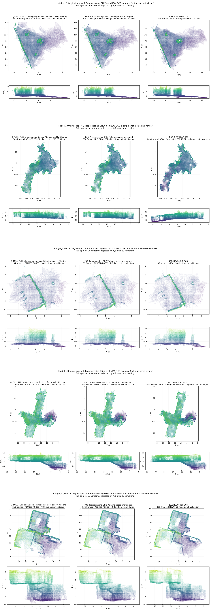

세 단계 그림의 마지막 열은 비교용 후보이며 최종 선택본은 아니다. 후보별 점군은 동일한 축과 높이 색 범위에서 비교했다.

<details>
<summary>세션별 동일 프레임 비교와 전체 후보</summary>

| 촬영본 | 동일 프레임 대조 | XY 후보 | XZ 후보 |
| --- | --- | --- | --- |
| 실외 | [3단계](docs/assets/session-portfolios/outside/matched_three_stage.png) | [XY](docs/assets/session-portfolios/outside/portfolio_xy.png) | [XZ](docs/assets/session-portfolios/outside/portfolio_xz.png) |
| 로비 | [3단계](docs/assets/session-portfolios/lobby/matched_three_stage.png) | [XY](docs/assets/session-portfolios/lobby/portfolio_xy.png) | [XZ](docs/assets/session-portfolios/lobby/portfolio_xz.png) |
| 실외 연결 | [3단계](docs/assets/session-portfolios/bridge_out1f/matched_three_stage.png) | [XY](docs/assets/session-portfolios/bridge_out1f/portfolio_xy.png) | [XZ](docs/assets/session-portfolios/bridge_out1f/portfolio_xz.png) |
| 메인 계단과 2층 | [3단계](docs/assets/session-portfolios/floor2/matched_three_stage.png) | [XY](docs/assets/session-portfolios/floor2/portfolio_xy.png) | [XZ](docs/assets/session-portfolios/floor2/portfolio_xz.png) |
| 서브계단 | [3단계](docs/assets/session-portfolios/bridge_12_sub/matched_three_stage.png) | [XY](docs/assets/session-portfolios/bridge_12_sub/portfolio_xy.png) | [XZ](docs/assets/session-portfolios/bridge_12_sub/portfolio_xz.png) |

</details>

### 4.2 같은 구역의 사진에서 상대 이동 관측을 생성

후처리의 기본 대응은 SIFT와 RootSIFT로 구하고 상호 ratio 0.75 조건을 적용했다. 수집 중 사용한 GFTT·BRIEF와 구분되는 재검사다. 저조도 구간에서는 CLAHE 전처리와 LoFTR 사전학습 모델도 비교했다. 대응점 주변의 신뢰 깊이를 확인한 다음 양쪽 깊이가 있으면 3D 강체 RANSAC, 한쪽 깊이를 사용할 수 있는 국소 재방문 실험에서는 EPnP-RANSAC을 적용했다.

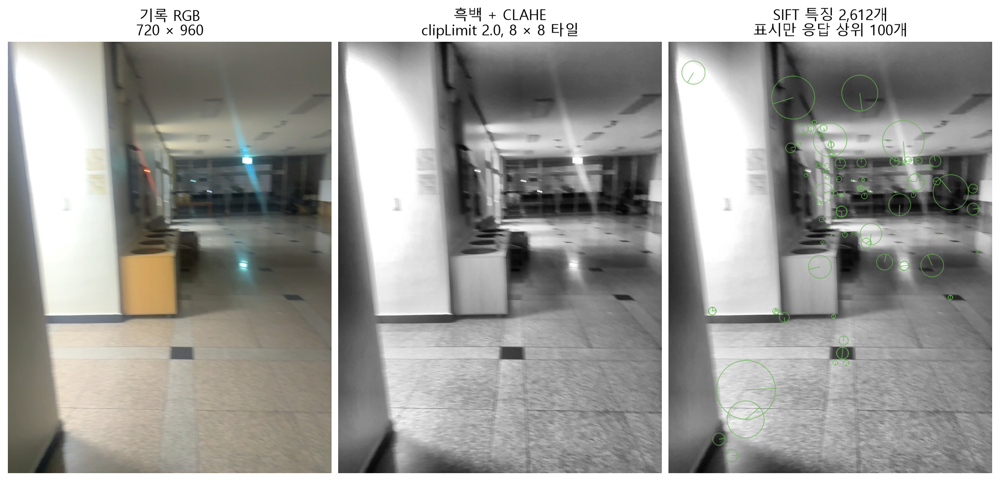

SIFT는 영상의 크기와 회전 변화에 비교적 안정적인 국소 특징을 만드는 알고리즘이다. 이 실험에서는 어두운 벽면의 대비를 보완한 뒤 최대 6,000개 특징을 찾고, 첫 번째와 두 번째 후보의 기술자 거리 비율을 검사했다. 두 영상에서 서로를 선택하는 대응만 남겨 한쪽 영상의 우연한 유사도를 줄였다.

RootSIFT는 SIFT 기술자를 L1 정규화하고 성분별 제곱근을 취한다. 사진의 밝기를 바꿔 3D 형상을 만드는 방법이 아니라, 같은 국소 패턴을 비교하는 표현을 바꾸는 방법이다. 영상 대비, 특징 수, 기술자 거리와 깊이의 역할을 나눠 본 이유다.

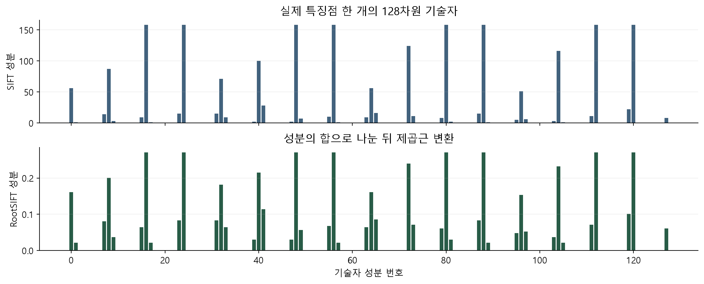

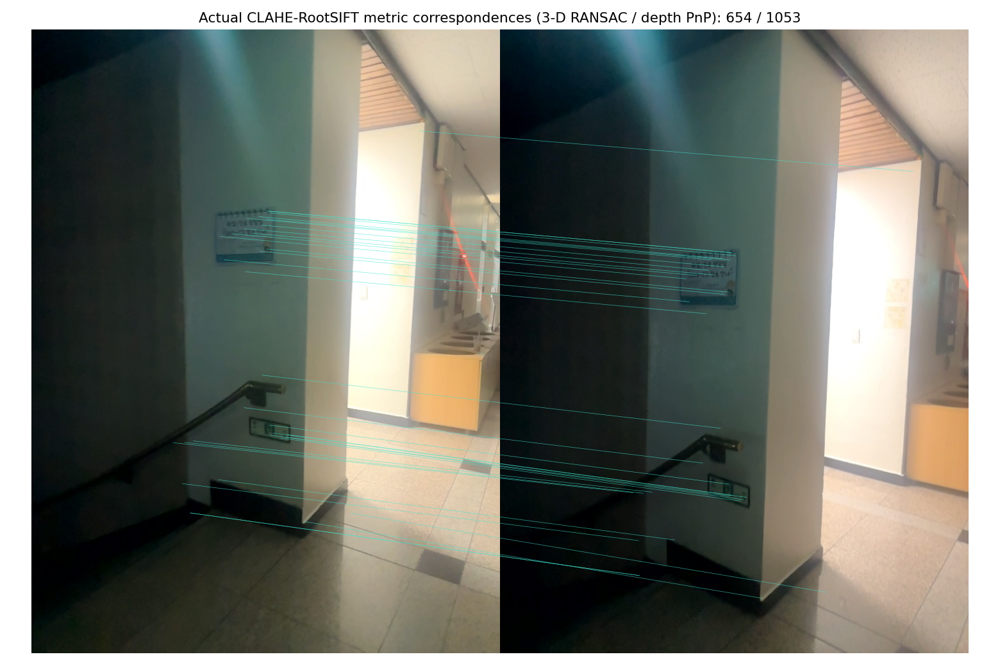

앞에서 복원한 656번과, 나중에 같은 구역을 다시 본 1055번이 실제 사례다. 이 단계의 출력은 지도 좌표가 아니라 두 영상의 픽셀 대응이다. Windows 설명용 재계산에서는 상호 RGB 대응 87쌍 중 양쪽 깊이가 유효한 38쌍을 얻었고, RANSAC의 공통 회전·이동으로 35쌍이 0.10m 이내에서 일치했다. 원래 Ubuntu 실행의 수치는 별도로 보존했다.

많은 대응점이 항상 좋은 측정은 아니다. 유리 너머 나무를 RGB에서 같은 물체로 찾아도 LiDAR가 유리나 다른 깊이를 측정했다면 잘못된 3D 연결이 된다. 신뢰도, 재투영 잔차, 공간 지지 범위와 ICP를 함께 검사한 이유다.

RANSAC은 작은 대응 집합에서 변환 가설을 반복 생성하고, 그 변환으로 설명되는 나머지 대응의 지지를 비교한다. 여기서 판정 대상은 ‘같은 객체인가’라는 의미 분류가 아니라 **두 관측이 하나의 카메라 상대 변환으로 일관되게 설명되는가**다. 영상쌍의 특징, 깊이에서 얻은 3D 대응, 최종 변환의 잔차를 차례로 확인했다.

| 영상에서 남긴 대응 | 미터 단위에서 검사한 일관성 |
| --- | --- |
| 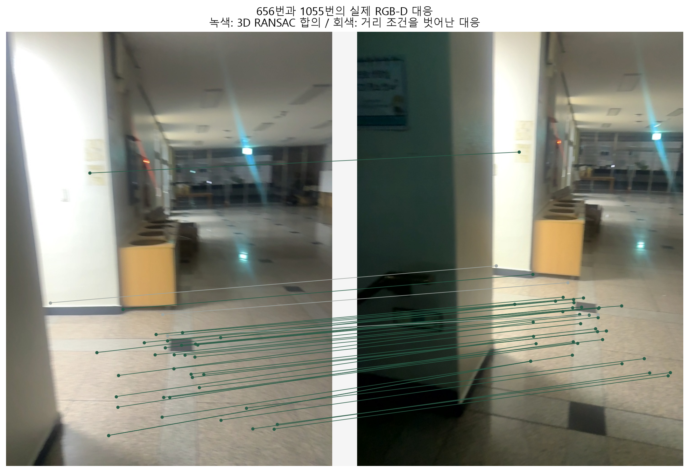 | 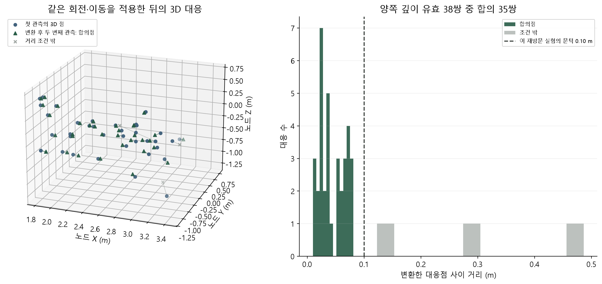 |

| 단계 | 확인하는 것 |
| --- | --- |
| 영상 대응 | 같은 구조를 보는 후보인가 |
| 신뢰 깊이 | 대응점에 미터 단위 거리가 있는가 |
| RANSAC | 하나의 강체 변환으로 설명되는가 |
| 공간 분포 | 좁은 구역이나 선에 대응이 몰려 있지 않은가 |
| ICP와 왕복 검사 | 표면 정합과 양방향 변환이 일관되는가 |
| 미사용 대응 검사 | 피팅에 쓰지 않은 관측도 같은 변환을 지지하는가 |

LoFTR 세션 간 검사는 완료된 200회를 집계했다. 국소 기하 조건을 통과한 로비 314↔2층 1215는 예약 대응 113개 중 103개가 일치했고 RMSE는 4.93 cm였다. 다만 기존 대응과 로비 프레임을 공유하므로 독립적인 장소 하나가 추가된 것으로 세지 않았다. 문제 루프 6쌍의 별도 LoFTR 검사는 모두 최종 기하 기준을 통과하지 못했다.

### 4.3 저장 루프를 양방향 ICP로 재검사

새 특징 대응과 별개로, DB에 이미 저장된 재방문 후보도 검사했다. 재방문은 먼 시각의 두 카메라를 연결해 누적 드리프트를 줄일 기회다. 비슷한 복도를 잘못 연결하면 포즈 그래프 전체가 틀어지므로 점군의 실제 표면을 대조했다.

저장 루프를 다시 검사할 때 양방향 trimmed point-to-point ICP를 사용했다. 가까운 대응의 하위 80%를 남기고 SVD/Kabsch 강체 정합을 반복한다. 양방향 overlap, RMSE와 왕복 변환을 함께 본다.

초기 세션 검사에서는 대응 거리 0.22 m, 평가 overlap 거리 0.15 m를 사용했다. overlap 0.45 이상, RMSE 7.5 cm 이하, 초기값 대비 25 cm/5° 이내, 왕복 10 cm/2° 이내를 판정 조건으로 뒀다. 세션 간 검사와 다른 실험의 설정은 별도 기록했다.

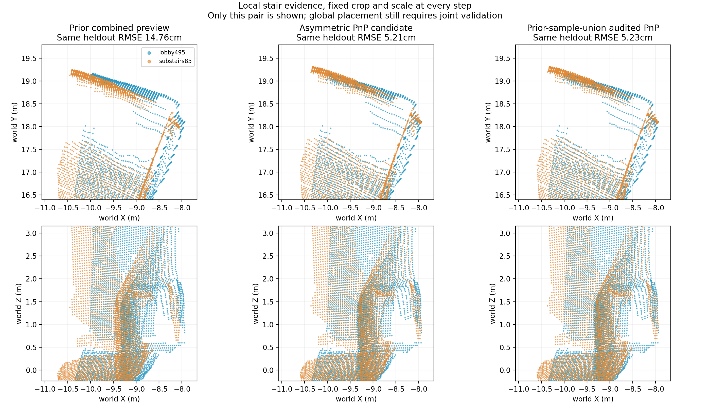

초기 저장 루프 검사에서 ICP는 연결을 사용할지 판정하는 역할이었다. 통과한 루프의 원래 상대 변환과 정보행렬을 그래프에 넣었으며 모든 루프 측정을 ICP 출력으로 덮어쓰지는 않았다. 이후 세션별 국소 정합과 새 RGB-D 재측정의 용도 및 가중치는 각각의 실행 기록에 남겼다.

평면의 법선 방향 거리만 작다고 표면이 실제로 겹친 것은 아니다. 떨어져 있는 두 벽 조각도 같은 무한 평면에 놓일 수 있다. 따라서 유한 패치의 최근접 거리와 겹침 비율을 함께 계산했다.

### 4.4 상대 관측을 모아 여러 프레임 자세를 함께 보정

카메라 포즈를 노드, 프레임 사이 이동과 재방문 측정을 연결로 표현했다. 한 쌍의 상대 변환을 전체 지도에 그대로 적용하지 않고 여러 관측을 함께 만족시키도록 프레임 자세를 조정했다. 이때 관측의 상대 이동 $Z_{ij}$와 현재 두 포즈 $T_i,T_j$가 만드는 상대 변환의 차이를 잔차로 둔다.

$$
E_{ij}=Z_{ij}^{-1}T_i^{-1}T_j
$$

$$
\mathbf{r}_{ij}=\begin{bmatrix}\operatorname{trans}(E_{ij})\\\operatorname{Log}(\operatorname{rot}(E_{ij}))\end{bmatrix}
$$

저장된 정보행렬로 잔차를 whitening하고 6차원 연결 블록의 크기에 Huber 손실을 적용했다. 초기에는 기존 roll/pitch를 유지하는 x/y/z/yaw 4자유도 모델을 사용했고, 후속 실험에서는 SE(3), 자세 prior, 법선과 유한 평면 제약을 비교했다.

$$
\min_{\{T_i\}}\sum_{(i,j)}\rho\!\left(\left\|L_{ij}\mathbf{r}_{ij}\right\|_2\right),\qquad L_{ij}^{\mathsf{T}}L_{ij}=\Omega_{ij}
$$

Huber, Dynamic Covariance Scaling(DCS), 구역 공유 switch를 대조했다. 연속된 여러 프레임이 같은 물리 구역을 반복 관측한 경우 정보량을 중복 계산하지 않도록 구역 단위 가중치를 적용했다. 각 연결 성분의 기준 포즈를 고정해 게이지 자유도를 제거했다.

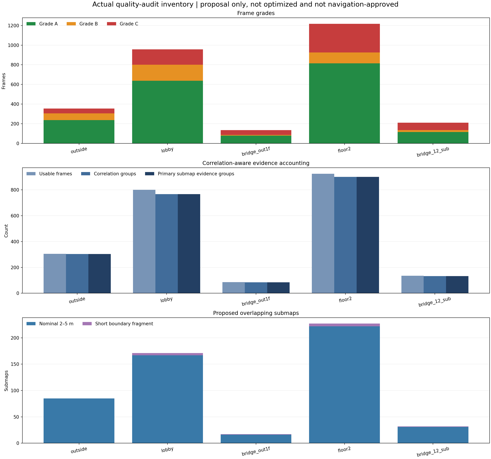

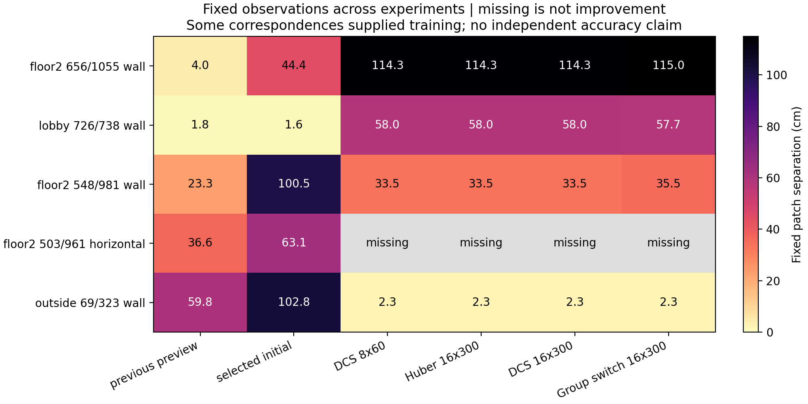

전처리, 그래프 입력과 자유도가 다른 후보는 손실 함수 하나만 바꾼 통제 실험과 구분했다. 최종 후보 선택에는 지표뿐 아니라 벽, 계단과 출입구의 전체 배치도 함께 고려했다.

최종 2층 **J04는 `pgo6_planes`**다. SE(3)의 이동과 회전을 조정하면서 기준 자세 prior, 수평 법선, 같은 평면 쌍의 거리와 법선 제약을 사용했다. 같은 벽이 두 번 촬영되어 떨어져 놓였을 때 관측면의 분리와 기울기를 함께 줄이는 구성이다. 카메라 Z를 한 값으로 고정하지 않아 계단의 상승을 유지했다. 기준 자세 prior는 새로 수집한 IMU 측정이 아니라 저장 자세에서 급격히 기울어지는 해를 억제하는 모델이다. [계산식](src/optimize_geometry_stage.py) / [J04의 실제 포즈 출처](docs/assets/session-portfolios/floor2/summary.json)

### 4.5 수치 수렴과 공간 정합을 따로 평가한다

목적함수가 줄어도 일부 벽은 더 벌어질 수 있다. 반복 구조에서는 잘못된 제약의 잔차를 줄이느라 다른 구간이 변형되기도 한다. 같은 원본 패치를 모든 후보에서 고정해 비교하고, 제약별 물리 잔차와 정규화 잔차를 구분했다.

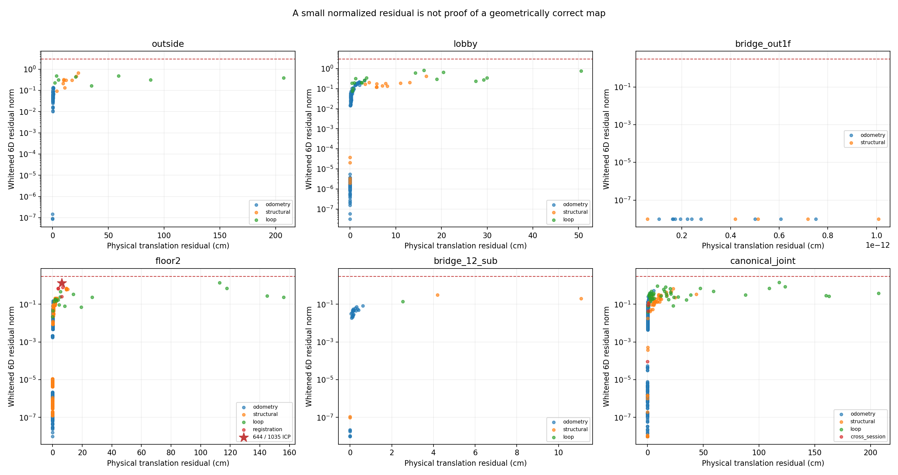

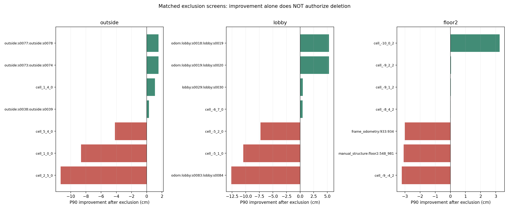

제약 제외 실험에서도 좋아지는 패치와 나빠지는 패치가 함께 나타났다. 원인 분석용 후보를 자동으로 최종 지도에 반영하지 않고 기존 관측과 함께 보관했다.

### 4.6 재방문 RGB-D BA로 국소 보정 가능성을 비교

J04와는 별도로 재방문 구간의 카메라와 3D landmark를 함께 조정하는 국소 RGB-D BA를 적용했다. 목적은 그래프 반복 횟수만 늘리는 대신 새로운 시각 관측을 넣었을 때 남은 중복 벽이 어떻게 달라지는지 보는 것이었다. 두 방문에서 각각 연속 9프레임을 읽고 특징점 track을 연결하였다. 재투영, 깊이와 방문 내부 상대 이동 prior를 Huber 손실로 결합했으며 카메라 내부 파라미터와 광학 좌표 변환, 깊이 배율은 고정했다.

656↔1055 주변에서는 61개 track, 324개 RGB 관측과 318개 유효 깊이 관측을 확보했다. 18개 카메라 중 영상으로 직접 연결되는 것은 10개이며 나머지는 이동 prior로 연결된다.

$
\min_{\{T_i\},\{\mathbf{P}_k\}}\sum_{i,k}\rho\!\left(\frac{\|\pi(T_{c,w,i}\mathbf{P}_k)-\mathbf{u}_{ik}\|_2}{\sigma_{px}}\right)+\text{depth 항}+\text{상대 이동 prior}
$

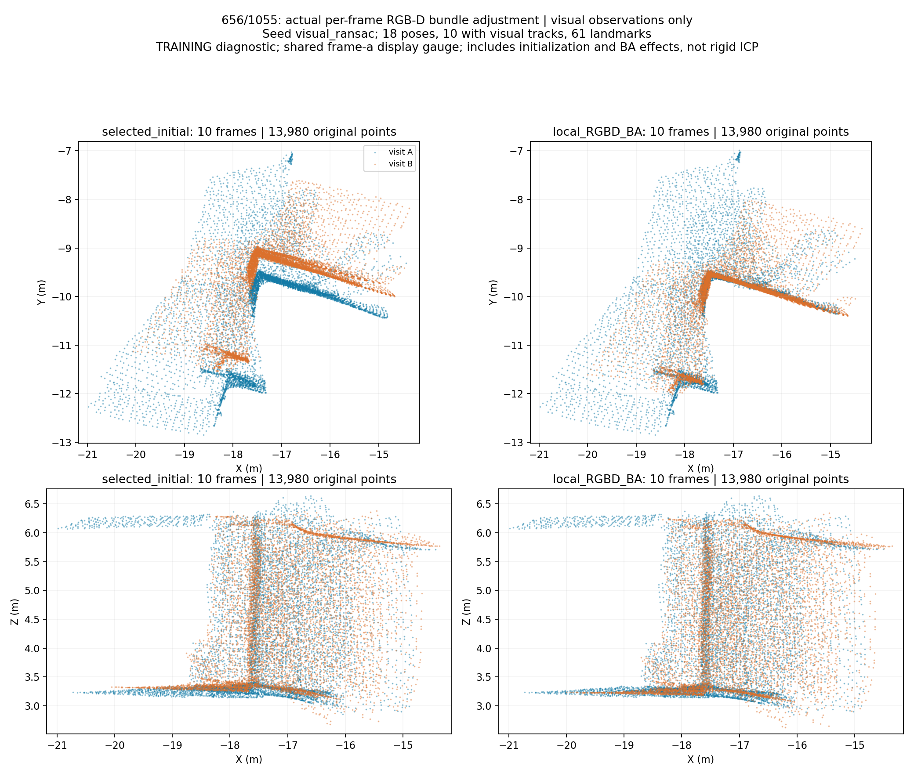

동일 목적함수의 벡터화 residual을 구현하고 기존 계산 및 차분 Jacobian과 대조했다. 국소 285변수 문제에서 TRF의 선형 풀이를 dense SVD로 바꿔 비교했다. 최종 두 초기값 계열의 상대 변환 차이는 0.132 mm/0.002566°였고, 낮은 학습 비용 후보의 재투영 P90은 3.543 px, 깊이 P90은 3.771 cm였다.

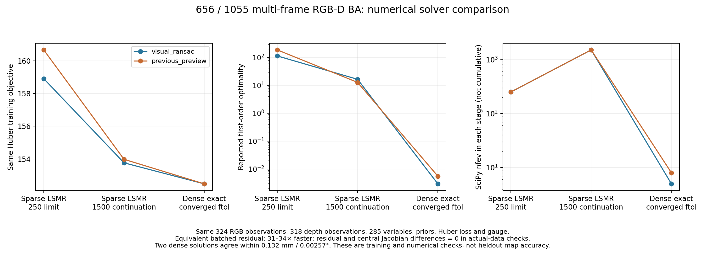

기존 미리보기를 기준선으로 두면 이 벽의 BA 반영 후보는 더 좋지 않았다.

| 같은 벽의 지표 | 기존 미리보기 | BA 반영 후보 | 변화 |
| --- | ---: | ---: | ---: |
| 관측면 사이 거리 | 4.048 cm | 5.141 cm | 1.093 cm 증가 |
| 20 cm 내 양방향 최소 겹침 | 59.04% | 51.93% | 7.11%p 감소 |

직전 중간 후보의 115.793 cm가 5.141 cm로 줄어든 것은 국소 악화를 복구한 결과다. 이 감소폭을 기존 기준선보다 우수한 성과로 제시하지 않는다. 재투영 P90 3.543 px와 깊이 P90 3.771 cm도 BA에 넣은 관측의 피팅 잔차이며 독립 측량 정확도가 아니다.

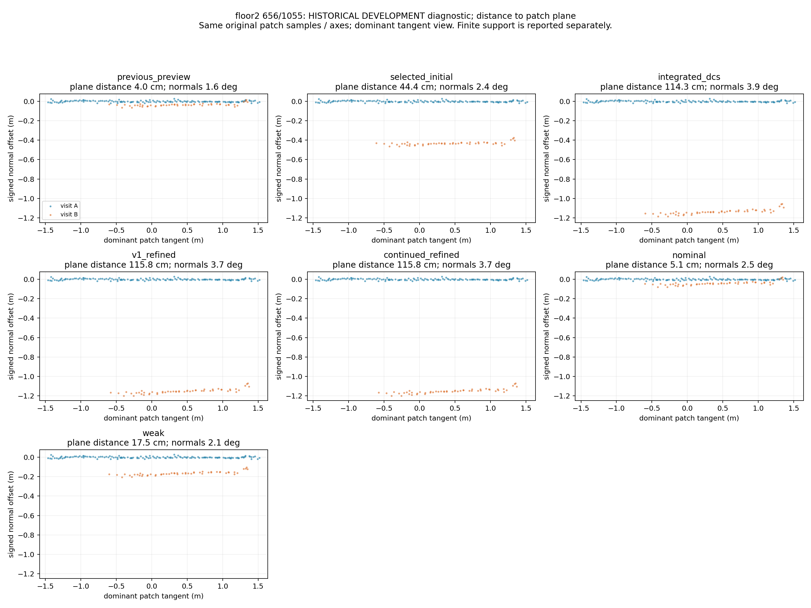

548↔981은 저조도와 흐림으로 지속 track을 확보하지 못했다. 이 구간은 별도의 재측정 과제로 남았다.

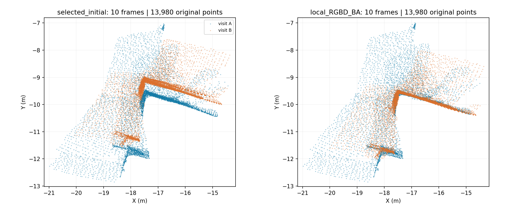

전체 XYZ 비교의 XY 부분을 확대한 그림이다. 시각 관측으로 연결된 국소 배치의 변화이며 건물 전체의 절대 위치 정확도를 뜻하지 않는다.

이 BA를 전체 PGO에 반영한 결과는 **F01 비교 후보**에 해당한다. 아래 최종 지도에 사용한 J04를 BA 결과라고 부르지 않는다. 특히 548↔981은 지속 track이 없어 이 BA를 적용하지 못했으므로 해당 벽의 J04 개선을 BA의 성과로 설명할 수 없다.

### 4.7 높이 오차와 층간 연결

카메라 Z를 일정하게 만드는 것은 층 높이 보정이 아니다. 계단을 오를 때는 카메라 높이가 실제로 변하고 같은 층에서도 휴대폰을 든 높이는 달라진다. 바닥의 높이와 카메라의 높이를 구분해야 한다.

선택 후보 J04와 이전 H00를 같은 기준 좌표계에서 비교해 전역 배치 차이와 내부 Z 변형을 나눴다. 최선 강체 정렬 후에도 Z 차이의 절대 P90이 17.99 cm 남아, 전체를 한 번 기울이는 것으로 설명되지 않는 변형을 확인했다.

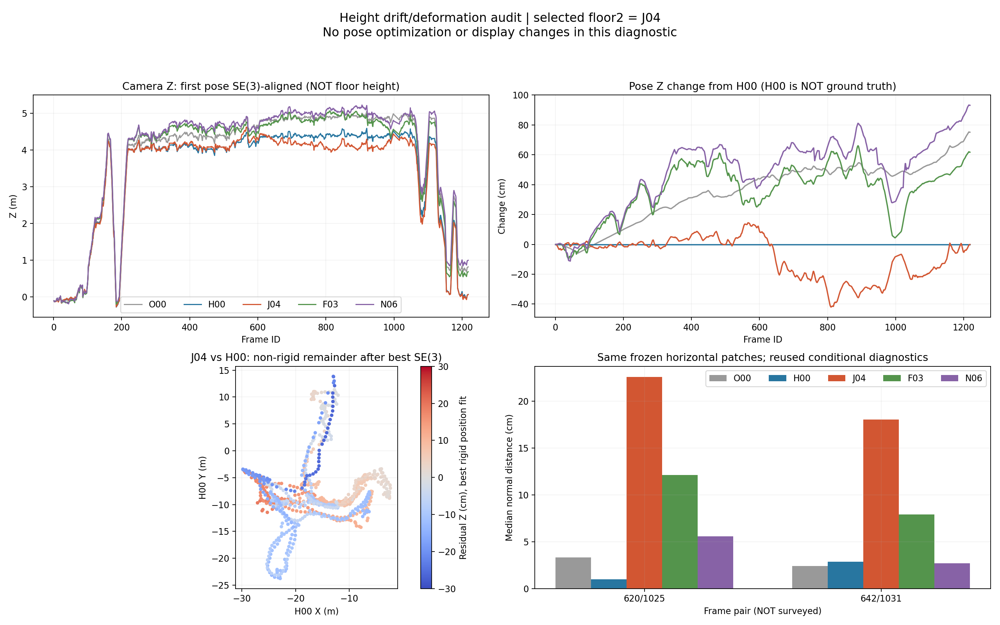

별도 Z 전용 실험은 X/Y와 회전을 고정하고 20프레임 간격의 선형 스플라인 오프셋만 조정했다. 같은 바닥의 상대 높이, 잠재 층 높이와 보정량 변화 prior를 사용하고 계단 및 연결 포즈는 고정했다.

| 같은 원본 관측의 지표 | J04 | Z02 비교 후보 |
| --- | ---: | ---: |
| 바닥 중심 P90−P10 | 26.67 cm | 11.81 cm |
| 수평 22쌍 잔차 중앙값 | 8.12 cm | 2.82 cm |
| 수평 22쌍 잔차 P90 | 16.40 cm | 8.45 cm |
| 최대 Z 보정량 | — | 20.92 cm |

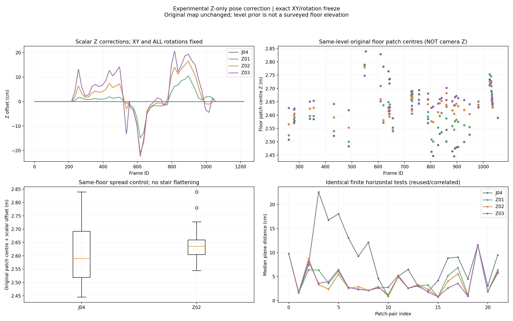

Z02는 개선과 국소 악화가 함께 있는 비교 후보다. 최종 선택 지도를 이 후보로 교체하지 않았다. 반복 사용한 바닥 관측의 잔차이며 독립 측량 성능으로 해석하지 않는다.

### 4.8 보정한 자세로 점군을 재생성하고 선택 지도 통합

포즈 그래프의 출력은 새 카메라 자세다. 점군 생성 단계에서 원본 깊이를 다시 읽고 같은 카메라 점에 후보별 자세를 곱해 지도 좌표를 재계산했다. 깊이값을 덮어쓰거나 두 겹 벽 중 하나를 삭제한 처리가 아니다. 자세 변화로 각 프레임의 관측면이 이동해 서로 가까워지는지를 비교했다.

먼저 초기 수집본과 최종 선택본의 점군을 나란히 확인했다. 왼쪽의 O_FULL은 앱 저장 자세로 복원한 전체 유효 RGB-D 1,215프레임이며, J04는 품질 선별과 보정을 적용한 925프레임이다. 프레임 선별 효과와 포즈 보정 효과가 함께 포함된 비교다.

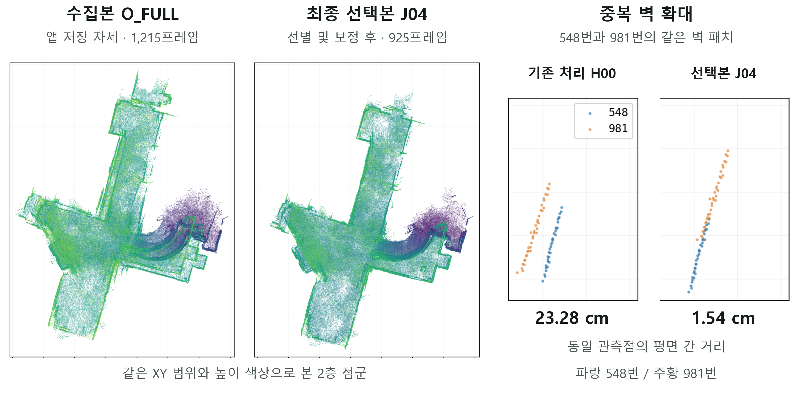

오른쪽 확대는 같은 벽을 촬영한 548번과 981번의 관측이다. 기존 처리 H00에서는 두 관측면이 23.28 cm 떨어져 있었고, J04에서는 1.54 cm로 가까워졌다. 동일한 유한 관측점으로 계산한 평면 간 거리이며 측량 정답과의 오차가 아니다. 다른 벽인 656↔1055 패치에는 54.42 cm가 남아, 이 결과와 전체 형상을 함께 보고 J04를 선택했다. [전체 점군 크게 보기](docs/assets/pointcloud-comparison-20261021/initial-j04-whole-cloud.png) / [벽 패치 크게 보기](docs/assets/pointcloud-comparison-20261021/j04-wall-548-981.png)

왼쪽의 O_FULL과 J04는 사용 프레임 수가 달라 선별 효과까지 포함한다. 자세 보정만의 비교에는 같은 A/B 프레임과 같은 전처리 카메라 점을 쓰는 O00·P00·후보별 자료를 사용했다. 최종 선택은 모든 세션에 J04를 복사하는 방식이 아니라 아래와 같이 기록마다 다른 후보를 골랐다.

선택한 세션 내부 형상을 유지하기 위해 통합 단계에서는 세션별 xyz와 yaw만 조정했다. 2층을 기준으로 두고 검토된 연결 측정과 출입구 대응을 이용해 배치했다.

$$
T_{w,i}=T_{w,s}T_{s,i}
$$

같은 세션의 모든 프레임에 동일 변환을 곱하므로 내부 상대 포즈는 유지된다. 이 성질은 좌표 변환의 구현 검사로 다루며 지도 정확도 성과로 집계하지 않았다.

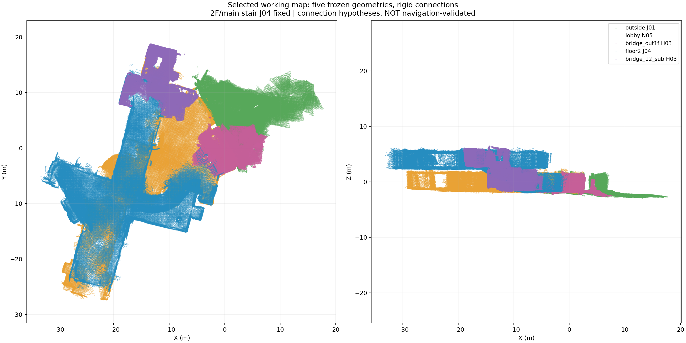

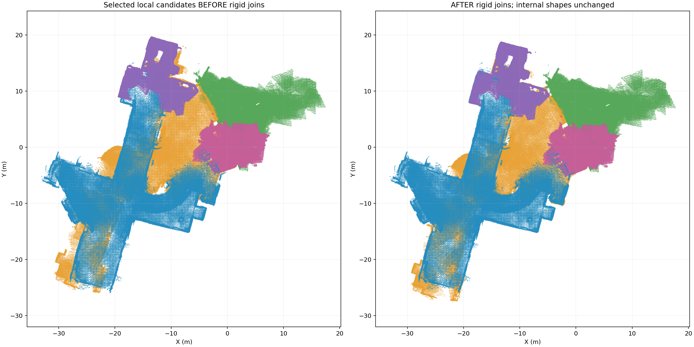

| 세션 | 선택 후보 | 포즈 | 통합 전 점 수 |
| --- | --- | ---: | ---: |
| 실외 | J01 | 305 | 464,565 |
| 로비 | N05 | 800 | 1,430,215 |
| 실외 연결 | H03 | 86 | 153,559 |
| 2층과 메인 계단 | J04 | 925 | 1,754,344 |
| 서브계단 | H03 | 135 | 261,829 |

실외 연결은 같은 출입구의 상관된 관측에 의존하는 부분이 있고 일부 연결은 엄격한 기준을 통과하지 못했다. 최종 선택본은 후속 개발의 기준 지도이며 모든 연결의 정밀 정합이 끝난 상태는 아니다.

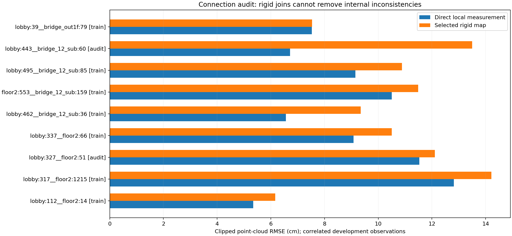

### 4.9 실시간 GNSS 보정과 로그 후보정

휴대폰의 위치는 한 번만 받지 않고 `watchPosition`으로 연속 수신한다. 이 API는 OS가 GNSS, Wi-Fi와 기지국 등의 정보를 결합한 위치를 제공하며 위성 의사거리나 반송파를 전달하지 않는다. 위도와 경도를 ECEF, ENU, 기존 지도 XY 순서로 변환한 뒤 미터 단위에서 필터를 계산한다.

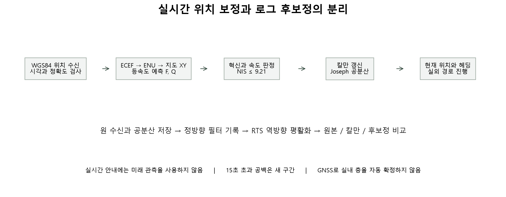

상태는 위치와 속도를 묶은 $\mathbf{x}=[x,y,v_x,v_y]^T$다. 프레임 사이 시간 $\Delta t$에 따른 등속도 전이와 불규칙한 보행 가속도를 나타내는 공정 잡음을 사용한다.

$$
F=\begin{bmatrix}I_2&\Delta t I_2\\0&I_2\end{bmatrix},\qquad
Q=\sigma_a^2\begin{bmatrix}\frac{\Delta t^4}{4}I_2&\frac{\Delta t^3}{2}I_2\\\frac{\Delta t^3}{2}I_2&\Delta t^2 I_2\end{bmatrix},\qquad \sigma_a=1.2\ \mathrm{m/s^2}
$$

브라우저의 보고 정확도 $a$는 95% 수평 반경이다. 등방성 Gaussian을 가정하여 $R=\max(1.5,a/2.4477)^2I_2$로 구성했다. 기존 iOS DB의 정확도는 신뢰수준을 단정할 수 없어 반경 자체를 표준편차로 두는 보수적인 설정을 별도로 기록했다. 이 가정과 필터 공분산은 지도 지리 정합의 오차까지 나타내지 않는다.

갱신 전 혁신 $\nu=z-H\hat{x}^-$와 혁신 공분산 $S=HP^-H^T+R$로 NIS를 계산한다.

$$
\mathrm{NIS}=\nu^T S^{-1}\nu\leq \chi^2_{2,0.99}=9.21034
$$

| 조건 | 동작 |
| --- | --- |
| 유효하지 않은 값 또는 역순 시각 | 갱신 거부 |
| 보고 반경 50m 초과 | 정상 수신 대기, 원본 로그 유지 |
| NIS 초과 또는 허용 이동 범위 이탈 | 측정 갱신 거부, 화면은 마지막 정상 위치 유지 |
| 10초 동안 정상 수신 없음 | 오래된 위치 표시, 경로 진행 안내 중단 |
| 마지막 정상 관측과 15초 초과 공백 | 속도 0의 새 필터 구간 시작 |
| 보고 반경 25m 초과 | 위치 표시 유지, 자동 진행 안내 중단 |

속도 판정은 마지막 수락 원 수신과의 거리, 경과 시간, 양쪽 보고 반경으로 구성한다. 보행 속도 상한 가정은 4m/s다. 공분산은 Joseph 형태로 갱신한다. 현재 위치를 도로나 복도에 강제 부착하지 않으므로 보정 결과와 이동 경로는 독립적이다.

저장 로그에는 정방향 칼만 결과와 예측 공분산을 보존하고 RTS 역방향 평활화를 적용한다. RTS는 미래 관측을 사용하는 후보정으로 실시간 안내에는 사용하지 않는다. 수신 공백으로 나뉜 구간은 서로 평활화하지 않는다. 일정하게 치우친 다중경로 편향이나 지도 배치 오차를 이 필터만으로 제거할 수는 없다.

구현은 [필터](web/public/gnss-filter.js), [지리 좌표 변환](web/public/geo-frame.js), [위치 및 헤딩 제어](web/public/location-controller.js)로 나눴다. 근거는 [W3C Geolocation](https://www.w3.org/TR/geolocation/), [FilterPy의 칼만 필터와 RTS 구현](https://filterpy.readthedocs.io/en/latest/kalman/KalmanFilter.html)을 따른다.

<a id="implementation"></a>

## 5. 구현

### 5.1 ROS 2 기록 재생과 누적 지도

Ubuntu와 ROS 2 Humble을 사용한 이유는 저장 파일 하나의 후처리로 끝내지 않기 위해서다. 센서 입력이 들어오는 동안 현재 관측까지의 지도를 만들고, 재방문을 발견하면 포즈와 누적 점군을 함께 갱신하는 구조를 목표로 했다. 이후 360도 카메라나 이동 로봇의 센서로 수집 범위를 넓혀도 입력과 처리 기능을 토픽 단위로 교체할 수 있다.

현재 구현에서는 수집 DB를 촬영 순서대로 읽고 도착한 관측만으로 점군과 그래프를 갱신한다. 계산된 포즈가 바뀌면 과거 RGB-D도 새 포즈로 다시 투영한다. **rqt에서는 처리 노드와 연결을, RViz에서는 갱신되는 점군과 포즈를 본다.** 두 화면을 같이 기록한 것은 처리 흐름과 공간 변화가 어떤 시점에 일어나는지 함께 관찰하기 위해서다.

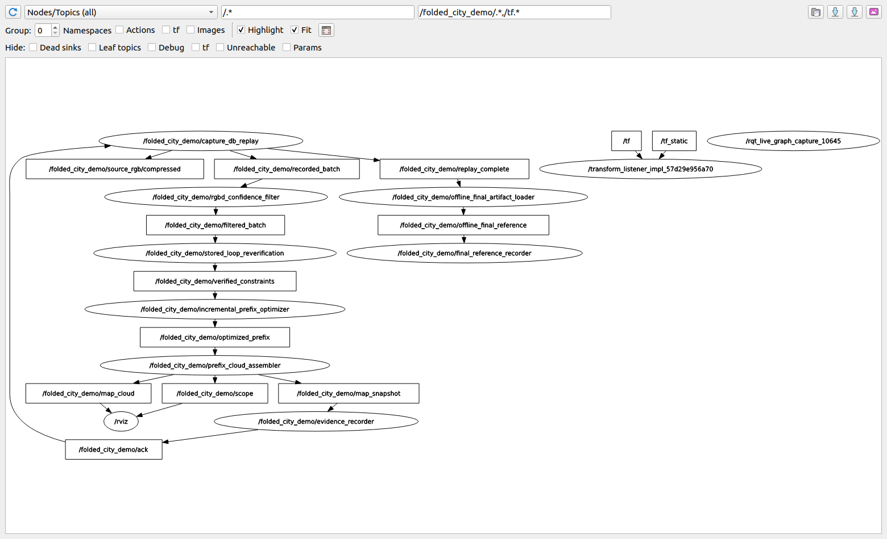

[확대 가능한 rqt 그래프](docs/assets/mapping-demo-20261019/rqt_graph.svg) / [노드와 토픽 원장](docs/assets/mapping-demo-20261019/ros_graph_inventory.json)

| ROS 노드 | 처리 |
| --- | --- |
| `capture_db_replay` | 촬영 순서대로 프레임 전달 |
| `rgbd_confidence_filter` | RGB-D 해독, 신뢰도 검사와 역투영 |
| `stored_loop_reverification` | 양쪽 관측이 도착한 저장 루프를 ICP로 검사 |
| `incremental_prefix_optimizer` | 현재까지의 그래프를 4DoF로 재최적화 |
| `prefix_cloud_assembler` | 현재 포즈로 누적 점군 재생성 및 발행 |
| `evidence_recorder` | 포즈, 점군, 계산 시간과 검사 결과 저장 |
| `offline_final_artifact_loader` | 재생 종료 후 별도 제작한 최종본 참조 전달 |
| `final_reference_recorder` | 재생 결과와 오프라인 최종본의 버전 기록 |

8개 노드는 한 프로세스의 SingleThreadedExecutor에서 실행했다. 마지막 두 노드는 오프라인 최종본을 불러오는 역할이며 메시 생성 노드가 아니다.

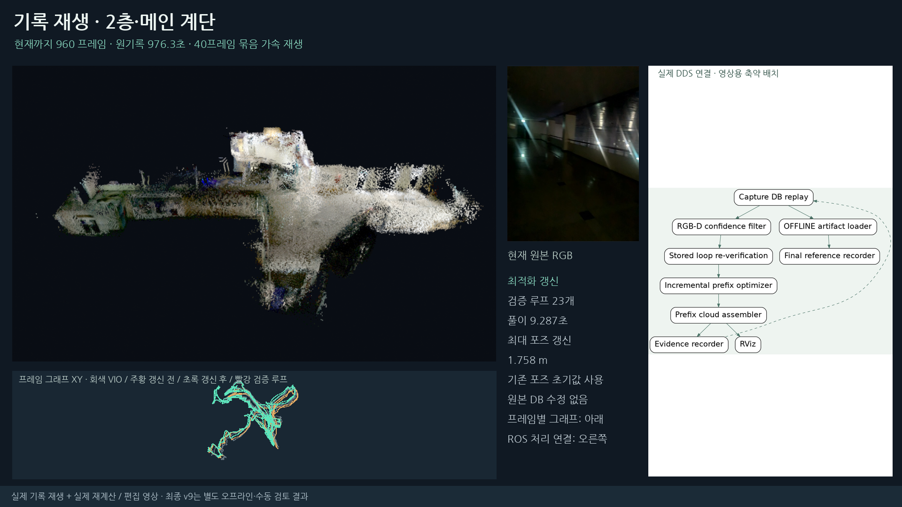

#### 지도 생성 영상

[](docs/assets/mapping-demo-20261019/mapping_story.mp4)

[영상 열기 — MP4, 1920×1080, 113초](docs/assets/mapping-demo-20261019/mapping_story.mp4)

[MP4 내려받기](docs/assets/mapping-demo-20261019/mapping_story.mp4?raw=true)

| 구간 | 내용 |
| --- | --- |
| 0:06 | 실제 rqt 노드 연결 |
| 0:12 | 실외 기록 재생 |
| 0:19.5 | 로비 기록 재생 |
| 0:37.5 | 실외 연결 기록 재생 |
| 0:40.5 이후 | 2층과 서브계단 재생, 이후 오프라인 지도 제작 단계 |

2,875프레임을 읽고 91개 저장 루프가 기하 검사를 통과했다. warm start와 풀이 한도 조정 후 prefix 풀이 20회가 모두 수렴했다. 약 95.36초의 실행 시간은 DB 가속 재생의 벽시계 시간으로, 새 휴대폰 데이터 수신과 시각 오도메트리 계산을 포함한 실시간 처리 속도가 아니다. 개별 풀이의 최대 지연은 9.29초였으므로 평균 처리량만으로 지연 없는 실시간 동작을 입증할 수 없다.

영상 후반의 표면과 마감 단계는 앞서 계산한 결과를 묶었다. 재생 결과와 최종 선택 지도를 자동으로 같은 결과로 간주하지 않는다.

360도 카메라를 붙이는 후속 구현에는 구면 영상의 투영 모델, 카메라와 IMU의 시간 동기화 및 외부 파라미터, 깊이 센서와의 대응을 다시 구성해야 한다. 현재 영상은 그 장비의 실시간 SLAM 완성 영상이 아니라 **관측이 도착할 때 처리와 지도 갱신을 관찰하는 구조의 기록 재생**이다. 로봇에 연결할 때도 같은 구조를 활용하되 장애물 변화와 제어 주기를 별도 평가한다.

### 5.2 점군에서 표면으로

점군은 형상 진단에 적합하지만 문패와 간판의 글자를 읽기에는 빈틈이 많았다. 같은 선택 포즈를 고정하고 여러 표현을 비교했다.

| 표현 | 구성 | 관찰 결과 |
| --- | --- | --- |
| TSDF 5 cm / 3 cm | 여러 깊이를 부호 거리장으로 적분 | 면이 연결되지만 얇은 구조와 글자 손실 |
| Ball Pivoting | 점과 법선으로 인접 삼각형 생성 | 빈 관측과 중복 구조가 남음 |
| TSDF + 사진 UV | 깊이 일치 조건을 만족하는 실제 사진 부착 | 문틀과 표지 세부 개선, 사진 경계 발생 |
| RGB-D 사진 시트 | 프레임별 깊이 격자에 원본 RGB 부착 | 촬영 시점의 세부 보존, 겹친 면과 깊이 구멍 |
| 세부 점 오버레이 | 깊이와 RGB 경계의 작은 구조 추가 | 얇은 구조와 노이즈가 함께 남음 |
| Gaussian 표시 학습 | 고정 중심에서 색, 불투명도와 크기 학습 | 학습 시점 밖의 흐림과 빈 공간 |

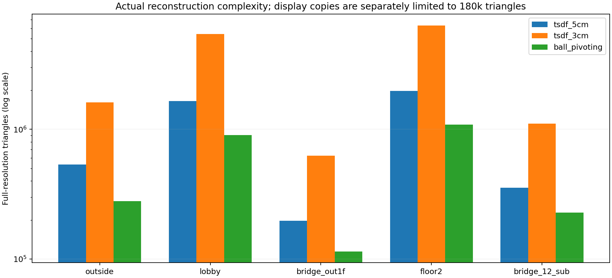

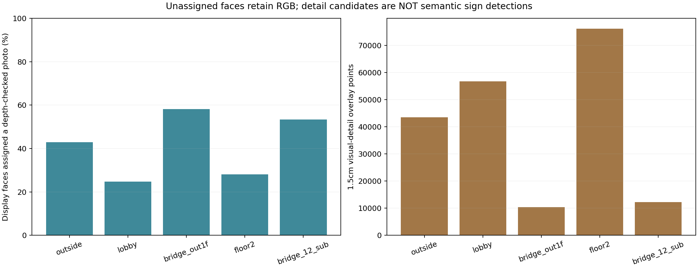

사진 UV의 조건을 만족한 면 비율은 세션별 약 25–58%였다. 깊이가 없는 면에 사진만 덮어 기하가 복구된 것으로 처리하지 않았다.

#### Gaussian 학습 실험

gsplat의 미분 가능한 렌더러와 Adam을 사용했다. 다섯 세션에 각각 600 step, 총 3,000 step을 실행했고 Gaussian은 총 793,559개였다. 중심과 카메라는 고정하고 RGB, opacity와 scale만 학습했다.

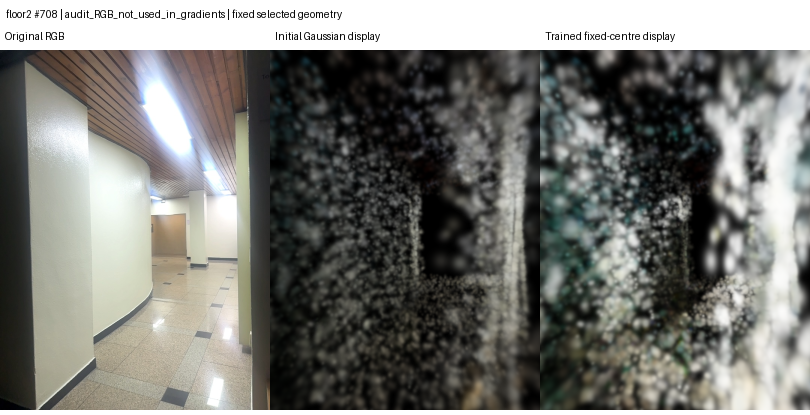

매 8번째 시점은 gradient 계산에서 분리했다. 위 그림은 그중 2층 708번이다. 초기 점군은 같은 촬영에서 만들었으므로 완전히 독립된 장면 평가는 아니다. 흐림과 공백이 남아 최종 표시 방식으로 채택하지 않았다. 중심 이동과 densification, pruning, 시점 의존 SH를 포함하는 전체 3DGS와도 구분된다.

### 5.3 층 구조와 실제 사진을 이용한 표시 보완

넓은 바닥과 천장을 한 면으로 메우면 복층 로비가 닫히거나 계단 통로가 막힐 수 있었다. 층별 높이, 관측 영역, 계단과 개방 공간을 나눠 표시 표면을 수정했다. 이는 사용자에게 공간을 보여 주기 위한 보완이며 센서 포즈의 오차를 고친 결과는 아니다.

사람이 사진으로 지정한 **두 벽 영역**의 표시 마감에서는 중복·잡음 12,170면을 제거하고 사진으로 지지한 벽 5,100면을 더했다. 이때 카메라 자세는 바꾸지 않았다. 문과 계단의 보행 연결 5개 및 목적지 5곳도 등록·검토했다. 자동 기하 추정과 사람이 보완한 표시 및 연결을 구분한다.

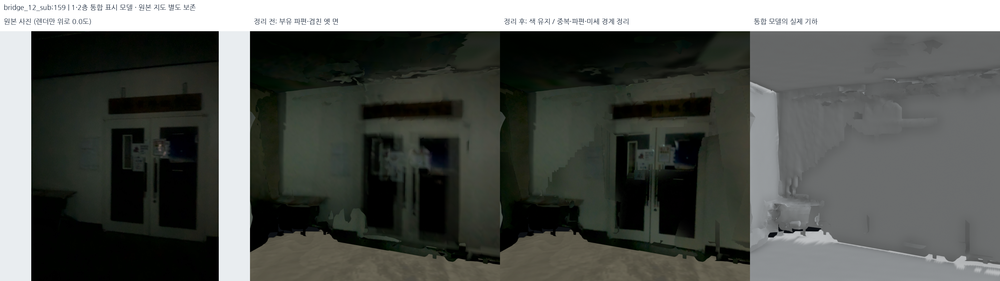

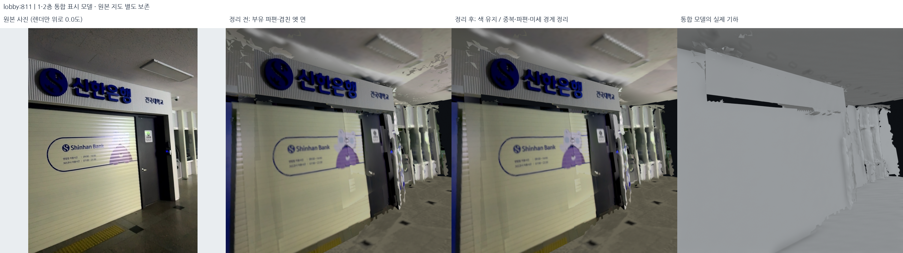

<details>
<summary>표면 정리 전후 움직임과 2층 복도</summary>

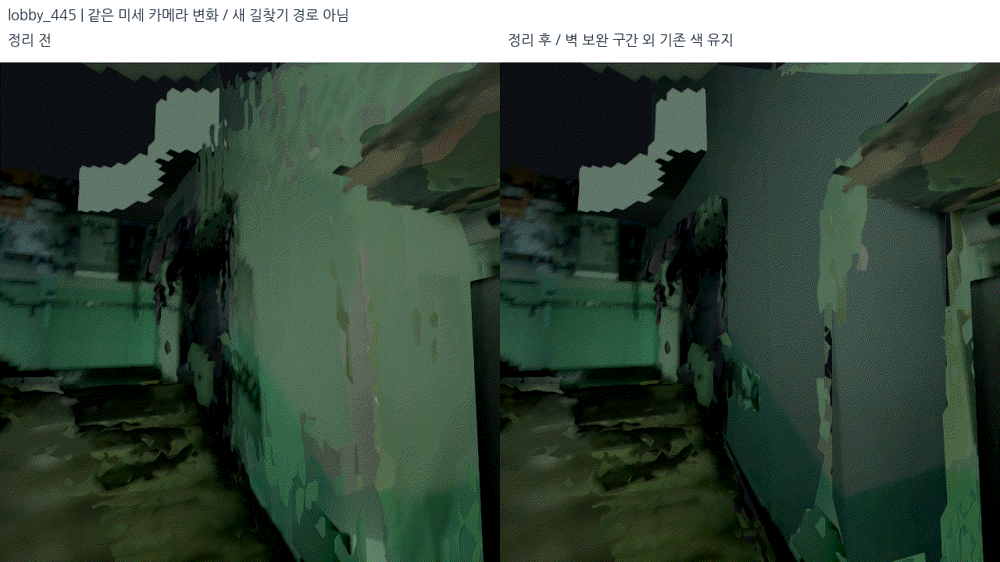

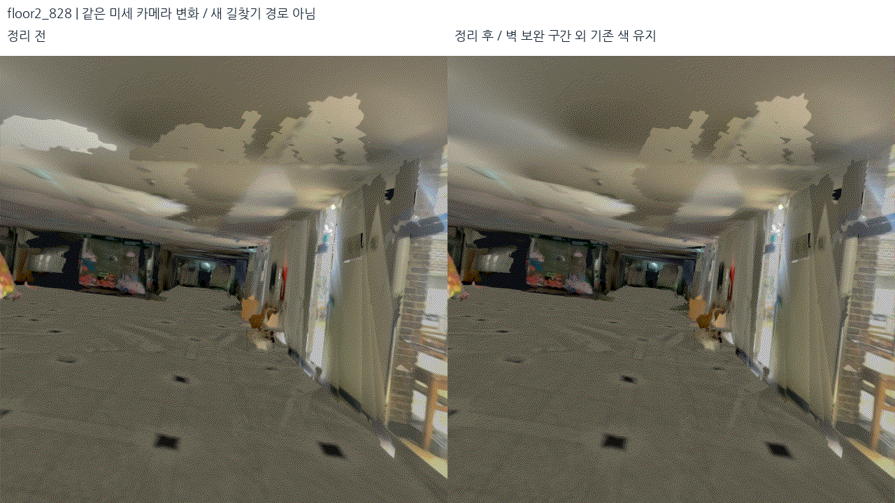

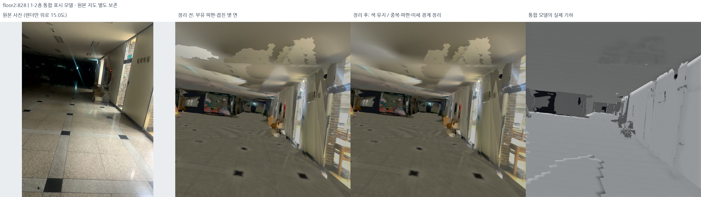

</details>

현재 보행 격자는 표시 메시에서 바닥과 장애물 후보를 추출한다. 따라서 표시 보완이 이동 공간 추출에 영향을 줄 수 있다. 관측 기반 기하와 표시용 표면, 통행 확인 상태를 각각 관리하고 연결별 현장 확인을 후속 단계로 뒀다.

### 5.4 촬영 동선과 보행 경로의 분리

지도 제작자는 벽을 여러 번 보고 같은 자리를 되돌아간다. 그 궤적을 안내 경로로 사용하면 방문자도 촬영자의 우회를 따라가게 된다. 길찾기 입력은 촬영 링크가 아니라 별도의 층별 보행 격자다.

격자 간격은 0.12 m, 중심 여유 반경은 0.24 m다. 같은 층에서 8방향 이웃을 연결하고 대각선 옆이 막혔을 때 모서리를 통과하지 않도록 했다. 다른 층의 같은 XY는 직접 연결하지 않는다.

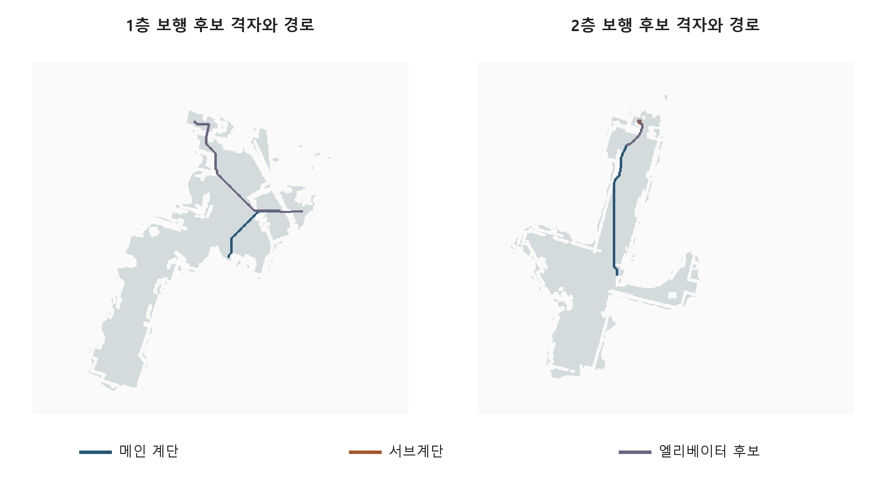

층간 이동은 메인 계단, 서브계단과 승강장 연결을 사용한다. 문과 전실도 명시적인 연결로 관리한다. A*는 누적 미터 거리 $g(n)$와 목적지까지의 3차원 직선거리 $h(n)$를 사용한다.

$
f(n)=g(n)+h(n),\qquad h(n)=\|\mathbf{p}(n)-\mathbf{p}_{goal}\|_2
$

연결 비용이 양 끝점의 직선거리 이상이라는 조건에서 이 휴리스틱은 남은 거리를 과대평가하지 않는다. 경로는 등록 격자와 선택한 연결 정책 안에서 거리 최소이며 연속 공간 전체의 최단곡선이나 최단시간 경로는 아니다.

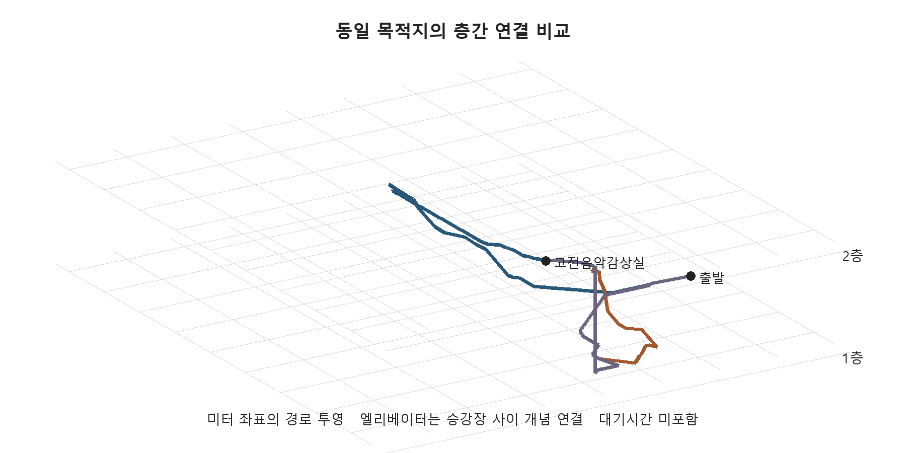

장소의 표식과 도착 지점도 구분했다. 매장 가운데에 표식이 있어도 경로는 복도에서 접근할 수 있는 문 앞에서 끝나야 한다. 장소 ID와 층, 접근 격자, 근거 사진을 함께 등록했다.

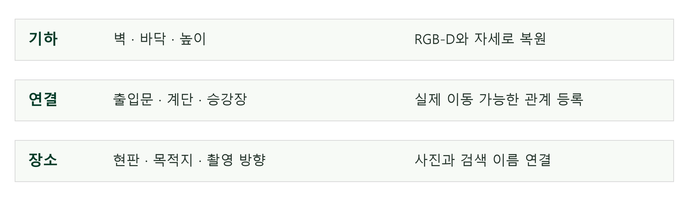

### 5.5 실제 사진 대응과 암부 보정

2,875장의 원본 RGB를 모두 해독했고 지도 대응 후보는 2,398장이다. 사진은 촬영 순서가 아니라 탐색 위치, 방향, 층, 연결 영역과 보행 거리를 기준으로 찾는다. 일반 층의 기본 검색 범위는 5 m, 방향 차이는 55° 이내다. 계단에는 높이와 촬영 세션 조건을 추가했다.

원본 사진은 보존하고 보정본과 축소판을 별도로 저장했다. 암부의 약한 bilateral 처리 후 선형 RGB에서 세 채널에 같은 gain을 적용했다. 필터 변화량은 채널당 최대 6/255, gain은 최대 2.2로 제한했다.

<table>
  <tr><th>원본 사진</th><th>암부 보정본</th></tr>
  <tr>
    <td>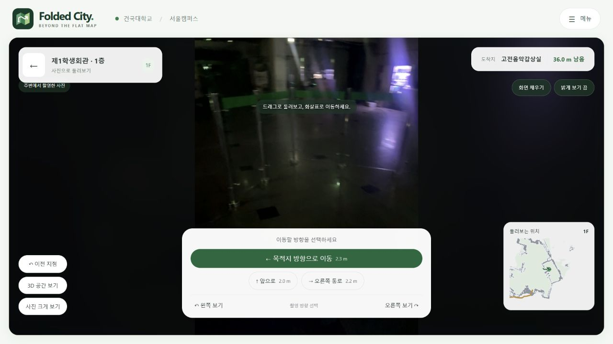</td>
    <td>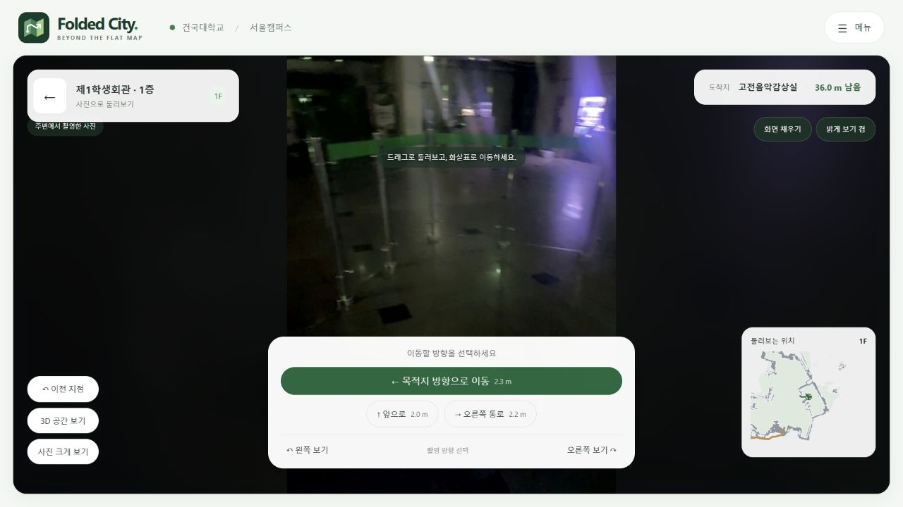</td>
  </tr>
</table>

사진은 촬영 시점의 원근 영상이다. 파노라마나 새 시점 합성이 아니며 촬영하지 않은 방향의 정보는 없다. 밝기 보정도 누락된 깊이나 검게 잘린 신호를 복원하지 못한다.

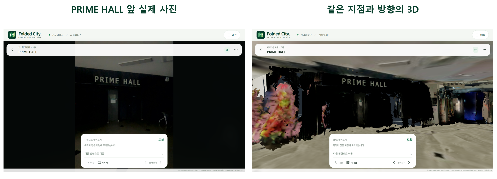

사진은 현장의 문과 표지판을 알아보는 데, 3D는 해당 지점과 다른 층의 관계를 이해하는 데 사용한다. 저장 사진의 방향을 바꾸고 같은 지점의 3D 보기로 이어진다.

### 5.6 현재 위치에서 입구까지 안내

목적지를 고른 뒤 **현재 위치에서 안내**를 누르면 실외 GNSS 안내를 시작한다. **사진으로 안내 시작**은 현장 위치와 무관한 가상 탐색이다. 두 기능이 같은 목적지와 이동 정책을 사용하되, 실제 수신 위치와 가상 탐색 위치는 섞지 않는다. 지도 오른쪽의 **내 위치**로 위치 표시만 먼저 켤 수도 있다.

위치 권한을 허용하면 `watchPosition`의 새 관측을 계속 받아 보정 위치, 경로 위 진행 정도와 남은 등록 거리를 갱신한다. 경로 이탈이 연속되면 다시 계산한다. 파란 점은 칼만 보정 위치, 주황 점은 마지막 수락 원 수신 위치, 반투명 원은 원 수신의 보고 반경이다. HTTPS 또는 localhost에서 동작한다.

헤딩은 기기 나침반을 우선 사용하고, 나침반이 없으면 수신 속도 0.7m/s 이상에서 제공되는 이동 방향을 사용한다. 자북 기준 나침반과 진북 기준 이동 방향을 화면에서 구분한다. 정지한 두 위치의 차이로 방향을 만들어내지 않는다. iPhone의 동작 및 방향 권한은 방향 버튼을 직접 눌러 허용한다. 방위각은 원형 보간으로 359°와 1° 사이를 처리한다. 자북 편차와 주변 금속에 의한 오차를 정밀 보상한 헤딩은 아니다.

실외에서는 OSM의 연결된 도보 가능 유형을 그래프로 구성하고 선분 위 현재 위치에서 Dijkstra 경로를 구한다. `foot=no`와 허용 근거 없는 `access=private/no`는 사용하지 않는다. 서로 다른 layer의 시각적 교차점을 합치지 않으며 건물 외피나 촬영 순서는 경로 입력이 아니다. 기본 지도에서 공개된 통로라도 현장 개방 여부까지 보장하지는 않는다.

학생회관 접근 지점과 가장 가까운 등록 도로 사이에는 약 **37.24m의 미등록 연결 구간**이 있다. 이 구간에는 직선 경로를 그리지 않는다. 등록 보행로 안내가 끝나면 사진과 현장에서 입구를 확인하고 **입구에 도착했어요**를 선택한다. 이후 층별 A* 경로와 실내 보행 추정으로 이어진다. 시작 장소와 도착한 층을 확인하는 방식이며, 입구를 모르는 상태에서 자동으로 실내 위치를 알아내는 기능은 아니다.

안내 카드에는 실외 등록 경로와 입구 이후 실내 경로를 나누어 표시한다. 도보 시간은 1.25m/s 기준의 대략적인 이동 시간이며, 미등록 연결 구간과 계단 속도 차이, 승강기 대기는 포함하지 않는다. 따라서 화면의 값을 출발지에서 호실까지의 완전한 도착 예정 시각으로 해석하지 않는다.

위치 따라가기 중에는 새 수신에 맞춰 지도를 이동하고, 유효한 헤딩이 있으면 진행 방향이 위로 오도록 회전한다. 사용자가 직접 지도를 움직이거나 돌리면 따라가기를 잠시 멈추며 **내 위치로 돌아가기**로 복귀한다. 정지 상태에서도 나침반 방향이 바뀌면 시점이 갱신되도록 위치 이동 조건과 헤딩 변경 조건을 분리했다.

실내 3D 개요에서도 OSM 배경을 유지한다. 지도 조작의 **회전**은 데스크톱 왼쪽 드래그로 방위와 기울기를 바꾸며, **이동**은 배경을 밀어 보는 방식이다. 터치는 기본 지도 이동과 두 손가락 회전을 사용한다. 사람 시점의 사진 및 3D 탐색은 별도의 근거리 카메라를 쓴다.

위치와 로그는 브라우저 메모리에서 처리한다. 현재 위치 좌표를 경로 API나 외부 서비스로 전송하지 않는다. 메뉴의 연구 도구에서 원본, 칼만 상태, 공분산과 RTS 결과를 JSON으로 저장하거나 다시 불러올 수 있다. 저장 로그와 합성 재현은 실시간 위치와 다른 상태로 표시한다.

<a id="results"></a>

## 6. 결과

### 6.1 지도 제작 결과

선택 포즈 2,251개에서 얻은 점군을 강체 배치하고 5 cm 복셀로 통합해 약 349만 점의 지도를 만들었다. 기하 지도와 사용자 표시 모델의 버전은 따로 고정했다.

| 산출물 | 버전과 내용 |
| --- | --- |
| 기하 지도 | `student_union_selected_20261017_v1` |
| 표시 모델 | `student_union_final_mesh_v9`, 색감 기반 shadow v3 |
| 지도 선택 원장 | [final_map_selection.json](config/final_map_selection.json) |
| 웹용 모델 | GLB 5개, 총 약 165 MB |
| 사진 원장 | [photo_library.json](web/public/data/photo_library.json) |
| 이동 공간 | [navigation.json](web/public/data/navigation.json) |
| 장소 원장 | [catalog.json](web/public/data/catalog.json) |

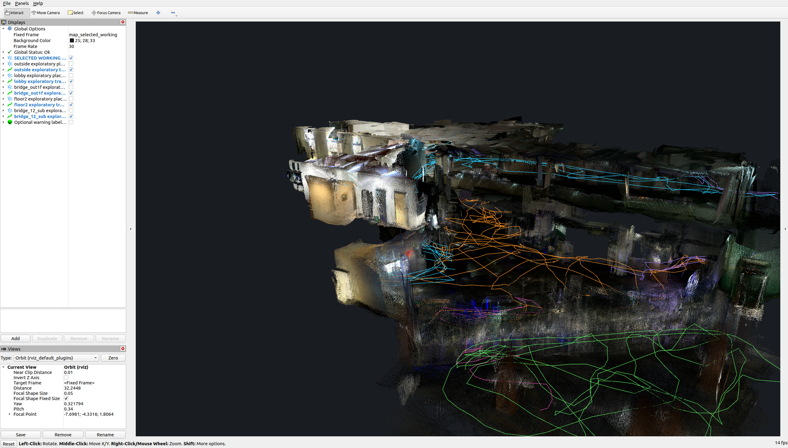

#### 같은 표면 90개로 본 보정 효과

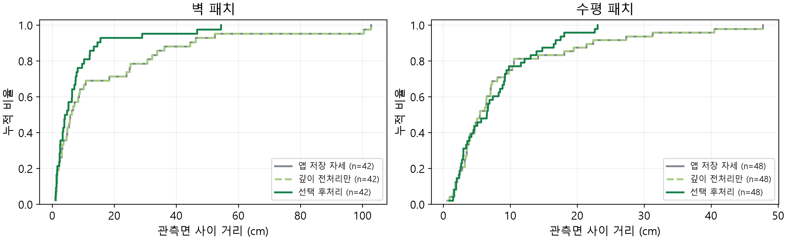

| 구역 | 후보 수 / 서로 다른 궤적 | 고정 대응 수 | 앱 저장 중앙값 / P90 | 선택 후 중앙값 / P90 | 악화한 대응 |
| --- | ---: | ---: | ---: | ---: | ---: |
| 실외 | 17 / 15 | 16 | 14.28 / 44.25 cm | 7.33 / 19.74 cm | 1 |
| 1층 로비 | 18 / 16 | 36 | 3.42 / 26.81 cm | 4.56 / 14.22 cm | 14 |
| 메인 계단·2층 | 21 / 19 | 38 | 6.30 / 26.82 cm | 5.11 / 14.36 cm | 16 |
| 실외 연결 | 17 / 12 | 0 | 평가 표본 없음 | 평가 표본 없음 | — |
| 서브계단 | 18 / 16 | 0 | 평가 표본 없음 | 평가 표본 없음 | — |

동일한 A/B 프레임과 관측 종류를 고정해 집계했다. 세 구역을 합친 중앙값/P90은 **5.73/32.37 cm → 5.20/15.63 cm**였고, 59개 대응은 개선되고 **31개는 악화**했다. 로비 중앙값도 좋아지지 않았다. 그림의 앱 기준 O00은 이미 저장 최적화를 거친 자세다. P00은 같은 자세에서 깊이 전처리만 바꾼 것이므로 고정 표면 평가값이 같다.

이 표본은 개발 중 반복 사용한 관측으로 서로 독립이지 않다. 후보 수는 내보낸 결과 항목 수이며 서로 다른 궤적 해시 수도 함께 표시했다. 최종 선택은 잔차와 전체 형상에 대한 사후 판단이고, 사전 정의한 종합점수의 자동 최적해는 아니다. 유효 대응이 없는 두 촬영본까지 포함한 전체 지도 평가나 연속 센서 프런트엔드부터 다시 돌린 **RAW / PGO / 전체 BA 분해 실험**은 아직 없다. 국소 BA는 별도의 비교 후보로 남겼다.

[표면 집계와 입력 해시](docs/assets/critical-review-20261021/surface-aggregate.json) / [비교 기준과 한계](docs/experiments/2026-10-21-critical-review.md)

### 6.2 목적지에 따라 달라지는 계단

동일한 학생회관 외부 지점 `outside_start`에서 각 목적지까지 계산했다.

| 목적지 | 계단 최단 | 메인 계단 | 서브계단 |
| --- | ---: | ---: | ---: |
| PRIME HALL | 32.8 m | 32.8 m | 64.5 m |
| 학생취업처 | 39.3 m | 39.3 m | 68.2 m |
| 고전음악감상실 | 41.8 m | 47.9 m | 41.8 m |
| 학생식당 진입 지점 | 16.7 m | 16.7 m | 16.7 m |
| CU | 44.3 m | 44.3 m | 44.3 m |


고전음악감상실은 서브계단이 메인 계단보다 6.1 m 짧다. 반면 PRIME HALL과 학생취업처는 메인 계단이 짧다. 건물의 같은 2층이라도 목적지 위치에 따라 적합한 층간 연결이 달라진다.

학생식당은 지하 내부가 아니라 1층에서 내려가는 진입 지점까지다. CU는 신한은행 앞쪽 원본 사진을 확인해 등록했다. 두 1층 목적지는 불필요한 층 이동을 하지 않는지 확인하는 대조 항목이며, 계단 선택은 2층 세 목적지에서 비교했다.

승강기 경로의 기하 길이는 PRIME HALL 59.1 m, 학생취업처 62.8 m, 고전음악감상실 36.4 m다. 이 비용은 승강장 사이의 수직 길이를 사용하며 대기·운행·문 개폐 시간이 빠져 있다. 따라서 계단 도보와 같은 비용의 최단 순위나 최소시간으로 제시하지 않는다. 위 거리들은 모델에서 계산한 값이고 실측 보행 거리와의 비교 및 이용자의 시간 절감 시험은 아직 없다.

### 6.3 연구 결과를 사용하는 웹 지도

캠퍼스 배경에서 제1학생회관을 선택하고 목적지를 검색하면 경로를 확인할 수 있다. 사진 안내에서는 추천 방향으로 이동하거나 주변 통로를 선택한다. 탐색 위치는 지도 안의 가상 위치다.


초기 캠퍼스 배경의 공개 고도 격자에는 5m 사이 최대 62m의 높이 차이가 나타나 경사 제한과 수면 처리를 시험했다. 이후 전역 OSM 평면을 연결하면서 교내 지형을 올리는 변환이 건물을 띄우는 문제가 생겼다. 현재 전역 보기에서는 캠퍼스 바닥과 건물 기저를 같은 표시 평면에 놓는다. 원 고도 자료는 보관하며 이를 실내 SLAM 좌표나 길찾기 격자에 적용하지 않는다.


학생회관 입구는 직접 촬영한 사진의 적갈색 기둥과 밝은 벽체를, 도서관은 화강석 마감을, 신공학관은 회청색 유리를 참고해 재질을 나눴다. 사진을 건물 전체에 붙인 외관 복원은 아니다. 외관 자료가 없는 건물은 중립 재질로 표시한다. [수정 전후와 입구 재생 기록](docs/assets/campus-render-20261020/README.md)


<table>
  <tr><th>모바일 지도와 목록</th><th>사진 안내</th><th>목록을 접은 지도</th></tr>
  <tr>
    <td width="33%"></td>
    <td width="33%"></td>
    <td width="33%"></td>
  </tr>
</table>

모바일은 검색, 목적지 선택, 경로 확인과 안내 시작을 한 흐름으로 구성했다. 하단 목록을 내리면 지도 영역이 커지고 올리면 목록을 스크롤할 수 있다. 배포본 메뉴에는 안내 사용법만 남기고 연구 정보, GNSS 재현과 사진 검사 도구는 저장소의 개발 자료로 분리했다.

페이지 전체의 고정과 스크롤 잠금을 풀어 모바일 브라우저의 문서 스크롤을 복원했다. 지도와 목록은 보이는 화면에 붙어 있고, 주소창 등으로 화면 높이가 바뀌면 함께 크기를 바꾼다. Windows의 모바일 레이아웃 확인에서는 문서 스크롤 전후와 화면 높이 변경, 목록의 세 높이, 경로 계산과 사진 안내를 대조했다. Safari 도구막대의 실제 축소 동작과 구분한 [모바일 화면 기록](docs/assets/mobile-safari-20261021/README.md)이다.

<details>
<summary>전체 화면 기록</summary>

| 구간 | 화면 |
| --- | --- |
| 실내 | [전체 3D](docs/assets/web-release-20261019/02-indoor-3d.jpg), [평면 경로](docs/assets/web-release-20261019/05-floorplan.jpg), [2층](docs/assets/web-release-20261019/16-floor2.jpg) |
| 경로 대안 | [계단 비교](docs/assets/web-release-20261019/04-route-options.jpg), [승강장 후보](docs/assets/web-release-20261019/15-elevator-route.jpg) |
| 사진 이동 | [출입구](docs/assets/web-release-20261019/06-photo-entrance.jpg), [로비](docs/assets/web-release-20261019/07-photo-lobby.jpg) |
| CU | [검색](docs/assets/web-release-20261019/13-search-cu.jpg), [경로](docs/assets/web-release-20261019/14-cu-route.jpg) |
| 부가 정보 | [메뉴](docs/assets/web-release-20261019/10-menu.jpg), [프로젝트 정보](docs/assets/web-release-20261019/11-project-info.jpg), [사진 검사](docs/assets/web-release-20261019/12-photo-audit.jpg) |
| 모바일 | [현재 펼친 목록](docs/assets/mobile-safari-20261021/06-sheet-expanded.png), [현재 사진 안내](docs/assets/mobile-safari-20261021/07-photo-navigation.png), [사진 보기 설정](docs/assets/mobile-journey-20261020/mobile-settings.jpg) |

데스크톱 기록은 2026-10-19 배포본이다. 모바일 사진 안내의 기존 캡처는 2026-10-20, 지도와 목록의 최신 캡처는 2026-10-21이다. [데스크톱 색인](docs/assets/web-release-20261019/README.md), [이전 모바일 색인](docs/assets/mobile-journey-20261020/README.md)과 [현재 레이아웃 확인](docs/assets/mobile-safari-20261021/README.md)에 환경을 기록했다.

</details>

#### 최신 경로 안내 화면


‘현재 위치에서 안내’는 연속 수신 위치와 헤딩을 사용한다. 지도를 직접 돌리거나 이동하면 따라가기를 멈추고, 다시 내 위치로 돌아갈 수 있다. 실내 보기에서도 주변 OSM 배경을 유지하며, 모바일 목록은 끌어올려 검색하고 내려서 지도를 볼 수 있다.

<p align="center"><a href="docs/assets/public-release-20261020/navigation-prime.mp4"></a></p>

[입구 → 로비 → 메인 계단 → PRIME HALL 시연](docs/assets/public-release-20261020/navigation-prime.mp4). 실제 브라우저 캡처 13장을 편집한 사진 안내다. 현장 보행이나 자동 실내 측위 영상은 아니다.

<a id="live-gnss"></a>

### 6.4 GNSS와 SLAM 지도 위치의 실제 대조

다섯 DB에서 고유 GNSS 시각 1,099개를 추출하고 1,098개를 같은 시각의 웹 지도 위치와 대조했다. 위경도를 ECEF, ENU와 SLAM XY로 변환하고 원본, 칼만과 RTS를 동일 시각에서 비교했다. 촬영 중 우회가 있으므로 최단경로를 위치의 정답으로 사용하지 않았다.


| 촬영 구간 | 공통 시각 | 원본 차이 RMSE | 칼만 | RTS |
| --- | ---: | ---: | ---: | ---: |
| 실외 | 337 | 4.73m | 4.88m | 4.66m |
| 1층 | 293 | 18.89m | 18.88m | 18.83m |
| 실외와 1층 연결 | 74 | 10.55m | 10.55m | 10.31m |
| 2층과 메인 계단 | 332 | 27.01m | 27.38m | 26.47m |
| 서브 계단 | 61 | 33.69m | 33.61m | 32.17m |

**실내 차이는 평활화 후에도 크게 남았다.** 칼만은 2층에서 오히려 차이가 커졌다. 이 수치는 GNSS, SLAM과 지도 배치의 상대 차이이며 독립 측량 대비 절대 정확도가 아니다. 1층 고유 시각 294개 중 반경 50m 초과 1개는 공통 필터 평가에 포함하지 않았다.

#### 평균 편향과 시간에 따른 변동을 분리


| 구간 | 원 수신의 평균 차이 벡터 크기 | 평균 제거 후 RMS |
| --- | ---: | ---: |
| 실외 | 3.42 m | 3.26 m |
| 1층 로비 | 15.76 m | 10.42 m |
| 메인 계단·2층 | 12.49 m | 23.94 m |

차이 벡터를 $e_t=p_t^{GNSS}-p_t^{map}$로 두면 $\mathrm{RMSE}^2=\|\bar e\|^2+\frac1N\sum_t\|e_t-\bar e\|^2$로 나뉜다. 평균 제거는 기록 전체를 사용하는 진단이지 방문자에게 적용한 실시간 보정이 아니다. 동 2 m·남 2 m의 고정 지도 이동을 취소하면 평균 벡터만 이동하며, 평균 제거 후 잔차는 그대로다. 이번 분석은 **운영 지도의 OSM–SLAM 배치를 바꾸지 않았다.**

실외 동일 337시각에서 원 수신·칼만·RTS의 상대 RMSE는 **4.73 / 4.88 / 4.66 m**다. 칼만의 위치 정확도 개선을 보여주는 결과가 아니다. 지도 대비 속도 증분 차이 RMS는 334개 시간 간격에서 **0.85 / 0.63 / 0.45 m/s**였지만, 이 역시 독립적인 실제 속도와의 오차는 아니다.

기존 iOS 반경 해석 $\sigma=r$과 웹 수신의 95% 반경 해석 $\sigma=\max(1.5,a/2.4477)$을 **같은 배포 필터 코드**로 재생했다. 웹 반경 해석을 가정한 실외 상대 RMSE는 4.73 / 4.78 / 4.67 m였다. iOS 로그를 실제 Safari 현장 수신으로 바꿔 부른 것이 아니라 입력 규칙의 민감도 비교다. 수락되지 않은 관측 시각의 예측 상태도 동일 시간 집합에 포함해 방법마다 표본이 달라지는 것을 막았다.

[배포 필터 직접 재생 코드](web/scripts/review-gnss-settings.mjs) / [설정·공통 시각·편향·잔차 JSON](docs/assets/critical-review-20261021/gnss-settings-replay.json) / [고정 오프셋의 영향](docs/assets/critical-review-20261021/offset-mean-separation.json)


<details>
<summary>글로벌 정합과 복도 및 층의 대조</summary>


캠퍼스와 GNSS의 좌표 변환은 같은 ENU 입력에서 일치했고 축척은 1이다. 동 2m, 남 2m의 표시 이동을 빼도 1층 RMSE는 16.89m, 2층은 26.68m였다. 표시 이동만으로 실내 차이를 설명할 수 없다. 실외 기록을 시간상 반으로 나눠 같은 강건 정합을 각각 수행한 yaw도 22.10° 차이가 나서, 짧은 실외 기록의 지리 정합 불확실성이 남는다. 새 후보를 운영 지도에 적용하지 않았다.


3차원 그림의 GNSS 높이는 비교용 SLAM 높이다. GNSS에서 층을 추정한 결과가 아니다. 보행면에 가깝더라도 동시각 기준과 멀리 떨어지는 경우가 있어, 가까운 복도에 점을 붙이는 것만으로 해결했다고 할 수 없다.

Windows 이관본에 원래 선택 포즈 CSV가 없어 웹 제작과 동일한 DB 최적화 포즈, 세션 배치와 사진 기준점 보간을 사용했다. 공개 사진 위치 189개와 최대 0.1mm 이내로 일치한다. 이는 웹 좌표 재현 검사이며 SLAM의 측량 정확도가 아니다. 원래 선택 CSV와 독립 기준점으로 하는 전체 위치 평가는 별도다.

</details>

#### 실측 로그의 웹 대조

[학생회관 입구 주변의 GNSS 재생 기록과 자료](docs/assets/measured-campus-replay-20261020/README.md)

개발 단계에서는 `261016-234854-outside.db`의 GNSS 338개를 기본 입력으로 재생했다. 원본은 주황색, 칼만 처리 궤적은 파란색이며 수집 구간과 시각을 따로 표시했다. 아래 화면과 영상은 그때의 분석 자료다. 현재 배포본에서는 로그 재현을 제공하지 않는다.


<p align="center"></p>

합성 입력 역시 저장소 안의 필터 시험 자료로 남겼다. 이전 합성 시나리오는 입구에서 약 100m 떨어진 OSM 경로에서 시작하며 학생회관의 계측 기록이 아니다. 배포본의 현재 위치 입력으로 사용하지 않는다. [입력 파일과 재생 확인 기록](docs/assets/measured-campus-replay-20261020/README.md)

[GNSS와 SLAM의 대조 방법과 실행 자료](docs/experiments/2026-10-20-gnss-slam-comparison.md)


<p align="center"></p>

다섯 촬영 구간과 SLAM XY / 글로벌 ENU를 선택하고 시점을 움직일 수 있다. 원본과 기준 위치의 위경도, 지도 좌표와 차이를 함께 표시한다. 검은 점은 과거 촬영의 지도 기준 위치이며 새 방문자를 자동 추적한 점이 아니다.

#### 배포본의 카메라 없는 실내 안내

목적지를 선택하고 ‘건물 안에서 안내 시작’을 누른다. 입구나 현재 보이는 장소를 선택한 뒤 동작·방향 접근을 허용하면 실제 가속도 주기에서 걸음을 검출한다. 입구 안쪽을 향한 시작 방향과 이후 상대 회전, 보폭으로 위치를 예측하고 보행 격자 및 출입문 연결로 벽 통과를 막는다. 계획 경로를 위치의 입력으로 넣거나 시간이 지났다는 이유로 점을 앞으로 보내지 않는다.

| 구간 | 위치 입력 | 사용자가 확인하는 것 |
| --- | --- | --- |
| 실외 접근 | 휴대폰 위치 서비스와 칼만 필터 | 실제 입구 |
| 실내 보행 | 확인한 시작점, 걸음과 방향 센서 | 위치가 다를 때 주변 장소 |
| 층간 이동 | 등록 계단·엘리베이터의 연결 | 도착한 층 |

센서가 없거나 방향이 오래되면 추정점을 유지하고 대기 상태로 표시한다. 현재 추정 좌표와 층으로 A*를 다시 계산할 수 있다. 실내 GNSS는 다시 주입하지 않는다. 보폭은 직접 잰 직선 구간으로 따로 맞출 수 있으며 측정 후 현재 위치를 다시 선택한다. [이용 흐름과 센서 처리](docs/experiments/2026-10-21-camera-free-walking.md)

#### 벽 앞에서 멈추는 추정을 바꾸기

하나의 위치와 방향만 유지하는 보행 EKF는 방향이 조금 틀어진 채 벽에 닿으면 이후 걸음도 계속 거부했다. 같은 걸음 입력에 여러 방향과 보폭 가설을 유지하는 지도 보조 파티클 필터를 적용했다. 상태는 **평면 위치, 방향, 방향 드리프트와 보폭 배율**이다. 중력 방향에 대한 각속도를 적분하고, 각 입자의 한 걸음 선분이 벽을 통과하면 그 가설을 제거한다. 남은 입자를 재표본화하며 분산에 따라 768–2,048개를 유지한다. 목적지나 추천 경로는 추정기의 입력이 아니다.


10월 20일의 같은 센서 기록으로 **5개 추정 설정 × 3개 방향 처리 × 3개 층 시작 시각 × 4개 난수 시드 = 180개 조합**을 계산했다. 아래 그림은 그중 중력 투영 각속도를 쓰는 조건의 비교다. 시작 시각과 난수에 대한 민감도 시험이며 180번의 독립 현장 실험은 아니다.


배포 기본 시드 `872341`, 2층 시작 `68.842초`에서 같은 67회 걸음 후보 중 위치 갱신은 **기존 EKF 21회 → 고밀도 PF 57회**였다. PF도 10회는 갱신하지 못했다. 불확실성이 7m를 넘는 시점은 4회였다. 1층은 30회 중 9회만 갱신해 입구 정렬과 초기 방향 문제를 해결하지 못했다. 이 기록에서는 계단 끝 위치를 확인했다고 가정해 2층을 초기화했다. 입구 한 번 선택만으로 1층부터 2층까지 자동 추적한 결과로 해석하면 안 된다.


<p align="center"></p>

위 화면과 영상은 저장된 실측 센서로 계산한 위치를 웹에 표시한 것이다. 파란 점과 방향 부채꼴은 추정값이고 회색 표시는 갱신 대기 상태다. 현장에서 Safari로 걸으며 녹화한 영상은 아니다. 화면의 경로는 A* 결과로, 추정 궤적을 그 경로에 맞추지 않았다.


첫 비교 그림 오른쪽은 마지막까지 살아남은 입자의 계보를 역추적한 **후보정**이다. 미래의 벽 제약까지 사용하는 만큼 실시간 위치와 나누어 제시했다. 배포본은 가운데의 인과적 필터만 사용한다. 벽 통과 0회는 지도 제약을 지켰다는 뜻이며 위치 정확도가 0m라는 뜻은 아니다. 독립 위치 정답이 없어 측위 RMSE는 계산하지 않았다.

구현은 [APF_PDR의 지도 보조 보행 추정](https://github.com/IlyarAbadi/APF_PDR)을 참고했다. 원 MATLAB의 cross-entropy 조건을 복제한 것은 아니며 브라우저 센서와 격자 지도에 맞춰 별도 구현했다. 방향·보폭의 작은 편차를 여러 가설로 유지하는 방식이라 큰 초기 오정렬이나 잘못된 층을 저절로 해결하지는 않는다. [전체 설정·선택 근거·재현 방법](docs/experiments/2026-10-21-map-particle-pdr.md) / [180개 조합](docs/assets/map-pdr-20261021/comparison.json) / [배포 기본 조건](docs/assets/map-pdr-20261021/selection.json)

[대조 방법과 원장](docs/experiments/2026-10-20-gnss-slam-comparison.md) / [전체 수치](docs/assets/gnss-slam-audit-20261020/summary.json) / [좌표 CSV](docs/assets/gnss-slam-audit-20261020/unique-fixes.csv)

<details>
<summary>초기 실외 보정과 합성 입력으로 확인한 필터 동작</summary>

#### 실측 로그

실외 DB `261016-234854-outside.db`에서 양의 정확도와 유효 좌표를 가진 338개의 고유 GNSS 시각을 추출했다. 같은 시각의 중복을 한 번만 사용했으며 DB는 읽기 전용으로 열었다. 지도 지리 정합에 선택했던 290개 표본과는 선정 조건이 다르다.


이 로그는 설정한 품질 및 혁신 문턱을 338개 모두 통과했다. 따라서 이상치 제거율을 성과로 제시하지 않는다. 독립 기준 위치가 없어 실측 절대 오차 RMSE나 정확도 향상률도 계산하지 않았다. 그림은 원 수신과 모델 기반 평활화의 차이다.

#### 위치 튐과 수신 공백을 주입한 합성 시험

연결된 OSM 경로 약 90.71m를 기준으로 seed 20261020의 합성 위치를 만들었다. 보행 중 잡음, 큰 위치 튐 3회, 저정확도 수신 1회와 18초 이상의 재수신 간격을 포함한다. 이 자료는 휴대폰 실측이 아니다.


| 동일 시각의 합성 기준 비교 | 수평 RMSE |
| --- | ---: |
| 원 수신 | 13.57m |
| 정방향 칼만 필터 상태 | 2.36m |
| RTS 후보정 | 1.41m |

전체 97개 중 93개를 수락했고, 주입한 튐 3개와 보고 반경 85m인 수신 1개를 거부했다. RMSE는 필터 기록이 남는 공통 96개 시각에서 계산했다. 칼만 상태에는 거부 시점의 모델 예측이 포함되지만 화면 마커는 마지막 정상 위치를 유지한다. 이 수치는 선택한 합성 조건의 결과이며 실측 정확도 수치가 아니다.

#### 실제 브라우저 화면


<table>
  <tr><th>모바일 현재 위치와 방향</th><th>위치 튐 처리</th></tr>
  <tr><td width="35%"></td><td></td></tr>
</table>

<p align="center"></p>

위 화면은 실제 로컬 웹에 재현 데이터를 입력해 촬영했다. 화면 안의 **합성 GNSS 재현 · 실제 수신 아님** 표시를 유지했다. 브라우저 위치 API의 모의 좌표와 방향 이벤트로 수신 및 권한 처리를 확인했고, 휴대폰 현장 시험은 이 결과에 포함하지 않았다.

[입력과 실행 방법](docs/experiments/2026-10-20-gnss-navigation.md) / [브라우저 검증 기록](docs/assets/gnss-navigation-20261020/browser-verification.json) / [그림과 로그 원장](docs/assets/gnss-navigation-20261020/README.md)

</details>

### 6.5 연속 IMU와 기압으로 다시 관찰한 층간 이동

기존 DB에서는 RGB-D 지도는 만들 수 있었지만 방문자의 보행을 원시 센서로 재현할 자료가 부족했다. 후속 수집에서는 Sensor Logger를 켜고 학생회관 밖에서 들어와 1층 메인 계단을 오른 뒤 2층 복도를 걸었다. 휴대폰은 걷는 방향을 향해 들었으며, 약 10초 간격 사진으로 장소와 경과 시간을 대조했다.

| 스트림 | 기록 규모 | 분석에서의 역할 |
| --- | ---: | --- |
| 가속도, 각속도, 중력, 자세 | 주요 스트림별 11,227행, 중앙 주기 약 100.32Hz | 보행 주기, 자세 변화와 수직 방향 신호 |
| 위치 | 90행 중 기록 구간 89행 | 수신 반경, 공백과 기존 지도 중첩 |
| 기압 | 101행, 약 0.94Hz | 층간 상대 높이 변화 |
| 원근 사진 | 11장 | 출입문, 계단, PRIME HALL의 시간 대응 |


사진에는 30.6초경 메인 출입문, 40.1초경 1층 로비, 50.2초와 60.2초경 계단, 70.3초경 PRIME HALL 앞이 담겼다. 기압 상대 높이는 1층 기준 구간과 2층 구간 사이에서 약 **4.18m** 증가했다. 기존 지도 층간 간격 4.15m와 비슷한 변화지만, 서로 다른 센서의 독립 측량 오차를 수 cm로 확정한 결과는 아니다.

위치가 끊겨도 IMU는 계속 기록되었다. 기록 중 위치 공백은 최대 약 13초였고 마지막 새 위치 이후에도 약 12.4초의 IMU가 남았다. 위치 반경의 중앙값은 14.25m, 최대는 129.83m였다. ‘GNSS가 약해지면 다른 센서가 필요하다’는 요구를 같은 이동 기록 안에서 관찰할 수 있었다.


전처리에서는 CSV의 열 순서가 아니라 열 이름으로 축을 읽었다. 원본 열은 `z, y, x` 순서였고, 중력이 분리된 가속도는 m/s²인 반면 비보정 가속도는 이 수집 설정에서 g 단위였다. 중력 벡터로 수직 방향을 정한 뒤 0.7–3.0Hz의 4차 Butterworth 대역통과와 양방향 필터로 보행 신호를 살폈다. 피크 후보는 183개였지만 실제 걸음 수 기준 없이 이를 확정 보수나 거리로 바꾸지는 않았다.

초기 신호 분석은 **PDR-aided EKF에 넣을 관측의 성격을 확인한 단계**다. 아래 웹 보행 검출은 양방향 필터 대신 과거와 현재 표본만 사용하는 필터로 따로 구현했다. 앱의 기압과 센서 수집률을 Safari 웹에서도 그대로 얻을 수 있다고 가정하지 않는다.

#### 같은 기록으로 확인한 입력 빈도와 방향축


같은 가속도 기록을 약 100Hz, 60Hz, 50Hz, 30Hz로 넣었을 때 기존 검출은 **146–164회**, 시간 재표본화와 주기 검출을 적용한 코드는 **173–174회**였다. 빈도에 따른 편차는 줄었지만 실제 걸음 수를 따로 세지 않아 어느 횟수가 정답인지는 평가하지 않았다. 보폭 기본 계수도 목적지에 도착하도록 맞추지 않았다.

화면을 세워 들면 휴대폰 위쪽 축이 수직에 가까워진다. 이때 위쪽 축의 방위각 대신 후면 카메라 방향의 수평 성분을 사용하고, 입구에서 안쪽을 향해 상대 자세의 기준을 맞춘다. 방향 기준을 잡기 전에는 위치를 진행시키지 않는다.


위 그림은 파티클 필터 적용 전의 입력 빈도와 방향축 수정 기록이다. 당시 벽 제약으로 멈춘 걸음은 61회였다. 이후 방법별 비교와 배포 설정은 앞의 지도 보조 PF 결과에 정리했다. 새 사진의 자동 대응은 위치 관측으로 수락한 결과가 없어 보폭 보정에 사용하지 않았다. **OSM–SLAM 배치는 그대로 두었고, 추가 ENU 이동을 없애도 입구 기준 로컬 보행 궤적 차이는 0m였다.** [당시 조건과 전체 집계](docs/experiments/2026-10-21-walking-sensor-calibration.md)

### 6.6 결과를 해석하는 범위

| 평가 대상 | 확인한 내용 | 남은 과제 |
| --- | --- | --- |
| 포즈와 표면 | 같은 원본 패치에서 후보별 상대 일관성 비교 | 독립 기준점으로 절대 정확도 측정 |
| 세션 연결 | RGB-D 근거와 강체 배치, 연결별 잔차 기록 | 약한 출입구 및 층간 연결의 추가 관측 |
| 보행 경로 | 격자 A*, 정책별 대안과 Dijkstra 대조 | 문, 전실, 계단과 승강장의 현장 통행 확인 |
| 사진 | 전체 RGB 해독, 원본 보존과 위치 및 방향 대응 | 빈 방향, 저조도, 반사 구간 보완 촬영 |
| 위치와 헤딩 | 위치 API, 칼만, RTS, 실내외 고유 GNSS 1,099개와 지도 위치 대조 | 큰 실내 차이의 보완, 실제 방문자의 웹 센서 수집과 측위 |
| 실내외 전환 | 입구 수동 확인 후 기존 실내 경로 연결 | 미등록 접근로 관측과 실내 자동 재위치 추정 |

코드 테스트는 알고리즘과 경계 조건을 확인한다. 웹 회귀 검사는 Node.js 80개와 Python 30개로 구성되며 오프라인 실험의 테스트 집계와 따로 관리한다. 위치 수신부터 실내 경로 API까지의 브라우저 시나리오와 실측 비교 화면의 구간 선택, 좌표 전환, 재생 및 모바일 표시를 확인했다. 지도 보조 PF는 브라우저 모듈 실행, 2층 표시와 현재 층 좌표의 재경로 계산까지 연결했다. 테스트 통과만으로 현장 통행이나 로봇 주행의 안전성이 확정되지는 않는다.

### 6.7 실내 높이와 배경지도의 기준

실내 지도와 보행 그래프의 1층은 −1.55m, 2층은 2.60m로 층간 차이가 4.15m다. 메인 계단과 서브계단은 XYZ polyline의 길이로 경로 비용을 계산한다. 같은 XY의 다른 층은 계단 등의 연결 없이 이웃 셀이 되지 않는다.

교내 지형을 올리는 표시 lift가 실내 보기에도 적용돼 1층이 배경 평면보다 약 12.18m 떠 보였던 문제는, 1층 기준을 평면에 맞추는 공통 표시 변환으로 수정했다. 모든 층과 경로에 같은 이동을 주므로 층간 차이와 계단 길이는 유지된다. 이는 배경과의 표시 정합이며 외부 절대 표고를 측량한 결과는 아니다.

추가 확인에서 교내 전체 보기에는 13.73m lift가 남아 있었다. 전역 배경은 평면이므로 건물 바닥과 캠퍼스 바닥도 0.08m 표시 평면에 맞췄다. 건물의 높이는 유지하고, 캠퍼스 외곽은 거친 격자의 삼각형이 아니라 원래 경계 다각형으로 그린다. 실내 좌표와 GNSS의 XY 배치는 바꾸지 않았다.

<p align="center"></p>

위치 서비스의 초기 반경이 50m를 넘으면 안내용 칼만 입력으로 수락하지 않지만, 이제 그 좌표는 ‘대략적인 위치’로 표시한다. 위치 권한, 수신 대기, 넓은 반경과 수신 실패를 따로 알리고 재수신 버튼을 제공한다. 고정밀 수신을 기다리는 동안 저정밀 초기 요청도 병행한다. [브라우저 모의 수신 확인](docs/assets/location-ground-20261021/browser-check.json)은 반경 1,500m에서 6m로 바뀌는 상태 전환 시험이며 실제 GNSS 정확도 시험은 아니다.

[고도 기준과 경로 길이 보존 검사](docs/experiments/2026-10-21-display-height-registration.md)

<a id="models"></a>

## 7. 사용한 모델과 알고리즘

### 사전학습 모델과 장면 표현 실험

| 모델 | 사용 방식 | 결과 |
| --- | --- | --- |
| LoFTR Indoor / Outdoor | ScanNet / MegaDepth 사전학습 가중치로 영상쌍 대응 추론 | 기하 검사의 후보 입력과 일부 연결 근거 |
| YOLOv8n-seg | 사람과 이동 객체 후보 마스크 추론 | 정적 기둥, 유리와 안내판 오탐으로 최종 마스크에 미적용 |
| 고정 중심 Gaussian 표현 | gsplat과 Adam으로 RGB, opacity와 scale 학습 | GPU 실험 완료, 최종 표시로 미채택 |

LoFTR와 YOLO는 사전학습 신경망의 추론이며 이 데이터로 가중치를 다시 학습하지 않았다. Gaussian은 장면마다 색과 불투명도, 크기를 피팅한 표현 최적화다. 이 셋을 SIFT, ICP, 칼만 필터와 같은 범주로 묶어 AI 모델 수를 늘리지 않았다. PyTorch, Kornia와 gsplat은 실행 프레임워크 및 라이브러리다.

LoFTR의 200회 중 국소 통과 1쌍은 같은 후보군의 SIFT 통과율과 대응시켜 비교한 결과가 아니다. 이를 SIFT보다 성능이 낮다는 결론으로 쓰지 않는다. YOLO의 오탐도 이 촬영본에서의 미채택 근거이며 모델 일반 성능의 비교가 아니다. 이 실험은 본문 기술 결과에 두고, 생성형 AI의 개발 보조 내역과 구분한다.

<details>
<summary>추론 설정과 Gaussian 학습 결과</summary>

| 실험 | 입력과 설정 |
| --- | --- |
| LoFTR | 실내 ScanNet 및 실외 MegaDepth 가중치, 최대 변 480 px, confidence 0.5, Kornia 0.7.1, PyTorch 1.13.1 CPU |
| YOLOv8n-seg | 초기 실외와 로비 1,312장, 입력 640, confidence 0.35, 마스크 5 px dilation, Ultralytics 8.3.91 |
| Gaussian | 270×360, RGB와 opacity 학습률 0.03, scale 0.004, scale 범위 0.008–0.10 m |
| Gaussian 환경 | Ubuntu 22.04, Python 3.10.20, PyTorch 2.13.0+cu130, CUDA 13.0, NVIDIA driver 595.84, RTX 5070 Laptop GPU 8GB |

Gaussian 손실은 RGB L1, coverage, clipped-depth L1과 log-scale prior의 합이다. 계수는 각각 1, 0.05, 0.02, 0.001이다. 유효 깊이 영역에서 측정한 학습 후 RGB PSNR은 다음과 같다.

| 촬영본 | 학습 RGB 시점 | gradient 미사용 RGB 시점 |
| --- | ---: | ---: |
| 실외 | 27.01 dB | 22.73 dB |
| 로비 | 21.06 dB | 12.72 dB |
| 실외 연결 | 32.15 dB | 15.33 dB |
| 2층과 메인 계단 | 18.59 dB | 8.36 dB |
| 서브계단 | 33.29 dB | 21.33 dB |

같은 촬영의 점군으로 초기화한 표시 실험이다. 중심과 카메라를 고정하고 RGB·opacity·scale만 600 step 학습했으며 densification과 SH는 사용하지 않았다. 원래 3DGS와 같은 조건의 재구성 비교가 아니므로 이 결과로 일반적인 Gaussian 표현의 부적합을 결론 내리지 않는다. PSNR은 각 시점의 유효 깊이 영역에서 계산해 촬영본마다 공통 평가 마스크도 아니다.

2층 비교 시점의 유효 깊이 평균 alpha는 0.676이었다. 모든 점이 투명한 출력은 아니지만 낮은 PSNR과 빈 영역의 원인을 밝히려면 입력 좌표·내부 파라미터·렌더링과 최적화 조건을 함께 재검사해야 한다. alpha만으로 오류가 없음을 증명할 수 없다. 실행 환경의 로컬 CUDA compiler는 13.0.88, runtime은 13.0.96이며 gsplat은 `512d366b`였다. [학습 및 표면 실험 원장](docs/experiments/2026-10-17-surface-model-portfolio.md)에 전체 설정과 결과가 있다.

</details>

### 기하와 수치 알고리즘

| 단계 | 방법 |
| --- | --- |
| 초기 폰 로그 실험 | CV Kalman filter, RTS smoother, Butterworth, Weinberg PDR, heading 혼합, 기압 상대 높이 |
| 웹 현재 위치 및 저장 로그 | 정확도 기반 CV Kalman, NIS 및 속도 게이트, Joseph 갱신, RTS, 원형 헤딩 보간, OSM Dijkstra |
| 영상 전처리 | CLAHE, 제한적 bilateral, 선형 RGB gain |
| 특징 | SIFT, RootSIFT, 상호 ratio matching |
| 상대 변환 | 3D rigid RANSAC, EPnP-RANSAC, SVD/Kabsch |
| 표면 검사 | trimmed point-to-point ICP, 별도 point-to-plane 실험, PCA, RANSAC/TLS 평면 |
| 포즈 최적화 | 4DoF, SE(3), Huber, DCS, 구역 공유 switch, RGB-D BA |
| 수치 풀이 | TRF, LSMR, dense SVD, 차분 Jacobian, IRLS |
| 높이와 배치 | Z 전용 bounded spline, 상대 높이 및 자세 prior, xyz+yaw 강체 배치 |
| 표면 표현 | voxel, TSDF, Ball Pivoting, Poisson, 사진 UV, RGB-D 사진 시트 |
| 경로 | 층별 점유 격자, 8방향 A*, Euclidean heuristic |

초기 폰 로그 처리는 도서관 인근의 별도 예비 실험이다. 이 방법들을 모두 학생회관의 최종 포즈 추정에 적용한 것은 아니다. 단계별 채택 여부는 [연구 이력](README_HISTORY.md)과 원 실험 문서에 구분했다.

### 연구자가 정한 방법을 구현에 옮기는 개발 보조

문제 정의, 수집 동선, 사용할 센서와 방법, 비교할 구간, 최종 후보의 선택은 연구자가 정했다. 개발 과정에서는 기존에 사용하던 처리 방법과 논문, 실제 데이터의 입력 형태를 제시하고 Codex로 반복 코드 수정과 오류 분석을 보조받았다. 무엇을 최적화할지와 어떤 결과를 채택할지는 별개의 판단으로 남겼다.

예를 들어 ‘최적화 비용이 낮다’는 설명만 받아들이지 않고 동일 벽 패치의 거리를 비교하도록 요구했다. 웹에서도 촬영 동선이 안내 경로로 쓰인 것을 지적하고, 공간 격자에서 최단경로를 새로 구하도록 수정했다. AI가 제안한 출력과 실제 연구 판단의 차이가 드러난 사례다.

| 개발 보조도구 | 사용한 작업 |
| --- | --- |
| GPT-5.6-sol 계열 | 초기 연구계획, 로그 및 DB 처리 절차를 검토하며 구현 보조 |
| GPT-6.1-sol High | 사진, 3D 보기와 경로 UI의 반복 구현 및 수정 보조 |
| GPT-6.1-sol Extra high | 시간, 지리 좌표와 여러 결과를 함께 대조하는 오류 분석 보조 |
| Astra Ultra | 연구자의 추가 사용 기재. 현재 작업 기록에서 특정 산출물과의 대응이 분리되지 않아 작업별 성과로 배정하지 않음 |
| Figma 디자인 참고와 연동 도구 | 지도 검색창, 장소 카드와 하단 시트 등 인터페이스 구현 참고 |

추론 수준은 사용 당시 설정의 표기다. LoFTR에 넣는 영상쌍이나 Gaussian에 넣는 RGB-D와 달리, LLM에는 연구 조건과 코드 수정 요청을 자연어로 전달했다. 자연어 개발 보조와 데이터에서 대응 및 장면 파라미터를 구하는 계산을 구분한다.

<details>
<summary>웹 구현에 전달한 조건을 묶어 정리한 예시</summary>

> 기존 지도와 사진, 경로 기능은 유지한다. 장소 검색에서 길찾기까지 한 흐름으로 연결하고 모바일 목록은 드래그해서 접거나 펼친다. 촬영자가 걸었던 궤적을 경로로 쓰지 말고 바닥과 벽으로 만든 격자에서 최단경로를 구한다. 실제 촬영 사진과 같은 위치의 3D 시점을 연결한다. 연구 수치와 검사 도구는 메뉴에 모으고, 일반 사용 화면은 건국대 녹색 계열의 단정한 지도 서비스처럼 구성한다.

위 문장은 여러 차례 전달한 구현 조건을 읽기 쉽게 묶은 것이며, 한 번의 프롬프트만으로 전체 연구를 수행했다는 뜻이 아니다. 연구 그림은 실제 로그, 점군, 계산 결과와 브라우저 화면으로 만들었다.

</details>

<a id="running"></a>

## 8. 실행과 재현

### 웹 지도

Node.js와 Python이 필요하다. 배포 설정은 Node.js 24와 Python 3.12를 기준으로 한다.

```sh
git clone https://github.com/subin11111/folded-city-atlas-public.git
cd folded-city-atlas-public/web
npm ci
npm run build
npm test
python -X utf8 server.py --port 8767
```

브라우저에서 `http://127.0.0.1:8767/`을 연다. API가 있으므로 단순 정적 서버 대신 `server.py`를 사용한다. `npm run build`는 배포 자산과 설정의 사전 검사이며 SLAM이나 지도 생성을 실행하지 않는다.

웹용 사진과 모델이 포함되어 clone 및 초기 로딩의 데이터량이 크다. 로컬 실행과 배포 설정, API는 [웹 README](web/README.md)에 정리했다.

### 현재 위치와 보정 재현

휴대폰에서는 HTTPS 사이트를 열고 **내 위치**를 허용한다. 방향 버튼은 별도로 눌러 동작 및 방향 접근을 허용한다. 데스크톱이나 현장 밖에서는 **메뉴 → 프로젝트 정보 → GNSS 재현·로그**에서 합성 시험 또는 실측 야외 로그 재생을 선택한다. 배포 사이트에는 반영된 커밋 이후의 기능이 제공된다.

```sh
cd web
npm run gnss:demo
node scripts/analyze-recorded-gnss.mjs
node --test test_gnss.mjs
```

그래프는 Matplotlib, NumPy와 Pillow로 만든다. 선택적인 브라우저 캡처 도구는 Playwright와 설치된 Edge를 사용하며 `GNSS_TEST_URL`로 실행 중인 서버 주소를 지정할 수 있다. 전체 명령과 입력 신뢰수준은 [GNSS 실험 기록](docs/experiments/2026-10-20-gnss-navigation.md)에 정리했다.

### Ubuntu 연구 처리

원본 DB와 실험별 입력 산출물은 별도 보관한다. 저장소만 복제하면 현재 웹은 실행할 수 있지만 모든 오프라인 실험의 원본이 복원되지는 않는다.

```bash
# ROS 2 Humble 및 필요한 입력을 준비한 환경
bash scripts/view_current_map.sh --check-only
bash scripts/view_current_map.sh

# 독립 세션 처리: 새 출력 폴더 사용
bash scripts/process_independent_sessions.sh --run outputs/independent_reproduction
```

기록 재생은 별도 터미널에서 실행한다.

```bash
ROS_DOMAIN_ID=83 bash scripts/with_ros.sh /usr/bin/python3 -s src/run_slam_replay.py \
  --output outputs/student_union_slam_replay_next --batch 40 --max-evaluations 180 --hold 600

ROS_DOMAIN_ID=83 bash scripts/with_ros.sh rviz2 -d config/slam_replay.rviz
```

입력과 의존성은 [처리 환경](requirements-processing.txt), [재생 실험](docs/experiments/2026-10-19-cartographic-replay-windows.md), [개발환경 이관](docs/windows_full_development_handoff.md)을 참고한다. 일부 실험은 과거 중간 산출물과 별도 GPU 런타임이 필요하다.

### 저장소 구성

```text
folded-city-atlas/
├── README.md             연구 개요, 방법, 구현과 결과
├── README_HISTORY.md     설계 변경과 실험 이력
├── config/               선택 지도, 전처리, 보완 정책과 RViz 설정
├── src/                  DB 해독, 정합, 최적화, 표면과 재생
├── scripts/              처리 및 시각화 실행 도구
├── tests/                오프라인 알고리즘 검사
├── docs/
│   ├── experiments/      단계별 실험과 수치
│   ├── assets/           실제 비교 그림, 그래프와 영상
│   └── EVIDENCE.md       보관 자료 전체 색인
└── web/
    ├── public/           지도 모델, 사진, 장소 및 보행 데이터와 UI
    ├── navigation.py    보행 격자와 A*
    ├── photo_library.py 위치와 방향에 맞는 사진 검색
    ├── walk.py          사진 이동과 층간 전이
    ├── server.py        로컬 서버와 공통 API
    └── api/dispatch.py  Vercel Python 엔트리포인트
```

### 배포

Vercel의 Root Directory는 `web`, 빌드는 `npm run build`, 정적 출력은 `public`이다. 지도와 사진은 정적 자산으로, 경로와 사진 이동은 Python Function으로 제공한다. `main` 브랜치와 Git 자동 배포가 연결되어 있다. 방문 요청마다 SLAM이나 사진 보정을 다시 실행하지 않는다.

저장소 공개와 서비스 접근 보호는 별도 설정이다. 배포 사이트의 접근 정책에 따라 Vercel 로그인이 필요할 수 있다.

### 서비스와 추가 자료

<table><tr><th>배포 웹</th><th>공개 연구 저장소</th></tr><tr><td align="center"><a href="https://folded-city-atlas.vercel.app/"></a></td><td align="center"><a href="https://github.com/subin11111/folded-city-atlas-public"></a></td></tr></table>

공개 저장소는 현재 파일만으로 새로 시작한 연구 배포본이다. 원본 DB와 개인 서류는 포함하지 않는다. 관리 저장소의 변경은 공개 정책을 통과한 파일만 단방향으로 반영한다. [공개본 동기화 방식](docs/public_repository.md)

## 9. 후속 연구

### 지도를 만드는 일과 방문자를 추적하는 일

지도 제작에서는 카메라와 깊이 센서를 계속 사용한다. 방문자는 카메라 없이 웹에서 안내받는 조건을 유지한다. 입구 기준의 걸음·방향 보행 EKF와 지도 보조 PF를 비교하고, 각속도 드리프트 및 보폭 배율을 함께 유지하는 PF를 연결했다. 다음에는 Safari 현장 기록과 독립 위치 기준으로 이 선택을 평가하고, 품질이 좋은 실외 GNSS와의 결합을 다룬다. 벽과 층간 연결은 불가능한 이동을 억제하는 제약이다. 추천 경로를 정답 위치처럼 넣어 사용자를 목적지로 끌어당기면 실제 추적 성능을 평가할 수 없다.

위치와 방향, 보폭 계수 및 방향 편향의 추정에 추가 센서 로그를 활용할 수 있다. 다만 폰의 방향과 보행 방향이 달라지는 경우, 화면이 꺼지는 경우, 웹에서 센서가 중단되는 경우를 같이 다뤄야 한다. 앱의 기압 관측을 웹 기능으로 그대로 대체하지 않는다.

### 정밀 기준과 실제 이용자 평가

독립 기준점과 출입문 및 계단의 실측 치수를 확보하면 지도 내부 정합과 지리 배치의 오차를 나누어 평가할 수 있다. 현재 미등록으로 남겨둔 입구 접근 구간도 추가 관측해 실외 도로 그래프와 실내 격자 사이를 실제 보행 공간으로 연결해야 한다.

평가 항목은 포즈 잔차만으로 끝나지 않는다. 초행 방문자의 입구 오선택, 목적지 도달률, 우회 거리와 이동 시간을 함께 측정하는 것이 목표다. 보행 로봇과의 연결은 동적 장애물, 문 개폐와 이동체 크기를 반영한 별도 지도 및 현장 실험으로 확장한다.

후속 단계에서는 계단과 엘리베이터를 구분한 경로를 휠체어, 유모차, 배달 카트 안내로 확장하고자 한다. 문 폭, 단차, 경사와 출입 조건을 현장에서 확인해 이동수단별 통행 가능 경로를 구성할 계획이다.

### 대중교통과 건물 내부의 연결

대치역에서 PRIME HALL까지처럼 도시 단위 이동을 안내하려면 대중교통 및 실외 길찾기 사업자의 경로와 도착 시간을 입구 연결 지점에서 이어야 한다. 이번 구현에서는 외부 API의 이용 비용과 운영 범위를 고려해 센서 기반 지도 제작과 실내 경로에 개발 자원을 집중했다. 버스와 지하철 경로 API는 연결하지 않았으며, 도시 출발지부터 호실까지 합산한 총 소요 시간도 제공하지 않는다.

이는 기술적으로 연결할 수 없다는 뜻이 아니다. 외부 경로의 도착점을 건물 중심이 아니라 실제 입구에 대응시키고, 그 뒤에 실내 경로와 층간 이동 시간을 더하는 방식으로 확장할 수 있다. 운행 정보와 실시간 대기, 실제 보행 속도를 포함한 평가는 후속 범위다.


<a id="references"></a>

## 10. 참고문헌과 데이터 출처

1. Lowe, D. G. **Distinctive Image Features from Scale-Invariant Keypoints.** IJCV, 2004. [논문](https://www.cs.ubc.ca/~lowe/papers/ijcv04.pdf)
2. Sun, J. et al. **LoFTR: Detector-Free Local Feature Matching with Transformers.** CVPR, 2021. [논문](https://arxiv.org/abs/2104.00680)
3. RTAB-Map. **RTAB-Map iOS와 ARKit의 역할.** [개발자 설명](https://github.com/introlab/rtabmap/discussions/1155)
4. RTAB-Map. **Robust Graph Optimization.** [기술 문서](https://github.com/introlab/rtabmap/wiki/Robust-Graph-Optimization)
5. Open3D. **RGB-D Integration.** [TSDF 구현 문서](https://www.open3d.org/docs/release/tutorial/pipelines/rgbd_integration.html)
6. gsplat. **Differentiable Gaussian rasterization.** [공식 저장소](https://github.com/nerfstudio-project/gsplat)
7. OpenStreetMap contributors. **캠퍼스 건물, 도로와 주변 지도.** [ODbL 이용 안내](https://www.openstreetmap.org/copyright)
8. AWS Open Data Terrain Tiles. **표시용 지형 자료.** [데이터 출처](https://registry.opendata.aws/terrain-tiles/)
9. Three.js. **웹 3D 표시.** [MIT 라이선스](web/public/vendor/THREE_LICENSE.txt)
10. W3C. **Geolocation API.** [위치, 정확도, 속도와 이동 방향 규격](https://www.w3.org/TR/geolocation/)
11. FilterPy. **KalmanFilter and RTS smoother.** [공식 구현 문서](https://filterpy.readthedocs.io/en/latest/kalman/KalmanFilter.html)
12. Apple. **DeviceOrientationEvent.** [방향 이벤트](https://developer.apple.com/documentation/webkitjs/deviceorientationevent)
13. Arandjelović, R. and Zisserman, A. **Three things everyone should know to improve object retrieval.** CVPR, 2012. [RootSIFT 원 논문](https://www.robots.ox.ac.uk/~vgg/publications/2012/Arandjelovic12/arandjelovic12.pdf)
14. MapLibre. **MapLibre GL JS API와 사용자 3D 레이어.** [Map API](https://maplibre.org/maplibre-gl-js/docs/API/classes/Map/) / [3D 레이어 예제](https://maplibre.org/maplibre-gl-js/docs/examples/globe-3d-model/)
15. Labbé, M. and Michaud, F. **RTAB-Map as an open-source lidar and visual simultaneous localization and mapping library for large-scale and long-term online operation.** Journal of Field Robotics, 36(2), 416–446, 2019. [원 논문](https://doi.org/10.1002/rob.21831)
16. Besl, P. J. and McKay, N. D. **A Method for Registration of 3-D Shapes.** IEEE TPAMI, 14(2), 239–256, 1992. [ICP 원 논문](https://doi.org/10.1109/34.121791)
17. Hart, P. E., Nilsson, N. J. and Raphael, B. **A Formal Basis for the Heuristic Determination of Minimum Cost Paths.** IEEE TSSC, 4(2), 100–107, 1968. [A* 원 논문](https://doi.org/10.1109/TSSC.1968.300136)
18. Kalman, R. E. **A New Approach to Linear Filtering and Prediction Problems.** Journal of Basic Engineering, 82(1), 35–45, 1960. [원 논문](https://doi.org/10.1115/1.3662552)
19. Rauch, H. E., Tung, F. and Striebel, C. T. **Maximum Likelihood Estimates of Linear Dynamic Systems.** AIAA Journal, 3(8), 1445–1450, 1965. [RTS 원 논문](https://doi.org/10.2514/3.3166)
20. Kerbl, B. et al. **3D Gaussian Splatting for Real-Time Radiance Field Rendering.** ACM TOG, 42(4), 2023. [원 논문과 프로젝트](https://repo-sam.inria.fr/fungraph/3d-gaussian-splatting/)
21. OpenStreetMap. **Simple Indoor Tagging.** [실내 공간 표현](https://wiki.openstreetmap.org/wiki/Simple_Indoor_Tagging)
22. Google. **ARCore Geospatial API.** [VPS의 입력과 사전 지도](https://developers.google.com/ar/develop/geospatial)
23. RTAB-Map. **Parameters.h.** [수집 당시 특징 검출·PnP·그래프 설정 정의](https://github.com/introlab/rtabmap/blob/master/corelib/include/rtabmap/core/Parameters.h)
24. Ai, M., Hokmabadi, I. A. S. and Zhao, X. **A Novel Smartphone PDR Framework Based on Map-Aided Adaptive Particle Filter with a Reduced State Space.** ISPRS IJGI, 14(12), 476, 2025. [논문](https://www.mdpi.com/2220-9964/14/12/476) / [공식 코드](https://github.com/IlyarAbadi/APF_PDR/tree/8865d26f2ddb7438ae8db154115d1c42e8756d6e)

자체 제작한 실험 기록은 외부 참고문헌과 구분해 [연구 이력](README_HISTORY.md)과 [자료 색인](docs/EVIDENCE.md)에 연결했다. 각 그림의 수치와 후보 선택 근거는 해당 실험의 JSON, CSV와 비교 그림으로 돌아가 확인할 수 있다.

캠퍼스 배경의 건물 외피와 직접 수집한 실내 지도는 서로 다른 자료다. 건물 높이가 없는 곳은 층수와 기본값으로 표시하며 배경 외피는 실내 측량 기준으로 사용하지 않는다.

## 11. 자료 이용

코드, 실험 문서와 비교 자료를 함께 보관한다. 원본 센서 DB, 대형 중간 점군, 개인 서류와 인증정보는 공개 저장소의 배포 자료가 아니다. 사진에는 인물, 게시물과 실내 시설 정보가 포함될 수 있어 재사용 범위는 별도로 확인해야 한다.

저장소 공개가 사진과 외부 데이터의 자유로운 재배포 허가를 뜻하지는 않는다. 별도 라이선스를 부여하지 않은 자료의 권리는 각 권리자에게 있으며 외부 라이브러리와 지도 데이터는 해당 라이선스를 따른다.

---

**Folded City** — 건국대학교 주수빈
[웹 지도](https://folded-city-atlas.vercel.app/) / [공개 연구 저장소](https://github.com/subin11111/folded-city-atlas-public)

<p align="center">
  
</p>
