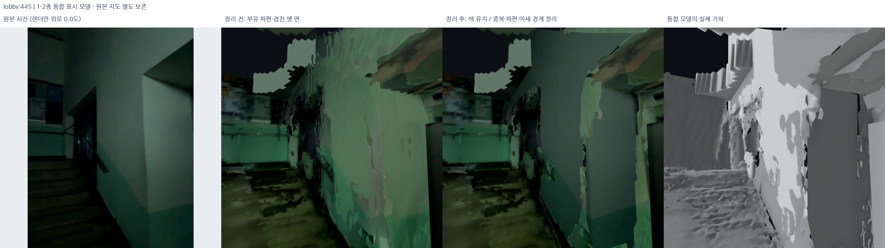

# Folded City 연구 이력

센서 로그 실험에서 제1학생회관의 다층 지도와 경로 탐색으로 발전한 과정을 정리했다. 설계가 바뀐 이유, 후보별 결과와 최종 선택을 시간 순서로 기록한다. 각 실험 문서의 수치와 당시 상태는 해당 실행 시점을 기준으로 한다.

[연구 보고서](README.md) / [시각화와 영상 전체 목록](docs/EVIDENCE.md) / [웹 실행](web/README.md)

## 전체 흐름

2026-10-21에는 README의 이론·수식·실행 설정·실험과 시각 자료를 유지하면서 보고서의 연구 흐름에 맞춰 순서를 재구성했다. 동기 다음에 전체 파이프라인을 놓고 관측, 기하 보정, ROS 처리, 표면과 사진, 공간 경로 및 GNSS를 이어 설명한다. README 자체를 확장 보고서로 사용하며 본문을 별도 문서로 분리하지 않는다. 같은 변경에서 지도 회전, 실내 OSM 배경과 현재 위치 안내를 보완했다.

| 기간 | 작업 | 설계상 결정 |
| --- | --- | --- |
| 9월 | 도서관 인근 폰 센서 로그와 주제 구체화 | 수평 좌표보다 출입구와 층 연결에 집중 |
| 10월 초 | 도서관 RGB-D DB 확인 | 단순 센서 로그에서 3차원 관측으로 전환 |
| 10월 16–17일 | 학생회관 다섯 촬영본 수집 | 실외, 로비, 계단과 층의 연결 관측 확보 |
| 10월 17일 | 재방문 검사, 포즈 그래프와 BA | 수치 수렴과 기하 일관성을 나누어 비교 |
| 10월 17–18일 | 세션별 선택과 통합, 표면 비교 | 내부 기하와 표시용 표면 분리 |
| 10월 18–19일 | 높이 진단, 층 구조와 사진 보완 | 계단과 복층 로비의 연결 보존 |
| 10월 19일 | ROS 재생과 최종 지도 이관 | 기록 재생 결과와 오프라인 최종본 구분 |
| 10월 19–20일 | 보행 격자, 목적지와 사진 안내 | 촬영 궤적과 별개인 A* 경로 |
| 10월 20일 | 모바일 개편과 연구 문서 정리 | 지도와 안내를 한 사용 흐름으로 구성 |
| 10월 20일 | 현재 위치와 헤딩, GNSS 보정 및 후보정 | 실외 수신과 실내 수동 전환을 구분하고 원본 보존 |
| 10월 20일 | 실내외 고유 GNSS 1,099개와 지도 위치 대조 | 큰 실내 차이를 확인하고 GNSS 평활화와 실내 자동 측위를 구분 |
| 10월 20일 | 캠퍼스 호숫가 지형과 외관 수정 | 표시 고도의 급상승을 완화하고 실사 참고 재질을 분리, 원본 좌표 보존 |

## 1. 도서관에서 시작한 문제 정의

처음 관심을 둔 문제는 상허기념도서관의 열람실 접근이었다. 같은 건물이어도 일반 자료실과 열람실 입구가 다르고, 차량이 다니는 도로에서 보행 출입구까지의 연결이 쉽게 보이지 않았다.

초기에는 비콘 없는 실내 길찾기와 호실 검색, 고가도로 상하 구분을 함께 검토했다. 논의를 거치며 지도 제작, 방문자 위치 추정과 경로 탐색을 별개로 설계했다. 카메라나 QR을 이용자가 항상 사용해야 하는 조건은 기본 사용 흐름으로 채택하지 않았다.

연구 제목은 **도시는 더 이상 평면이 아니다: Multi-Sensor Fusion SLAM 기반 실내외 연속 측위 및 3차원 경로 탐색**으로 정했다. 위치 오차가 경로 선택을 크게 바꿀 수 있다는 문제의식이며 특정 오차와 우회 거리를 실측했다는 의미는 아니다.

### 초기 GNSS, IMU와 기압 실험

2026년 9월 2일 로그는 약 311.24초다. 가속도와 자이로 약 100 Hz, 기압 약 0.94 Hz, 위치 179행 중 실외 135개를 이용했다. 위치 기록은 iOS Core Location 출력이며 위성별 의사거리와 반송파 원시 관측이 아니다.

CV Kalman filter와 RTS 평활화, Weinberg 보폭 모델, 방위각 혼합과 기압 상대 높이를 시험했다. 휴대폰 취급이 걸음 후보에 섞여 중력 투영과 대역통과 처리를 적용했다. 469개의 step-like 후보와 약 0/4.90/8.78 m 높이 가설을 얻었지만, 정답 걸음과 층 라벨은 없었다.

이 실험은 무제약 PDR의 드리프트와 공간 제약의 필요성을 확인하는 예비 단계였다. 이후 학생회관의 최종 SLAM에 이 필터를 그대로 결합하지는 않았다.

## 2. RGB-D 수집으로 전환

도서관의 초기 `261006-162929.db`는 477프레임이며 GPS가 없었다. 이후 제1학생회관으로 옮겨 외부 354프레임과 로비 958프레임을 수집했다. RGB 720×960, 깊이 192×256, confidence와 프레임별 보정값을 해독했다.

원본 DB에는 오도메트리뿐 아니라 앱의 최적화 포즈도 저장되어 있었다. 따라서 비교 기준을 `Node.pose`, 앱 저장 최적화본과 새로운 후처리 후보로 나눴다. 분리 노드는 가까운 프레임 번호에 임의로 붙이지 않았다.

[데이터 원장](docs/data_inventory.md) / [초기 두 세션 처리](docs/experiments/2026-10-17-student-union.md)

### YOLO 마스크를 사용하지 않은 이유

YOLOv8n-seg를 초기 1,312장에 적용했다. 실외 24장과 로비 81장에서 객체가 탐지되었으나 기둥, 유리와 안내판이 사람 또는 차량으로 분류되는 사례가 있었다. 일부 프레임에서는 정적 구조의 절반 이상이 마스크에 들어갔다. 최종 초기 처리본은 마스크 없이 다시 생성했다.

### GNSS의 역할 조정

GNSS 보고 정확도 중앙값은 외부 14.25 m, 로비 17.97 m였다. 실내에는 오래된 위치가 반복되어 최적화의 강한 제약으로 사용하기 어려웠다. 지리 배치의 보조 기준과 진단 자료로 남기고, 후처리 포즈 그래프의 GNSS prior는 0개로 뒀다.

## 3. 연결 촬영과 계단 데이터 추가

실외와 로비의 첫 240개 후보 검사는 영상 대응 또는 신뢰 깊이가 부족해 연결을 얻지 못했다. 유리문에서 RGB와 깊이가 서로 다른 표면을 가리키는 문제가 나타났다.

이후 실외에서 출입문을 지나 로비로 들어오는 촬영, 메인 계단과 2층, 서브계단과 양 층 승강장 촬영을 추가했다. 수집량은 다섯 DB, 2,875프레임이 되었다.

[추가 세션 처리](docs/experiments/2026-10-17-added-sessions.md)

## 4. 재방문 측정과 세션 연결 검사

SIFT와 RootSIFT, CLAHE, LoFTR로 후보를 구하고 깊이 신뢰도, 3D RANSAC, ICP와 재투영을 검사했다. 기존 내부 루프 160개 중 6개가 새 측정 조건을 통과했다. SIFT 기반 세션 간 검사는 설정별 반복을 포함한 3,200회, 완료된 LoFTR 세션 간 검사는 200회였다.

좁은 평면에 있는 대응을 무조건 퇴화로 판정하던 조건도 수정했다. 고정된 비공선 3D 대응의 강체 정합과 무늬 없는 point-to-plane ICP의 관측 가능성이 다르기 때문이다. 공간 분포와 회전 normal matrix를 추가로 검사했다.

로비와 2층의 공동 최적화 후보 6개는 수치적으로 수렴했지만, 검증 전용 위치 잔차가 기준을 넘어 이 단계에서는 병합을 보류했다.

[루프 및 교차 세션 재검사](docs/experiments/2026-10-17-cross-session-revalidation.md) / [기하 보정](docs/experiments/2026-10-17-geometry-correction.md)

## 5. 서브맵, 프레임 그래프와 제약 충돌

긴 궤적을 품질과 추적 경계로 나누고 서브맵 단위 강건 최적화를 비교했다. Huber, DCS와 구역 공유 switch를 사용했다. 같은 장소를 연속 촬영한 관측은 독립적인 여러 장소처럼 가중하지 않았다.

2층에서는 일부 벽이 좋아지는 대신 다른 벽이 벌어졌다. 같은 원본 패치의 point-to-plane 잔차와 유한 겹침을 고정해 비교하고, 제약을 하나씩 제외해 변화 원인을 조사했다. 정규화된 목적함수와 실제 미터 단위 잔차가 같은 경향을 보이지 않는 사례도 확인했다.

[서브맵 비교](docs/experiments/2026-10-17-submap-robust-optimization.md) / [프레임 최적화](docs/experiments/2026-10-17-floor2-local-optimization.md) / [제약 충돌](docs/experiments/2026-10-17-constraint-conflict-audit.md)

## 6. 국소 RGB-D BA와 수치 해법

656↔1055 주변의 61개 track으로 카메라와 landmark를 함께 최적화했다. Sparse LSMR 기반 풀이에서 평가 한도에 도달한 뒤 같은 목적함수를 벡터화하고 dense SVD 선형 풀이로 비교했다. 최종 국소 결과는 학습 gate를 통과했다.

전체 그래프 반영 후보는 직전의 큰 국소 악화를 줄였지만 이전 preview보다 모든 지표가 좋은 것은 아니었다. 548↔981에서는 충분한 track을 얻지 못했다. 별도 수동 구조물 대응과 유한 평면 제약도 비교했다.

[재방문 BA와 수치 결과](docs/experiments/2026-10-17-floor2-revisit-ba.md) / [구조 제약 실험](docs/experiments/2026-10-17-independent-structure-optimization.md) / [실행 스크립트](docs/experiments/reproduction/floor2_revisit_v2/README.md)

## 7. 세션별 후보 선택

기록별 전처리 10개 profile과 과거 및 신규 최적화 후보를 비교했다. 91개 점군과 112장의 비교 그림을 만들었고, 같은 A/B 프레임 집합의 원본과 전처리 대조를 추가했다.

최종적으로 실외 J01, 로비 N05, 실외 연결 H03, 2층 J04, 서브계단 H03을 선택했다. 후보마다 입력, 자유도와 과거 의존성이 달라 한 종류의 최적화 방법에 대한 단일 순위로 해석하지 않는다.

[후보 전체](docs/experiments/2026-10-17-session-portfolios.md) / [선택 구역 분석](docs/experiments/2026-10-17-visual-shortlist-analysis.md)

## 8. 선택 지도 통합

선택한 세션 내부 포즈는 유지하고 xyz와 yaw 강체 배치만 추정했다. 로비, 2층과 서브계단은 기존 RGB-D 연결로 배치하고, 실외 연결은 선택 포즈에서 대응점을 다시 투영해 변환을 구했다.

총 2,251포즈의 점군을 5 cm 복셀로 합쳐 3,493,208점을 얻었다. 일부 출입구 연결은 한 구역의 상관된 관측에 의존하며, 연결별 엄격 기준 미달도 남았다. 해당 잔차와 국소 문제를 보존한 채 후속 표현의 기준 지도로 고정했다.

[통합 방법과 잔차](docs/experiments/2026-10-17-selected-working-map.md) / [최종 선택 설정](config/final_map_selection.json)

## 9. 표면 표현 비교

같은 포즈에서 TSDF 5 cm와 3 cm, Ball Pivoting, 사진 UV, 사진 시트와 세부 점을 비교했다. 작은 글자와 문틀은 저해상도 깊이만으로 살리기 어려웠고, 사진 투영에는 깊이와 시야 검사가 필요했다.

Poisson 및 연속 표면 후보도 시험했다. 빈 곳을 매끄럽게 잇는 결과가 실제 관측을 더 정확히 설명하지는 않아, 점군과 표면을 따로 남겼다.

[표면 비교](docs/experiments/2026-10-17-surface-model-portfolio.md) / [연속 표면](docs/experiments/2026-10-17-surface-continuity.md) / [표시와 깊이 지표](docs/experiments/2026-10-17-display-depth-and-whole-map.md)

### CUDA Gaussian 학습

CUDA 환경에서 고정 중심 Gaussian의 RGB, opacity와 scale을 학습했다. 다섯 촬영본 각각 600 step을 실행했으나 학습에 쓰지 않은 일부 시점의 흐림과 빈 영역이 컸다. 전체 3DGS로 확장하거나 웹 기본 표현으로 채택하지 않았다.

## 10. 층 구조와 높이 문제

평평한 바닥과 천장을 넓게 만드는 초기 표시 방식은 복층 로비와 계단 주변을 잘못 닫았다. 관측된 층 구간과 아트리움 개방 영역을 나누고, 근거가 부족한 임의 높이 천장은 철회했다.

상부 벽 접합을 보완하는 과정에서는 기하 포즈의 Z 변형도 별도로 조사했다. J04의 내부 높이 변화가 확인되어 X/Y와 회전은 고정한 Z 전용 후보를 계산했다. 일부 바닥 일관성은 개선됐지만 최종 지도는 교체하지 않았다.

[복층 구조](docs/experiments/2026-10-18-multilevel-topology-repair.md) / [천장 철회](docs/experiments/2026-10-18-withdraw-inferred-ceilings.md) / [포즈 Z 진단](docs/experiments/2026-10-18-pose-z-deformation-audit.md) / [Z 전용 실험](docs/experiments/2026-10-18-floor2-z-only.md)

## 11. 사진, 재질과 최종 마감

실제 사진으로 문, 간판과 바닥 무늬를 보완했다. 바닥을 단색으로 바꾼 후보는 무늬 손실이 커 철회했고, 색을 중성화한 밝기 보정도 회색화 문제로 바꿨다. 현재 색감은 약한 필터와 제한적인 선형 RGB gain을 적용한 shadow v3를 기준으로 한다.

표시 메시의 작은 파편, 중복 면과 접합을 정리해 `student_union_final_mesh_v9`를 고정했다. 이후 공유 외곽 후보는 별도 비교본으로 남았다.

[바닥 재질과 간판](docs/experiments/2026-10-18-visual-floor-seams-prime-hall.md) / [암부 보정](docs/experiments/2026-10-19-shadow-visibility-web-handoff.md) / [메시 마감](docs/experiments/2026-10-19-final-mesh-visual-cleanup.md) / [외곽 후보](docs/experiments/2026-10-19-shared-contour-candidate.md)

## 12. ROS 재생 영상과 지도 레이어

RGB-D와 저장 포즈를 순서대로 읽고 저장 루프를 재검사하는 8개 ROS 노드를 구성했다. 미래 끝점이 있는 연결을 현재 그래프에 넣지 않고, 현재까지의 prefix를 다시 풀어 과거 관측을 재투영했다.

초기 재생은 raw 포즈에서 매번 재시작하며 풀이 한도에 걸렸다. warm start와 최대 평가 횟수를 조정한 v3에서는 20번의 풀이가 수렴했다. rqt_graph와 RViz, 원본 RGB와 처리 시간을 묶어 113초 영상을 제작했다.

캠퍼스 배경은 OSM의 건물, 길과 지형을 사용했다. 초기 2D 지도 초안과 현재 웹 3D 배경은 서로 다른 export다. 실내 표시 영역은 촬영 지도의 범위이며 실측 건축 도면과는 다르다.

[ROS 재생과 지도 레이어](docs/experiments/2026-10-19-cartographic-replay-windows.md)

## 13. 개발환경 이관

Ubuntu에서 수집한 원본과 최종 포즈, 메시, 코드와 실행환경 목록을 Windows로 이관했다. 큰 지도는 최종 결과 중심으로 묶고 과거 실험의 수치와 비교 그림은 별도로 보존했다. 실제 설치 환경과 인증정보는 공개 저장소에서 관리하지 않는다.

[환경 이관 절차](docs/windows_full_development_handoff.md) / [현재 연구 상태](README.md)

## 14. 보행 격자와 목적지 안내

사진의 시간 순서 또는 촬영 궤적을 길로 쓰는 대신 바닥과 장애물 후보를 12 cm 격자로 만들었다. 층간 전이는 등록된 계단과 승강장으로 제한하고 A*로 경로를 계산했다. 장소는 이름과 별칭뿐 아니라 층, 접근 지점과 근거 사진으로 관리한다.

고전음악감상실은 서브계단이 메인 계단보다 6.1 m 짧게 계산되었다. PRIME HALL과 학생취업처는 메인 계단 경로가 짧았다. 학생식당은 지하 내부가 아니라 1층 진입 지점으로 등록했고 CU는 신한은행 앞쪽 사진을 확인해 추가했다.

RGB 2,875장을 모두 해독하고 2,398장을 지도 대응 후보로 남겼다. 사진 검색에는 위치, 방향, 층과 연결 영역을 사용한다. 원본, 보정본과 축소판을 따로 보관한다.

[보행 경로](web/navigation.py) / [사진 대응](web/photo_library.py) / [장소 원장](web/public/data/catalog.json)

## 15. 웹 배포와 모바일 개편

연구 결과와 웹 런타임을 분리했다. 브라우저는 미리 처리한 GLB와 사진을 표시하고 Python API가 격자 경로와 다음 사진을 반환한다. Vercel의 Git 연동으로 `main` 자동 배포를 구성했다.

2026년 10월 20일에는 장소 둘러보기와 길찾기 탭을 하나의 흐름으로 합쳤다. 하단 목록을 끌어올리면 장소를 스크롤하고 내리면 지도가 커지도록 바꿨다. 사진 안내는 다음 이동을 우선 표시하고 원본, 밝기, 3D와 미니맵을 보기 설정에 모았다.

[모바일 화면](docs/assets/mobile-journey-20261020/README.md) / [배포 화면](docs/assets/web-release-20261019/README.md) / [웹 기술 문서](web/README.md)

### 현재 위치와 로그 처리

실외 위치는 휴대폰 OS의 연속 수신을 지도 좌표로 변환하고 정확도 기반 CV Kalman과 NIS로 처리한다. 저장 로그에는 RTS 후보정을 적용한다. 실측 야외 338개와 고정 seed의 합성 시험을 별도로 비교했으며, 합성 재현을 표시한 실제 웹 화면을 남겼다. OSM에서 입구까지 약 37.24m의 연결로가 빠져 있어 이 구간은 현장 확인 후 실내 A*로 넘긴다.

[GNSS 설계와 실험](docs/experiments/2026-10-20-gnss-navigation.md) / [화면과 그래프](docs/assets/gnss-navigation-20261020/README.md)

## 설계 변경의 근거

| 관찰한 문제 | 변경한 설계 |
| --- | --- |
| 건물에 도착해도 목적지 입구를 찾기 어려움 | 건물, 층, 접근 지점과 연결을 분리 |
| 촬영자는 반복 이동하고 되돌아감 | 촬영 궤적과 보행 그래프 분리 |
| RGB가 같아도 유리와 반사면의 깊이가 다름 | 특징점 이후 신뢰 깊이와 기하 검사 |
| 목적함수는 줄지만 다른 벽이 벌어짐 | 고정 패치, 미사용 관측과 제약 제외 비교 |
| XY 형상은 유지하면서 높이만 다듬을 필요 | Z 스칼라 spline의 별도 비교 실험 |
| 매끄러운 표면이 계단이나 로비를 막음 | 관측 기하와 표시 보완의 별도 관리 |
| 저해상도 깊이에서 글자와 문패 손실 | 실제 사진 텍스처와 사진 안내 |
| 모바일에 조작과 연구 설명이 과밀 | 단일 길찾기 흐름과 접이식 정보 |
| 수신 위치가 튀거나 정확도가 낮음 | 정확도 가중 칼만, NIS 및 속도 판정, 정상 위치 유지 |
| OSM 도로와 실내 접근점 사이 연결로 누락 | 미등록 구간 표시 및 입구 수동 확인 |

## 자료와 재현

각 단계의 자세한 설정, 지표, 실패 원인과 실행 명령은 원 실험 문서에 있다. 시각자료와 수치 원장은 [전체 자료 색인](docs/EVIDENCE.md)에서 찾을 수 있다. 원본 DB와 대형 중간 출력은 별도 보관하며, 과거 실행을 그대로 재현하려면 해당 입력과 환경을 함께 준비해야 한다.
