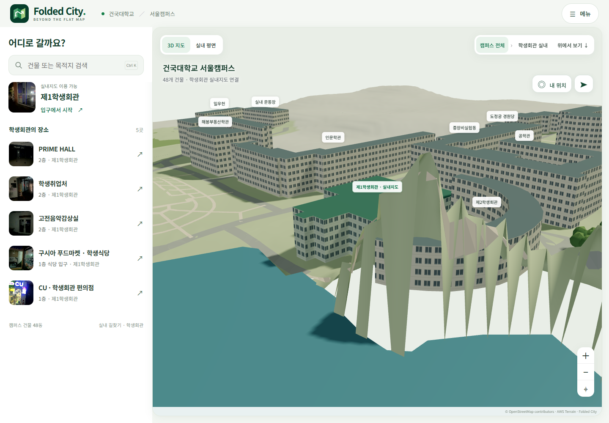
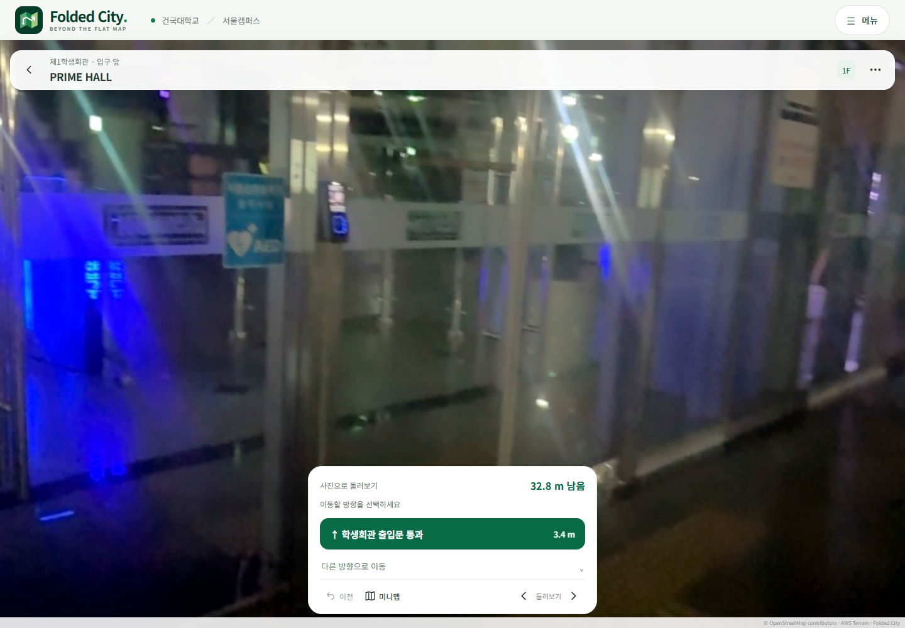
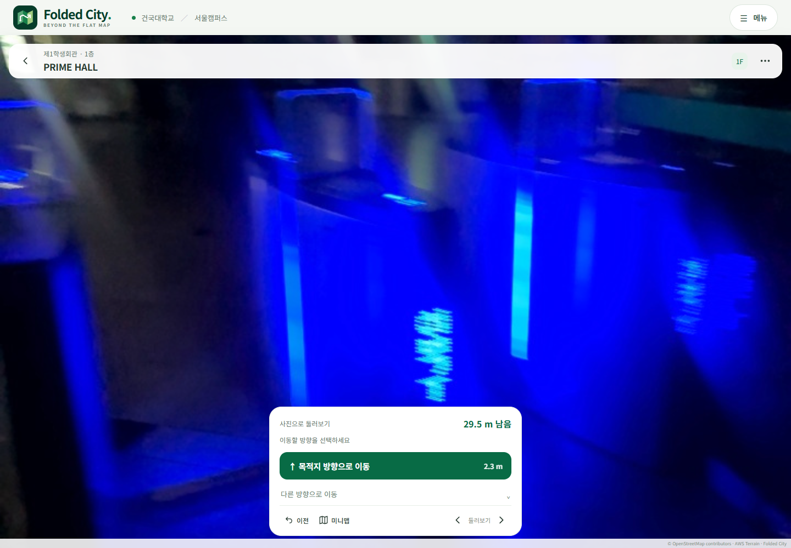
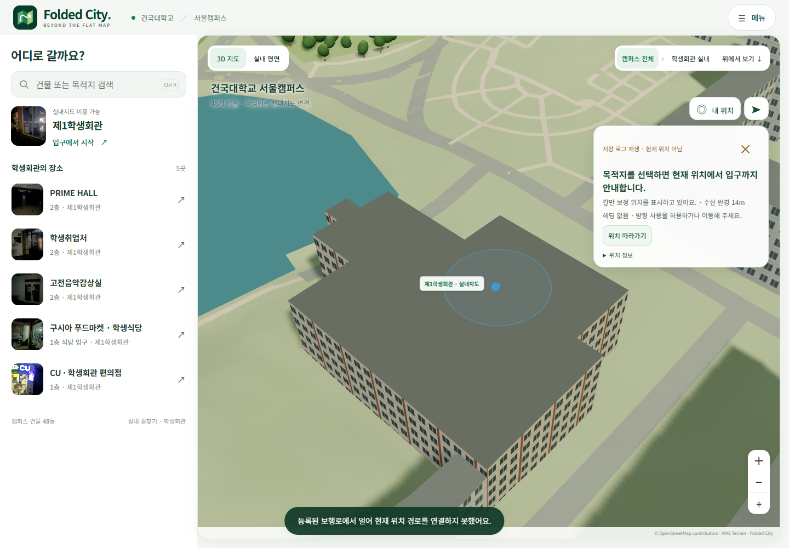
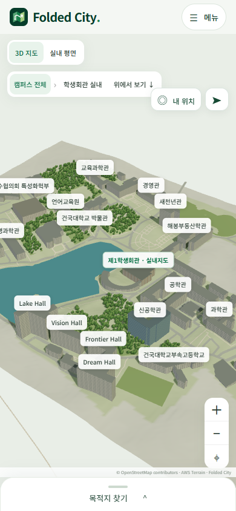

# 캠퍼스 지형과 외관

실제 웹 화면을 같은 카메라 위치에서 촬영했다. 생성형 이미지를 사용하지 않았다.

| 수정 전 | 수정 후 |
| --- | --- |
|  |  |

공개 고도 격자의 호숫가에서 5m 옆 지점과 최대 62m 차이가 났다. 수면은 22m로 평탄화되어 있어 삼각형 절벽이 생겼다. 격자 중심점이 호수 안에 있다는 이유로 삼각형을 통째로 지운 처리도 경계에 틈을 만들었다.

표시 고도에 0.35m/m의 경사 상한을 적용하고 수면 경계와 연속된 격자를 구성했다. 상하좌우 인접 격자의 최대 차이는 1.75m이며 표시 높이가 바뀐 정점은 3,063개다. 이 값은 지형 정확도 지표가 아니라 화면의 급상승을 제한하는 설정이다. 원본 격자와 건물 외곽, 미터 축척, SLAM 지도와 경로 격자는 보존했다. 배경 건물이 공중에 뜨지 않도록 표시용 밑면을 조정하되 학생회관의 정합 기준 높이는 유지했다.

## 건물 재질의 근거

| 건물 | 참고 자료 | 화면 표현 |
| --- | --- | --- |
| 제1학생회관 | 직접 촬영한 `outside:19`, `outside:263` | 적갈색 계열 기둥 띠, 밝은 벽체와 유리 |
| 상허기념도서관 | [AURUM 건축 자료](https://www.aurum.re.kr/Bits/BuildingDoc.aspx?num=178&page=1) | 화강석 계열과 좁은 창 |
| 신공학관 | [건대신문 준공 사진](https://popkon.konkuk.ac.kr/news/articleView.html?idxno=8654) | 회청색 유리와 수평 띠 |
| 나머지 건물 | 외관 미확인 | 중립 재질 |

팔레트와 창 패턴은 참고 자료에서 착안한 단순 표현이다. 외부 사진을 내려받아 재배포하거나 전면 사진 텍스처로 사용하지 않았다. 학생회관 입구 사진만으로 건물 전체 외벽과 지붕 색을 실측했다고 해석할 수는 없다.

## 입구와 로그 재생

제1학생회관 선택 후 입구 앞에서 실제 사진 안내가 열리고, 추천 이동으로 출입문을 통과하는 것을 확인했다. 첫 화면은 `bridge_out1f:99` 사진이며 출발 위치는 기존 `outside_start`다. 사용자 제공 캠퍼스 화면만으로 출입문의 정밀 좌표를 새로 측량하거나 GNSS 정합을 변경하지 않았다.

저장된 야외 GNSS를 재생해 시점이 진행되는 것을 확인했다. 녹화 당시의 GNSS와 웹 경로의 불일치는 재질 변경으로 고쳐지는 문제가 아니다. 실내에서 방문자의 위치를 자동 추적한 결과도 아니다.

모바일 화면

검사 기록: [verification.json](verification.json). 재현 스크립트: `web/scripts/verify-campus-render.mjs`.
