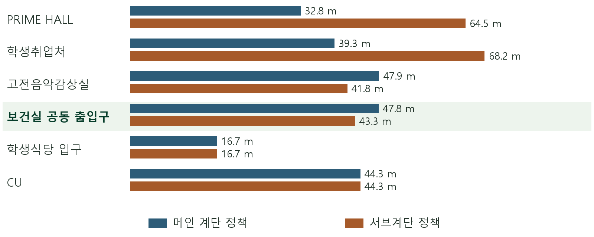
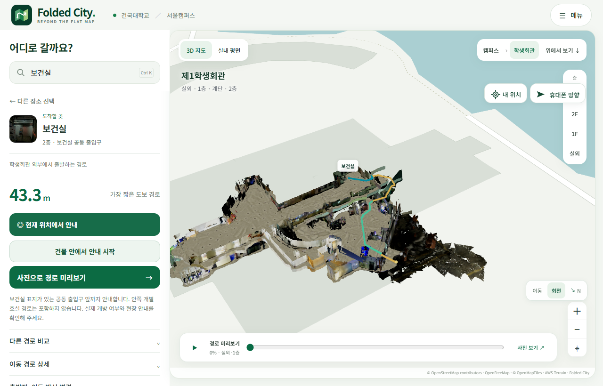
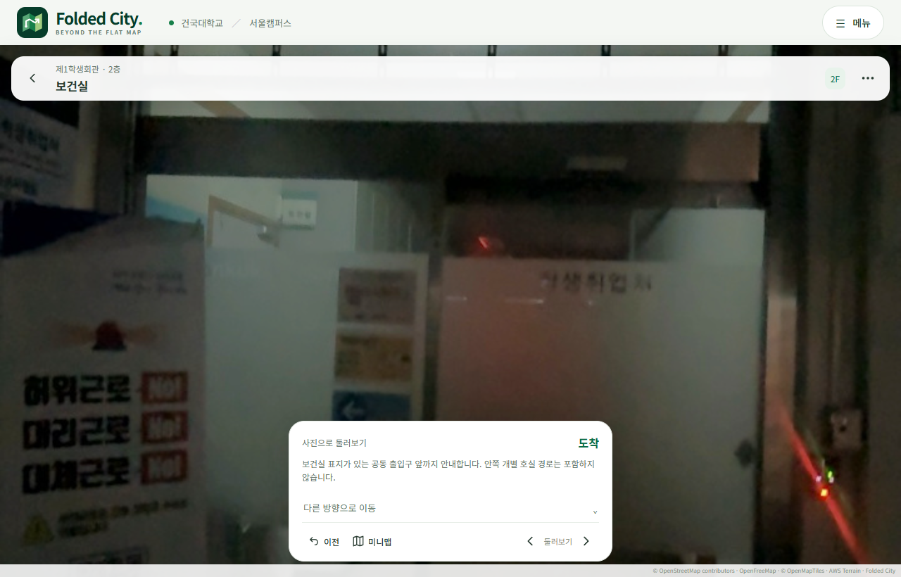

# 보건실 공동 출입구 안내

사용자는 고전음악감상실 문을 바라보고 오른쪽으로 약 90도 돌아보면 보건실이 있다고 설명했다. 같은 위치의 `bridge_12_sub:164`와 `floor2:569` 원본 사진에서 유리 출입구 위의 보건실 표기를 확인했다.

등록 목적지는 `health_room`이며 2층의 기존 보행 셀 `2:343:177`, 지도 좌표 `[-16.76, 10.16, 2.63] m`를 사용한다. 관측된 공동 출입구의 카메라 접근 지점이다. 안쪽 보건실 개별 문과 내부 통행 경로는 이 촬영에 포함되지 않는다. 보행 지도와 원래 좌표 배치는 바꾸지 않았다.

| 출발 및 연결 조건 | 지도 경로 길이 |
| --- | ---: |
| 학생회관 외부에서 서브계단 | 43.3 m |
| 학생회관 외부에서 메인 계단 | 47.8 m |
| 학생회관 외부에서 엘리베이터 | 37.9 m |
| 고전음악감상실 접근 지점에서 | 1.6 m |

엘리베이터 길이는 승강장 간 수직 연결을 포함한 기하 길이이며 대기·운행 시간이나 무장애 통행을 입증하는 값은 아니다. 모든 길이는 지도에서 계산했으며 실제 걸음으로 측정한 거리가 아니다.

같은 학생회관 외부 출발점에서 보건실 공동 출입구의 서브계단 경로는 메인 계단보다 4.5 m 짧다. 그림의 다른 다섯 목적지도 같은 보행 격자와 연결 정책으로 계산했다.

보건실 검색 결과에서 경로 API가 서브계단을 선택하는 것과, 고전음악감상실에서 사진 안내로 이동해 도착하는 흐름을 확인했다. 도착할 때 한 번만 촬영 방향 `1.455754 rad`으로 맞춰 표지를 보여 주며 이후에는 사용자가 시점을 자유롭게 돌릴 수 있다. 실제 도착 사진은 `bridge_12_sub:164`가 선택됐고 페이지 실행 오류는 없었다. 검사는 장소 안내의 연결을 확인한 것으로 실시간 측위 정확도 평가와 다르다.

[브라우저 확인 수치](browser-check.json) / [장소 원장](../../../web/public/data/catalog.json)
