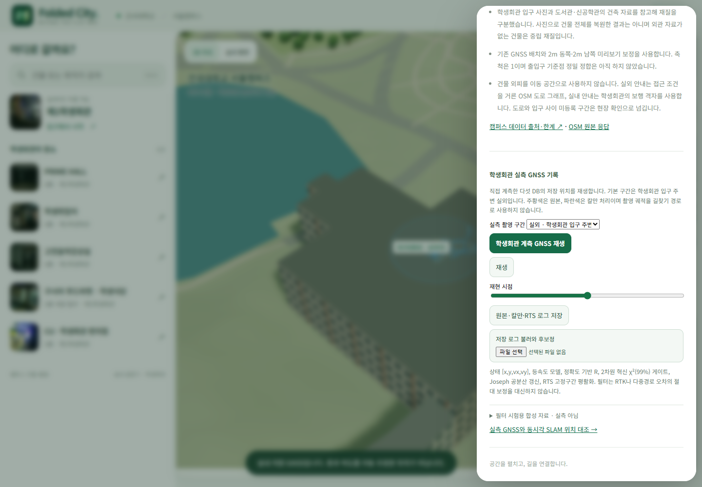
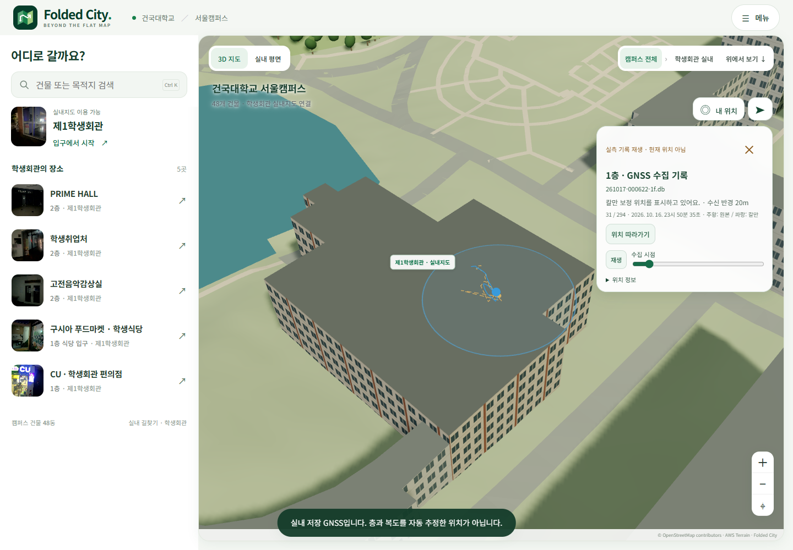
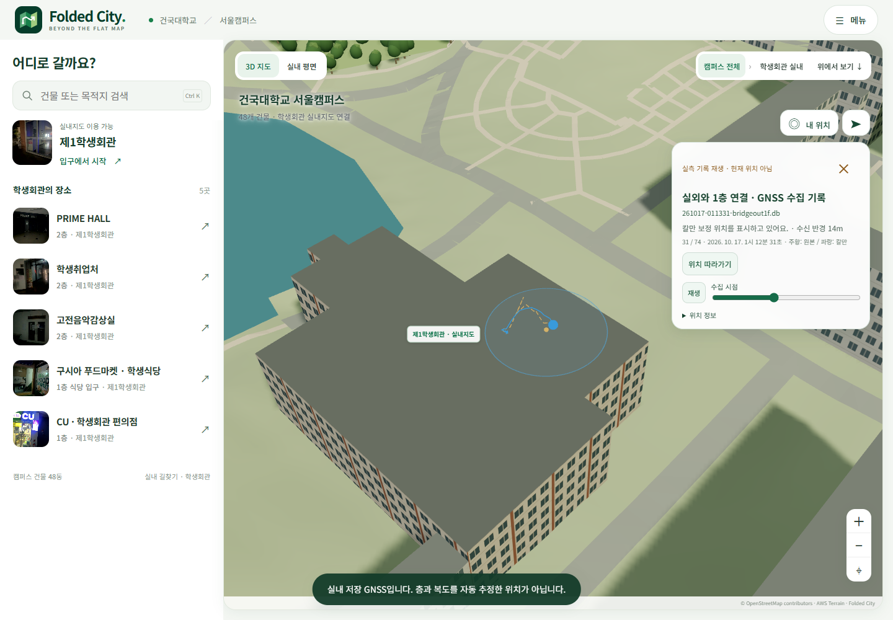
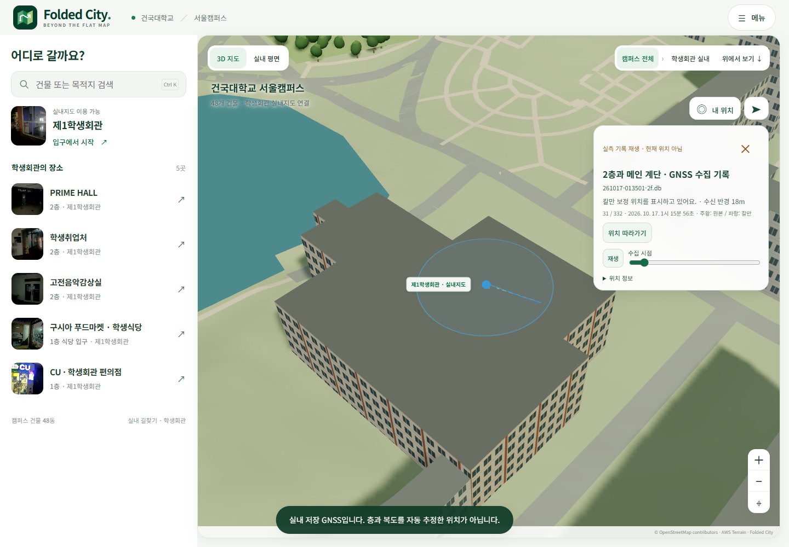
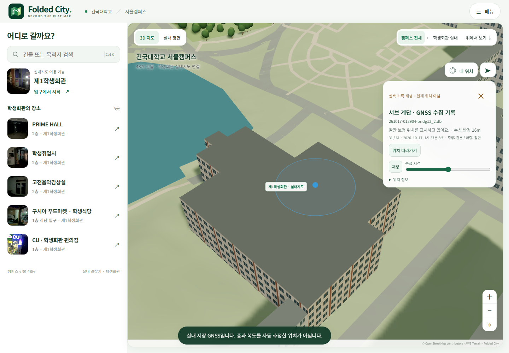
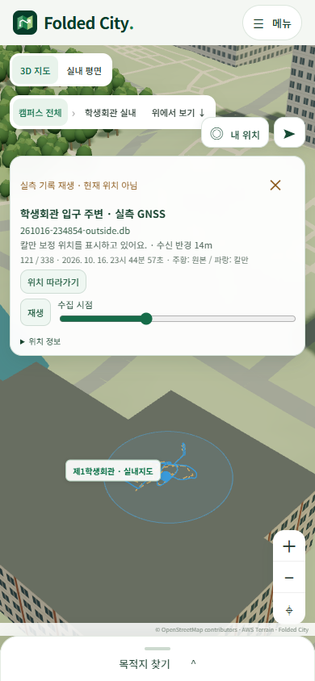

# 학생회관에서 수집한 GNSS 재생

[실외 기록 바로 재생](https://folded-city-atlas-subin11111s-projects.vercel.app/?recording=outside)

실제 브라우저에서 원본 DB의 GNSS를 재생해 촬영했다. 생성형 이미지를 사용하지 않았다. 입구에서 약 100m 떨어진 위치로 시작하는 기존 합성 시험과 구분한다.

| 구간 | 원본 DB | 고유 GNSS 시각 |
| --- | --- | ---: |
| 실외 | `261016-234854-outside.db` | 338 |
| 1층 | `261017-000622-1f.db` | 294 |
| 실외와 1층 연결 | `261017-011331-bridgeout1f.db` | 74 |
| 2층과 메인 계단 | `261017-013501-2f.db` | 332 |
| 서브 계단 | `261017-013904-bridg12_2.db` | 61 |

주황색은 저장된 원본 GNSS, 파란색은 기존 등속도 칼만 처리다. 과거 수집 궤적과 새로 계산하는 길찾기를 구분하기 위해 재생 화면에는 OSM 목적지 경로를 겹치지 않는다. 원본 위경도, 지도 정합, 칼만 설정은 바꾸지 않았고 입구로 좌표를 강제 이동하지 않았다. 원본의 보고 반경과 위치 차이도 그대로 남는다. 점의 화면 높이는 배경 지형에 투영한 표현이며 GNSS 층 판정 결과가 아니다.

합성 입력은 접힌 필터 시험 항목에서만 시작한다. 입력이 원본 학생회관 DB와 대응되는지 세션 ID, 파일명과 SHA256 형식을 확인한다. 내보내기에도 출처를 보존한다.

나머지 실측 구간

실내 로그의 차이는 자동으로 해결되지 않는다. [동시각 SLAM 위치와의 대조](../gnss-slam-audit-20261020/README.md)를 함께 본다.

모바일 화면

검사: [verification.json](verification.json). 원본 DB와 처리 기록의 브라우저 내보내기: [recorded-browser-export.json](recorded-browser-export.json). 재현: `web/scripts/verify-measured-replay.mjs`.
