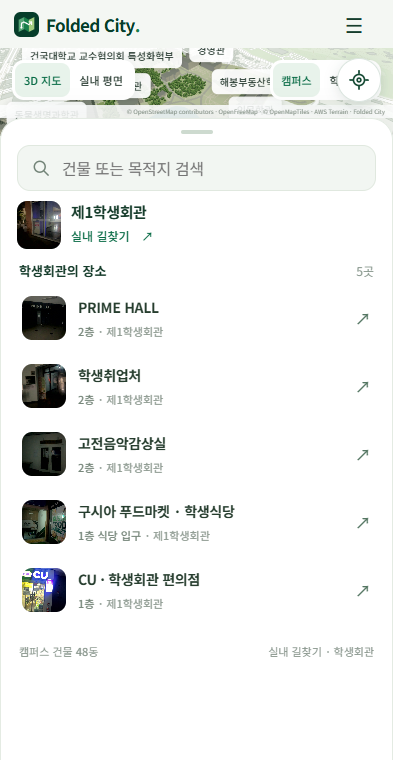
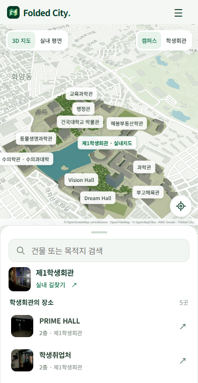

# 모바일 문서 스크롤과 지도 크기

사용자가 보낸 Safari 화면 녹화에서는 위로 스크롤할 때 주소창과 하단 도구막대가 작아지고 콘텐츠 영역이 넓어졌다. 기존 지도는 `body`를 고정하고 루트 스크롤을 막아 일반 페이지와 다른 동작을 했다.

문서 스크롤을 허용하고 지도 앱의 프레임만 `sticky`로 유지했다. 초기 수정은 문서에 96px의 스크롤 여유를 두었지만, 사용자의 재확인에서 Safari의 바가 그대로 남았다. 당시 마우스 휠로 문서가 움직이는 것과 지도 위의 실제 터치가 문서를 움직이는 것을 구분하지 못했다.

후속 수정에서는 첫 세로 스와이프를 브라우저에 넘긴다. 문서가 64px 이상 이동하면 MapLibre의 일반 한 손가락 조작으로 돌아가며, 맨 위로 돌아오면 다시 문서 스크롤을 허용한다. 최초 상태에서는 두 손가락으로 지도를 조작할 수 있다. 목록과 그립도 처음 위로 쓸 때에는 문서로 전달하고, 이후에는 목록 높이를 조절한다. 사진 화면의 세로 스와이프는 항상 문서에 전달한다. 문서의 스크롤 여유는 기본 240px이며 새로고침이나 뒤로 가기에서 문서 위치가 복원되면 그 위치 뒤에 여유를 확보한다. 앱은 보이는 영역에 붙어 있어 빈 하단으로 드러나지 않는다. 홈 화면의 독립 실행 모드에는 이 여유나 최초 터치 전환을 적용하지 않는다. 주소창을 강제로 숨기는 API나 사용자 설정 변경은 사용하지 않았다.

`visualViewport`의 높이와 오프셋은 프레임에 적용한다. 지도와 하단 목록은 그 안에서 다시 배치된다. 지도 드래그와 목록 높이 조절은 유지하며 핀치 줌 중에는 앱 크기 재설정을 멈춘다. 동적 뷰포트 단위는 [WebKit의 viewport units 설명](https://webkit.org/blog/12445/new-webkit-features-in-safari-15-4/)을 참고했다.

## 초기 레이아웃 확인

Windows Edge의 Chromium 모바일 레이아웃, 너비 393px에서 실행한 결과다. 브라우저 UI를 그려 넣은 합성 화면이 아니며 Safari의 네이티브 도구막대 애니메이션을 자동 시험한 자료도 아니다.

| 조건 | 앱 위쪽 / 아래쪽 | 지도 높이 | 캔버스 높이 |
| --- | --- | ---: | ---: |
| 보이는 높이 650px | 0 / 650px | 355px | 355px |
| 문서 65px 스크롤 | 0 / 650px | 355px | 355px |
| 보이는 높이 760px | 0 / 760px | 417px | 417px |
| 목록 접기 | 0 / 760px | 674px | 674px |
| 문서 끝까지 스크롤 | 0 / 760px | 674px | 674px |
| 목록 펼치기 | 0 / 760px | 88px | 88px |

실제 장소 선택으로 경로 API의 200 응답과 32.8m 경로를 확인하고 사진 안내로 이동했다. 사진 안내에서는 브랜드 헤더가 숨겨지고 하단 안내 패널이 프레임 아래쪽 760px에 맞았다. 콘솔 실행 오류는 0개였다. 데스크톱은 프레임을 `display:contents`로 처리해 기존 배치를 유지한다.

[전체 레이아웃 수치](layout-check.json)와 [사진 안내 화면](07-photo-navigation.png)을 함께 보관한다. 검색 키보드와 핀치 줌의 좌표 처리는 `web/test_viewport.mjs`에서 별도 시험한다. 실제 Safari의 도구막대 축소 정도는 iPhone에서 확인한다.

## 실제 터치 전달 확인

기존 운영본에서 지도 위를 한 손가락으로 위로 쓸면 캔버스의 `touch-action:none` 때문에 문서 `scrollY`가 0px에 머물렀다. 문서 스크롤 여유만 늘려서는 해결되지 않는 상태였다. MapLibre의 협력 제스처를 최초 상태에 적용하고, 더 높은 우선순위로 캔버스에 걸려 있던 터치 차단도 함께 수정했다. [공식 제스처 옵션](https://maplibre.org/maplibre-gl-js/docs/API/type-aliases/MapOptions/#cooperativegestures)

Chrome DevTools Protocol의 터치 입력을 사용했다. 테스트 응답에서만 지도 카메라를 읽을 수 있도록 노출했으며 제품 소스에는 테스트용 전역 변수를 넣지 않았다.

| 입력 | 확인 결과 |
| --- | --- |
| 첫 지도 스와이프 | 문서 0 → 240px, 지도 중심 유지 |
| 다음 한 손가락 스와이프 | 문서는 같은 위치, 지도 중심 이동 |
| 두 손가락 회전·확대 | bearing 약 -32 → -62.72°, zoom 14.5 → 14.87 |
| 목록 그립 드래그 | 접힘과 펼침 모두 동작 |
| 문서 맨 위에서 목록 위로 스와이프 | 문서 약 197px 이동, 목록 중간 높이 유지 |
| 사진 화면 세로 스와이프 | 문서 약 185px 이동, 사진 안내 유지 |
| 화면 높이 650px | 앱 아래쪽도 650px, 빈 하단 없음 |
| 240px 위치에서 새로고침 | 복원 위치는 유지하고 다음 스와이프로 480px까지 문서 이동 |

전환 과정에서 MapLibre의 알림 제거 타이머와 제스처 해제를 분리해 실행 오류를 없앴다. 최종 시나리오의 페이지 실행 오류는 0개였다. 이 결과는 Windows Chromium의 실제 터치 전달 확인이며, Safari 네이티브 바 애니메이션의 하드웨어 시험은 아니다.

[터치 시나리오 전체 수치](touch-handoff.json)
