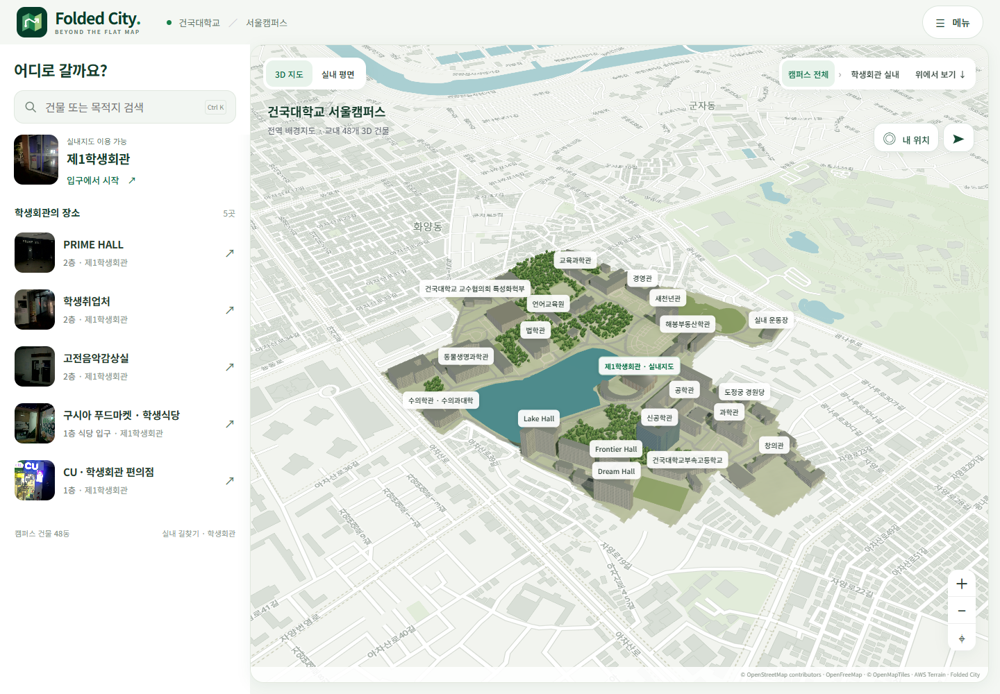
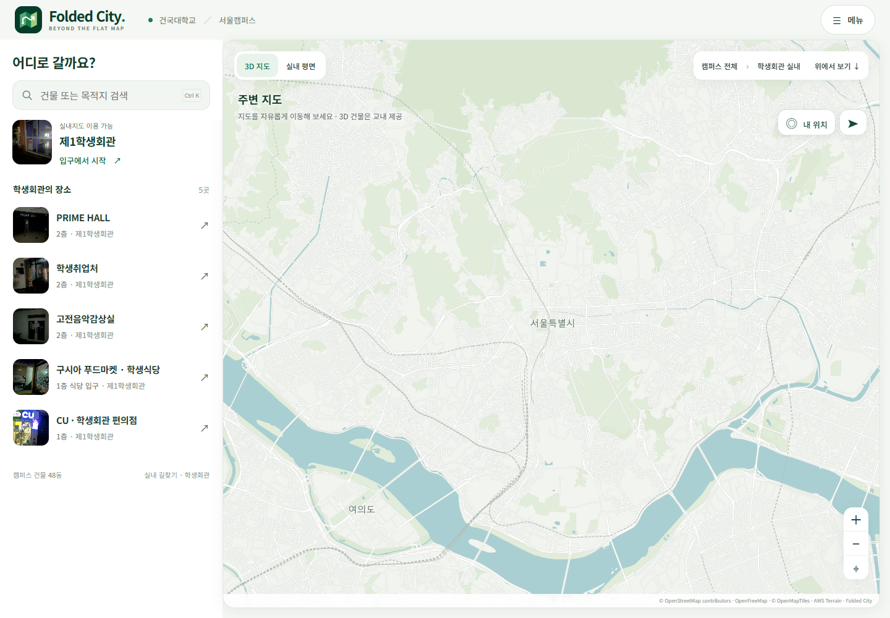
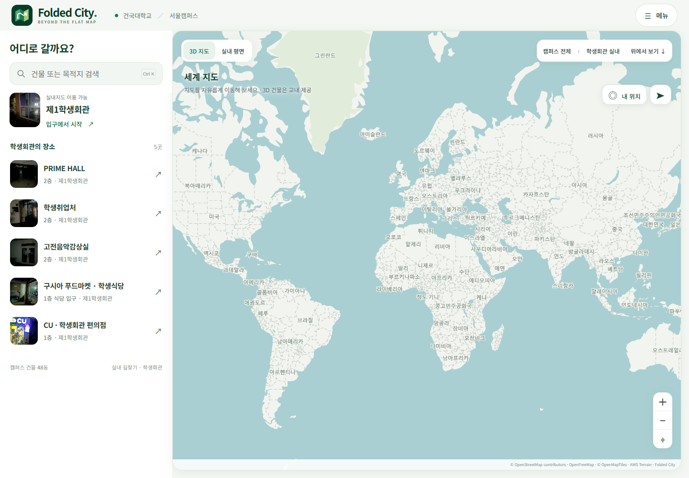
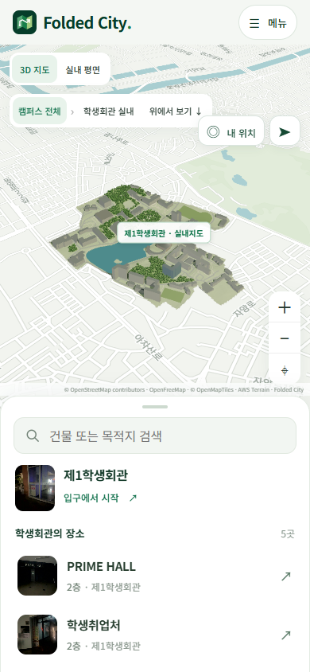
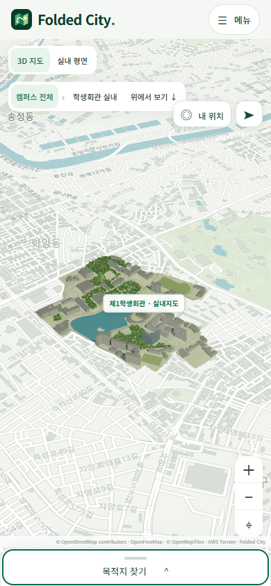
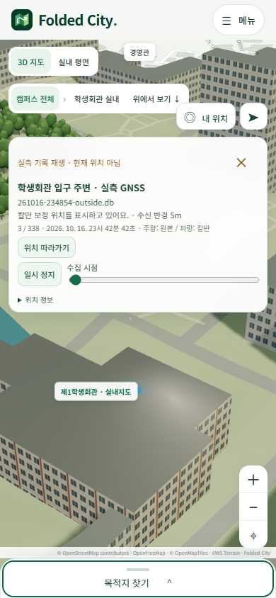

# 전역 배경지도와 교내 3차원 레이어

배경지도는 OpenFreeMap의 OSM 기반 벡터 타일을 MapLibre GL JS 6.15.0으로 표시한다. 교내 이동 경계인 maxBounds를 두지 않아 다른 지역으로 이동하고 세계 축척까지 축소할 수 있다. 교내 건물 48동과 표시용 지형은 Three.js 사용자 레이어이며, 교외 건물은 평면 윤곽으로 표시한다.

| 교내 3D와 주변 배경 | 서울 범위 |
| --- | --- |
|  |  |

| 모바일 지도와 장소 목록 | 목록을 내린 지도 |
| --- | --- |
|  |  |

기존 지리 정합의 미터 좌표를 WGS84와 Web Mercator 표시 좌표로 변환한다. ECEF와 ENU의 왕복 및 지역 투영 행렬을 검사하고, 원본 GNSS와 선택 SLAM 좌표는 유지한다. 위경도 계산과 배경에 3D를 배치하는 과정은 정밀 측량 정합을 새로 수행한 결과가 아니다.

학생회관 표식을 선택하면 등록 입구의 실제 사진으로 연결한다. 전역 배경은 탐색 범위이며 새 지역의 실내 안내나 전국 길찾기 데이터를 제공한다는 의미는 아니다.

`verification.json`은 교외 이동, 세계 축척, 캠퍼스 복귀, 입구 사진 연결, 모바일 목록과 실제 GNSS 재생을 확인한 기록이다. 외부 타일, 글꼴 및 지도 자료 요청 상태도 함께 기록한다.
