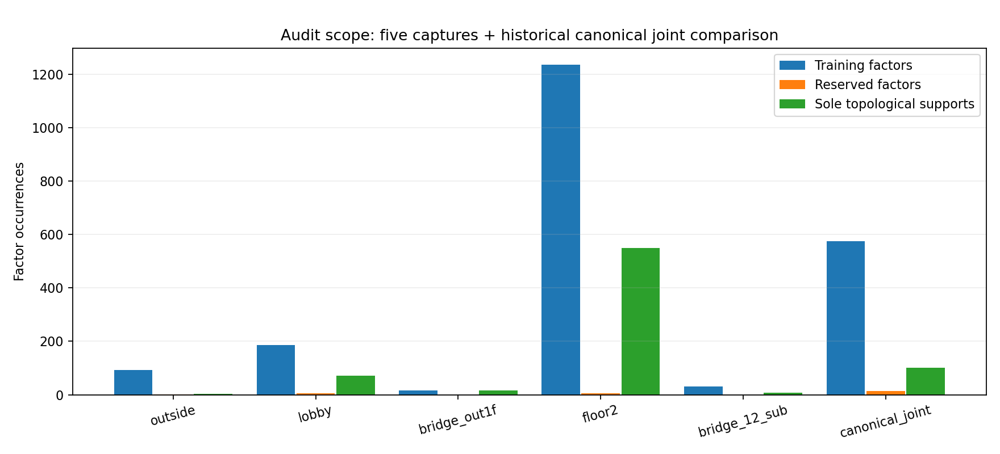
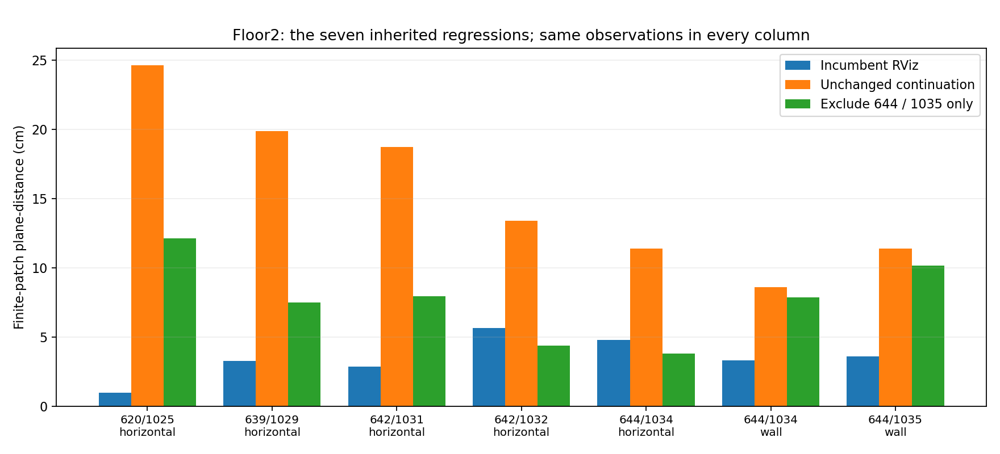
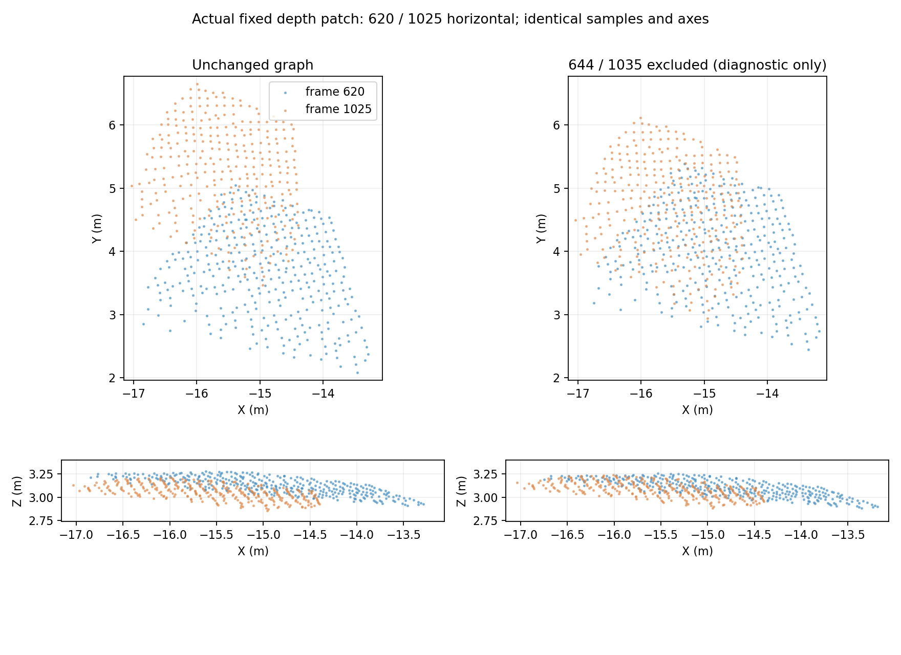
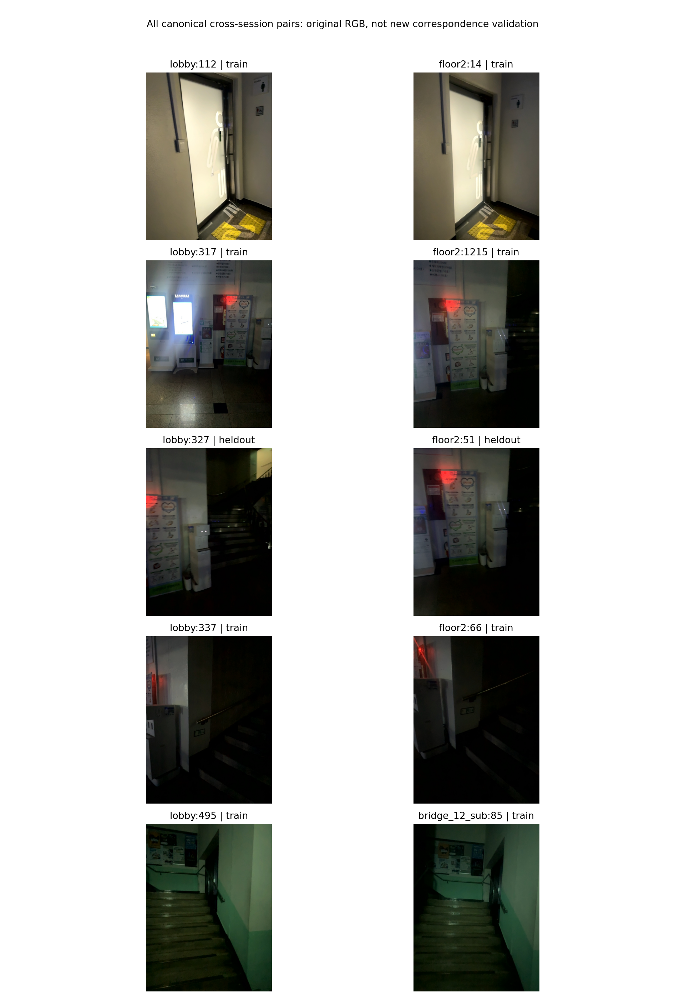
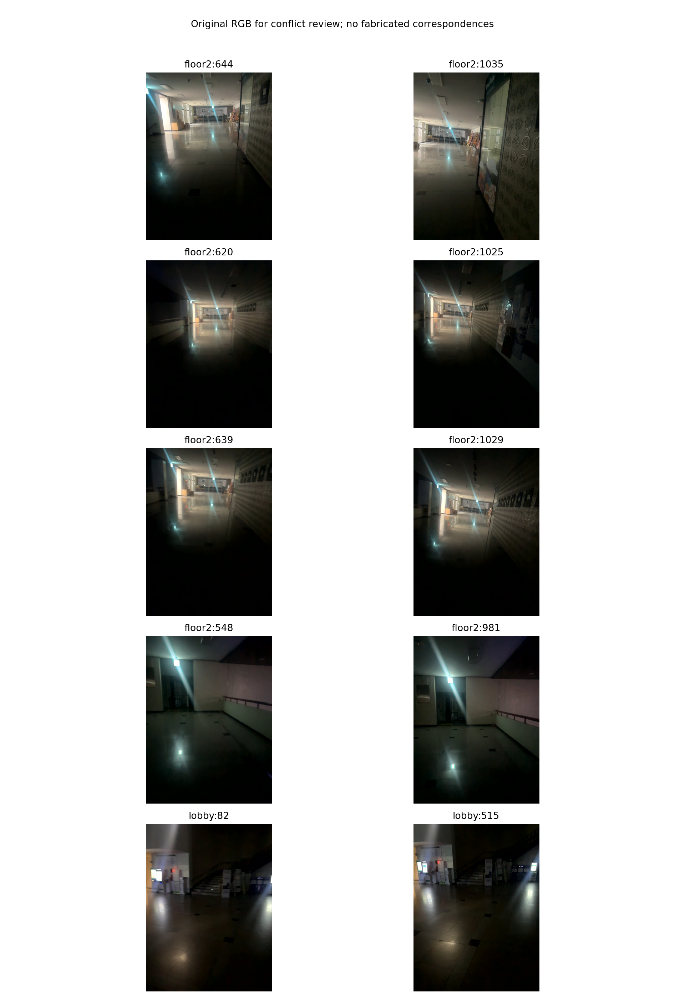

# 기존 제약 충돌 전수 감사 — 2026-10-17

## 결과와 적용 범위

**기존 제약의 충돌이 정합 실패의 원인 중 하나였다는 실험적 근거를 확인했다.**
가장 명확한 대상은 2층 `extra:floor2:644:floor2:1035:19` 단일 프레임 표면 ICP
제약이다. 같은 초기 포즈·수치 설정에서 이것만 제외하면 주변 바닥 악화가 줄었다.
새 수동 구조물548↔981이 모든 악화를 만든 것은 아니다. 이전부터 이어진 악화가
많았고, 그 수동 제약을 제외하는 대조군은 오히려 나빠졌다.

다만 **잘못된 장소 대응이라고 확정한 것, 모든 충돌을 해결한 것, 새 지도를
채택한 것은 아니다.** 제외 실험은 특정 측정의 유해한 영향/비호환성을 보여 주며,
실제 원인은 해당 측정·주변 odometry·깊이/기울기 편향의 조합일 수 있다.

원인 분석 단계에서는 원본 제약과 기본 RViz, 선택 지도 및 DB를 유지했다. 제외 실험의 포즈는 별도 감사 폴더에 저장했으며 점군 전체 재생성과 통합은 수행하지 않았다. 그림은 원본 RGB와 고정 깊이 표본을 재투영한 결과다.

## 1. 무엇을 전부 확인했는가

현재 다섯 로그의 독립 그래프와, 그 입력 계보인 과거 canonical 통합 후보를
검사했다. 과거 후보는 최신 2층 후보를 새로 병합한 지도가 아니다.

| 감사 대상 | 노드 | 학습 제약 | 예약 제약 | 단독 위상 연결 edge | 비선형 대조 실험 |
|---|---:|---:|---:|---:|---:|
| 외부 | 85 | 92 | 2 | 3 | 19 |
| 로비 | 171 | 187 | 5 | 72 | 26 |
| 외부–1층 브리지 | 17 | 16 | 0 | 16 | 1 |
| 최신 2층 프레임 그래프 | 1,215 | 1,237 | 5 | 549 | 27 |
| 서브 계단 | 32 | 32 | 0 | 8 | 7 |
| 과거 canonical 통합 후보 | 532 | 576 | 14 | 101 | 86 |

총 **2,166개 factor 출현**, 학습 factor **2,140개**를 검사했다. 통합 후보와
독립 그래프가 일부 원본 측정을 공유하므로 서로 다른 물리 관측 2,166개라는
뜻은 아니다. 다섯 독립 그래프만 합하면 1,576개 출현이다.

- 모든 factor: 변환 형식, 정보행렬 양정치성, 출처, 공분산, 역할, 물리 잔차,
  정규화 잔차, 강건 가중치, 그래프 연결 기여를 검사.
- 모든 학습 factor: Jacobian 영향도 선별. 1,391개는 선형 제외 영향도를 계산했고,
  749개는 제거 시 연결이 끊겨 동일 그래프만으로 판별 불가로 기록.
- 연결을 유지하는 모든 재방문/등록/세션 연결 **구역**과 submap 경계 연결:
  같은 warm start의 비선형 제외 대조 실험. 연속성 제약은 선형 영향 상위 항목도
  추가 검사했다. 개별 factor의 모든 조합을 비선형으로 탐색했다는 뜻은 아니다.
- 연결이 끊기는 구역 제외 25건은 별도 표시하고 합격/불합격을 만들지 않았다.
- 2층 약한 연속성 제약 441개를 117개 연속 span으로 묶어 확인했다.
  **117개 모두 span 전체 제거 시 분리**되므로 현재 데이터로 독립 판별할 수 없다.
- 원본 RGB-D 재검증 기록160개와 curated 추가 제약20개를 대조했다.
- 과거 graph manifest33개의 제약 ID·측정/공분산/역할 fingerprint 계보를 기록했다.
  폐기된 후보들을 현재 목적함수에 동시에 넣었다는 의미가 아니다. 이33개를 모두
  새로 최적화한 것도 아니다.



전체 factor 목록은 [all_factors.csv](../assets/constraint-audit-review/all_factors.csv),
계보는 [history_inventory.json](../assets/constraint-audit-review/history_inventory.json),
요약·순위·개별 예약 관측 변화는 [summary.json](../assets/constraint-audit-review/summary.json).

## 2. 사용한 알고리즘과 대조 조건

### 2.1 좌표·공분산·학습 역할 검사

포즈는 `T_w_i`, 측정은 `M_ab = inv(T_w_a) @ T_w_b`이다. tangent 순서는
translation3개 다음 rotation-vector3개다. 원본 frame 측정을 submap anchor로
보낼 때 `M_root = L_a M_ab inv(L_b)`와 SE(3) adjoint 공분산 변환을 재계산했다.
품질 B의 공분산 inflation을 유지하고 역변환해 원본과 비교했다.

**canonical 루프·세션 연결63개 모두 원본 측정/공분산/역할 대조를 통과했다.**
모든 감사 그래프에서 Cholesky whitening 목적값과 `eᵀ Ω e × weight`를 비교했다.
최대 절대 차이는 약5.2e-14였고 정보행렬 eigenvalue clipping은0개였다.
동일 프레임 쌍이 학습과 예약에 동시에 들어간 경우도 없었다.

따라서 현재 검사 범위에서 “좌표 변환을 반대로 했다”, “공분산 변환을 잘못했다”,
“예약 edge가 몰래 학습에 들어갔다”는 근거는 발견되지 않았다. 물리 측정의
정확성까지 입증한 것은 아니다.

2층에는 같은 인접 프레임 쌍의 native odometry와 local RGB-D registration이
함께 있는 사례3개(351/352,352/353,582/583)가 있다. 서로 다른 측정 모델의
의도된 병용이며, 센서 정보의 상관성까지 제거되었다고 해석하면 안 된다.
이 등록 제약도 제외 실험에 포함했고, 현재 644 제약 정도의 악화 원인은 아니었다.

656↔1055는 이전 BA 단계에서 기존 예약 측정을 보관하고 개발용 학습 제약으로
교체한 이력이 있다. 이번 감사가 이를 새 독립 검증으로 되돌려 계산하지 않았다.
[당시 명시한 역할 변경](2026-10-17-floor2-revisit-ba.md)을 그대로 유지했다.

### 2.2 위상 검사와 선형 영향도

Tarjan bridge 검사를 edge ID 단위로 수행해 parallel edge도 구분했다. 해당 edge를
제외하면 성분이 늘어나는 경우, 잔차가 작다는 이유로 신뢰 제약이라고 판단하지 않았다.

모든 학습 제약에 원래 잔차의 sparse Jacobian(3-point finite difference)을 구성했다.
고정된 강건 가중치에서 `H = JᵀJ + εI`를 분해하고, Woodbury factor deletion으로
한 측정 제외 시 포즈 변화량을 선별했다. 이는 damping과 현재 선형화에 의존하는
근사치다. 이를 정밀 공분산이나 비선형 최종 해라고 부르지 않는다.

native odometry와 약한 경계 연결을 따라 cycle도 계산했다. 루프와 연속 궤적의
불일치는 충돌의 증상이지만, odometry drift인지 루프 오측정인지 이것만으로는
구별할 수 없다. source/role/좌표 검사 코드는 `src/audit_constraint_provenance.py`.

### 2.3 실제 비선형 제외 대조

각 대상마다 **동일한 원래 warm start와 bound**를 사용한 원형 그래프 continuation을
대조군으로 두었다. 제외군만 더 오래 풀어서 좋아졌다는 혼동을 피했다.

- 세션 submap 및 과거 통합: 원래 DCS 정책 유지.
- 최신 2층: 원래 block-Huber 정책 유지.
- outer6회, inner 최대150평가, sparse LSMR 최대3,000회, 2-point Jacobian.
- 게이지·원래 성분·translation/rotation correction bound는 유지.
- 예약 측정은 fitting에서 제외. 제외 시 그래프가 분리되는 경우는 결과 비교 보류.
- 원본에서 고정한 동일90개 유한 패치(외부16,로비36,2층38)와 예약 프레임 cloud의
  symmetric clipped RMSE·overlap을 평가. 패치를 후보마다 다시 고르지 않았다.
- 기존 preview 대비5cm 이상 악화한 패치 수를 함께 기록.

166개 모두 마지막 inner solve는 성공 종료했고 active bound는0개였다.
그러나 strict outer 기준은 **47개 충족,119개 미달**이다. 수치 종료와 최적해·
실제 정합 성공은 다르다. 이119개를 수렴 완료로 표시하지 않았다.

추가로 644 제약 제외/원형2개와 로비 원형/연속 edge 제외3개는 outer12회,
inner400평가, LSMR10,000회, 3-point Jacobian으로 확인했다. 총 새 비선형 계산은
**171개(166개 선별 + 별도 고예산 확인5개)**다. 고예산 확인에서도 같은 현상이
재현됐지만 strict outer 미달 여부는 각 보고서에 남겼다.

## 3. 가장 명확한 충돌: 2층644↔1035 단일 프레임 ICP

출처는 `geometry_review/surfaces/single_frame_near_holdouts/constraints.json`이다.
원래부터 `eligible_for_joint=false`인 최종 불승인 측정이지만,
`eligible_for_experimental_graph=true`, `local_geometry_verified=true`로 **명시적
실험 그래프용**이었다. 계약 위반으로 몰래 들어간 버그라고 판정하지 않았다.
실험 제약의 지도 전체 영향이 이제 구체적으로 확인된 것이다.

입력은 σ_translation=10cm, σ_rotation=3°의 등방 모델이다. 기하 정보행렬의
최소/최대 eigenvalue 비는 약0.000594로 방향별 지지가 매우 불균등한데,
목적함수에는 이 불균등성이 등방10cm/3° 모델로 압축되어 있다.
이것이 잘못된 방향 강도를 만들었을 가능성이 있으며, 이번에는 그 모델을 수정하지 않았다.

최신 그래프에서 이 측정의 잔차는6.23cm/3.48°, χ²≈1.73이고 Huber 가중치는1이다.
정규화 norm이 δ=3보다 작아 강건 손실이 이를 이상치로 낮추지 않는다.
주변 포즈가 이 측정을 따라 변형되면 측정 자체 잔차는 작아질 수 있다.

| 같은2층38패치 | 원형 이어풀기 | 644제약1개만 제외 |
|---|---:|---:|
| 중앙값 | 4.49cm | 4.08cm |
| P90 | 11.97cm | 8.72cm |
| 최대 | 24.64cm | 12.13cm |
| 기존 RViz보다5cm 이상 악화 | 7개 | 3개 |
| 548↔981 벽 | 0.98cm | 0.97cm |
| 656↔1055 벽 | 5.12cm | 1.77cm |

예약된642↔1031 전체 프레임의 clipped RMSE도 약3.56cm 감소하고 overlap은
38.13%p 증가했다. 단순히 fitting한 벽 하나만 개선한 결과는 아니다.
과거 canonical 통합 후보에서도 같은 제약 제외 시 전체90패치 P90이
**19.32→15.43cm**, 악화 패치 수가21→15개로 줄었다.

반대로 원형 그래프를 같은 조건으로 더 풀기만 한 대조군은 사실상 그대로였다.
그래서 “이번 한 번 덜 풀어서 생긴 현상”보다 **제약의 상충하는 영향**이라는
설명이 강해졌다. 단, 삭제 후보의 참/거짓을 입증하거나 최종 지도를 승인한 것은 아니다.

제외 후 그 측정을 예측하면 상대 변환 잔차는 약1.09m/5.23°가 된다.
즉 기존 측정과 나머지 지도 관계가 크게 다르다. 이를 어느 쪽에 맞춰 해결할지는
여러 프레임의 독립 측정과 주변 odometry 검증으로 결정해야 한다.





## 4. 큰 물리 오차가 강건 손실에 걸리지 않는 이유

현재 graph information 모델은 제약마다 크게 다르다.

| 최신2층 학습 측정 | 위치 잔차 | 모델상 translation σ | χ² |
|---|---:|---:|---:|
| native620↔1025 | 1.449m | 6.574m | 0.0768 |
| native639↔1029 | 1.561m | 7.109m | 0.0554 |
| 표면ICP644↔1035 | 0.062m | 0.100m | 1.7335 |

이 σ는 그래프에 저장된 정보행렬과 품질 inflation에서 나온 **모델상 수치**다.
실제 센서 정확도가6~7m라는 측정 결과가 아니다. 약한 native 루프는1m 이상
어긋나도 정규화 목적값이 작아지고, 상대적으로 강한 국소 ICP가 주변을 지배할 수 있다.
따라서 Huber/DCS를 추가했다는 사실만으로 모순이 해결되지 않는다.

강건 손실은 whitened residual에 적용된다. 공분산 스케일과 관측 가능한 방향이
맞지 않으면 물리적으로 큰 오차와 optimizer가 보는 이상치가 다를 수 있다.
[Ceres의 covariance/whitening 설명](https://ceres-solver.readthedocs.io/latest/nnls_covariance.html)과
[robust loss 설명](https://ceres-solver.readthedocs.io/latest/nnls_modeling.html)을 참고한다.
위 프로젝트 수치는 외부 문헌의 수치가 아니라 실제 입력 그래프와 포즈에서 계산했다.


## 5. 다른 로그에서 확인한 것

### 외부

외부 s0073↔s0074 또는 s0077↔s0078 약한 경계 연결 제외 시16패치 P90이
20.97→19.43cm로 작게 개선했다. 그러나 제외 자리의 측정 불일치는 약1.01m이며,
예약 관측 하나의 RMSE는 약0.60cm 악화했다. 다른 예약 관측 개선으로 중앙값에
가려질 수 있다. **전체 개선·삭제 승인으로 판단하지 않는다.**

### 로비

로비 s0018↔s0019 또는 s0019↔s0020 odometry를 각각 제외하면36패치 P90은
18.22→12.91cm로 개선했다. 높은 계산 한도에서도 재현됐다.

하지만 해당 연속 측정 자리에 각각 **0.896m/1.022m,4.70°**의 불일치를 남겼다.
최대 패치 오차는60.62→63.74cm로 오히려 커지고 악화 패치6개도 그대로다.
로비82↔516 예약 관측은 좋아졌지만 다른 예약 관측에는 작은 악화가 있다.
**odometry가 틀렸다고 단정하거나 이 edge를 지우면 안 된다.** 같은 cycle에 있는
재방문 측정·연속 구간을 함께 재측정할 필요가 있다는 뜻이다.

### 2층

새 수동548↔981 제약을 제외한 대조군은 P90이11.97→15.05cm, 악화7→8개로
나빠졌다. 644 제약과 달리 현재 후보에 도움이 되는 쪽이다. 그래도 이 수동 제약은
약한 개발 관측이며 독립 정확도 보증으로 승격하지 않는다.

최신2층 전역 그래프에는 별도 gravity factor나 층 전체 floor-plane factor가 없다.
국소 바닥·벽 fitting은 SE(3) 상대 제약 하나로 압축되어 있다. 따라서 해당 구역의
벽이 맞아도 다른 바닥 높이/기울기가 자동으로 유지되지는 않는다.
과거 `pgo6_planes`의 두 유한 평면·자세/법선 제약은 다른 실험 목적함수다.
[과거 평면 실험 기록](2026-10-17-geometry-correction.md)과 최신 그래프를 혼동하지 않는다.

### 외부 브리지·서브 계단

외부 브리지는17개 submap의16개 연결 전부가 단독 위상 연결이다. 내부 예약 loop와
고정 비교 패치가 없어 낮은 잔차만으로 정합을 검증할 수 없다. 서브 계단도 내부
확인 루프는 있으나 현재 같은 패치/예약 관측 평가 재고가 없어 제외 결과만으로
가장 좋은 알고리즘을 결정하지 않았다. `0개 악화`는 검증 관측0개라는 뜻이다.

### 세션 간 연결

canonical에는 cross-session edge5개(학습4,예약1)가 있다. 학습 구역 제외도
검사했으며, 로비495↔서브계단85는 해당 세션 연결을 혼자 지탱해 제거 검증이
불가능하다. 다른 연결을 지웠을 때 나빠지는 결과도 있어 일괄 제거는 부적절하다.

학습 그래프의 실제 연결 성분은 **로비+2층+서브계단 / 외부 / 외부브리지**의3개다.
기존 RViz 표시 배치가 있다는 것과 검증된 cross-session edge로 연결된 것은 다르다.
이번 독립 최적화 이후 이3성분을 새로 붙이지 않았다.




## 6. 검증 기록과 시각 검토의 한계

canonical의 active native loop48개(학습36,예약12)는 별도 RGB-D 재검증 기록에서
모두 통과하지 못했다. 가장 많은 이유는 valid depth 대응 부족31건이고 나머지는
시각 대응 수·3D 합의·분포·예약 검증 등의 조건이다. 이들이 기존의 native 검사에는
통과했다는 명칭과, 독립 RGB-D 재측정에도 통과했다는 뜻을 구분해야 한다.

**재검증 실패=잘못된 장소 대응은 아니다.** 어둡고 반사하는 실내 영상, 깊이
결측, 반복 구조에서 재측정할 정보가 부족할 수 있다. 이를 모두 지우거나 기준을
한 번에 완화하지 않는다. 수동 RGB 기준점은 깊이가 없는 경우에도 유효한 시각
관측으로 쓸 수 있지만, 없는 깊이를 정확한3D 위치로 간주하지 않는다.

원본 RGB에서644/1035·620/1025·639/1029는 유사한 복도 구조와 표지가 보인다.
사진만으로 다른 장소라고 단정할 근거는 약하다. 이 때문에 장소 식별과 수치적
상대 포즈의 정확도를 분리해 조사해야 한다.



모든 평가 패치는 반복해서 사용한 개발 관측이다. 측량 정답·새 독립 센서의 검증이
아니고, 일부는 fitting/문제 선택과 상관되어 있다. 예약 전체 프레임 cloud도 독립
측량 정답이 아니다. 순위의 `heldout_geometry_regressed`는 **중앙값** 검사이므로,
반드시 개별 `heldout_geometry_changes`도 확인한다. 중앙값이 좋아도 한 관측이
나빠질 수 있음을 외부 사례에서 확인했다.

## 7. 남은 문제와 권장 수정 방향 — 아직 미적용

644제약 제외 후에도 기존 RViz보다5cm 이상 나쁜 패치는 다음3개다.

| 같은 고정 패치 | 기존 RViz | 644제약 제외 진단 |
|---|---:|---:|
| 620↔1025 수평면 | 0.98cm | 12.13cm |
| 642↔1031 수평면 | 2.86cm | 7.93cm |
| 644↔1035 벽 | 3.61cm | 10.17cm |

다음 구현에서는 아래를 **각각 대조하며** 진행하는 것이 합리적이다.

1. 644↔1035를 최종 채택 제약과 분리 보관하고, 같은 구역의 다중 프레임 RGB-D·
   수동 고정 구조물로 다시 측정한다. 기존 측정을 무조건 삭제했다는 뜻은 아니다.
2. 국소 ICP 정보행렬의 약한 방향을 유지한 anisotropic/rank-aware 정보 모델과,
   관측된 벽/바닥 방향만 제한하는 유한 표면 factor를 비교한다.
3. 로비는 의심 cycle의 odometry와 loop를 함께 재측정한다. 연속 edge 삭제로
   생긴0.9~1m 불연속을 정상 개선으로 채택하지 않는다.
4. 동일한 유한 바닥이라고 확인한 패치만 바닥 거리/법선 제약으로 사용하고,
   계단·외부 경사·다른 층 전체를 한 높이로 평탄화하지 않는다.
5. 구역별 개선 뒤 이웃 벽·바닥·예약 전체 프레임·계단 높이를 재검사한다.
   관측이 없는 연결은 조건부로 남기며, 새 통합 승인을 자동으로 하지 않는다.

즉 **알고리즘 이름을 세션마다 바꾸는 것보다, 무엇을 측정했는지·어느 방향을
얼마나 신뢰하는지·서로 양립 가능한지부터 고쳐야 한다.** 전수 감사로 그 우선순위를
확인했지만 모든 충돌의 유일한 원인이나 최종 해를 얻었다고 주장하지 않는다.

## 8. 산출물·재현·보존

감사 원본 폴더: `outputs/student_union_20261017_constraint_audit_v1/`

- `inventory.json`, `domains/*/inventory.json`: 전체 factor, 선형 영향도, 위상, 출처.
- `jobs.json`, `ablations/*/*.json`:166개 실제 대조 계산과 포즈·수렴·고정 관측 점수.
- `report.json`, `completion.json`: 순위와 완료/입력 해시 보존 확인.
- `provenance/report.json`:63개 원본 대조, whitening, cycle, 역할·재검증 대조.
- `confirmations/`: 로비3개 고예산 확인. 별도2층 고예산 확인은
  `outputs/student_union_20261017_independent_v1/regression_diagnosis/`.
- 보고용 사진13장·CSV·JSON: `docs/assets/constraint-audit-review/`.
  `manifest.json`에 그림 SHA256과 입력 출처를 남겼다. 제목 배치 보정 전 초안은
  감사 출력의 `publication_initial_layout/`에 보존하고 README에서는 사용하지 않았다.

```bash
OPENBLAS_NUM_THREADS=1 OMP_NUM_THREADS=1 MKL_NUM_THREADS=1 \
python3 src/audit_constraint_conflicts.py \
  --output outputs/student_union_20261017_constraint_audit_NEW --workers 3

OPENBLAS_NUM_THREADS=1 python3 src/audit_constraint_provenance.py \
  --output outputs/student_union_20261017_constraint_audit_NEW/provenance

OPENBLAS_NUM_THREADS=1 python3 src/confirm_constraint_conflicts.py \
  --output outputs/student_union_20261017_constraint_audit_NEW/confirmations

OPENBLAS_NUM_THREADS=1 python3 src/publish_constraint_audit.py \
  --run outputs/student_union_20261017_constraint_audit_NEW \
  --output outputs/student_union_20261017_constraint_audit_NEW/publication
```

출력 경로는 새 경로여야 한다. 입력 그래프/포즈 경로는 각 스크립트와 보고서의
source binding을 확인한다. 다른 데이터를 대상으로 경로만 임의 변경하지 않는다.
현재 코드는 원본 DB를 read-only로 열고 그래프를 메모리에서만 제외한다.

전체 검증: `python3 -m pytest -q` **343 passed**. 새 위상/선형 제외 테스트2개 포함.
소스4개 `py_compile` 통과. 모든 감사 입력 DB/그래프 해시가 유지됐다.
코드 테스트 통과는 지도 정확도 승인이 아니다. 대용량 DB·outputs와 PDF ignore는
유지했다.
