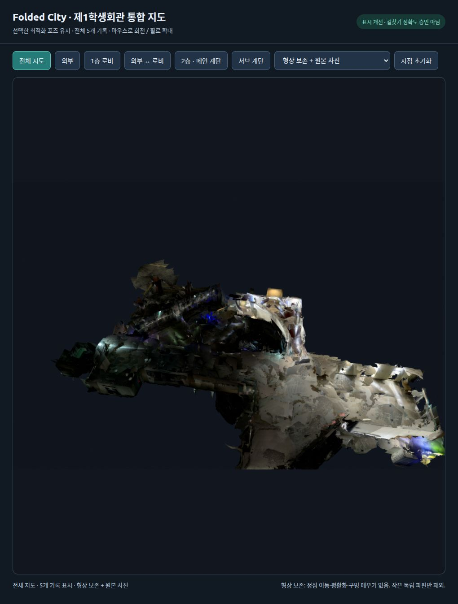

# 최적화 이후 깊이 지표가 달라진 이유와 전체 지도 표시

## 깊이 지표의 정의

렌더의 첫 교차 깊이와 센서 깊이의 차이는 포즈 정합 오차와 다른 지표다.
모든 실험에서 `config/current_map.json`의 선택과 world pose는 그대로다.

측정했던 값은 같은 카메라 ray에서 처음 만나는 메시 면의 camera-Z와 원본 센서
depth의 차이다. 다음 경우 최적화 pose가 고정되어 있어도 값은 변한다.

1. Poisson은 단순 색칠이 아니라 새 표면을 추정한다. 면과 모서리 형상이 달라진다.
2. 구멍을 잇거나 앞쪽 면을 지우면 ray가 다른 면을 먼저 만난다. 몇 cm의 국소
   표면 변경으로도 구멍 뒤 몇 m 떨어진 면이 나타나 큰 ray-depth 차이가 날 수 있다.
3. 이전/이후 hit 픽셀 집합이 다르면 서로 다른 모집단의 중앙값을 비교하게 된다.
4. RGB 텍스처만 바꾸는 경우는 정점/면 깊이를 바꾸지 않는다.

Poisson의 새 표면 추정과 외삽 문제는
[Open3D 공식 재구성 문서](https://www.open3d.org/docs/release/tutorial/geometry/surface_reconstruction.html),
ray/표면 거리의 의미는
[Open3D distance queries](https://www.open3d.org/docs/release/tutorial/geometry/distance_queries.html)를 참고했다.
이 원리와 이번 데이터에서 실제 확인한 수치는 구분한다.

## 동일 픽셀 재검사

`src/audit_display_depth.py`에서 이전/이후 모두 hit한 픽셀, 새로 hit한 픽셀,
사라진 hit를 나눴다. 원본 DB는 읽기 전용이다.

| 기록·시점 | 전체 hit 각각의 중앙값 이전→Poisson(cm) | 동일 hit 픽셀 중앙값 이전→Poisson(cm) |
|---|---:|---:|
| 외부 264 | 16.05→13.16 | 16.07→12.86 |
| 로비 38 | 30.22→22.67 | 30.13→21.61 |
| 외부 브리지 81 | 5.97→5.41 | 5.21→5.50 |
| 2층 1054 | 57.34→61.16 | **56.62→61.81** |
| 서브 계단 157 | 15.20→9.95 | 15.20→10.48 |

따라서 2층 악화를 픽셀 집합 변화만으로 설명할 수는 없다. 2층 동일 픽셀의
이전/Poisson 표시 깊이 변화 중앙값은 7.79cm, P90은 225.13cm였다.
이 P90은 정점이 225cm 이동했다는 뜻이 아니라, ray가 다른 전경/배경 면으로
바뀐 영향까지 포함한다. 이것만으로 원래 pose 정확도나 원본 지도의 절대 오차를
측정한 것은 아니다. 보고서의 기존 동일 벽 간격/pose residual과 다른 지표다.

## 시험했지만 기본 표시로 채택하지 않은 방법

`src/build_fidelity_display.py`로 Poisson과 원래 전체 3cm TSDF를 14개 고정
카메라에서 대조했다. 새 전경 면을 제외하고 빠진 원래 face를 3회 복원한 뒤
별도 6개 시점으로 검사했다. 다섯 기록의 산출물은
`outputs/student_union_fidelity_display_v1/`에 보존했다.

특정 카메라에서는 원본 표면과 가까워졌지만 보지 않은 시점에서 일관성이 부족했다.
2층에서는 성분이 100,513개까지 늘었다. 픽셀에서 보이는 원래 삼각형만 복원하면
고밀도 메시의 연결 patch가 아니라 고립된 face가 남는 문제가 있었다.
2층 검사 시점 933에서 원래 3cm 표면 대비 깊이 차 중앙값 8.09cm/P90 90.66cm도
남았다. **이 후보를 “해결책”으로 포장하거나 전체 기본 표시로 채택하지 않았다.**

## 전체 지도에 적용한 보수적 기본 표시

추정 면을 더 만드는 방식 대신 이미 생성되어 있던 **전체 해상도 5cm TSDF**를
표시 기준으로 정했다. `src/build_geometry_preserving_display.py`로 다섯 기록 모두에
같은 정책을 적용했다.

- 면적 0.005m² 미만 독립 성분만 표시본에서 제외한다.
- 남긴 모든 삼각형의 세 꼭짓점 좌표가 원래 5cm TSDF와 **배열 단위로 정확히
  동일함**을 unused vertex 제거 전후 각각 검사했다.
- 정점 이동·평활화·Poisson·구멍 메우기·표시 면 수 축약을 하지 않았다.
- 원본 RGB를 깊이 검사 후 UV로 입혔다. 사진 목록/원본 해상도와 atlas 정책은 이전과 같다.
- 기존 최적화 포즈/DB/점군 및 이전 후보를 유지했다. `config/current_display.json`만
  별도 표시 선택을 가리킨다. `config/current_map.json`은 바꾸지 않았다.

| 기록 | 기준 전체 5cm 성분 | 표시 후 성분 | 표시 삼각형 |
|---|---:|---:|---:|
| 외부 | 1,996 | 577 | 526,730 |
| 로비 | 4,754 | 1,269 | 1,626,810 |
| 외부 브리지 | 534 | 126 | 194,105 |
| 2층·메인 계단 | 6,849 | 1,920 | 1,950,311 |
| 서브 계단 | 882 | 218 | 351,131 |

전체 4,649,087삼각형이다. 위 “기준”은 원래 전체 5cm TSDF다. 이전의
3cm/18만 면 표시와 같은 baseline이 아니므로 조각 수를 직접 빼서 개선량을
주장하지 않는다. 두 표시 사이에는 voxel·면 수 제한·작은 성분 제거가 함께 다르다.

12개 source/audit/계단 시점에서 **원래 전체 5cm TSDF 대비** 표시 깊이 변화의
중앙값과 P90이 모두 0m였다. 모든 픽셀이 0변화라는 뜻은 아니다. 아주 작은
전경 성분을 삭제한 픽셀은 뒤쪽 면을 볼 수 있다. 원본 센서와의 오차도 0이 아니다.
예를 들어 2층 1054번 원본 센서 대비 중앙값은 53.46→53.69cm다.
이 값은 기존 지도/센서 불일치를 포함하며 이번 표시 단계에서 다시 피팅하지 않았다.

**남은 한계:** 원래 표면의 큰 구멍·거친 깊이·잘못 겹친 벽은 남는다. 작은 독립
문패 같은 실제 물체를 제외할 가능성도 있어 원본은 유지했다. Poisson보다
매끈하지 않지만 형상을 임의로 더 바꾸지 않는 기본 보기다. 따라서 **파편화의
완전한 해결은 아니며**, 원래 표면을 보존하는 표시와 더 매끈한 추정 후보를
전체 지도에서 표현을 비교할 수 있다.

## 실제로 연 전체 지도

앱 내 브라우저에 [로컬 통합 지도](http://127.0.0.1:8766/)를 열고 실제 렌더 화면과
“전체 지도 · 5개 기록 표시”를 확인했다. native 앱 자동화는 사용할 수 없어, 같은
Open3D 렌더러를 loopback 전용 서버에서 실행하고 브라우저로 조작하게 했다.
화면은 합성 그림이 아니라 실제 GLB/점군이다. 외부 서비스에 업로드하지 않았다.



기록별 보기, 드래그 회전, 휠 확대, 시점 초기화, 다음 4개 표시를 전환한다.

1. 형상 보존 + 원본 사진: 현재 기본.
2. 이전 18만 면 표시.
3. Poisson 연속 표면: 형상 변화가 있는 비교 후보.
4. 선택한 원본 점군.

서버가 종료되면 프로젝트 루트에서 `bash scripts/view_display_map.sh`로 다시 실행한다.
이 명령은 127.0.0.1:8766에만 bind한다. `--check-only`로 지도/표시 버전과 해시를
확인할 수 있다. 네이티브 비교 창도 다음으로 실행할 수 있다.

```bash
bash scripts/view_surface_portfolio.sh \
  --preserved outputs/student_union_preserved_display_v1 \
  --continuity outputs/student_union_surface_continuity_v1
```

## 동일 카메라 비교 자료와 검증

- [외부](../assets/preserved-display-review/outside/source_photo.png)
- [로비](../assets/preserved-display-review/lobby/source_photo.png)
- [외부 브리지](../assets/preserved-display-review/bridge_out1f/source_photo.png)
- [2층](../assets/preserved-display-review/floor2/source_photo.png),
  [메인 계단 회색 재질](../assets/preserved-display-review/floor2/stairs_geometry.png)
- [서브 계단](../assets/preserved-display-review/bridge_12_sub/source_photo.png),
  [계단 주변 회색 재질](../assets/preserved-display-review/bridge_12_sub/stairs_geometry.png)
- [25개 사진·실행 수치·동일 픽셀 분석·출처](../assets/preserved-display-review/manifest.json)

사진 비교 순서는 원본 RGB → 이전 표시 → Poisson → 형상 보존이다. 회색 재질은
후보 3개를 같은 조명/보정 카메라로 비교한다. 이 사진들은 같은 촬영의 반복 관측이며
측량/새 센서 검증은 아니다. `src/render_preserved_display.py`에 재현 절차가 있다.

산출물은 `outputs/student_union_preserved_display_v1/<session>/preserved_textured.glb`
및 `preserved_geometry.ply`이며 입력 불변·파일 해시와 남긴 삼각형 좌표를 검사했다.
현재 표시 manifest SHA-256:
`5c03b90ad58d485e7c0519d6abdc6c0414054f22da1cfe30e9987c4fb659ca74`.
단위 테스트 **385 passed**, 원본 지도/DB 유지.
