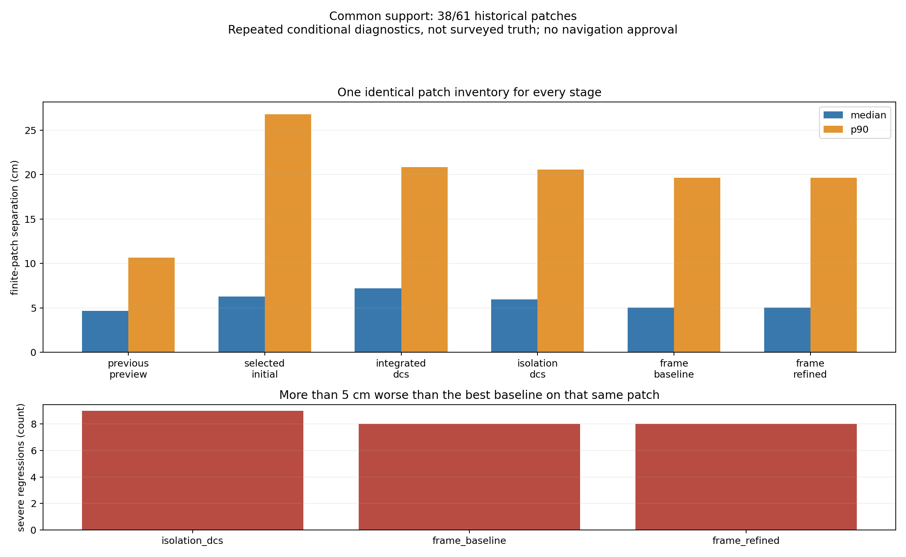
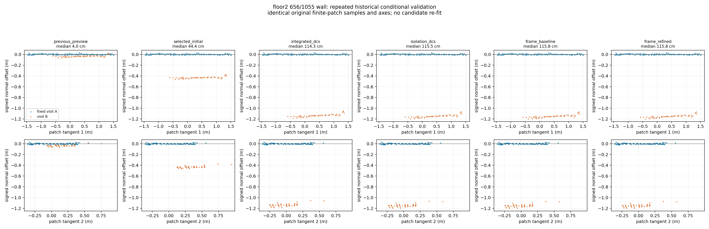
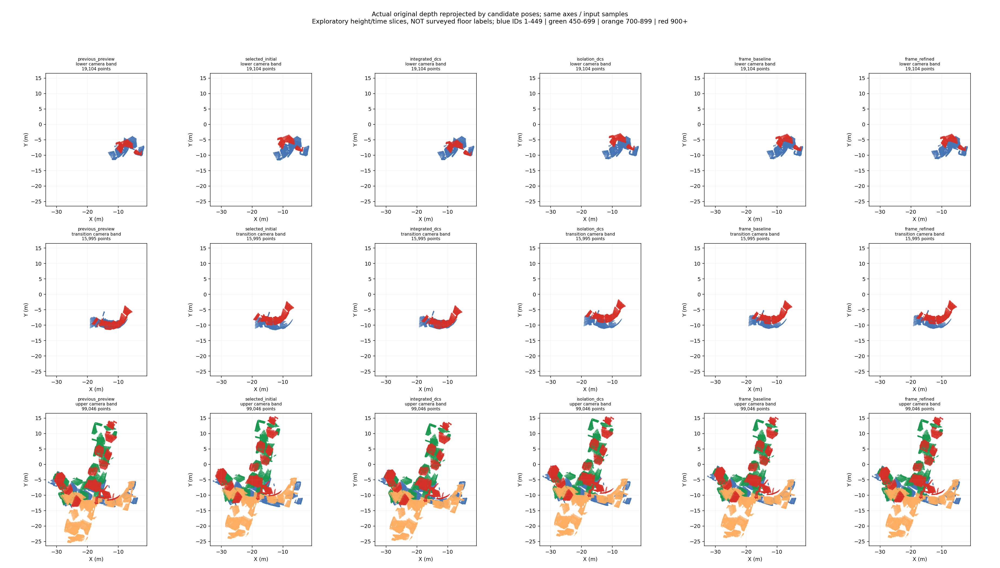
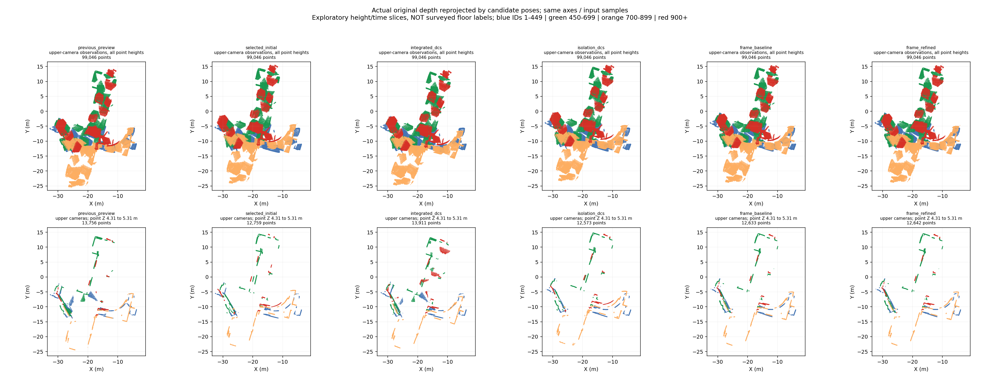
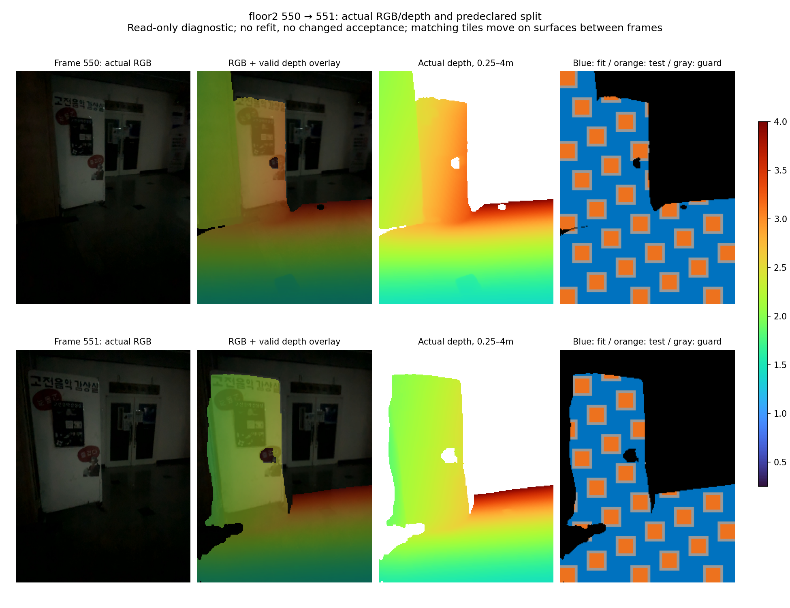

# 2층 분리·프레임 단위 국소 최적화 실험

실행일: 2026-10-17. 대상 원본: `261017-013501-2f.db`.
이 문서는 [직전 서브맵 실험](2026-10-17-submap-robust-optimization.md)에 이어,
2층 중복 벽을 대상으로 수행한 추가 실험을 기록한다.

실험 루트는 `outputs/student_union_20261017_floor2_local_v1/`이며 이하 `R`로 표기한다.
원본 DB와 이전 결과를 덮어쓰지 않고 모든 후보를 새 디렉터리에 저장한다.
**최적화 성공, 관측 간 일관성 개선, 지도 정확도 승인, RViz 교체는 서로 다른 판정이다.**

## 1. 범위와 동결한 기준

- 다른 네 세션의 포즈는 변경하지 않는다. 2층 촬영 DB에는 1층 일부와 메인 계단도
  들어 있으므로 DB 이름을 모든 프레임의 층 라벨로 간주하지 않는다.
- 초기 화면의 빨간 영역은 여러 높이·촬영 시점을 투영한 모습이다. 단일 XY
  그림만으로 서로 다른 층의 벽과 같은 층의 중복 벽을 모두 구분할 수 없다.
  시각화는 고정된 초기 포즈의 카메라 높이·시간 구간별로 나누며, 이는 측량된 층
  라벨이 아니다. 아래 프레임 번호도 초기 표시 영역과 동일하다고 단정하지 않는다.
- 기준은 이전 RViz 미리보기 포즈(`previous_preview`), 동결된 앱 기반 초기값
  (`selected_initial`), 직전 통합 DCS 후보(`integrated_dcs`) 세 가지다.
- 기존 품질 판정: 1,218프레임 중 A 815/B 110/C 293, 23개 run, 26개 hard boundary.
  초기 CSV에 없는 495/496/497은 모두 C이고 포즈를 만들어 채우지 않는다.
- 지면을 하나의 높이로 펴거나 중복 벽을 삭제하지 않는다. 전체 고정 높이 제약,
  새 교차 세션 제약, 깊이 스케일 보정, 카메라 내부 보정 변경은 사용하지 않는다.
- 원본을 SQLite `mode=ro`로 열고 SHA-256을 비교한다. 원본 SHA-256은
  `bd15632bad4bc253461b6ce2dc0c4304d3024785983dddbc968bdb83e48f9c6e`다.
- 기존 `config/folded_city.rviz`와 기본 지도는 유지한다.

## 2. 실험 A — 다른 세션 제약만 제거

`src/isolate_floor2_graph.py`는 직전 v7 그래프에서 2층의 노드, 초기 포즈,
내부 측정, 공분산, train/heldout 역할을 그대로 보존한다.
제거한 교차 제약은 로비112→2층14, 로비317→2층1215,
로비337→2층66의 학습 제약과 로비327→2층51의 예약 제약, 총 4개다.

남은 그래프는 227개 anchor, 251개 제약, 1개 연결 성분이다.
204개 odometry, 22개 structural continuity, 19개 학습 루프,
6개 예약 루프로 이루어지며 예약 루프는 목적함수에 넣지 않는다.
첫 anchor를 고정해 gauge 자유도를 제거한다.

알고리즘은 기존 SE(3) pose graph + DCS 정보 가중치 + 구역별 정보량 평균화다.
SciPy sparse TRF/LSMR 내부 해법을 사용하고, DCS phi=5.991,
외부 IRLS 최대 16회, 각 내부 최대 300평가로 실행했다.
기존 품질 run 안에서만 보정 포즈를 확장하고 A/B 925프레임을 내보냈다.

모든 내부 solve는 성공을 보고했고 총 152회 평가했다. 다만 마지막 외부
파라미터 변화는 `2.31e-5`로 외부 중단 기준 `1e-7`을 만족하지 않았다.
이를 전체 알고리즘의 엄격한 수렴 완료로 쓰지 않는다.

내부 상대측정 잔차는 다음과 같았다. **아래는 벽 간격이 아니라 edge 잔차다.**

| 프레임 관계 | 통합 DCS | 2층 분리 DCS |
|---|---:|---:|
| 642↔1031 | 1.4193m | 1.4196m |
| 656↔1055 | 1.1757m | 1.1725m |
| 834↔897 | 0.1609m | 0.1610m |

교차 세션 제약만 제거해도 큰 불일치가 남는다. 따라서 다른 층의 배치만이
문제의 유일한 원인은 아니며, 2층 내부 측정·연속 포즈와 그 반영 강도를
함께 살펴야 한다. 이 결과가 개별 루프의 옳고 그름을 단독으로 확정하지는 않는다.

기록: `R/isolation_graph`, `R/isolation_optimization`, `R/isolation_expanded`.

## 3. 실험 B — 모듈 안의 원본 RGB-D 재측정

재현 코드: `src/remeasure_floor2_local.py`.
기존 점군을 통째로 ICP 변환하지 않고 DB에서 개별 RGB/depth/confidence/calibration을
읽어 프레임 간 상대 변환을 다시 측정했다.

### 후보와 학습/검증 분리

- 250–1100번 중 A/B만 사용하며 모든 중간 프레임도 같은 quality run에 있어야 한다.
  hard boundary, C 프레임, 서로 다른 모듈을 넘지 않는다.
- 시간 간격 최대 5.5초, 프레임 간격 1/3/5, 초기 상대 이동 최대 1.5m/40°.
  적격 361쌍에서 결정적 표본 160쌍을 선택했다. 전체 재방문 루프 재측정이 아니다.
- 기존 예약 14쌍의 양 끝점 주변 ±10프레임을 후보에서 제외했다.
  제외 목록은 `R/remeasurements/selection.json`과 report에 남아 있다.
- depth를 16px 타일, modulus 5로 나눠 별도 검증 타일을 두고,
  훈련점에는 검증 타일 주변 3px 여유 영역도 제외했다.
  이는 같은 프레임 내 공간 분리이지 새로운 센서나 독립 촬영 검증은 아니다.
- depth 0.25–4m, confidence≥50, pixel stride 2, voxel 6cm.

### 실제 사용한 정합 알고리즘과 채택 기준

1. RootSIFT + 양방향 ratio 0.75 매칭. 깊이가 있는 대응을 3D로 역투영한다.
2. 3D RANSAC 900회, inlier 8cm, 최소 12대응/합의율 50%.
   초기 포즈 대비 25cm/5° 이내인 시각 seed만 허용한다.
   부족하면 기존 상대 포즈에서 시작하며, 이 경우 시각 대응 검증을 통과했다고 쓰지 않는다.
3. PCA 법선 기반 Cauchy point-to-plane ICP를 최대 35회 적용한다.
   깊이 기하 Hessian rank 6, 최소/최대 고유값 비율 `1e-4` 이상을 요구한다.
4. 훈련 overlap≥0.45, inlier NN RMSE≤7cm,
   clipped RMSE 최소 0.5mm 개선, 보정량≤15cm/3°를 요구한다.
5. 역방향 ICP의 cycle 오차≤3cm/1°를 요구한다.
   역방향은 전방 결과의 역변환으로 초기화하므로 독립 정합 검증이 아닌 국소 일관성 검사다.
6. 학습값만으로 채택 결과를 고정한 뒤 검증 타일의 수치를 계산한다.
   검증 결과를 보고 임계값을 완화하거나 채택 목록을 바꾸지 않았다.

160쌍 중 3쌍만 위 기준을 통과했다. **새로운 루프 클로저가 아니라 시간적으로
가까운 프레임의 약한 보조 제약**이다. 이 3쌍 모두 충분한 RGB-D 특징 합의는 없었다.

| 쌍 | run / source submap | 보정 이동 / 회전 | 검증 clipped RMSE 전→후 |
|---|---|---:|---:|
| 351→352 | 006 / 0063 | 3.94cm / 1.73° | 10.64→10.95cm |
| 352→353 | 006 / 0063 | 7.04cm / 1.21° | 15.48→14.49cm |
| 582→583 | 009 / 0102 | 4.01cm / 1.90° | 12.58→13.06cm |

검증 지표는 2쌍에서 조금 악화한다. 통과 수 자체를 지도 개선으로 해석하지 않는다.
가중치는 Hessian 역행렬을 센서의 참 공분산으로 사용하지 않고,
이동 σ=10cm/회전 σ=3°의 보수적 모델로 둔다.
같은 source submap의 앞 두 제약은 정보량을 평균해 중복 투표를 줄인다.
이는 센서·odometry 간 통계적 상관을 완전히 제거하는 방법은 아니다.

### 좌표계 및 평가 지표 감사

재현 코드: `src/audit_floor2_local_remeasurement.py`.
최종 감사: `R/remeasurement_audit_v2/report.json`.
앞선 `remeasurement_audit`도 덮어쓰지 않고 보존했다.

RGB는 너비×높이 720×960, depth 192×256이고 보정값의 이미지 크기와 일치한다.
광학→노드 변환과 역투영 후 별도 재투영을 검사했으며 수치 왕복 오차 최대
`1.14e-13px`였다. 이는 구현의 산술 일관성 검사이지 외부 보정 정확도의 측량 검증은 아니다.
cycle 방향 `T_a_b @ T_b_a`도 정상이며 채택 3쌍의 검증값은 모두 유한했다.

중요한 한계: 타일로 훈련점을 뽑으면 서로 다른 실제 표면에 구멍이 생겨
유클리드 최근접점 RMSE가 커질 수 있다. **160개 추정 변환을 변경하지 않고**
표본만 달리해 평가한 결과다. 전체 깊이 점군은 훈련점을 포함하므로 독립 검증이 아니다.

| 평가 표본 | NN inlier RMSE 중앙값 | 7cm 초과 |
|---|---:|---:|
| 분리된 훈련 타일 | 8.18cm | 144/160 |
| 전체 깊이 점군 | 6.32cm | 50/160 |

94쌍은 표본만으로 이 기준을 넘나든다. 따라서 거절 144쌍을 144개의 실제
센서 정합 실패로 설명하면 안 된다. 550→551은 point-to-plane 절대거리 중앙값
7.13mm지만 NN RMSE 7.60cm, 역방향 cycle 이동 6.25cm였다.
최적화 목적과 안전 판정 지표가 다르다. 실제 RGB는 어둡고 depth 공백이 있으며,
이 쌍의 유효 3D 시각 대응은 분리 전 39개에서 엄격한 훈련 분리 후 7개로 줄었다.
이번 후보와 채택 기준은 동결하고 이 한계를 별도 기록했다.

## 4. 실험 C — 프레임 단위 PGO와 보조 제약 대조

재현 코드: `src/optimize_floor2_frames.py`.
기존 227개 anchor 사이의 보정을 보간하는 대신 초기 포즈가 존재하는
1,215개 프레임 각각을 SE(3) 변수로 둔다. 첫 프레임을 고정하고 다른 세션은
포함하지 않는다. 이는 **프레임 pose graph이며 bundle adjustment가 아니다.**
영상 landmark, 카메라 intrinsic, depth scale을 함께 추정하지 않는다.

비교 그래프는 두 개다.

| 설정 | 공통 제약 | 추가 제약 |
|---|---|---|
| `frame_baseline` | native odometry 1,214 + 기존 loop 25 | 없음 |
| `frame_refined` | 위와 완전히 동일 | 국소 registration 3 |

기존 1,239개 제약과 모든 초기 노드가 완전히 동일한 것을 검사했다.
두 그래프 모두 연결 성분 1개다. loop 25개는 학습 19개/예약 6개 역할을 유지한다.

### 측정·공분산·강건화

- native 프레임 odometry는 공분산에 동결된 canonical odometry noise floor와
  `(0.5 × native/selected 불일치)^2`를 대각 성분으로 더한다.
  noise floor는 이동 각 축 1cm, 회전 각 축 0.2°다.
  이는 데이터 의존 모델 선택이며 교정된 센서 불확실성이 아니다.
- hard boundary를 넘거나 C를 포함하는 441개 연속 제약은 공분산을 25배로 키우고
  강건화 가능한 `structural`로 분류한다. 나머지 773개 odometry는 강건 정보 가중치 1이다.
  441개 중 C만 포함 417개, 경계+C 23개, 경계만 1개다. 이를 모두 제거하면
  그래프는 429성분으로 나뉘며, 239개는 graph bridge여서 작은 잔차로 그 타당성을
  독립 검증할 수 없다. **완전히 독립인 모듈들을 새 근거만으로 연결한 것이 아니라,
  약화한 기존 연속성 가정을 유지한 프레임 PGO**라는 한계가 있다.
- 기존 anchor loop를 원래 프레임으로 정확하게 역변환한다.
  `M_root = L_a M_frame inv(L_b)`이므로
  `M_frame = inv(L_a) M_root L_b`이고,
  공분산은 `Ad(inv(L_b)) C_root Ad(inv(L_b))ᵀ`로 옮긴다.
  기존 품질 불확실성 증가와 train/heldout 역할을 유지한다.
  실제 25개 왕복 최대 오차는 변환 `7.1e-15`, 공분산 `2.13e-14`였다.
- 새 제약은 `registration`으로 구분하고 Huber 정보 가중치를 적용한다.
  heldout, 이웃 ±10프레임, C, run 경계, 중복·자기 연결 진입을 차단한다.
  현재 canonical heldout 6개는 native heldout 8개의 부분집합이다.
  향후 다른 canonical heldout을 추가하면 예약 목록도 합집합으로 확장해야 한다.
- Huber delta=3, 구역별 정보량 평균화, 외부 IRLS 최대 8회,
  내부 sparse TRF/LSMR 최대 200평가, 초기값 기준 성분별 이동±5m/회전벡터±20°.
  3축 회전 성분 경계이므로 전체 회전각 20° 제한과는 다르다.
- solve 전 입력·코드 snapshot과 SHA-256을 저장하고 종료 후 동일 여부를 검사한다.

isolation과 frame 방식은 변수 수뿐 아니라 연속 제약 불확실성 모델도 달라진다.
따라서 **3개 재측정의 효과만 분리하는 올바른 대조는 frame_baseline↔frame_refined**다.
isolation↔frame 차이를 모두 새 정합 알고리즘의 효과로 돌리지 않는다.

## 5. 평가 원칙

재현 코드: `src/evaluate_floor2_local.py`.

- 기존 동일 61개 유한 벽/수평 패치의 관측 점을 재현한다. 후보에 유리하게 새 평면을
  추출하거나 대응을 재선택하지 않는다. 원본 기준 재현 오차도 검사한다.
- 각 후보의 가용 패치 수와 누락 ID를 기록한다. 모든 기준/후보에 공통으로 있는
  교집합 지표와 각 후보의 전체 가용 지표를 구분한다. 누락은 개선으로 세지 않는다.
- 전후 비교는 같은 RGB-D 프레임, 같은 축, 같은 표본을 사용한다.
  화면의 전역 gauge만 공통 첫 프레임에서 강체 정렬한다. 표면에 맞춰 ICP로
  시각화용 재정합하지 않는다. 상대 패치 거리에는 화면 정렬을 쓰지 않는다.
- 5cm 초과 회귀를 세고, 중앙값과 별도로 주요 벽 및 계단의 악화를 기록한다.
- 기존 heldout도 여러 실험에서 반복해서 봤으므로 새로운 독립 검증이라고 하지 않는다.
  그래프에 안 넣은 관계여도 같은 프레임/odometry를 공유한다.
- 패치 평면 간격은 관측 간 일관성이지 실측 위치·문폭·바닥 높이 정확도가 아니다.
  평면에 평행한 미끄러짐은 이 값만으로 드러나지 않을 수 있어 법선 각도와
  유한 패치의 20cm 이내 점 비율도 `patch_metrics.csv`에 함께 저장한다.
  궤적의 카메라 z는 카메라 이동과 자세를 포함하며 계단 실측 높이와 같지 않다.

## 6. 실행 결과 및 시각자료

**이번 후보는 채택하지 않았다.** 분리 그래프, 국소 재측정, 프레임별 후보 계산,
점군 재생성, 조건부 평가와 사진 저장은 실행했다. 그러나 큰 중복 벽은 남고,
프레임 solve도 엄격한 수렴에 이르지 않았다. 지도 정합 문제 해결은 미완료다.

### 수치 해법 종료 상태

| 후보 | 내부 평가 횟수 | 마지막 비용 | 마지막 최대 파라미터 변화 | 종료 |
|---|---:|---:|---:|---|
| frame_baseline | 8×200=1,600 | 2.899347 | 0.027626 | 모든 내부 풀이 평가 한도 |
| frame_refined | 8×200=1,600 | 3.444558 | 0.028388 | 모든 내부 풀이 평가 한도 |

두 후보 모두 active bound 0개, 마지막 강건 가중치 변화 0이다.
파라미터 변화는 이동(m)·회전벡터(rad) 성분을 함께 센 최댓값이다.
종료 상태는 `success=false`이며 이 포즈는 **반복 한도 시점의 중간 후보**다.
두 그래프는 추가 제약 수가 다르므로 목적함수 비용을 직접 비교해 더 좋은
지도라고 결론내리지 않는다. 아직 더 계산하면 무엇이 바뀔지 검증하지 않았다.
따라서 큰 오차의 원인이 전부 측정에 있고 해법 수렴은 무관하다고 단정하지 않는다.

### 모든 단계의 동일 38개 패치 교집합

61개 중 분리/통합 A/B 후보에서도 관측할 수 있는 공통 38개만 비교한 표다.
23개 누락은 별도로 기록하고 개선으로 계산하지 않는다.

| 단계 | 간격 중앙값 | P90 | 최대 |
|---|---:|---:|---:|
| 이전 RViz 미리보기 | 4.67cm | 10.65cm | 23.28cm |
| 선택 초기 포즈 | 6.30cm | 26.82cm | 100.47cm |
| 직전 통합 DCS | 7.20cm | 20.85cm | 114.34cm |
| 2층 분리 DCS | 5.97cm | 20.59cm | 115.54cm |
| 프레임 PGO | 5.05cm | 19.65cm | 115.80cm |
| 프레임 PGO + 국소 제약 3개 | 5.04cm | 19.65cm | 115.80cm |

현재 후보끼리는 일부 개선했지만 **이전 RViz의 동일 관측보다 여전히 나쁘다.**
프레임+재측정 후보는 공통 38개 중 8개에서 각 패치의 가장 좋은 기준보다 5cm
이상 악화한다. 새 제약 3개의 효과는 작고, 이것만으로 재방문 누적 오차가
수정됐다는 근거는 얻지 못했다.

프레임 후보에는 C 포즈도 존재하므로 전체 61개 패치를 평가할 수 있다.
그 별도 결과는 중앙값 6.72cm, P90 19.06cm, 최대 115.80cm,
가용 기준 중 최선 대비 5cm 초과 회귀 15/61이다. 이 숫자를 위 38개 표와
서로 다른 표본인 채로 직접 비교하지 않는다. C 포즈는 아래 밀집 점군에서 제외한다.

### 중요한 벽·수평면을 개별 확인

| 고정 관측 | 이전 미리보기 | 분리 DCS | 프레임 PGO | +국소 제약 |
|---|---:|---:|---:|---:|
| 656↔1055 벽 | 4.05cm | 115.54cm | 115.80cm | 115.80cm |
| 548↔981 벽 | 23.28cm | 34.11cm | 28.71cm | 28.72cm |
| 644↔1035 벽 | 3.61cm | 2.53cm | 8.77cm | 8.77cm |
| 503↔961 수평면 | 36.61cm | 누락 | 11.29cm | 11.90cm |
| 608↔1023 수평면 | 10.65cm | 누락 | 16.92cm | 16.93cm |
| 608↔1023 벽 | 18.64cm | 누락 | 9.59cm | 9.59cm |

656↔1055 벽은 새 후보에서 법선 차이 3.72°, 유한 패치의 20cm 이내 비율 0이다.
그 이전 미리보기는 각각 1.63°, 비율 1이었다. 평면 중앙값 하나만의 착시로
새 후보가 좋다고 결론내릴 상황이 아니다. 모든 수평면을 바닥이라고 단정하지
않았으며 계단의 실측 층고·단높이 평가는 아직 완료하지 못했다.

### 재생성 점군과 실제 사진

세 점군 모두 동일 A/B 925프레임, frame/pixel stride 1, depth 0.25–4m,
confidence≥50, voxel 5cm, batch 20으로 생성했다. 925프레임 모두 깊이를
제공했고 생략 DB 프레임 293개의 ID를 기록했다. confidence 누락 fallback은 0개다.
내보내는 과정에서 추가 ICP·평면화·합성 점 삽입은 하지 않았다.

| 후보 | PLY 점 수 | 파일 (`R/` 아래) |
|---|---:|---|
| 2층 분리 | 2,424,109 | `clouds/isolation/floor2.ply` |
| 프레임 PGO | 2,259,780 | `clouds/frame_baseline/floor2.ply` |
| 프레임+재측정 | 2,263,599 | `clouds/frame_refined/floor2.ply` |

점 수 감소가 정확도 개선을 의미하지 않는다. 복셀에 들어가는 관측이 달라지면
같은 입력에서도 점 수가 바뀐다. 최종 인계 때 DB, 포즈, 실행 소스, 출력 파일,
RViz 해시를 다시 비교했고 모두 일치했다. 기본 RViz는 바꾸지 않았다.

평가 그림 13장은 `R/final_evaluation/figures/`에 있다. 평가 출력은 완료 후
`full_evaluation`에서 `final_evaluation`으로 옮겼으며 원래 명령과
`relocation.json`을 보존했다. 아래 출판본은 평가·감사의 실제 PNG 11장,
총 5.09MiB이고 원본과 RGBA 픽셀 동일성을 검사했다.
출처·캡션·해시: [시각자료 manifest](../assets/floor2-local-review/manifest.json).











XY 그림은 모든 단계에 공통인 150프레임/134,145개 깊이 샘플을 사용하는
진단용 얇은 뷰다. 전체 925프레임 PLY의 점밀도나 지도 완전성을 나타내지 않는다.
원본 RGB 모음, 카메라 높이, 다른 벽, 거절한 정합 전후 사진도 같은 폴더에 있다.

최종 검증: `python3 -m pytest -q` **301 passed in 4.91s**,
`git diff --check` 통과, README/본 문서의 로컬 링크 누락 0개,
출판 사진 11개와 원본의 RGBA 픽셀 동일성 재확인 완료.

### 남은 작업과 이번 결과의 해석

1. 프레임 풀이의 미수렴과 약한 모듈 경계의 관측성을 분리해서 확인해야 한다.
   벡터화 해법은 보조 시험만 했고 긴 수렴 실행/중간 포즈 비교는 아직 하지 않았다.
2. 큰 오차가 있는 서로 다른 방문 사이에는 새로 채택한 제약이 없다.
   이번 3개 시간 인접 제약을 공간적으로 분산된 재방문 기준점으로 세면 안 된다.
3. 깊이 타일 공백에 민감한 NN 판정은 진단되었지만 새로운 평가 규칙을 설계하고
   독립 표본에 검증하는 일은 남았다. 이번 결과를 보고 기존 기준만 완화하지 않았다.
4. 모듈 간 실제 공통 구조물/코너 대응, 여러 프레임을 함께 사용하는 재측정,
   약한 경계 민감도, 실제 층·계단 구분과 실측 대조가 추가로 필요하다.
   충분한 근거 없이 전체 지도를 연결하거나 현재 후보를 배포하지 않는다.

## 7. 재현 명령과 파일 연결

아래는 이 실험의 경로와 설정이다. **기존 출력이 있으면 의도적으로 실패**하므로
재실행할 때는 새 run 디렉터리와 그에 맞는 입력/출력 옵션을 사용한다.
이전 실행 당시 코드가 필요하면 각 출력의 `source_snapshot` 또는 `source_*.py`를
확인한다. 실행 중 파일을 수정하면 해시 검사가 실패한다.

```bash
task_run=outputs/student_union_20261017_floor2_local_v1

python3 src/isolate_floor2_graph.py \
  --manifest outputs/student_union_20261017_submap_robust/graph_input_v7/manifest.json \
  --output "$task_run/isolation_graph"

OPENBLAS_NUM_THREADS=1 OMP_NUM_THREADS=1 MKL_NUM_THREADS=1 \
python3 src/optimize_robust_submaps.py \
  --manifest "$task_run/isolation_graph/manifest.json" \
  --output "$task_run/isolation_optimization" --methods dcs \
  --outer-iterations 16 --max-evaluations 300 --skip-leave-one-group

python3 src/expand_submap_poses.py \
  --quality-root "$task_run/isolation_graph/quality_view" \
  --graph-manifest "$task_run/isolation_graph/manifest.json" \
  --backend-report "$task_run/isolation_optimization/report.json" \
  --variants dcs --output "$task_run/isolation_expanded"

python3 src/remeasure_floor2_local.py --output "$task_run/remeasurements"
python3 src/audit_floor2_local_remeasurement.py \
  --report "$task_run/remeasurements/report.json" \
  --output "$task_run/remeasurement_audit_v2"

OPENBLAS_NUM_THREADS=1 OMP_NUM_THREADS=1 MKL_NUM_THREADS=1 \
python3 -u src/optimize_floor2_frames.py \
  --output "$task_run/frame_baseline" --outer-iterations 8 --max-evaluations 200

OPENBLAS_NUM_THREADS=1 OMP_NUM_THREADS=1 MKL_NUM_THREADS=1 \
python3 -u src/optimize_floor2_frames.py \
  --output "$task_run/frame_refined" \
  --remeasurements "$task_run/remeasurements/report.json" \
  --outer-iterations 8 --max-evaluations 200

python3 src/evaluate_floor2_local.py \
  --trajectory isolation_dcs "$task_run/isolation_expanded/dcs/floor2/trajectory.csv" \
  --trajectory frame_baseline "$task_run/frame_baseline/trajectory.csv" \
  --trajectory frame_refined "$task_run/frame_refined/trajectory.csv" \
  --graph-manifest "$task_run/frame_refined/manifest.json" \
  --output "$task_run/final_evaluation"

python3 src/export_floor2_local_clouds.py --variant isolation
python3 src/export_floor2_local_clouds.py --variant frame_baseline
python3 src/export_floor2_local_clouds.py --variant frame_refined
python3 src/export_floor2_local_clouds.py --finalize
python3 src/publish_floor2_local_evidence.py
python3 src/summarize_floor2_local.py
python3 -m pytest -q
```

그래프 단계, 재측정, 원본 감사, 평가와 export의 각 `report.json`/`manifest.json`에
입력 해시와 설정을 남긴다. `handoff_audit/report.json`은 공유 제약 동일성,
graph→solver→전체/AB trajectory 연결, 평가에 사용한 포즈, 실제 PLY와
최종 시점의 DB·입력 소스·RViz 해시를 다시 검사하는 인계 기록이다.

학습 중 관측하지 않은 실측 자료가 없기 때문에 이 기록이나 테스트 통과가
내비게이션용 지도의 정확도 승인을 대신하지 않는다.

## 8. 계산 성능 보조 실험 — 지도 후보 선택과 별개

1,215개 프레임 풀이가 오래 걸려 별도의 `src/floor2_vectorized_solver.py`를
구현하고 기존 실행 파일·프로세스는 그대로 유지했다. 회전 보정, 상대 포즈,
측정 오차, whitening을 배치 행렬 연산하고 동일 SciPy TRF/LSMR 설정을 사용한다.
알고리즘이나 측정 가중치를 바꾸는 기법이 아니라 같은 잔차 계산의 벡터화다.

실제 프레임 그래프에서 무작위 잔차와 평가 10회 후 파라미터·비용의 최대 차이는
0이었다. 별도 테스트 16개로 영각·π 인근 회전, 비대각 정보행렬, 작은 합성
그래프 해법도 확인했다. 해당 합성 테스트는 센서 사진이나 지도 결과가 아니다.

| 동일 머신의 보조 벤치마크 | 기존 | 배치 연산 |
|---|---:|---:|
| 초기 평가 1회 | 0.489s | 0.0768s |
| 평가 10회 | 5.161s | 0.827s |
| 잔차 함수 1회 | 25.39ms | 0.422ms |

약 6.2배의 단기 풀이 가속을 확인했지만 전체 실행 속도 보장은 아니다.
희소 선형 풀이 비용은 그대로 남는다. 이 보조 벤치마크는 현재 지도 후보의
전체 최적화를 대체하지 않았으며 지도 정확도의 추가 증거로 세지 않는다.
