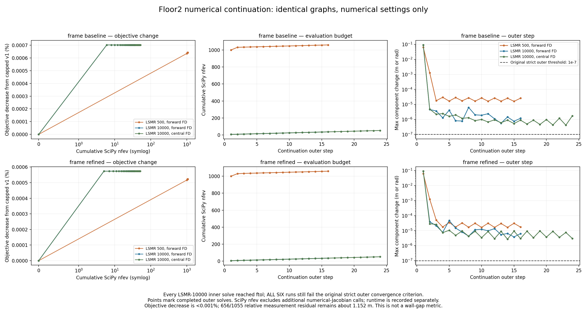
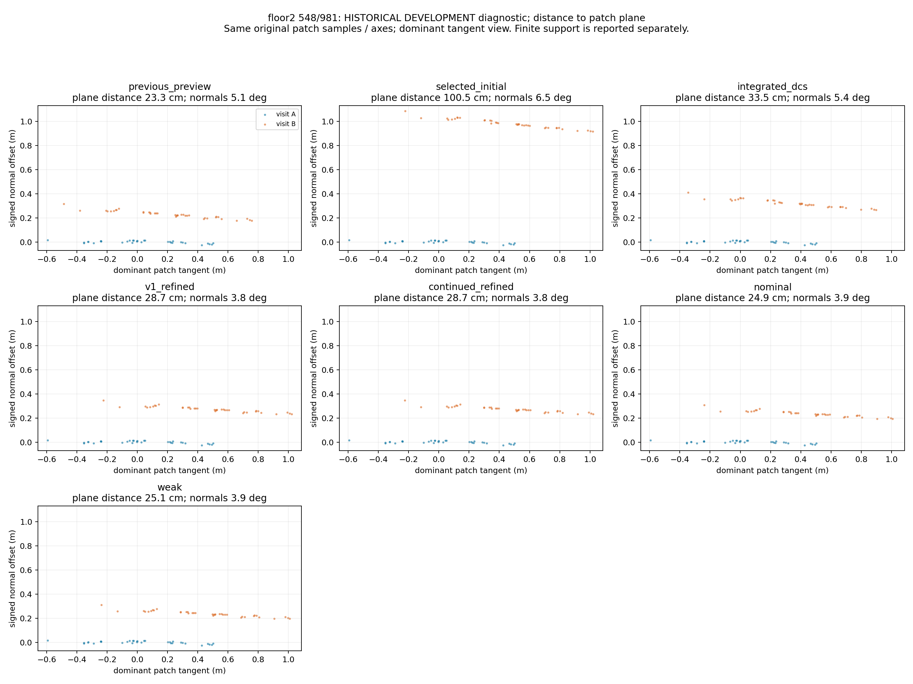

# 2층 재방문 RGB-D BA와 수치 수렴 분리 실험

이 기록은 [직전 2층 국소 최적화](2026-10-17-floor2-local-optimization.md)의 후속이다.
목표는 같은 그래프를 오래 푸는 효과와 **새로운 재방문 관측을 넣는 효과**를 구분하는 것이다.
원본 DB, 이전 출력과 다른 세션은 유지한다. 실행 산출물은
`outputs/student_union_20261017_floor2_revisit_v2/`에 보존한다.

## 1. 출발 상태와 검증 범위

- 대상: `261017-013501-2f.db`. 이 촬영에는 2층뿐 아니라 하부 로비와 계단도 포함된다.
- 원본 SHA256: `bd15632bad4bc253461b6ce2dc0c4304d3024785983dddbc968bdb83e48f9c6e`.
- 그래프: 1,215개 프레임. 기본 그래프는 연속 제약 1,214개와 루프 25개,
  refined 그래프는 직전 실험의 인접 프레임 제약 3개를 추가한다.
- 기존 루프 중 학습 19개, 예약 6개. 연속 제약 중 441개는 낮은 품질/구간 경계의
  약한 구조적 연속성 가정이다. 그래프가 하나라는 사실만으로 관측 연결이 검증되지는 않는다.
- 조사 대상은 548↔981, 656↔1055. 후자는 이전에 예약했던 관측이지만 문제를 보고
  다시 조정하므로 이번부터 **개발 자료**다. 과거 예약 지표를 독립 테스트라고 부르지 않는다.
- 절대 높이 고정, 지면 평탄화, 층간 강제 정합, 원본 DB 수정은 하지 않는다.

## 2. 기존 목적함수 그대로 수치 풀이를 계속하면?

`src/continue_floor2_graph.py`는 원래 manifest의 초기 포즈, 게이지와 보정 경계를
그대로 유지한다. 직전 결과를 초기값으로 쓰되 보정 한도를 새 포즈 중심으로 이동시키지 않는다.
예약 edge는 목적함수와 연결 성분 계산에서 제외한다.

알고리즘은 SE(3) 프레임 포즈 그래프, 블록 Huber IRLS, sparse trust-region reflective
비선형 최소제곱, LSMR 선형 풀이이다. 같은 물리 구역의 비-odometry 제약은 구역 내
개수로 가중치를 나누므로 연속 프레임을 독립적인 여러 장소로 세지 않는다.
회전 잔차는 SO(3) log, 위치 잔차는 측정 역변환을 곱한 상대 변환의 translation이다.

| 수치 설정 | 기본 그래프 총 함수 평가 | refined 총 함수 평가 | 결과 |
|---|---:|---:|---|
| 기존 LSMR 최대 500, 이어 풀기 | 1,060 | 1,059 | 첫 outer 한도, 이후 ftol 종료 |
| LSMR 최대 10,000 | 36 | 35 | 16회 inner 모두 ftol 종료 |
| LSMR 10,000 + 3-point Jacobian | 52 | 51 | 24회 inner 모두 ftol 종료 |

기본 비용은 `2.899346935 → 2.899326593`, refined는
`3.444558089 → 3.444538340`이다. 감소율은 각각 약 **0.00070%, 0.00057%**뿐이다.
원래 outer 종료 기준인 `max parameter step < 1e-7`은 모든 실험에서 미충족이다.
10,000 설정의 마지막 step은 기본 `1.18e-6`, refined `6.34e-6`이다.
따라서 **inner 비용 종료 조건 충족**과 **엄격한 전체 수렴**은 구분한다.
중앙차분도 이 판정을 바꾸지 않았다.

기본 그래프에서 일부 세계좌표 위치는 최대 약 9.3cm 움직였지만, 문제의 두 방문 간
상대 변환 변화는 548↔981 약 0.098mm, 656↔1055 약 0.016mm였다.
이는 공통 방향의 이동과 국소 정합 개선이 다르다는 실제 사례다.

### 기존 루프의 가중치 출처도 확인

548↔981의 위치 표준편차는 약 **1.61m**이며 native `effective_information`에서 왔다.
656↔1055는 약 **2.20m**이고 예약 edge라 애초에 fitting에 참여하지 않는다.
프레임↔서브맵 변환 때문에 새로 생긴 값은 아니다.
이 수치를 근거 없이 작게 바꾸지는 않았다. 새로운 관측 재검증을 먼저 수행한다.

## 3. 실제 다중 프레임 RGB-D 재방문 대응

구현은 `src/remeasure_floor2_revisits.py`다. SQLite는 read-only로 열고 각 실행에
소스 snapshot, 입력 해시, 선택 프레임, pair별 성공/실패를 남긴다.

1. 원본 RGB에 CLAHE(clip 2, 8×8)를 적용하여 어두운 영상의 특징을 추출한다.
2. SIFT 최대 6,000개, contrast 0.02와 RootSIFT descriptor를 사용한다.
3. 상호 ratio 0.75 매칭 후 양쪽 depth가 있으면 3D rigid RANSAC(10cm, 2,000회),
   한쪽만 depth가 있으면 EPnP-RANSAC으로 기하 일관성을 검사한다.
4. 프레임당 하나의 관측만 갖는 conflict-free track을 구성한다.
   양 방문에서 각각 최소 두 프레임에 보이고, 각 방문에 최소 한 개 metric depth가 있는
   track만 BA에 사용한다. 같은 장소의 연속 프레임 수를 장소 수로 부풀리지 않는다.
5. 각 학습 카메라의 SE(3)와 공유 3D landmark를 **동시에 변수로 둔다**.
   intrinsics, optical-to-node extrinsics, depth scale은 고정한다.
6. RGB 재투영 잔차(σ=3px), optical-depth 잔차(σ=4cm), 방문 내부 상대 이동 prior를
   Huber loss로 함께 최소화한다. 정상 prior는 8cm/3°, 품질 C 또는 hard boundary는
   40cm/10°다. 이는 센서 오차를 보정한 통계 공분산이 아니라 명시적인 모델 가정이다.
7. selected initial, 기존 preview, RGB-D RANSAC 초기값을 비교하되 **학습 비용만으로**
   후보를 선택한다. 예약 영상의 점수를 보고 초기값을 선택하지 않는다.

최소 12개 track, 재투영 P90≤8px, depth P90≤10cm, 양의 깊이,
고정 landmark 기준 rigid 관측 가능 rank 6과 optimizer 성공을 학습 gate로 사용한다.
고정 landmark의 rank가 full BA의 보정된 marginal uncertainty라는 뜻은 아니다.

### 프레임 선택과 실패도 보존

첫 실험 `revisits/`는 방문당 `center + {-4,-2,0,2,4}`의 5프레임이었다.
548↔981은 track 0개, 656↔1055는 3개여서 BA를 실행할 근거가 부족했다.

두 번째 `revisits_dense/`는 같은 구간의 연속 9프레임(`-4…4`)으로 바꾸고
한쪽 depth만 있는 PnP 대응도 연결했다. 예약 프레임은 바꾸지 않았다.
548↔981은 여전히 track 0개다. 원본 영상은 심한 저조도·흐림을 보인다.
656↔1055는 **61개 track**을 확보하여 18개 카메라 포즈(게이지 하나 고정)와
61개 landmark의 실제 공동 BA를 실행했다.
정확한 관측 수는 RGB 324개, 유효 depth 318개다. 18개 카메라 중 시각 관측으로
직접 연결된 것은 10개이며 나머지 8개는 방문 내부 이동 prior에만 의존한다.
따라서 18개 모두를 영상으로 새로 복구했다는 뜻은 아니다.

최초 BA의 최저 학습 비용은 visual RANSAC 초기값에서 158.91,
재투영 P90 3.34px, depth P90 3.97cm였지만 250회 한도에 걸려 채택하지 않았다.
기존 preview 초기값도 비용 160.67로 비슷한 영역에 도달한 반면,
selected-initial 초기값은 비용 4,560.89에 남았다. 초기값에 민감함을 보여 주며,
학습 잔차가 작다는 사실을 전체 지도 정확도로 환산하지 않는다.

추가로 같은 61개 track과 324개 관측을 고정하여 각 초기값을 1,500회 더 풀었다
(`revisits_ba_continued/`). visual RANSAC 비용 153.759, preview 비용 153.973으로
내려갔지만 둘 다 평가 한도에 도달했다. 이 단계 역시 학습 gate를 통과하지 않았으며
그래프에 넣지 않았다. 잘 맞아 보이는 중간 포즈를 수렴 완료로 처리하지 않는다.

특징점의 depth 채택 조건은 0.25–5m, confidence≥50, 3×3 이웃 중 최소 5개 유효,
depth 범위≤12cm다. 진단용 cloud는 pixel stride 2, 6cm voxel을 사용한다.
최종 고밀도 cloud export의 0.25–4m/5cm voxel과 용도가 다르므로 혼동하지 않는다.

### 같은 목적함수의 dense exact 풀이

`src/rgbd_bundle_vectorized.py`에서 관측 변환을 배치 계산하여 반복적인 역변환을
줄였다. 실제 324개 관측에서 기존 residual 및 중앙차분 Jacobian과의 최대 차이가
모두 0이었고, residual 계산은 약 34.4배 빨라졌다. 별도 테스트는 비가환 extrinsics,
깊이 누락, 뒤쪽 점의 투영 clamp, sparsity, gauge와 작은 최적화 문제를 검사한다.

285개 변수의 이 국소 문제는 dense 풀이가 가능하므로, 동일 Huber·prior·관측·게이지·
`ftol/xtol/gtol=1e-7`을 유지하고 **TRF + exact dense SVD 선형 풀이**로 바꿨다.
Jacobian은 colored 3-point 차분을 dense 행렬로 변환한다.

| 이어 푼 초기값 | 추가 평가 | 시간 | 비용 | 종료 |
|---|---:|---:|---:|---|
| visual RANSAC 계열 | 5 | 0.99초 | 152.4718309 | ftol |
| previous preview 계열 | 8 | 1.46초 | 152.4719901 | ftol |

두 결과의 상대 변환은 **0.132mm / 0.002566°** 차이다. 최저 학습 비용 후보의
재투영 P90은 3.543px, depth P90은 3.771cm다. 기존 학습 gate를 통과했고
`revisits_ba_exact/report.json`으로 고정했다. 첫 결과를 두 번째 결과로 덮어쓰지 않았다.
ftol 성공은 전역 최적해 증명이나 gtol 충족과 같지 않으며, 마지막 optimality는 0.002916이다.
전체 Jacobian rank 285도 **이동 prior를 포함한** 값이지 영상만의 관측 가능성은 아니다.

실행 코드는 `src/continue_floor2_revisit_ba.py`, 각 exact 풀이의 source snapshot과
수치 동등성 검사·singular values는 `bundle_dense_exact/`, `bundle_dense_exact_previous/`
산출물에 있다. 이는 새 대응을 추가한 실험이 아니라 같은 관측의 수치 해법 비교다.

## 4. 평가에서 평면 거리와 실제 겹침을 분리

`src/evaluate_floor2_revisits.py`는 과거 61개 패치를 그대로 재사용한다.
모든 단계에서 공통 관측이 있는 것은 38개다. 누락을 개선으로 계산하지 않는다.
과거의 "finite patch separation"은 유한 점들을 **무한 평면까지 측정한 거리**였으므로
이번 그림과 표는 point-to-plane distance로 명시한다.

이에 더해 실제 유한 점들 사이의 양방향 최근접 거리, 20cm 내 겹침 비율,
법선 차이를 기록한다. 서로 떨어진 동일 평면 조각이 거리 0으로 좋은 결과처럼
보이는 허점을 방지하는 테스트를 추가했다.

656↔1055의 고정 패치에서 기존 preview는 양방향 최소 겹침 약 59.04%,
법선 차이 1.63°였다. 수치 이어풀기 결과는 겹침 0%, 법선 차이 3.72°,
양방향 NN 중앙값 약 115.95/114.96cm다. 따라서 이 구역의 기존 악화는
단순한 평면 지표의 착시만은 아니다.

### 전체 프레임 예약 검증의 한계

각 중심의 `{-9,-7,+7,+9}` 프레임은 새 매칭·RANSAC·BA·후보 선택에서 제외했다.
그러나 촬영 시점이 인접하고 같은 포즈 체인을 쓰므로 독립 ground truth가 아니다.
기존 그래프의 odometry까지 제거한 새 테스트도 아니다.

원본 예약 영상 확인 결과, 특히 656↔1055 주변은 서로 다른 모서리 면·계단을
보고 있다. 기존 preview도 20cm 양방향 최소 겹침이 약 3.14%뿐이었다.
따라서 전체 창의 NN 점수는 시야·가림·방문 내부 포즈의 영향을 크게 받으며,
**BA의 합격/불합격을 단독 결정할 충분한 공통 가시 영역이 확인되지 않았다**.
창을 사후에 좋은 구간으로 바꿔 점수를 높이지 않고 `low_overlap_inconclusive`로 남긴다.

## 5. 그래프 반영 원칙

`src/integrate_floor2_revisit_graph.py`는 학습 gate를 통과한 BA만 진단 후보에 넣는다.
같은 endpoint의 기존 제약은 보관한 뒤 교체하여 이중으로 세지 않는다.
기존 물리 구역 group을 유지하고 예약에서 개발로 바뀐 edge를 기록한다.
서로 다른 구역 사이의 학습/예약 프레임 중복도 금지한다.

전체 세션을 landmark BA로 푸는 것은 아니다. **국소 창에서 RGB-D BA로 측정 →
전체 프레임 PGO로 오차 분배 → 원본 RGB-D로 재투영**하는 단계다.
이때 BA 내부 이동 prior와 기존 odometry는 상관되어 있다. 따라서 완전히 독립적인
측정처럼 설명하지 않으며, 12cm/4° 및 표준편차 2배 모델의 민감도를 비교한다.
이 값은 BA marginal covariance도, 측량 정확도도 아니다.

수치 성공만으로 RViz 기본 지도를 교체하지 않는다. 미검증 구역과 계단 높이,
다른 벽의 악화를 함께 확인한다. `accepted=false`, `navigation=false`는 유지한다.

## 6. 재현과 보존

수치 이어풀기 예시(출력 폴더는 새 경로여야 한다):

```bash
python3 src/continue_floor2_graph.py \
  --source outputs/student_union_20261017_floor2_local_v1/frame_refined \
  --output outputs/student_union_20261017_floor2_revisit_v2/convergence/frame_refined_lsmr10000 \
  --solver-preset lsmr-10000 --outer-iterations 16 --max-evaluations 1000
```

매칭 실행 설정은 각 `selection.json`, 소스는 각 실행 폴더의 `source_*.py`가 기준이다.
현재 소스를 과거 실행 설정과 혼동하지 않는다. 실패한 첫 설정, dense 설정,
수치 비교 설정을 덮어쓰지 않고 모두 남긴다.

실제 사진·그래프는 합성하거나 벽을 지워 만든 것이 아니다. 원본 관측, 동일 표본,
동일 축으로 만들어 바이트 동일 복사하고 출처 SHA256을 남긴다.
DB·큰 출력·PDF의 기존 ignore 정책은 유지한다.

## 7. 최종 결과와 채택 판정

nominal(12cm/4°)과 weak(24cm/8°) 모두 1,215개 포즈, 동일 925개 A/B export 포즈,
한 연결 성분이다. 656↔1055의 기존 예약 edge 하나를 보관 후 새 학습 제약으로
교체했다. 다른 루프의 측정·가중치 모델은 바꾸지 않았다.
16회 inner solve가 모두 ftol 종료했으며 활성 bound는 0개다. 원래 엄격한 outer
step 기준은 미달(마지막 nominal `2.33e-5`, weak `1.39e-5`)이어서 이를 수렴 완료와
혼동하지 않는다. 새 edge의 측정 대비 위치 잔차는 1.164m에서 각각 5.35/18.55cm다.
이 edge 잔차는 아래 실제 표면 지표와 다른 값이다.

| 동일 38패치 point-to-plane 중앙값들의 집계 | 중앙값 | P90 | 최대 |
|---|---:|---:|---:|
| 기존 preview | 4.67cm | 10.65cm | 23.28cm |
| 직전 프레임 후보 이어풀기 | 5.04cm | 19.65cm | 115.79cm |
| 새 BA 제약 nominal | 4.76cm | 15.03cm | 25.97cm |
| 새 BA 제약 weak | 4.76cm | 17.88cm | 26.16cm |

656↔1055의 벽 패치 plane-distance는 **115.793→5.141cm**, 약한 제약에서는
17.482cm다. 양방향 최소 20cm 유한 겹침은 **0→51.93%**로 회복했다.
그러나 기존 preview는 4.048cm/59.04%였고, nominal의 양방향 NN 중앙값도
18.58/5.03cm다. 따라서 “모든 점이 5cm 이내” 또는 “원래 지도를 능가했다”는
해석은 틀리다. 주요 성과는 **직전 실험의 큰 국소 악화 복구**다.

548↔981은 28.708→24.926cm로 조금 변했지만, 새 BA 측정이 없어 문제 구역으로
남는다. 공통 38개 중 과거 기준별 최선보다 5cm 이상 나쁜 패치는 8→7개다.
예약 전체 프레임의 656 구역 겹침도 0.86→4.58%일 뿐이므로 공통 시야 부족 판정은
그대로다. 전체 지도의 승인을 보류하고 기본 RViz는 유지했다.

학습 관측과 겹치는 3패치를 제외한 공통 35패치 중앙값은 4.5720→4.5725cm로
사실상 그대로다. 즉 개선은 주로 목표 구역에 국한된다. 전체 61패치에서 이어풀기
대비 가장 큰 새로운 악화는 644↔1035 벽의 +2.48cm(8.77→11.26cm)다.
5cm를 넘는 새 악화는 없지만, 작은 악화까지 없었다는 뜻은 아니다.

새 제약을 더 약하게 하면 656 벽 지표가 5.14→17.48cm로 달라진다.
이는 재측정 성공 외에도 주변 연속성 가정과 제약 가중치의 영향이 남았음을 보여 준다.
가중치를 더 강하게 하여 보이는 벽만 억지로 맞추지는 않았다.

### 실제 점군과 사진

원본 RGB-D와 각 후보의 최적화 포즈로 처음부터 재투영했다. 완성 점군만 이동하거나,
문제 벽을 삭제하거나, 바닥을 평면으로 덮은 결과가 아니다.

| 출력 | 동일 A/B 프레임 수 | 점 수 |
|---|---:|---:|
| `clouds/frame_refined_lsmr10000/floor2.ply` | 925 | 2,263,268 |
| `clouds/integration_nominal/floor2.ply` | 925 | 2,218,966 |
| `clouds/integration_weak/floor2.ply` | 925 | 2,223,913 |

위 경로의 기준은 `outputs/student_union_20261017_floor2_revisit_v2/`다.
각 manifest는 입력/출력 hash, 925개 프레임 목록, decode 전부 성공, 원본 DB/RViz
불변, depth/voxel 설정을 검증한다. 점 수 감소는 voxel 합쳐짐 등에 따른 결과이지
정합 성공의 독립 증거가 아니다.






사진 15장은 [공개 시각자료 폴더](../assets/floor2-revisit-review/)에 있다.
[manifest](../assets/floor2-revisit-review/manifest.json)는 원본 PNG와 바이트 동일함을
검증한다. `surface_hypothesis_*.png`는 별도로 시도한 **rigid point-to-plane 후보**이며
BA가 아니다. 채택하지 않았고, 실제 BA 사진은 `local_ba_*.png`로 구분했다.

### 남은 작업

1. 548 구역은 저조도에서 지속 track을 확보하지 못했다. 기존 영상의 문틀·간판·기둥
   같은 고정 구조물을 더 넓은 구간에서 대응시키거나, 명시적 수동 기준점 확인이 필요하다.
2. 656 구역도 독립 공통 시야 검증이 부족하다. 가시 영역이 확인된 별도 관측 또는
   실측으로 확인해야 하며, 이번에 반복 평가한 패치를 새 독립 검증으로 부르면 안 된다.
3. 영상 관측 없는 포즈와 약한 모듈 경계의 연결 근거를 보완해야 한다.
   가중치만 조정하는 대신 해당 경계의 실제 대응을 확보하는 것이 우선이다.
4. 다른 벽 7개 악화, 계단 상승 높이, 외부·다른 층 연결 검증은 별개로 남는다.
   이번 결과만으로 통합 지도나 길찾기 품질이 확정되지 않는다.

전체 테스트 `python3 -m pytest -q`: **333 passed**. 코드 검증과 지도 정확도 승인은
별개다. 이전 단계 출력·원본 DB·RViz를 삭제/교체하지 않았다. Git에는 원본 DB와
대용량 실행 출력을 제외하고 재현 코드·테스트·문서·검토용 시각자료만 포함한다.

실제 실행한 보조 스크립트가 Git에서 제외되는 `outputs/` 안에만 남지 않도록
[동결 실행 스크립트 사본](reproduction/floor2_revisit_v2/README.md)도 보존했다.
일반 알고리즘은 `src/`에 있으며, 사본은 당시 경로·설정·그림 생성법을 확인하는 용도다.

nominal 재현 명령(같은 입력을 준비하고 출력 폴더는 새 경로 사용):

```bash
OPENBLAS_NUM_THREADS=1 OMP_NUM_THREADS=1 python3 src/integrate_floor2_revisit_graph.py \
  --source outputs/student_union_20261017_floor2_revisit_v2/convergence/frame_refined_lsmr10000 \
  --remeasurements outputs/student_union_20261017_floor2_revisit_v2/revisits_ba_exact/report.json \
  --output outputs/student_union_20261017_floor2_revisit_v2/integration_nominal \
  --sigma-multiplier 1
```

weak은 `--sigma-multiplier 2`, 다른 output을 사용했다. 최종 평가의 정확한 명령은
`evaluation_final/report.json`의 `command`, 사진 공개 명령은
`src/publish_floor2_revisit_evidence.py --run … --evaluation … --output …`이다.
