# 큰 중복 벽의 원인 진단과 통합 기하 재최적화

2026-10-17, 제1학생회관. 원본 다섯 DB와 이전 미리보기를 보존한 후
`outputs/student_union_20261017_geometry_review/`에서 실행한 후속 실험이다.
이 문서의 모든 사진은 실제 RGB 관측 또는 실제 계산 결과의 렌더다.
이미지 생성 모델로 만든 장면이나 재현한 RViz 화면은 없다.

결론: **재최적화·재생성·검증은 실행했지만, 전체 지도의 교체 승인은 보류했다.**
일부 큰 벽 중복은 개선됐으나 미사용 구간의 큰 악화와 연결 부족이 남았다.
기존 RViz 기본 파일·점군은 유지했다. 정확한 집계와 실행 보고서 해시는
[최종 수치 JSON](student_union_20261017_geometry_metrics.json)에 있다.

## 실험 설계와 판정 단위

목표는 한 벽이 두 장으로 보이는 원인을 확인하고, 추가 근거가 있는 구간을
재최적화하는 것이다. 다음 판정은 서로 다르다.

- `accepted_for_experiment` / `eligible_for_experimental_graph`: 출처와 한계를
  명시하고 새 그래프의 실험 제약으로 사용할 수 있음.
- `local_geometry_verified`: 해당 영상쌍의 국소 기하 검사 통과. 다중 세션
  전체 연결이나 독립 측량 정확도를 뜻하지 않음.
- `accepted`: 그래프 보고서에서는 전체 채택 guard 통과 여부.
- `navigation_ready`: 보행 지도 승인 여부. 이번 실험에서는 항상 false.

앱·기존 후보·새 후보 비교에 같은 프레임, 같은 깊이 필터, 같은 유한 평면
관측을 사용한다. 이전 실패나 미완료 실행도 삭제하지 않는다. 여러 방법을
같은 자료에 시험했으므로 결과는 반복 실험의 내부 일관성 평가다.

## 1. 포즈 선택과 센서 해석 점검

코드: `src/audit_geometry_baselines.py`.
결과: `baselines/report.json`, `baselines/frozen/{session}_poses.csv`.

원본 odometry, 앱 저장 포즈, 기존 오프라인 후보와 재측정 후보를 비교했다.
각 후보의 첫 공통 노드를 원본 기준에 맞추는 단일 좌표계 변환만 적용했다.
전체 궤적 best-fit 대신 공통 기준 포즈로 좌표계를 맞췄다.

선택 정책은 결과를 보기 전에 고정했다. 기존 그래프 미사용 검증 쌍이 세 개
이상이고, clipped 최근접 거리 RMSE 중앙값이 1cm 이상 개선되고, overlap
손실이 0.03 이하이며, 벽 간격 p90 악화가 2cm 이내일 때만 앱 기준을 바꾼다.
이 수치는 센서의 검정된 정확도가 아닌 보수적인 초기값 선택 정책이다.
기존 검증 쌍은 과거 실험에서 반복 사용됐고 앱 내부에서 쓰였을 가능성도
있으므로 독립적인 신규 holdout으로 부르지 않는다.

다섯 세션 모두 앱 포즈를 임시 기준으로 고정했다. 2층의 기존 오프라인
후보는 벽 중앙값을 8.45→3.50cm로 줄였지만 수평면은 5.00→6.62cm로 악화했다.
검증 점군 중앙값 개선은 약 6.9mm였다. 따라서 이 선택은 앱 포즈가 모든
벽에서 가장 좋다는 주장이 아니다. 마지막 평가는 이전 RViz 통합본도 포함한다.

보정값의 camera-local transform은 세션 내 일정했다. 프레임별 intrinsic은
변했으며 기존 decoder가 매 프레임의 값을 적용하고 있다. 샘플 감사에서
depth 해상도로 환산한 intrinsic 변화는 보통 약 1.16–1.90px,
외부–로비 브리지에서는 최대 약 10.10px였다. 이것만으로 보정값 오류라고
판정할 수 없다. 원본 DB의 confidence·깊이·포즈를 다시 해석하고 SHA-256을
비교했다.

## 2. 문제가 큰 구간과 원본 사진

기존 루프의 국소 대응을 기준으로 추출한 동일 유한 평면의 불일치다.
실측 건물 오차가 아니다.

| 구간 | 앱 기준 면 간격 | 해석 |
|---|---:|---|
| 외부 69↔323 벽 | 102.8cm | 같은 출입구 기둥·외벽의 재방문 |
| 2층 548↔981 벽 | 100.5cm | 같은 랜딩 난간 아래 낮은 벽 |
| 로비 595↔650 벽 | 46.2cm | 마스코트·곡선 전시대 주변; 반사 깊이 편향 가능 |
| 2층 503↔961 수평면 | 63.1cm | 같은 복도 타일 바닥의 국소 관측 |
| 로비 82↔290 수평면 | 47.7cm | 기존 바닥 후보의 높이 불일치 |

로비 문제 벽은 법선 차이가 약 0.62°인데 간격이 46cm였다. 따라서 모든
문제를 roll/pitch나 z 오차 하나로 설명할 수 없다. 점이 무작위로 퍼지는
잡음과 별개로, 개별 관측 면이 서로 떨어지는 체계적인 중복이 있다.

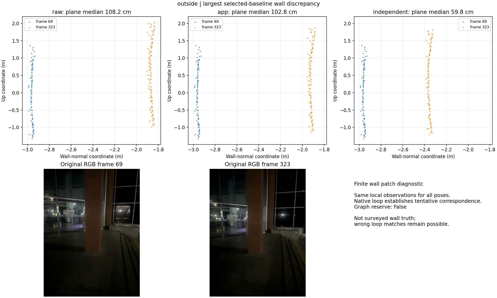

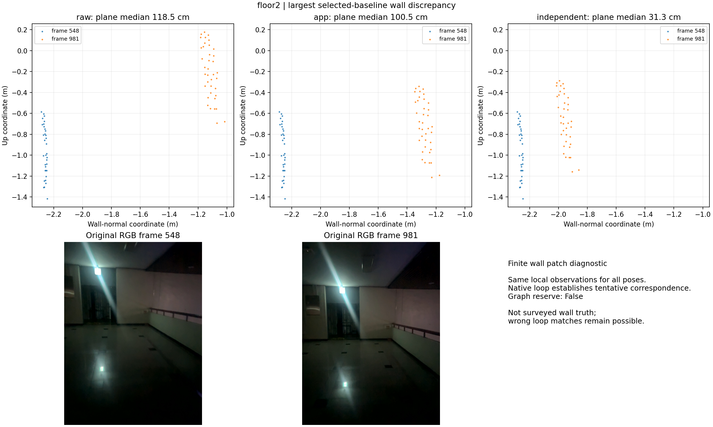

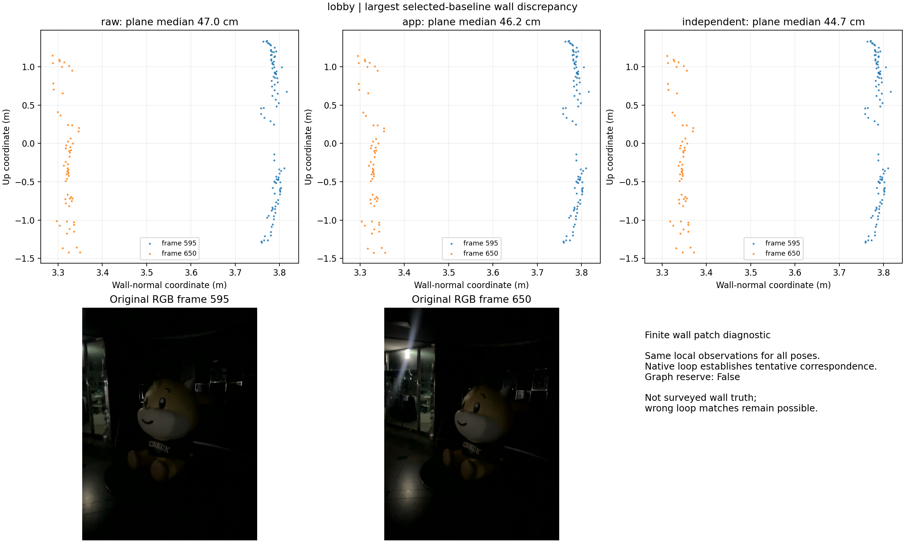

## 3. 추가 교차 세션 대응: 한쪽 깊이 PnP

코드: `src/recover_geometry_connections.py`.
결과: `connections/`, `connections/focused_recovery/`, `connections/union_audit/`.

기존 양쪽 깊이 3D 대응의 한계를 보완하기 위해 다음 절차를 실행했다.

1. CLAHE 대비 보정 및 고밀도 RootSIFT 특징을 추출한다.
2. 2m 카메라 위치 이웃을 번갈아 탐색해 한 문 주변에 검색이 몰리지 않게 한다.
3. 한쪽 영상에서 신뢰 깊이를 가진 3D점과 반대편 2D점을 연결한다.
4. 양방향 EPnP-RANSAC으로 상대 포즈를 각각 추정한다.
5. Huber 재투영 오차로 양방향 변환을 보정한다.
6. 양방향 변환 일관성, 3D 대응, 재투영, 중력 방향을 감사한다.
7. 기존 7cm metric holdout, 6px 재투영 기준과 과거 whole-frame 검증 역할을 유지한다.

처음 175쌍, 이후 중복을 제외한 추가 240쌍을 탐색했다. 최초 네 개의 국소
통과 중 하나는 이미 알던 대응이었다. 과거 매처의 검증 depth 픽셀 이웃을
합집합으로 제외하고 과거 검증 샘플까지 다시 평가한 결과,
**새 실험 입력으로 남은 대응은 로비495↔서브85 한 개**다.
기존 로비112↔2층14 재측정은 새로운 장소로 중복 계산하지 않는다.
로비176↔2층51과 로비396↔서브208은 합집합 감사에서 철회했다.
철회 이전 제약을 사용한 `graph_refined/`는 중간 실험으로만 보존한다.

최종 교차 입력은 `connections/union_audit/graph_candidates.json`이다.
로비495↔서브85는 새 미사용 샘플 RMSE 약 5.23cm, 과거 LoFTR 검증 샘플
약 5.50cm였고, 과거 검증 영역과 겹치는 학습 샘플 25개를 제거했다.
이는 같은 계단 근방 관측이므로 세 번째 독립 물리 구역 확보를 자동으로
의미하지 않는다.

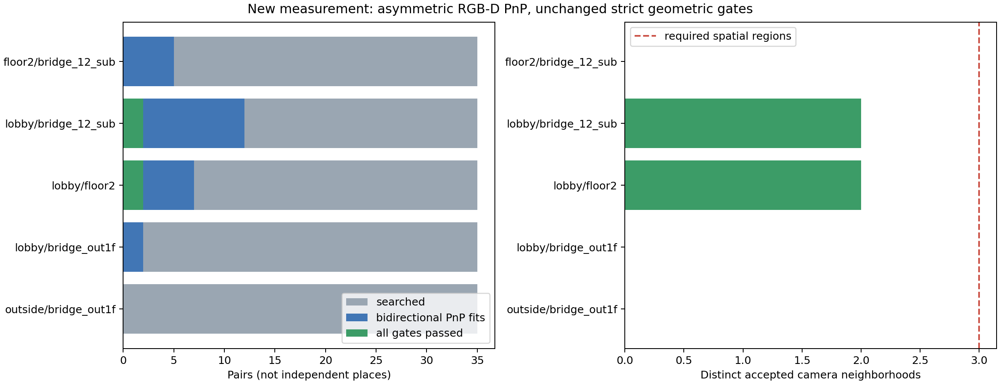

위 그림은 초기 검색 진단이다. 최종 채택 수는 그림의 최초 통과 수와 다르다.
실패/철회 이유와 각 단계 결과는 JSON과 대응 사진에 남겼다.

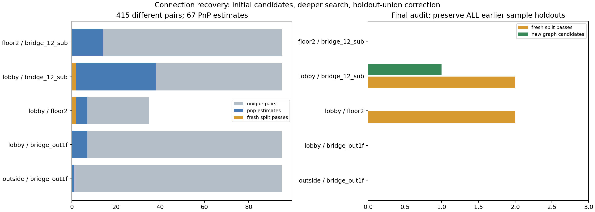


## 4. 수동 구조물 기준점의 가능성 확인

결과: `connections/manual_feasibility/manual_landmarks_report.json`.

실제 원본 이미지를 보고 고정된 문틀·패널 모서리를 표시했다. 수동 픽셀은
자동 대응을 수동이라고 이름만 바꾼 것이 아니며, 위치 불확실성도 기록했다.

- 로비39↔외부 브리지79: 상단 패널·문틀 모서리 8개, 약 ±5px의 시각적
  위치 불확실성. 양쪽에서 confidence와 깊이 연속성 조건을 만족하는 것은 3개였다.
- 외부263↔외부 브리지117: 확실하게 같은 하단 문틀 접점 2개, 약 ±7px.
  유효 깊이는 1개뿐이었다. 상단 구조는 화면 밖이고 유리 뒤 특징은 깊이가 모호했다.

수동 기준점도 충분한 3D 지지를 확보하지 못했다. 따라서 임의 좌표를 더
만들거나 이 두 연결을 새 검증된 제약으로 승격하지 않았다. 표시한 사진과
각 픽셀의 유효성 결과를 보존했다.

## 5. 재방문 표면 정합과 제약 재측정

코드: `src/refine_geometry_surfaces.py`.
결과: `surfaces/summary.json`과 구간별 보고서·원본 사진·전후 단면.

confidence 필터를 통과한 RGB-D를 6cm voxel로 줄이고 PCA로 표면 법선을
추정했다. 양방향 법선 일치 최근접 대응, Cauchy IRLS point-to-plane
Gauss–Newton으로 상대 SE(3)를 구했다. Hessian의 rank/condition을 검사해
평면 한 장의 미관측 이동 방향을 충분한 6DoF 관측으로 오해하지 않게 했다.
단일 평면을 rank-deficient로 판정하고 알려진 코너 변환을 회복하는 테스트를
실행했다.

이 국소 ICP의 법선은 16개 이웃, 반경 0.32m, PCA 평면성 비율 0.06 조건으로
계산했다. 대응 거리 0.35m·법선 차이 30° gate, Cauchy scale 0.03m,
최대 35회 반복을 사용했다. 한 번의 이동/회전 증분은 0.08m/1°로 제한하고
초기값 대비 총 보정이 0.75m/10°를 넘으면 중단했다. 이 gate는 구현상의
탐색 제한이며 해당 수치만큼의 최종 오차를 허용한다는 뜻이 아니다.

초기에는 중앙 프레임의 -2/0/+2를 정합에 쓰고 ±7/±10 전체 프레임을 감사했다.
먼 프레임은 카메라 회전으로 공통 시야가 부족해 실패했다. 이후 ±1 전체
프레임을 사후 감사했으며, 시간적으로 가까운 상관된 검증이라는 사실을
그대로 기록했다. 2층 일부는 프레임 누적의 번짐을 확인하기 위해 중앙
프레임만 쓰는 별도 실험도 실행했다.

| 실험 제약 | 근접 미사용 프레임 overlap 전→후 | 인라이어 RMSE 전→후 |
|---|---:|---:|
| 로비 595↔650 | 40.0→74.2% | 9.27→7.26cm |
| 로비 445↔495 | 64.5→65.2% | 9.41→8.37cm |
| 외부 69↔323 | 49.1→90.6% | 11.07→6.97cm |
| 외부 113↔351 | 40.2→85.3% | 11.15→8.53cm |
| 2층 644↔1035, 단일 프레임 실험 | 24.9→61.0% | 9.89→9.71cm |

이 표는 앱 상대 포즈와 국소 재측정의 비교다. 그래프에 반영한 최종 포즈의
성능은 별도 평가한다. 특히 저장된 루프 변환 자체가 재측정보다 좋거나
비슷한 사례도 있었다. 문제는 측정뿐 아니라 그래프가 그 상대 관계를
실현하는 강도와 다른 제약과의 일관성에도 있다.

2층548↔981의 전체 SE(3) 재측정은 인접 검증 RMSE 11.89cm로 실패했다.
기존 검증 전용 656↔1055, 608↔1023은 학습으로 전환하지 않았다.

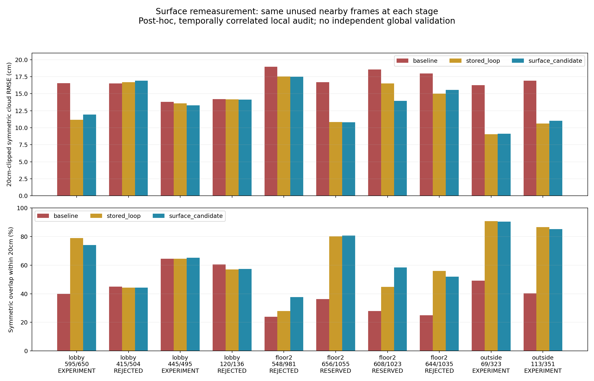

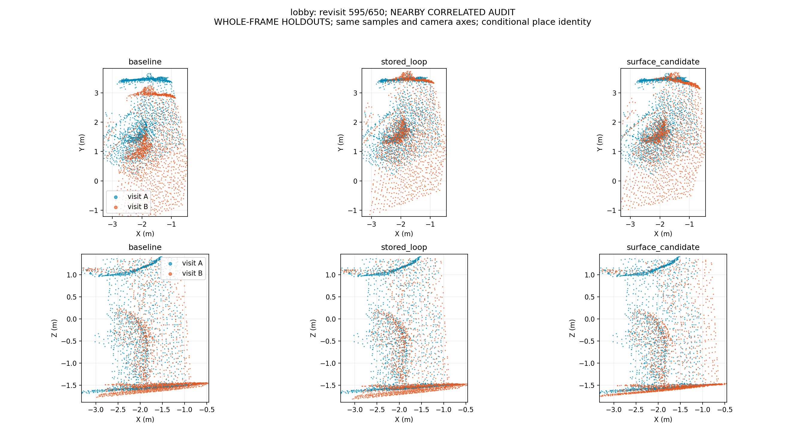

## 6. 같은 유한 평면만 묶는 제약

코드: `src/export_local_plane_factors.py`.
입력: `surfaces/plane_reviewed/constraints.json`.

전체 SE(3) 측정이 불충분해도, 같은 구조물의 유한 평면이 명확하게 보이면
관측된 방향만 제약할 수 있다. 학습·검증 평면 점을 원본 RGB로 투영해
실제로 같은 표면인지 확인했다.

평면 관측 추출은 PCA 법선 → 방향 제한 RANSAC(160회, 거리 3cm) →
SVD 평면 재적합을 사용한다. 수평 후보는 up 방향에서 12° 이내,
벽 후보는 수직에서 15° 이내이며, 점 법선 일치 조건은 18°다.
학습 inlier≥40·예약 inlier≥12, 유한 접선 폭≥0.18m·면적≥0.08m²,
학습 RMS≤2cm·예약 inlier RMS≤2.5cm·예약 inlier 비율≥65%로 검사했다.
가까운 예약점의 지지 반경은 0.15m다. 지면을 제거하는 RANSAC이 아니라
유한한 관측 평면을 추출하는 용도이며, 검증점까지 사용한 후보 채택의
조건부 선택 편향은 최종 해석에서 제외하지 않았다.

- 2층548↔981: 오른쪽 검은 난간 아래 연녹색 낮은 벽. 출입구 끝 벽과
  혼동하지 않았다. 기존 측정에서 국소 지지 100%, 평면 거리 약 5.11cm였다.
- 2층503↔961: 같은 복도 타일 바닥의 유한 영역. 계단 디딤판이나 서로 다른
  층을 묶지 않았다. 기존 측정에서 지지 65%, 평면 거리 약 1.22cm였다.

두 평면의 글로벌 중심을 cA,cB, 단위 법선을 nA,nB라고 할 때, 부호를 맞춘
법선 차이와 `(cB-cA)·nA`, `(cB-cA)·nB`를 잔차로 사용한다. 거리 표준편차
모델은 0.08m, 각도는 3°, block Huber δ=3이다. 대칭 거리 두 개는 √2로
정규화한다. 평면 접선 방향 이동은 제약하지 않는다.

공통 전역 바닥 높이를 정하지 않는다. 수평면 제약은 **확인된 동일 국소
바닥의 두 관측** 사이에만 걸리며 계단과 외부 경사 전체를 평탄화하지 않는다.

## 7. 전체 프레임 그래프와 대조 실험

코드: `src/optimize_geometry_stage.py`, 결과: `graph_final/`.

선택 포즈가 있는 주 연결 요소의 2,862개 프레임을 노드로 사용한다. 기존 odometry와 검증된
저장 루프, 이전에 재측정한 루프, 새 실험 제약을 연결한다. 동일 쌍을 새
측정으로 교체할 때 중복 정보를 더하지 않는다. 기존 whole-pair holdout은
유지하고 새 검증 쌍과 같은 native 학습 edge도 제외한다.

초기 세션 배치는 학습 제약만 사용한다. 충분한 연결이 없는 외부와
외부–로비 브리지는 각각 별도 그래프 성분이다. 공통 화면에서 비교할 때만
이전 표시 좌표에 기준점을 맞춘다. 그 표시 위치가 새 연결의 근거는 아니다.

실험 변형은 같은 초기 포즈에서 출발한다.

| 변형 | 추가로 추정·제약하는 것 |
|---|---|
| `pgo4` | x/y/z/yaw, 기존 기울기 유지 |
| `pgo6_attitude` | SE(3), 기준 자세의 up-vector 정규화 σ=2° |
| `pgo6_normals` | 위 조건 + 관측된 국소 수평면 법선 |
| `pgo6_planes` | 위 조건 + 확인된 동일 벽/바닥의 유한 평면 제약 두 개 |

수평 법선은 로비·2층·서브 계단에서 12프레임 간격으로 추출했다. 카메라
아래 0.4–2.4m에 있는 유한 평면 중 관측이 충분한 것을 선택했으며 총 167개다.
법선 σ=3°, block Huber δ=2를 사용한다. 가구 상판 등의 가능성이 있어
자동 추출만으로 바닥 의미 라벨을 확정하지 않는다. 경사 가능성이 있는
외부·외부 브리지에는 이 가정을 적용하지 않았다.

up-vector prior는 앱 기준 자세를 크게 바꾸지 않도록 하는 정규화이며,
이번에 독립 IMU 신호를 새로 측정·융합한 것이 아니다. 새 독립 IMU factor는 0개다.
법선·평면 후보의 채택에는 같은 프레임의 검증용 깊이 표본도 사용되므로,
일부 지표는 후보 선택을 조건으로 한 기하 일관성 평가다. 인접 프레임 검사도
같은 센서·궤적과 상관되므로 독립적인 신규 데이터 검증으로 부르지 않는다.

상대 포즈 잔차는 `inverse(measurement) × inverse(poseA) × poseB`의
이동과 rotation vector다. 정보행렬로 whitening하고 edge별 Huber δ=3을
적용한다. 새 상대측정의 최소 σ는 0.10m/3°이며 검정된 센서 공분산이 아닌
명시적 모델이다. SciPy sparse trust-region least-squares와 LSMR을 사용한다.
자세 보정은 물리적 기울기 변화 5° guard를 별도로 검사한다.

`graph_baseline/`의 초기 4DoF 실행은 180회 제한으로 수렴하지 않아 보존했다.
`graph_control/`은 500회 한도로 다시 실행한 기존 제약 대조군이다.
`graph_refined/`는 과거 검증 샘플 합집합 감사 전 제약을 사용한 중간 실행이다.
최종 비교의 새 입력은 `graph_final/`에 명시한다. 이전 실행의 소스 스냅샷과
입력 해시를 보존하므로 실행 중 코드 개선과 과거 기록을 혼동하지 않는다.

최종 네 solver는 모두 수렴했고 보정 경계에 닿지 않았다. SE(3)+법선/평면의
최대 기울기 보정은 약 0.606°다. 다음 수렴 횟수는 정확도 순위가 아니다.

| 변형 | 함수 평가 횟수 | 로비327↔2층51 미사용 상대포즈 오차 | 2층560↔서브162 미사용 상대포즈 오차 |
|---|---:|---:|---:|
| `pgo4` | 323 | 16.87cm / 2.58° | 10.03cm / 2.74° |
| `pgo6_attitude` | 347 | 16.71cm / 2.62° | 9.97cm / 2.71° |
| `pgo6_normals` | 70 | 16.98cm / 2.66° | 10.30cm / 2.74° |
| `pgo6_planes` | 87 | 17.09cm / 2.75° | 10.39cm / 2.91° |

로비–2층은 최소 15cm guard도 통과하지 못했다. 로비–서브에는 독립된
whole-pair 감사 자체가 없으며, 두 2층–서브 영상쌍도 같은 문 근방이다.
연결 성분은 `[bridge_12_sub, floor2, lobby]`, `[outside]`, `[bridge_out1f]`다.
학습 교차 edge로 연결됐다는 것과 세 독립 구역에서 검증됐다는 것은 다르다.

사후 코드 검토에서 연결별 감사 누락을 명시적으로 탐지하도록 보완했다.
4DoF의 odometry holdout도 호출 전에 제외하도록 수정했다. 실제 실행에는
해당 odometry가 0개라 포즈 수치에는 영향이 없다. 실행 당시 `report.json`과
`source_snapshot.py`는 수정하지 않고 `postrun_guard_review.json`에 차이·해시·
추가 미승인 사유를 기록했다. 모든 변형은 여전히 `accepted=false`다.

## 8. 평가와 사진 보존 방법

코드: `src/evaluate_geometry_stage.py`, `src/render_geometry_progress.py`.

평면은 후보마다 다시 맞추지 않는다. 원본 방향의 학습 점으로 결정적으로
추출한 기존 유한 patch를 고정하고, 같은 미사용 점을 각 포즈에 적용한다.
평면 간 거리·법선 각도·시간별 높이·전체 점군 거리를 비교한다. 학습 구간과
native 검증 전용 구간은 표에 구분한다.

새 그래프의 국소 성공만으로 전체 개선을 선언하지 않았다. 전체 기존 평면
대응을 대상으로 회귀 검사를 확장했다. 최종 평가는 78개 프레임 쌍에서
고정 패치 122개를 비교하며, 그중 13개 검증 전용 쌍의 패치는 22개다.
하나의 쌍에서 벽과 바닥을 각각 추출해도 두 독립 장소로 계산하지 않는다.

아래 수치는 패치별 대칭 평면 절대거리 중앙값들을 집계한 cm 단위 통계다.
점 개수로 가중한 오차나 측량 기준 절대정확도가 아니다.

| 단계 | 전체 122패치 중앙값 / P90 | 검증 22패치 중앙값 / P90 / 최대 | 이전 RViz 대비 >5cm 악화 패치 |
|---|---:|---:|---:|
| 이전 RViz | 5.00 / 18.48 | 4.79 / 13.14 / 30.12 | 0 |
| 선택 초기값 | 5.95 / 31.18 | 6.49 / 36.83 / 44.40 | 25 |
| 4DoF | 4.87 / 14.51 | 5.66 / 16.61 / 55.79 | 13 |
| SE(3)+자세 | 4.97 / 14.74 | 5.36 / 16.93 / 55.85 | 13 |
| SE(3)+법선 | 4.80 / 14.99 | 5.22 / 22.31 / 55.91 | 12 |
| SE(3)+유한 평면 | 4.73 / 15.01 | 4.67 / 23.34 / 54.42 | 11 |

초기값보다 좋아졌다는 사실만으로 기존 RViz보다 낫다고 말할 수 없다.
또한 전체 중앙값이 좋아져도 문·벽 한 곳의 큰 오차를 허용할 수 없다.

| 유한 패치 | 이전 RViz | 선택 초기값 | SE(3)+법선 | SE(3)+유한 평면 | 역할 |
|---|---:|---:|---:|---:|---|
| 외부69↔323 벽 | 59.84 | 102.77 | 3.55 | 3.55 | 재측정 학습 관계 |
| 로비595↔650 벽 | 44.59 | 46.19 | 11.83 | 11.84 | 재측정 학습 관계 |
| 2층548↔981 벽 | 23.28 | 100.47 | 35.70 | 1.54 | 새 평면 factor 학습 관계 |
| 2층503↔961 수평면 | 36.61 | 63.10 | 33.77 | 1.63 | 새 평면 factor 학습 관계 |
| 2층656↔1055 벽 | 4.05 | 44.40 | 55.91 | 54.42 | 검증 전용, 큰 악화 |
| 2층642↔1031 수평면 | 2.86 | 2.40 | 16.93 | 18.06 | 검증 전용, 악화 |

548↔981과 503↔961의 개선은 해당 평면 관계를 제약에 넣은 뒤, 분리된
깊이 점에서 잔차가 줄었다는 뜻이다. 프레임 쌍 자체가 학습에 쓰였으므로
독립 검증 성공으로 제시하지 않는다. 2층644↔1035의 새 전체 SE(3) 측정은
최종 그래프에서도 상대포즈 잔차 14.94cm/4.93°가 남는다. 국소 측정 통과와
전체 그래프 안에서 그 관계가 실현되는지는 별개다.

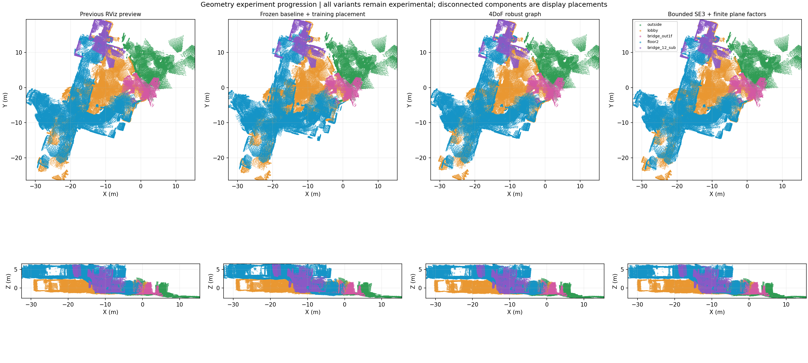

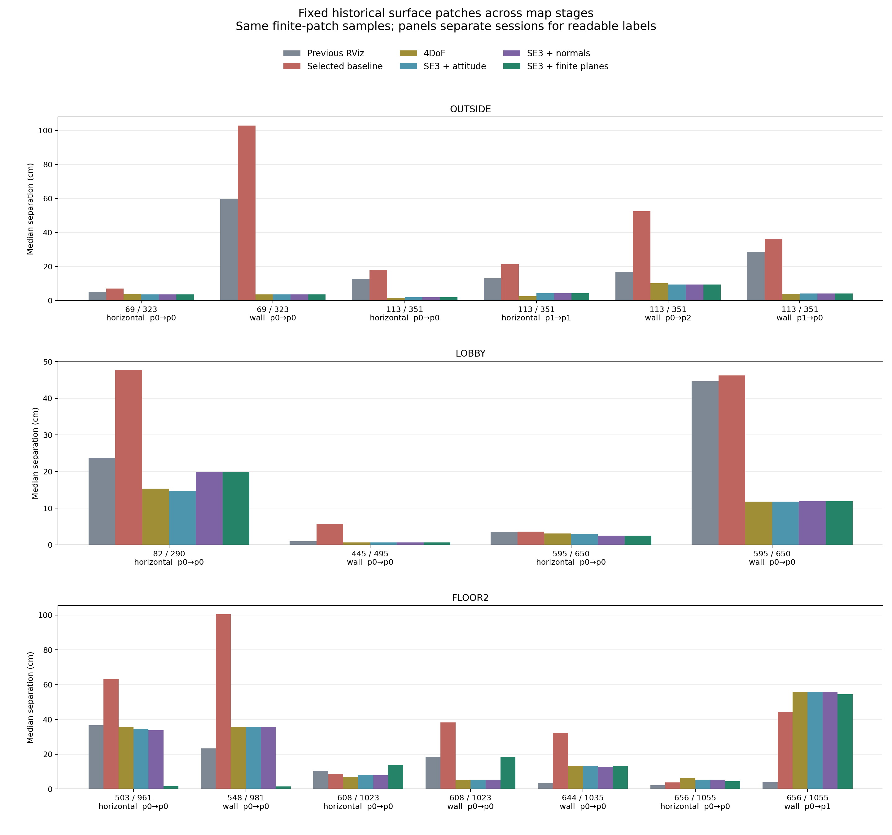

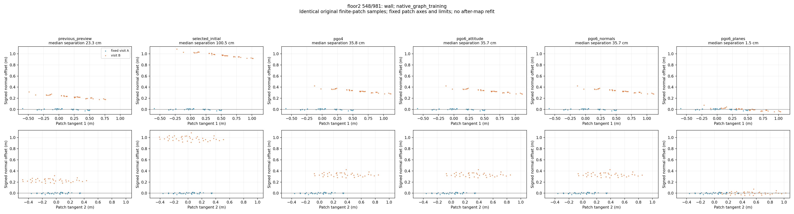

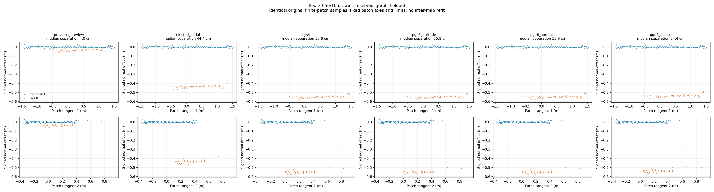

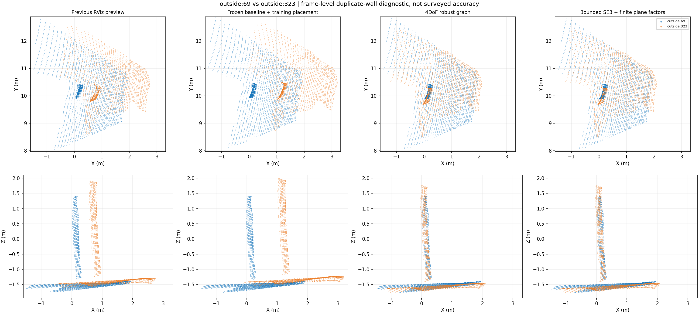

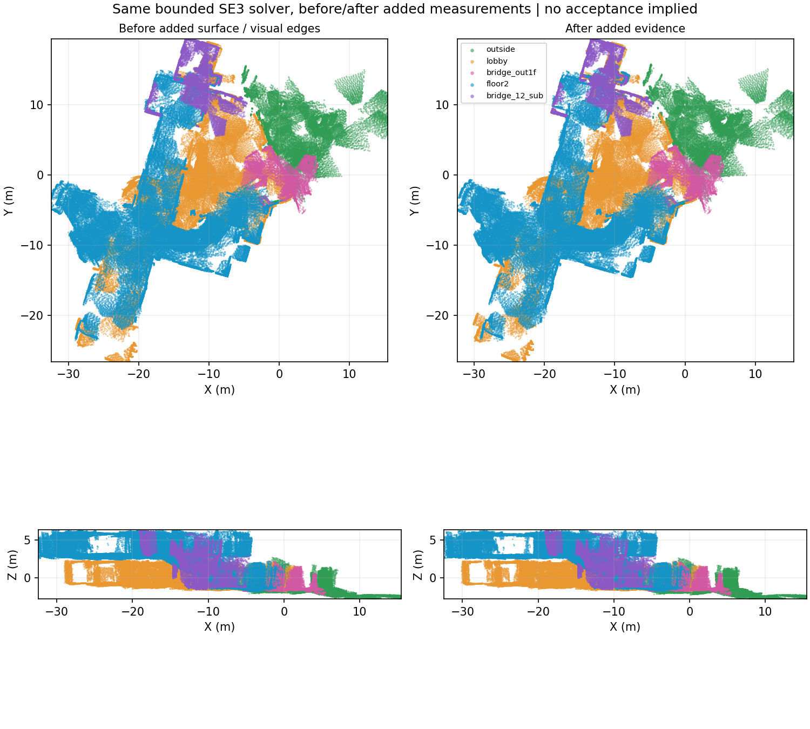

시각화는 이전 RViz 포즈, 선택 기준 포즈의 학습 기반 배치, 4DoF,
유한 평면 포함 SE(3)를 동일한 RGB-D 샘플과 축 범위로 렌더한다. 점을
덜 보여주거나 사후 best-fit 이동해서 정합이 개선된 것처럼 만들지 않는다.
표시를 위한 샘플링과 좌표 범위는 `render_manifest.json`에 기록한다.

`docs/assets/geometry-review/manifest.json`은 README에 포함한 실제 사진과
그림의 원본 경로, SHA-256, 설명, 한계를 보관한다. 무손실 PNG 재압축 후
크기와 디코딩된 RGBA 픽셀이 동일한지 확인한다. 대용량 원본·점군·중간
출력은 기존처럼 Git에서 제외하고 작은 검토용 그림과 수치 요약만 남긴다.

전역·세션별·문제 구간·높이의 단계 비교 PNG 17개와 고정 패치 국소 비교
PNG 28개를 산출했다. 핵심 27개 그림을 README와 연결 가능한 저장소
갤러리에 보관했다. 수치 보고서를 바꾸지 않고 축 라벨 가독성만 개선하는
`src/render_fixed_patch_summary.py`도 남겼다.

원래 전역 렌더 manifest는 포즈 해시만 담았고 높이 그림 한 개를 목록에서
누락했다. 코드 수정과 `figures/postrun_manifest_review.json`으로 실제 17개
PNG·현재 원본 DB·설정·코드 해시를 보완했다. 원래 manifest와 그림은
변경하지 않았다. 사후 점검 기록과 원래 렌더 실행 당시의 provenance는 구분한다.
향후 렌더 실행은 코드·설정·원본 전후 해시와
전체 PNG 목록을 함께 기록한다.

## 9. 새 포즈로 점군 재생성

코드: `src/export_geometry_candidate.py`.
산출물: `candidate_clouds/manifest.json`, `combined_candidate.ply`, 세션별 PLY·CSV·로그.

기존 완성 점군을 단순히 옮기지 않았다. 각 세션의 원본 RGB-D에서
confidence≥50, 깊이 0.25–4m, 전체 사용 가능 프레임·픽셀 stride=1,
voxel=0.05m로 다시 생성했다. 마스크는 사용하지 않았다.

| 세션 | 새 포즈 프레임 | 점군 점 수 |
|---|---:|---:|
| 외부 | 353 | 631,767 |
| 로비 | 949 | 1,943,794 |
| 외부 브리지 | 134 | 237,102 |
| 2층·메인 계단 | 1,215 | 2,451,359 |
| 서브 계단 | 211 | 473,244 |
| 합계 | 2,862 | 5,287,589 |

동결 포즈가 없는 원본 노드 13개(외부349; 로비175/185/319/320/321/398/727/736/904;
2층495/496/497)는 추측 포즈를 만들지 않고 제외했다. 원본 DB에서는 삭제하지 않았다.
다섯 궤적은 `pgo6_planes.csv`와 수치적으로 일치하고 원본 DB 전후 해시도 같다.

이 점군은 `map_geometry_candidate`라는 비교 좌표계의 **실험 후보**다.
세 연결 성분을 화면에 함께 보이도록 배치했을 뿐 외부 연결을 승인하지 않았다.
기존 `EXPLORATORY_ALL_SESSIONS.rviz`와 기본 미리보기는 교체하지 않았다.

## 10. 실행 재현과 코드 검증

전체 세부 `argv`·설정·입력 해시는 각 단계 JSON에 있다. 이전 단계의
`reviewed`, `added_reviewed`, `revalidated`, `all_preview` 산출물이 필요하며
이전 실험 문서에 생성 명령이 있다. 다음은 **이미 검증한 동결 입력**에서
최종 실험을 새 디렉터리로 재현하는 명령이다. 기존 결과를 덮어쓰지 않는다.

```bash
OPENBLAS_NUM_THREADS=1 OMP_NUM_THREADS=2 MKL_NUM_THREADS=1 \
python src/optimize_geometry_stage.py \
  --baselines outputs/student_union_20261017_geometry_review/baselines/report.json \
  --extra-edges outputs/student_union_20261017_geometry_review/connections/union_audit/graph_candidates.json \
  --extra-edges outputs/student_union_20261017_geometry_review/surfaces/near_holdouts/constraints.json \
  --extra-edges outputs/student_union_20261017_geometry_review/surfaces/outside_near_holdouts/constraints.json \
  --extra-edges outputs/student_union_20261017_geometry_review/surfaces/single_frame_near_holdouts/constraints.json \
  --plane-constraints outputs/student_union_20261017_geometry_review/surfaces/plane_reviewed/constraints.json \
  --output outputs/student_union_geometry_reproduction/graph --max-evaluations 500

python src/evaluate_geometry_stage.py \
  --graph outputs/student_union_geometry_reproduction/graph \
  --output outputs/student_union_geometry_reproduction/evaluation --scan-all-historical

python src/render_geometry_progress.py \
  --graph outputs/student_union_geometry_reproduction/graph \
  --baseline-graph outputs/student_union_20261017_geometry_review/graph_control \
  --output outputs/student_union_geometry_reproduction/figures

python src/export_geometry_candidate.py \
  --graph outputs/student_union_geometry_reproduction/graph --variant pgo6_planes \
  --output outputs/student_union_geometry_reproduction/candidate_clouds

python -m pytest -q
```

추가 교차 대응 탐색은 다음으로 재현한다. 초기·추가 시험의 당시 설정을
재현하는 `--no-preserve-prior-sample-holdouts`는 비교 실험 전용이며,
그 결과를 그대로 최종 그래프 입력으로 사용하지 않는다.

```bash
python src/recover_geometry_connections.py \
  --output outputs/student_union_geometry_reproduction/connections \
  --limit-per-connection 35 --no-preserve-prior-sample-holdouts

python src/recover_geometry_connections.py \
  --output outputs/student_union_geometry_reproduction/connections_focused \
  --limit-per-connection 60 --selection ranked \
  --skip-report outputs/student_union_geometry_reproduction/connections/report.json \
  --pair outside:bridge_out1f --pair lobby:bridge_out1f \
  --pair lobby:bridge_12_sub --pair floor2:bridge_12_sub \
  --no-preserve-prior-sample-holdouts

python src/recover_geometry_connections.py \
  --output outputs/student_union_geometry_reproduction/connections_union \
  --audit-passing-report outputs/student_union_geometry_reproduction/connections/report.json \
  --preserve-prior-sample-holdouts
```

코드 테스트는 holdout 학습 제외, 원본 보존, 평면의 접선 방향 자유도,
정합의 관측성 부족, 알려진 변환 회복, 유한 패치 재현과 분리 집계 등을 검사한다.
그림 목록 누락·DB 변경 탐지도 포함하며 전체 **144 passed, 5 subtests passed**다.
지도 품질은 이 단위 테스트와 별도이며, 테스트가 통과해도 기하 승인 상태는 false다.

## 11. 실측과 최종 승인에 필요한 것

문 폭·복도 폭·실제 층고의 독립 실측값은 제공되지 않았다. 영상/점군으로
추정한 길이를 실측이라고 부르지 않는다. 계단 평가의 카메라 Z 범위에는
휴대폰 높이가 포함된다. 이런 항목은 `not_measured`로 남긴다.

메인 계단 세션의 카메라 Z 범위는 선택 초기값5.333→후보4.748m,
서브 계단은4.600→4.675m다. 실제 층고를 모르므로 둘의 차이를 그대로
층고 오차라고 쓰거나 같게 강제하지 않는다. 같은 랜딩을 별도로 확인한
상승/하강 반복 관측과 독립 높이 기준이 부족해 계단 높이의 정확도 승인은 미완료다.

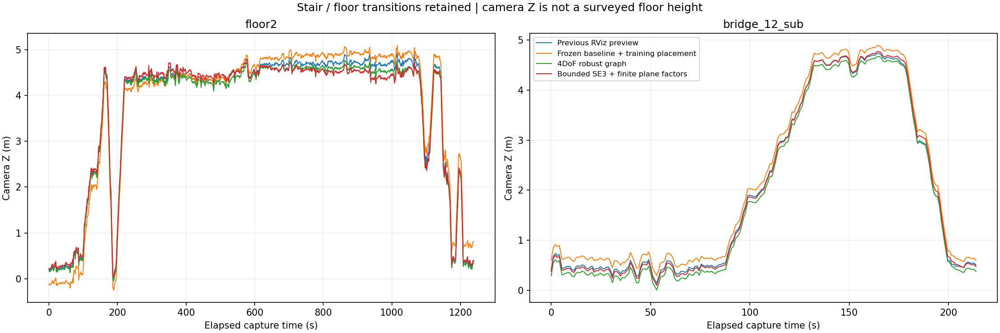

외부↔브리지↔로비의 여러 분산된 공통 구역과 독립적인 층간 검증이 충분하지
않으므로, 국소 개선이 있어도 전체 통합 기하 확정과 navigation 승인은
별도의 미완료 항목이다. 현재 자료로 가능한 재측정·수동 기준점 감사·
최적화·시각 검증을 수행했으며 실패 원인을 함께 기록했다.

현재 확인된 것은 **세션 내부의 체계적인 중복**, **국소 관계를 맞추면 다른
부분에 남거나 이동하는 그래프 불일치**, **연결의 관측 근거 부족**이다.
반사/저조도 깊이 편향, 일부 상대측정과 정보행렬의 부정확성은 가능성이 있으나
이번 실험만으로 각 원인의 비중을 단정할 수 없다. 지면 RANSAC 제거만으로
해결되는 문제는 아니며, 평면 두 개의 좋은 잔차만 보고 전체를 승인하지 않는다.

## 참고와 실제 구현 구분

- [Open3D multiway registration](https://open3d.org/docs/latest/tutorial/pipelines/multiway_registration.html): 다중 관측을 포즈 그래프에서 결합하고 불확실한 연결을 처리하는 개념 참고.
- [Ceres 3D pose graph example](https://github.com/ceres-solver/ceres-solver/blob/master/examples/slam/pose_graph_3d/README.md): 상대 포즈 잔차와 graph gauge 개념 참고.
- [Ceres nonlinear least-squares](https://ceres-solver.readthedocs.io/latest/nnls_modeling.html): 강건 손실의 residual block 개념 참고.
- [OpenCV solvePnP](https://docs.opencv.org/4.12.0/d5/d1f/calib3d_solvePnP.html): 한쪽 3D점과 반대편 2D 관측으로 상대 포즈를 추정하는 PnP 구현 참고.

이번 실제 구현은 NumPy/SciPy/OpenCV다. 위 참고 문헌의 라이브러리를
실행했다는 뜻이 아니다. EKF, GNSS 강제 배치, 전체 지면 평탄화, 메시
복원은 이번 기하 재최적화 실험에 사용하지 않았다.
