# 다섯 로그 독립 재최적화와 구조물 관측의 활용

2026-10-17 실행. 전체 산출물은
`outputs/student_union_20261017_independent_v1/`, Git에 보관하는 수치·사진·출처는
[시각자료 폴더](../assets/independent-structure-review/),
[수치 요약](../assets/independent-structure-review/summary.json),
[사진 manifest](../assets/independent-structure-review/manifest.json)에 있다.

이번에 다섯 세션의 **독립 그래프 최적화 15회**를 실행하고, 세션별 동일 프레임으로
기준·실험 점군 10개를 재생성했다. 이후 수동 구조물 관측을 활용한 새 상대 포즈를
2층 전체 그래프에 약하게 반영하여 11번째 점군도 만들었다.
새 2층 후보에서 548↔981 벽 간격은 직전 BA 후보 24.93cm에서 **0.98cm**로
줄었다. 다만 전체 지도가 확정된 것은 아니다. 같은 38패치에서 기존 RViz보다
5cm 이상 악화한 패치 7개가 남아 기본 지도를 교체하지 않았다.

## 1. 입력과 처리 범위

| 세션 | 원본 DB | 전체 프레임 | 사용 A/B 프레임 | 서브맵 | 독립 그래프 내부 루프 학습/예약 |
|---|---|---:|---:|---:|---:|
| 외부 | `261016-234854-outside.db` | 354 | 305 | 85 | 8 / 2 |
| 로비 | `261017-000622-1f.db` | 958 | 800 | 171 | 17 / 5 |
| 외부–로비 브리지 | `261017-011331-bridgeout1f.db` | 134 | 86 | 17 | 0 / 0 |
| 2층·메인 계단 | `261017-013501-2f.db` | 1218 | 925 | 227 | 19 / 6 |
| 서브 계단 | `261017-013904-bridg12_2.db` | 211 | 135 | 32 | 1 / 0 |

기존 품질 감사의 A/B/C 분류와 검증된 상대 측정값을 재사용했다. RGB-D 특징을
다섯 DB 전체에서 다시 추출한 실행은 아니다. 새로운 영상·깊이 관측 처리는 뒤의
문틀과 2층 반복 벽 실험에서 수행했다. 세션 이름 `floor2`는 1층 일부·메인 계단도
포함하는 촬영 로그 전체를 뜻한다.

`src/isolate_floor2_graph.py`에 `--session`을 추가했다. 각 세션의 초기 포즈,
측정값, 공분산, 학습/예약 역할을 유지하면서 다른 세션의 노드와 모든 교차 세션
제약을 제외했다. 합계 532개 서브맵, 585개 내부 제약이다. 학습 성분마다 gauge를
고정했고, 예약 edge는 성분 연결이나 fitting에 사용하지 않았다.

외부 브리지에는 이전에 통과했던 native 루프가 1개 있지만, 이번 품질 서브맵
그래프에 남은 루프는 0개다. 초기 포즈에서 만든 연속성 측정만 있는 트리는
새 절대 형상을 결정할 수 없다. 이 세션의 세 방법이 거의 같은 초기 포즈를
출력한 것은 알고리즘 차이보다 관측 정보가 부족하기 때문이다.

원본 DB는 읽기 전용으로 열었다. 모든 DB의 SHA-256은 기존 감사 해시와 일치한다.
RGB/depth 원본, 카메라 보정값, 지면 높이, 계단 높이, RViz 기본 설정은 수정하지 않았다.

## 2. 세션마다 비교한 알고리즘

`src/optimize_robust_submaps.py`로 각 로그에 다음 세 방법을 새로 실행했다.
최적화 변수는 서브맵마다 SE(3) 보정이며, 저장된 상대 측정과 예측 상대 포즈의
오차를 공분산으로 whitening한다. 강건화는 odometry 외 제약에 적용한다.

1. **Block-Huber IRLS:** 정규화된 edge 오차가 delta=3을 넘을 때 정보량을 낮춘다.
2. **DCS:** `s=min(1, 2φ/(φ+χ²))`, 정보량 `s²`, `φ=5.991`.
3. **구역 공유 switch:** 한 물리 구역에 속한 edge의 χ² 중앙값을 사용해
   `s=λ/(λ+median χ²)`, 정보량 `s²`, `λ=10`을 적용한다.
   같은 구역에서 연속 촬영한 프레임 수가 독립 장소 수로 누적되지 않게 한다.

공통 설정은 outer 최대 12회, inner 최대 150회, world translation 성분 보정 한계
±5m, rotation-vector 성분 한계 ±30°다. SciPy TRF/LSMR,
`ftol=xtol=gtol=1e-9`, 선형 허용오차 `1e-10`을 사용했다. 이 보정 한계와
공분산 모델은 실측 정확도를 나타내지 않는다. 이번 실행에서는 leave-one-group
추가 최적화는 생략했으며, 이를 수행한 것으로 계산하지 않았다.

외부와 두 브리지는 모든 방법에서 엄격한 outer 종료 기준까지 도달했다.
로비와 2층은 마지막 inner solver의 비용 종료 조건은 충족했지만,
`max step < 1e-7`의 엄격한 outer 기준에는 12회 안에 도달하지 않았다.
한도 증가만으로 형상 오류가 사라진다는 근거는 없다.
각 회차와 공분산·edge 가중치는 `optimization/<session>/report.json`에 있다.

서브맵 보정은 같은 품질 run 내부의 경로 길이에 따라 translation 선형 보간과
회전 SLERP로 프레임에 확장했다. hard boundary를 가로질러 보간하지 않았다.
C 프레임은 점군에서 제외하고 누락 수를 기록했다.

기존 4DoF 강건 PGO와 앞서 수행한 2층 RGB-D BA 후보도 비교에 추가했다.
이 둘은 이번에 새로 계산한 알고리즘으로 중복 집계하지 않았다.

## 3. 기준 포즈와 선택 과정에서 확인한 문제

앱 초기 포즈인 `selected_initial`과 이전 RViz의 `incumbent_preview`는 서로 다르다.
이전 RViz의 로비·2층에는 앞선 공동 그래프 가설이 이미 반영되어 있다.
따라서 새 후보가 앱 초기 포즈보다 개선됐다는 사실만으로 기존 화면보다 낫다고
선택하면 안 된다. 첫 검토 결과는 `review_initial_only_superseded.json`으로 보존하고,
이전 RViz 포즈까지 포함해 다시 비교했다.

서로 다른 세션 좌표계는 최초 공통 카메라의 **단 한 번의 강체 gauge 변환**으로
맞췄다. 이 변환은 내부 상대 포즈를 바꾸지 않는다. 좌표계를 맞추지 않은 채
translation 차이를 최적화 변형으로 세거나 다른 축 범위의 사진을 비교하지 않았다.

평가 패치는 기존 유한 평면의 ID·깊이 샘플·대응을 한 번 복원해 고정했다.
후보를 본 뒤 다시 평면을 fitting하거나 잘 맞는 패치만 선정하지 않았다.
전체 이력 122패치 중 모든 후보에서 공통으로 남는 90패치는 외부 16,
로비 36, 2층 38개다. 품질 필터로 빠진 32패치를 개선으로 계산하지 않았다.
미사용 loop 및 결정적으로 선택한 인접 프레임 최대 30쌍의 깊이 거리도 검사했다.
이 자료는 반복 개발에 사용한 관측이며 독립 측량 데이터가 아니다.

| 공통 패치의 중앙값 / P90 / 최대 | 기존 RViz | 독립 DCS |
|---|---:|---:|
| 외부 16패치 | 12.88 / 28.98 / 59.84cm | 8.41 / 20.97 / 31.98cm |
| 로비 36패치 | 3.03 / 21.79 / 44.59cm | 4.49 / 18.22 / 60.61cm |
| 2층 38패치 | 4.67 / 10.65 / 23.28cm | 5.98 / 20.59 / 115.54cm |

외부는 분포가 개선됐지만 기존보다 5cm 이상 나빠진 패치 3개가 있다.
로비 DCS는 6개, 2층 DCS는 9개다. 기존 대비 악화 한계·미사용 관측·수렴을 함께
검사했으므로 이 후보들을 기본 지도로 자동 교체하지 않았다.
브리지 두 세션은 비교에 쓸 고정 패치/예약 루프가 부족해 개선을 입증하지 못했다.

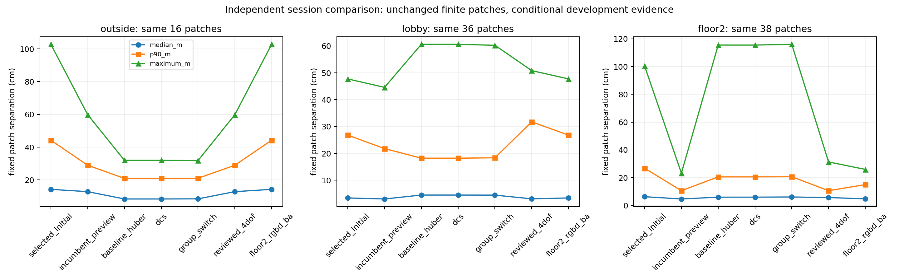

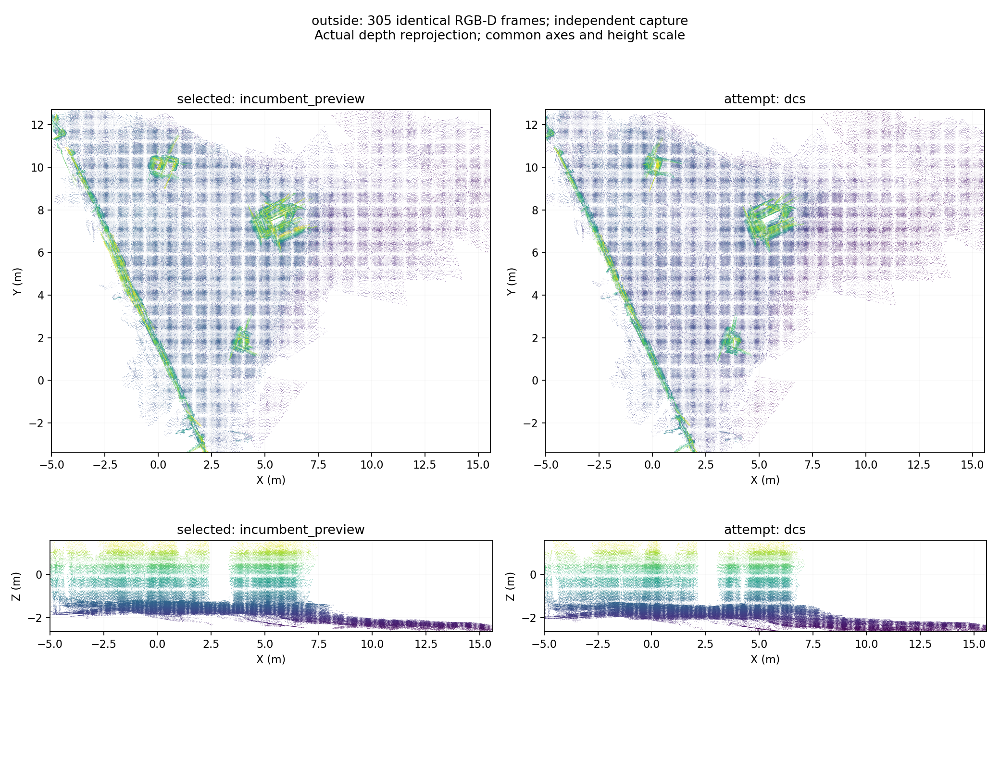

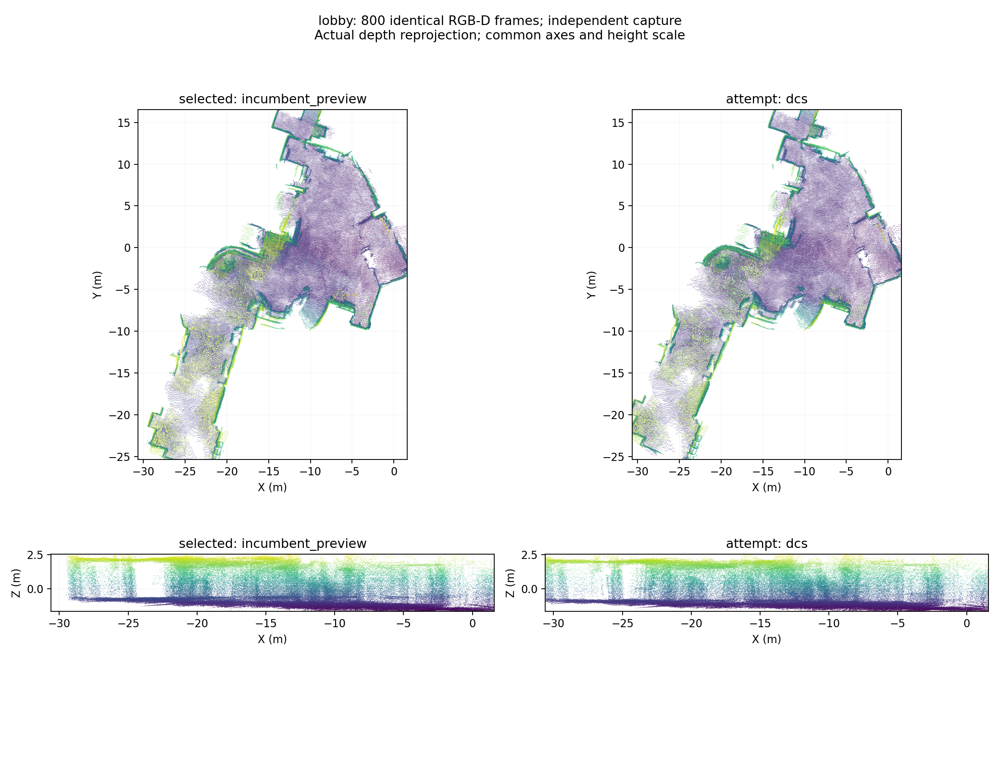

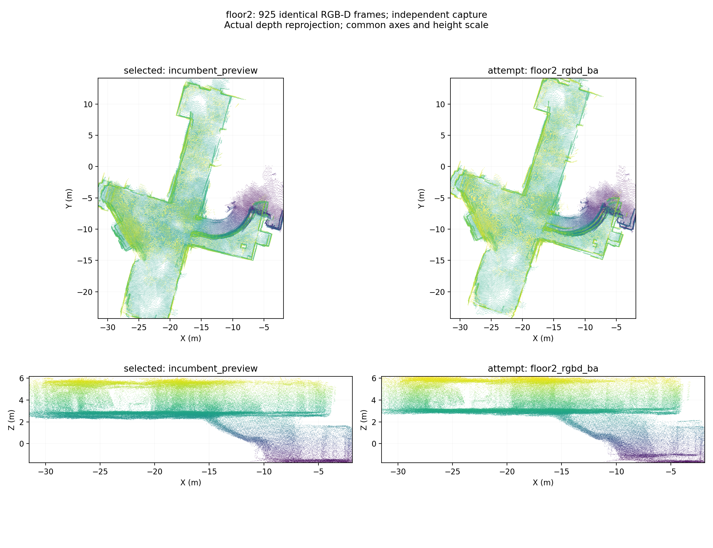

[외부 브리지 사진](../assets/independent-structure-review/bridge_out1f_clouds.png)과
[서브 계단 사진](../assets/independent-structure-review/bridge_12_sub_clouds.png)도 보관했다.

## 4. 빨간 수동 기준점이 의미했던 것과 임계값 실험

검토에서 확인한 로비39↔외부 브리지79의 8개 모서리는 영상에서 같은 구조를
식별하는 관측으로 사용할 수 있다. 기존 사진의 빨간색은 **틀린 RGB 대응**이라는
뜻이 아니라 양쪽 깊이가 모두 조건을 통과하지 못했다는 뜻이었다.

기존 깊이 판정은 confidence≥50, 거리 0.25~5m, 3×3 영역의 유효 픽셀≥5개,
유효 깊이 범위≤12cm다. iPhone confidence 값은 이 DB에서 0/50/100이다.
모서리는 원래 앞·뒤 표면이 섞이기 쉬워 깊이 연속성 조건에 민감하다.

| 깊이 범위 한계 | 양쪽 모두 유효한 모서리 |
|---|---:|
| 6cm | 2 / 8 |
| 12cm | 3 / 8 |
| 13cm | 3 / 8 |
| 25cm | 5 / 8 |
| 40cm | 5 / 8 |
| 60cm | 6 / 8 |

브리지 4번의 범위는 12.30cm여서 경계값에 걸렸다. 하지만 로비 3번과
브리지 1번은 해당 주변에 confidence≥50 깊이 픽셀이 없었다.
양쪽 3D 대응 수가 모든 영상 대응의 수는 아니다. 자동 매칭용 12/20점 조건을
수동 점 8개에 그대로 적용해 fitting 자체를 막은 방식은 활용 범위가 지나치게 좁았다.

이번에는 8개 모두 RGB 잔차로 사용했다. 한쪽 깊이만 있어도 깊이 잔차를 추가하고,
깊이가 없는 쪽은 재투영 관측을 유지했다. soft 깊이 후보는 유효 픽셀≥3개,
깊이 범위≤60cm로 후보를 만들되 `σ_depth=0.06m + 0.5×깊이 범위`로 약하게
반영했다. confidence 0 깊이는 metric 관측으로 쓰지 않았다.
이 오차 모델은 보정된 센서 통계가 아닌 실험용 불확실성 모델이다.

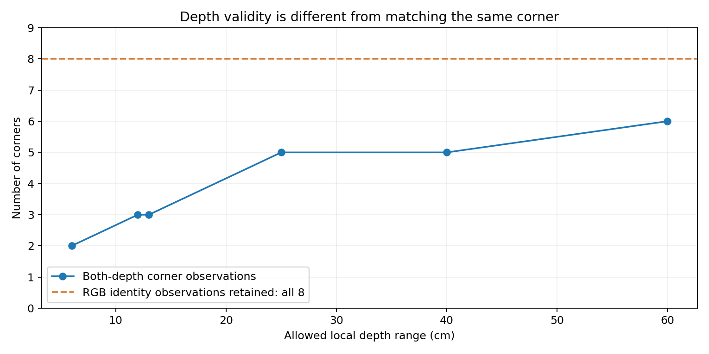

## 5. 수동 구조물 + 다중 프레임 재투영

코드는 `src/refine_manual_structure.py`다. 임의의 세션·프레임 쌍을 annotation JSON으로
지정할 수 있으며, 세션 간 출입구와 한 세션의 반복 벽에 동일한 구현을 사용했다.

1. 원본 720×960 RGB에서 고정 구조물의 수동 픽셀과 ±5px 또는 ±8px 불확실성을 기록한다.
   기존 문틀은 이전 assistant가 표시한 점이고, 2층 점도 assistant 시각 추정이다.
   정밀 수동 클릭이나 실측 관측은 아니다.
2. 중심 프레임에서 인접 ±1,2,3 프레임으로 pyramidal LK를 추적한다.
   31px window, pyramid 4, forward/backward 오차<2px를 사용한다.
3. 최초 버전에서 비슷한 모서리로 잘못 이동한 추적을 사진으로 발견했다.
   이후 원본 패치 상관≥0.60, 기존 포즈로 예상한 위치와 차이<60px 검사를 추가했다.
   이 선택은 기존 포즈에 조건부이며 독립 검증으로 표현하지 않는다.
4. 각 세션 내부 카메라 상대 포즈와 보정값은 고정하고, 두 촬영 구역 사이의
   상대 SE(3)와 공유 landmark 좌표를 공동 최적화한다. 카메라 전체를 움직이는
   full BA와는 구별한다. landmark 초기값은 신뢰 깊이 또는 보정된 광선 삼각측량이다.
5. RGB 재투영과 유효 optical-depth 잔차에 Huber를 적용한다. 한 landmark를 같은
   방문에서 반복 관측한 수의 제곱근으로 정규화하여 반복 프레임이 클릭 오차를
   부당하게 없애지 않게 한다. TRF, dense Jacobian, 최대 1000평가를 사용한다.
6. 학습 ±3과 겹치지 않는 ±5,6 프레임의 실제 RGB/depth를 평가한다.
   같은 센서·인접 궤적이므로 독립 측량 검증은 아니다.
7. landmark 변수를 Jacobian에서 제거한 뒤 포즈의 data rank를 검사한다.
   pose prior를 넣어 가짜 full rank를 만들지 않았다. 픽셀·m·rad의 혼합 단위
   conditioning을 보정된 공분산으로 해석하지 않는다.
8. 클릭 불확실성을 방문/landmark별로 공유한 12회 perturbation 실험을 수행한다.
   같은 점을 여러 번 추적했다고 클릭 오차를 독립 노이즈로 나누지 않는다.

문틀 실험은 중심만 fitting한 후보와 다중 프레임 후보를 비교했다.
다중 프레임 후보는 34개 RGB 관측, 31개 유효 깊이 관측을 사용했고
학습 재투영 중앙값은 2.48px였다. 그러나 예약 RGB 관측은 5개뿐이고
P90은 13.41→15.34px, 클릭 perturbation의 상대 위치 변동은 최대 26.36cm였다.
강한 전체 지도 연결로 승격하지 않았다. 외부263↔브리지117의 두 기준점은
부분 관측으로 남겼으며 6DoF 포즈를 단독 확정하지 않았다.

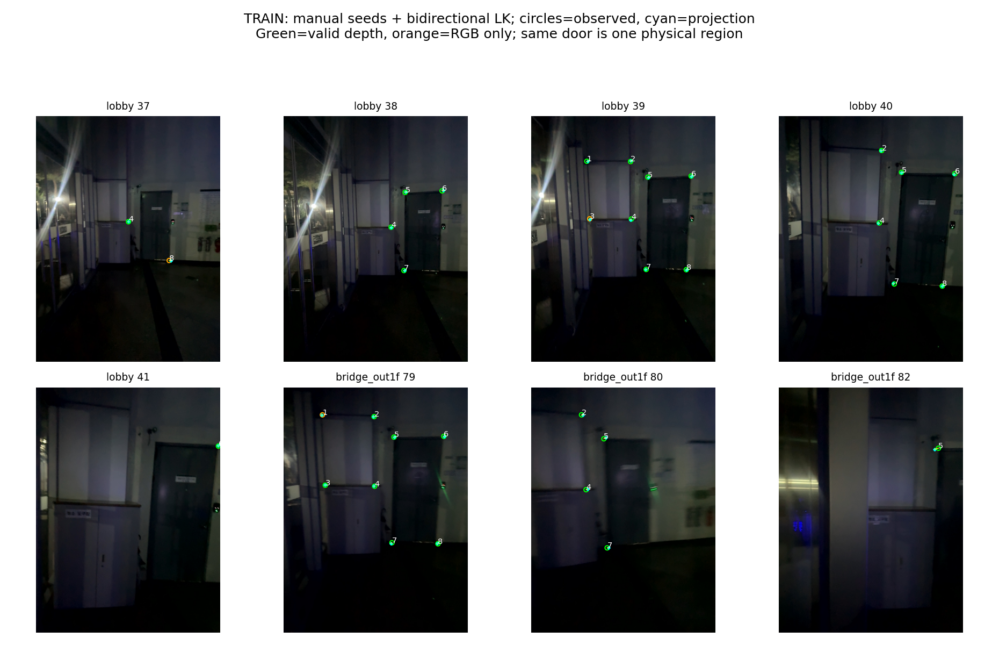

## 6. 반복 벽: 바닥·벽·모서리가 서로 다른 방향을 보완

비교 화면의 네 열은 시간순 최신 결과가 아니라 서로 다른 방법의 과거 비교다.
X/Y/Z는 회전과 연결되어 있으므로 서로 다른 후보의 좌표 성분을 이어 붙이지 않았다.
또한 서로 다른 시야의 점군 중심 차이를 대응점 X/Y 오차로 계산하지 않았다.

548↔981의 같은 검은 격자문, 불투명 파티션, 난간 코너를 원본에서 확인해
8개 영상 기준점을 `config/student_union_manual_structures.json`에 추가했다.
직접 유효 깊이를 제공한 landmark는 2개뿐이지만, 나머지 RGB 관측을 버리지 않고
31개 학습 RGB·5개 depth 관측과 카메라 사이 기하로 함께 fitting했다.

여기에 같은 유한 바닥/벽의 training 깊이로 추정한 법선·중심을 추가했다.
RANSAC/SVD로 얻은 `wall:0↔0`, `horizontal:0↔0`을 고정하고,
평면 법선 방향 거리 잔차(σ=8cm)와 법선 방향 차이(σ=3°)를 사용했다.
한 평면의 중심끼리 X/Y/Z를 강제로 일치시키는 잔차는 사용하지 않았다.
바닥·벽의 교차선 방향은 영상 모서리 관측이 보완한다.
계단과 외부 전체를 한 평면으로 만드는 제약은 없다.

| 같은 유한 패치의 거리 | 이전 RViz | 과거 4DoF | 과거 평면 후보 | 새 구조물 공동 fitting |
|---|---:|---:|---:|---:|
| 바닥 법선 방향 | 12.46cm | 7.47cm | 14.51cm | 3.20cm |
| 벽 법선 방향 | 23.28cm | 35.83cm | 1.54cm | 1.60cm |

이 표의 새 평면은 학습에 사용했으므로 훈련 관계의 개선이다. 법선 각도는
모든 방향에서 개선되지 않았다. 바닥 법선 차이는 기존 2.38°에서 3.14°가 됐다.
세부 각도와 거리를 모두 [방향별 JSON](../assets/independent-structure-review/summary.json)에
연결된 원본 보고서와 `directional_diagnostics/report.json`에 남겼다.

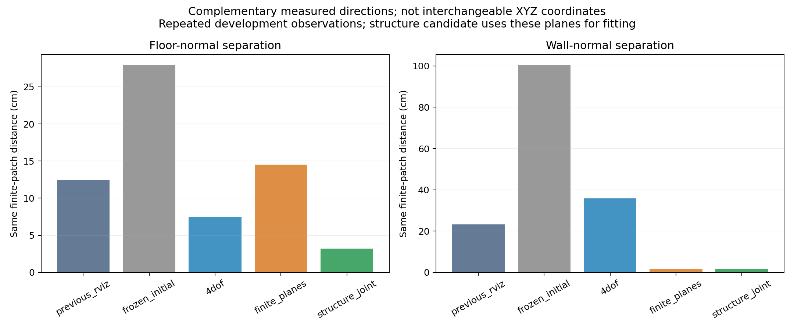

미사용 영상 재투영 중앙값은 10.75→4.26px, P90은 27.22→20.44px였다.
미사용 프레임 점군의 20cm clipped RMSE는 18.35→17.75cm,
overlap은 0.232→0.293이었다. 클릭 perturbation 위치 변화는 최대 30.63cm다.
강한 제약의 기준은 충족하지 못해도, 개선 방향과 불확실성을 기록한 **약한 개발 제약**으로
전체 2층에 시험할 수 있다고 판단했다. 검증 통과와 같은 의미로 부르지 않는다.

## 7. 약한 구조물 제약을 전체 2층에 실제 반영

코드는 `src/integrate_weak_structure.py`다. 직전 `integration_nominal` 프레임 그래프의
1215개 포즈를 warm start로 사용했다. 548↔981의 기존 같은 endpoint loop를
보관·제외한 뒤 새 제약 1개로 대체했다. 같은 관측을 두 번 집계하지 않았다.
예약 edge를 학습으로 바꾸는 경우는 거부했다.

translation sigma는 모델 하한 20cm와 perturbation 최대 이동 중 큰 값인
**30.63cm**, rotation sigma는 하한 **5°**를 사용했다. 보정된 통계 공분산이 아니라
민감도를 반영한 보수적 isotropic 모델이다. 바닥·벽·8개 코너가 하나의 구역에서
나왔으므로 여러 독립 edge 대신 `manual_structure_weak:548:981` 한 개를 추가했다.
Huber PGO는 SE(3) 전체를 함께 풀며, 특정 축을 다른 후보에서 복사하지 않는다.

20 outer회, inner 최대 500평가, batched residual·중앙차분·LSMR 최대 10000을 사용했다.
마지막 inner는 `ftol` 종료, 활성 bound 0이지만 엄격한 outer step 기준은 미달이다.
마지막 step은 9.16e-6이다. 이 수치 한계도 남겼다.

| 동일 38개 패치 | 중앙값 | P90 | 최대 |
|---|---:|---:|---:|
| 기존 RViz | 4.67cm | 10.65cm | 23.28cm |
| 직전 RGB-D BA + PGO | 4.76cm | 15.03cm | 25.97cm |
| 구조물 약한 제약 + PGO | **4.49cm** | **11.97cm** | **24.64cm** |

548↔981 벽은 직전 24.93→**0.98cm**, 656↔1055는 5.14→5.12cm다.
하지만 642↔1031 수평 패치는 18.71cm, 644↔1035 벽은 11.36cm로 남는다.
기존 RViz보다 5cm 이상 악화한 패치 7개가 유지된다. 따라서 일부 벽 개선을
전체 지도 승인으로 표현하거나 기본 RViz를 자동 교체하지 않았다.

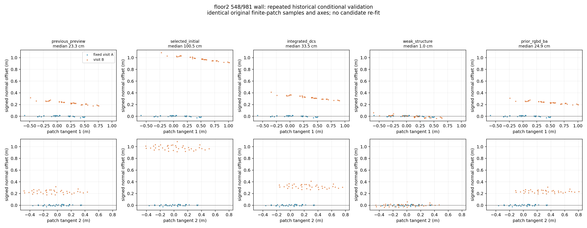

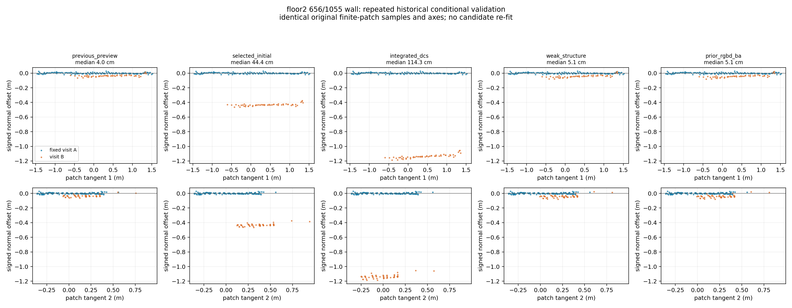

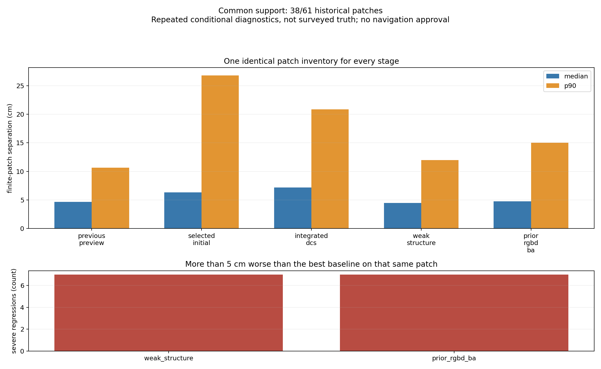

925개 동일 A/B 프레임, confidence≥50, 0.25~4m, pixel stride=1,
5cm voxel로 재생성한 최신 비교 점군은 **2,283,395점**이다.

`outputs/student_union_20261017_independent_v1/clouds/floor2/weak_structure/cloud.ply`

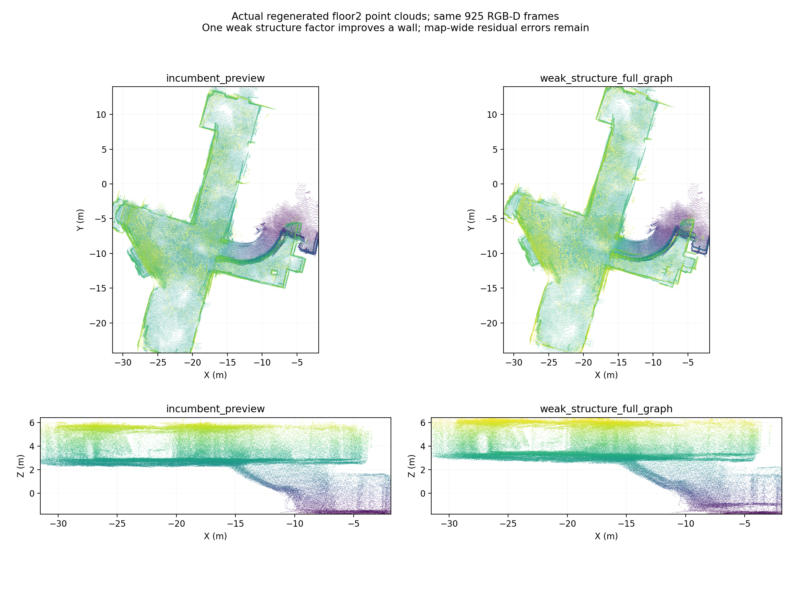

## 8. 합치기 판단과 남은 구간

이번 15개 독립 그래프에는 교차 세션 제약이 없다. 기존 canonical 연결 근거는
외부↔외부 브리지 0, 외부 브리지↔로비 0, 로비↔2층 학습 3·예약 1,
로비↔서브 계단 1개다. 다섯 세션 전체를 지지하는 연결 그래프는 아직 없다.
새 문틀 fitting도 한 물리 출입구의 관측이므로 독립된 공통 구역 여러 개를
확보한 것으로 세지 않는다. 이번 단계에서 합친 PLY나 새 통합 RViz는 만들지 않았다.

반복 벽 식별에 구조물을 사용할 수 있음은 실제 fitting과 2층 PGO 반영으로 확인했다.
다음에는 기존 사진에서 642↔1031, 644↔1035 등 남은 구간의 고정 구조물을
확인해 같은 형태의 약한/강한 관측을 추가하고, 지지하는 방향과 민감도를 기록해야 한다.
기존 자료의 대응 가능 구간을 먼저 조사한다. 실측 층고·문 폭과 최종 사용자
지도용 검증은 여전히 별도 작업이다.

## 9. 파일과 재현 명령

세션별 포즈: `selected/<session>/trajectory.csv`는 기존 기준을 gauge만 맞춘 보존본,
새 독립 후보는 `expanded_sessions/<session>/<method>/<session>/trajectory.csv`다.
기준/후보 점군은 `clouds/<session>/selected/cloud.ply`, `attempt/cloud.ply`다.
최신 약한 제약 2층 포즈는 `structure_integration/trajectory_AB.csv`이며 전체 평가는
`structure_integration_evaluation/report.json`이다. `selected`를 새 최적화 채택본으로
오해하지 않도록 `review.json`의 `selected_label`과 출처를 함께 확인한다.

독립 최적화 명령과 설정은 `commands_optimization.json`, 각 `logs/`에 있다.
기존 산출물을 덮어쓰지 않고 fresh output을 지정해야 한다.

```bash
python3 src/isolate_floor2_graph.py --session outside \
  --manifest outputs/student_union_20261017_submap_robust/graph_input_v7/manifest.json \
  --output NEW_RUN/isolation/outside
python3 src/optimize_robust_submaps.py \
  --manifest NEW_RUN/isolation/outside/manifest.json \
  --output NEW_RUN/optimization/outside --outer-iterations 12 --max-evaluations 150 \
  --translation-bound 5 --rotation-bound-degrees 30 --skip-leave-one-group
# 위 두 명령을 나머지 4개 session에도 적용한 후:
python3 src/review_independent_sessions.py --run NEW_RUN --stage prepare
python3 src/evaluate_submap_candidates.py --expanded-root NEW_RUN/expanded \
  --graph-manifest NEW_RUN/disjoint_graph.json --scan-all-historical --output NEW_RUN/evaluation
python3 src/review_independent_sessions.py --run NEW_RUN --stage review
python3 src/review_independent_sessions.py --run NEW_RUN --stage export
python3 src/review_independent_sessions.py --run NEW_RUN --stage render

python3 src/refine_manual_structure.py --depth-policy soft \
  --output NEW_MANUAL_OUTPUT
python3 src/refine_manual_structure.py --annotations config/student_union_manual_structures.json \
  --depth-policy soft --output NEW_STRUCTURE_OUTPUT
python3 src/integrate_weak_structure.py \
  --source outputs/student_union_20261017_floor2_revisit_v2/integration_nominal \
  --measurement NEW_STRUCTURE_OUTPUT/floor2_548__floor2_981/report.json \
  --output NEW_INTEGRATION_OUTPUT
```

중간에 중단된 prepare의 완료된 확장은 입력 해시를 확인한 뒤 재사용한다.
경로 문자열/Path 오류와 첫 tracking 오대응을 수정했고, 중간 결과는
`*_superseded`, `manual_structure`, `floor2_structure_soft_v2/v3`에 남겼다.
`review_before_solver_metadata_fix.json`의 BA inner 성공 표기 오류는 현재
`review.json`에서 원본 solver 보고서를 읽도록 수정했다. 결과 선택은 바뀌지 않았다.

검증: 전체 `python3 -m pytest -q` **341 passed**. 이 중 새 테스트는 RGB-only 관측이
깊이 없는 쪽에서 유지되는 경우의 포즈 회복, gauge 상대 포즈 보존, 나쁜 벽을
중앙값과 별도의 국소 회귀 판정, 미사용 edge 승격 방지, 약한 제약 중복 제거를 확인한다.
테스트 통과는 지도 실측 정확도의 증명이 아니다. 사진은 실제 RGB/depth와 계산
결과이며 생성형 이미지가 아니다. 원본/산출물 해시는 각 보고서와 사진 manifest에 있다.

구현 이론 참고: [OpenCV PnP와 상대 관측](https://docs.opencv.org/4.12.0/d5/d1f/calib3d_solvePnP.html),
[Ceres 재투영 잔차·강건 손실 설명](https://ceres-solver.readthedocs.io/latest/nnls_tutorial.html).
실제 구현은 저장된 카메라 보정을 사용한 SciPy 최적화이며 Ceres를 호출한 것은 아니다.
