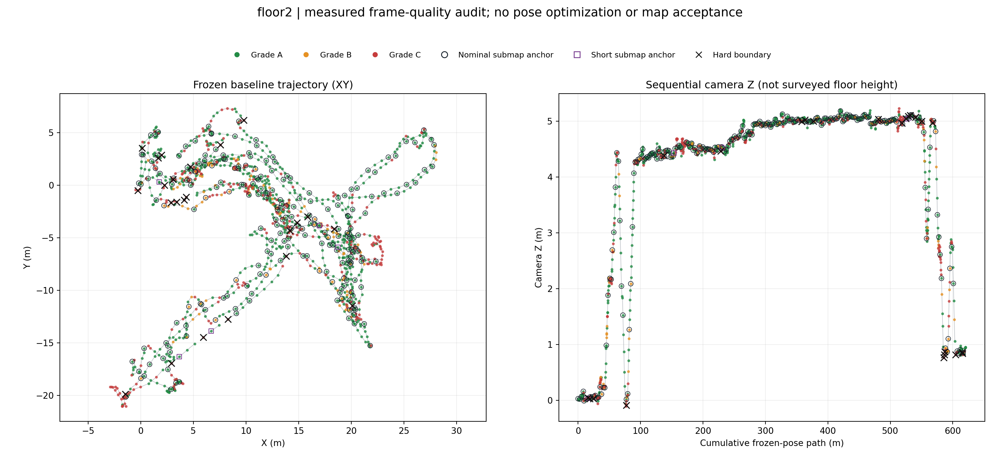
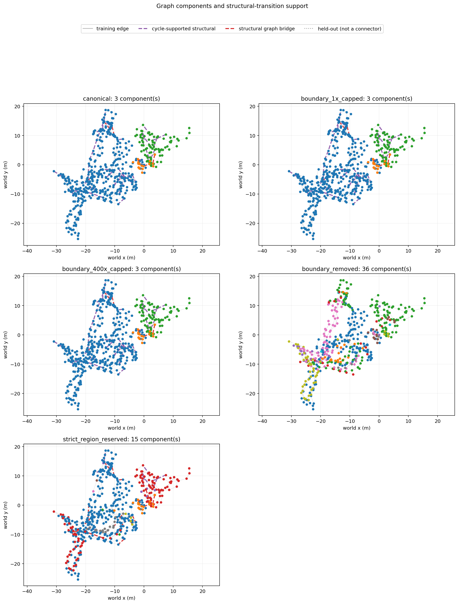
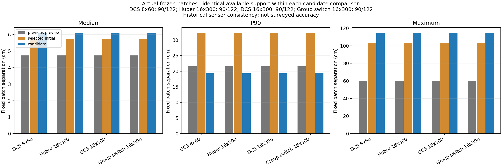
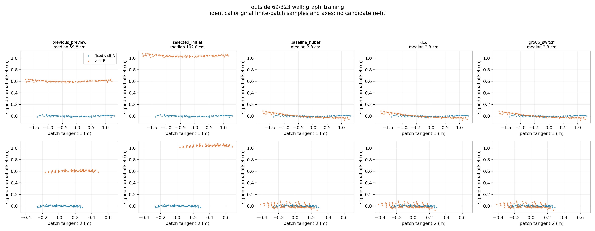
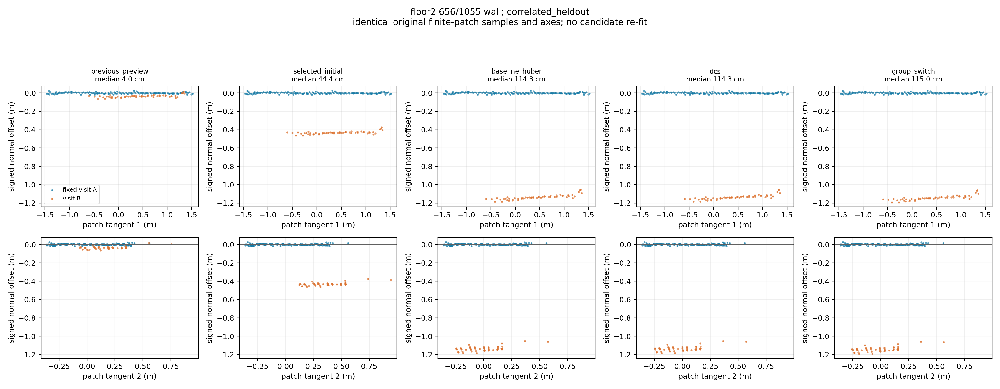
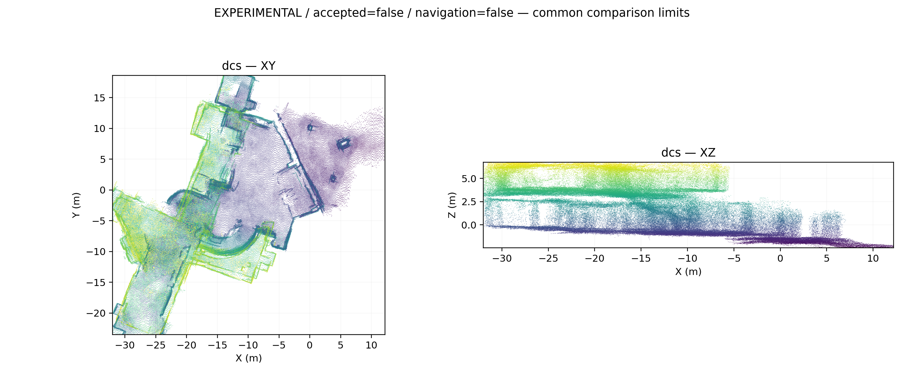
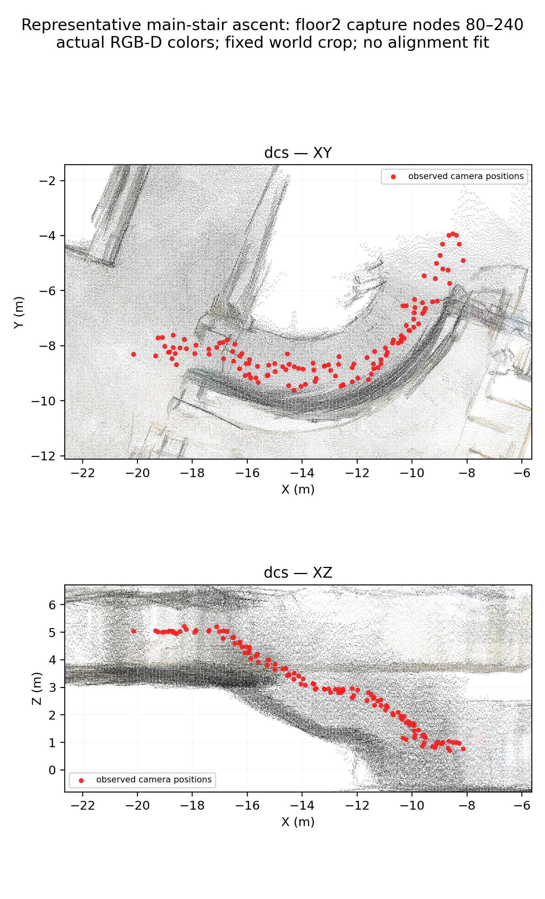

# 서브맵 기반 강건 최적화와 재검토 기록

2026-10-17, 제1학생회관. 이전 [기하 지도 재검토](2026-10-17-geometry-correction.md)에
이어, 품질이 나쁜 프레임·상관된 대응·연결 경계가 큰 중복 벽에 미치는 영향을
분리하는 실험이다. 원본 DB 5개와 과거 결과를 보존한다. 모든 그림은 실제
센서 관측 또는 실제 계산값으로 만든다.

현재 기준 입력은 `outputs/student_union_20261017_submap_robust/graph_input_v7/`이다.
v6는 아래 제약 역할 오류를 포함한 과거 진단이며, 새 지도 채택 근거로 사용하지 않는다.
원본 파일, 실행 명령, 소스 스냅샷, 입력·출력 SHA-256은 각 결과 디렉터리에 남긴다.

## 재진행하면서 발견하고 수정한 문제

직전 변경을 되돌린 상태에서 소스와 남아 있던 결과를 대조했다.
그래프 생성·포즈 확장·초기 gate 코드가 사라졌고 backend의 구역별 정보량 정규화가
빠져 있었다. 저장된 스냅샷을 검토한 뒤 코드를 재구축하고 수치·계약 테스트를 추가했다.
기존 출력이 남아 있다는 이유만으로 현재 소스의 실행 결과라고 취급하지 않았다.

1. `joint_role=local_evidence_only` 관계가 전역 학습 제약으로 승격되는 오류를 수정했다.
   로비462↔서브36, 2층553↔서브159가 v6에 실제 포함돼 있었다. v7에서는 제외한다.
   2층560↔서브162도 같은 역할로 제외 기록하지만, v6에서도 품질 필터로 이미 빠져 있었다.
2. 같은 구역의 비-odometry 제약 N개에 총 정보량이 N배 쌓이지 않도록 각 목적항을
   `1/N`로 정규화했다. 동일 측정을 5번 복제한 경우 한 번과 같은 포즈 영향을 갖는지
   Huber/DCS/group-switch 모두 시험했다. 이는 상관을 근사하는 공학적 규칙이며,
   센서 간 교차 공분산을 직접 추정한 통계 모델은 아니다.
3. pose expansion에서 실제 입력 그래프 hash, quality 파일, 초기 포즈,
   anchor/session/run 일치 여부를 검사한다. 다른 실행 보고서를 잘못 연결하면 중단한다.
4. 전체 122개 기준 패치와 후보에서 남은 90개를 섞어 개선률을 계산하지 않는다.
   각 후보가 평가 가능한 **동일 패치 집합**에서 기준과 후보를 함께 계산한다.
   누락한 패치는 0 오차가 아니라 결측으로 기록한다.
5. LORO라는 이름의 결과는 **해당 구역을 제외한 측정 경로의 cycle 불일치**이다.
   이번 실행은 구역마다 전체 그래프를 다시 최적화하는 leave-one-out을 수행하지 않았다.
   이 값을 실제 위치 오차, 위치 불확실성, 측량 정확도라고 해석하지 않는다.

## 1. 프레임 품질 검사와 작은 지도 구간

코드: `src/build_quality_submaps.py`, `src/render_submap_quality.py`.
결과: `outputs/student_union_20261017_submap_quality/`.

| 세션 | 프레임 | A | B | C | 상관 그룹 | 서브맵 |
|---|---:|---:|---:|---:|---:|---:|
| 외부 | 354 | 237 | 68 | 49 | 303 | 85 |
| 1층 로비 | 958 | 637 | 163 | 158 | 767 | 171 |
| 외부–로비 브리지 | 134 | 78 | 8 | 48 | 84 | 17 |
| 메인 계단·2층 | 1,218 | 815 | 110 | 293 | 901 | 227 |
| 서브 계단 | 211 | 116 | 19 | 76 | 133 | 32 |
| 합계 | 2,875 | 1,883 | 368 | 624 | 2,188 | 532 |

평가 항목은 confidence, 0.25–4m 유효 깊이 비율, 깊이 이웃 지지율,
장변 640px 회색 영상의 Laplacian 분산, 노출 clipping, depth 좌표에서의 intrinsic 변화,
포즈 증분, 시간 간격이다. A≥75점, B≥45점이며 치명 임계값 위반은 C로 분류한다.
점수는 추적 정확도의 확률이 아니며, 깊이가 매끈해도 전역 포즈가 틀릴 수 있다.
전체 임계값은 품질 manifest의 `thresholds`에 저장한다.

대표 프레임으로부터 0.30m·8°·3초 이내 프레임을 같은 상관 그룹으로 묶는다.
품질 C는 정합 근거와 후보 점군 재생성에서 제외하지만, 영상이 흐리다는 이유만으로
추적이 끊겼다고 단정하지 않는다. 명시적 경계는 >1m 이동, >75° 회전, >5초 간격,
>3 depth-pixel intrinsic 변화, 기준 포즈 없음, 깊이/보정값 decode 실패다.
경계 65개를 기록했다. 큰 포즈 증분은 keyframe 간격의 영향도 있으므로 추적 실패의 확정 라벨은 아니다.

동일 run 안에서 목표 3.5m, 최대 5m, 겹침 약 1m로 작은 지도 구간을 만든다.
532개 중 521개는 2–5m이고 11개는 경계 때문에 남은 짧은 조각이다.
겹치는 서브맵끼리도 독립 관측은 아니다. 이번 단계는 작은 구간의 **anchor 그래프**를
푸는 방식이며, 모든 서브맵 쌍에 새로운 dense ICP를 다시 수행한 것은 아니다.




## 2. 그래프 구성과 불확실성

코드: `src/build_robust_submap_graph.py`.
v7은 532개 anchor, 590개 edge다. odometry 471, 구조 경계 56,
학습 내부 루프 45, 학습 교차 세션 4, 예약 내부 루프 13, 예약 교차 세션 1개다.

`T_w_i`는 frame i의 점을 world로 옮긴다. edge 측정은 `inverse(T_w_a) @ T_w_b`다.
frame의 상대측정을 anchor로 옮길 때 SE(3) adjoint로 6×6 공분산을 전파한다.
오차 좌표는 `[tx,ty,tz,rx,ry,rz]`이며, 역변환·연쇄 합성·anchor 변환은 수치 미분으로 검증했다.
부정 공분산은 거부하고, 사용한 eigenvalue 범위·clipping·원래 출처를 기록한다.
단위가 다른 m²와 rad²의 원시 trace를 비교해 측정을 고르지 않는다.

odometry는 연속 frame 경로를 합성한다. 프레임당 기본 모델 σ=1cm/0.2°를 사용하므로
이를 실제 검정된 ARKit 공분산이라고 해석하지 않는다. 재측정 제약은 원래 정보행렬/
공분산을 사용하고, 없는 경우 명시된 σ 모델과 그 출처를 기록한다.

품질 경계 양쪽을 잇는 56개 관계는 연속성이 있다는 가정이 포함된 `structural` edge다.
기본 공분산은 25배로 늘리고 switch 대상으로 처리한다. 이 중 12개는 해당 edge를
제거하면 경로가 끊기는 graph bridge다. 이런 edge는 잔차가 0이거나 가중치 변경에
위치가 일정해도 정확성이 검증된 것이 아니다. 외부 브리지의 경계 연결 5개도 이 경우다.

연결 성분은 실내(로비·2층·서브 계단) 430개, 외부 85개, 외부–로비 브리지 17개다.
각 성분에 gauge를 별도로 고정한다. 서로 다른 성분을 같은 화면에 표시한 위치는
탐색용 초기 배치이며, 새로 검증된 외부 연결을 뜻하지 않는다.



## 3. 비교한 최적화 알고리즘

코드: `src/optimize_robust_submaps.py`.
측정 M, 두 포즈 Ta/Tb에 대해 `E = inverse(M) @ inverse(Ta) @ Tb`를 구하고,
이동 벡터와 rotation vector를 6D 잔차로 사용한다. 정보행렬로 whitening한 뒤
SciPy sparse trust-region least-squares/LSMR과 IRLS로 푼다. 이것은 SE(3) 전체 log의
이동 부분과 동일하다고 가정하지 않는다.

| 방법 | 구현 | 이번 설정과 한계 |
|---|---|---|
| block Huber | 잔차 norm≤δ면 1, 그 밖은 δ/norm의 정보량 가중치 | δ=3 |
| DCS | `s=min(1,2φ/(φ+χ²))`, 정보량 가중치 `s²` | φ=5.991; 6D 95% 검정 임계값이 아닌 경험 설정 |
| 구역 switch | 구역 member χ² 중앙값 q로 `s=λ/(λ+q)`, 가중치 `s²` | λ=10; 중앙값 갱신과 평균 목적항을 조합한 휴리스틱 |

각 방법에서 비-odometry 구역의 member 정보량은 1/N로 정규화한다.
odometry 가중치는 1을 유지하고 예약 edge는 목적함수와 연결성 계산에서 제외한다.
첫 비교는 outer iteration 8회, 각 least-squares 최대 60회로 실행했다. v7에서는
여러 내부 풀이가 이 한도에 도달해, 같은 입력으로 16회/300회까지 늘린
`optimization_*_v7_extended` 재실행을 추가했다. solver 성공/최종 증분을 함께 기록한다.
한 내부 solver가 수렴했다는 사실이 IRLS 고정점 또는 지도 정확도를 보장하지 않는다.

DCS의 출처는 [Agarwal 외, ICRA 2013](https://www.ipb.uni-bonn.de/wp-content/papercite-data/pdf/agarwal13icra.pdf)다.
switch 변수와 prior의 원래 정식화는
[Sünderhauf·Protzel, IROS 2012](https://nikosuenderhauf.github.io/assets/papers/IROS12-switchableConstraints.pdf)에 있다.
이번 `group_switch`는 그 논문의 joint switch 최적화를 그대로 구현한 것이 아니다.
새 GNSS·독립 IMU factor, EKF, 전체 단일 바닥 높이 제약은 이번 실험에 추가하지 않았다.
새 semantic 동적 객체 mask도 적용하지 않았다.

## 4. 민감도와 과거 초기 gate 실험

v7에서 경계 공분산 1배·25배·400배와 경계 edge 제거를 비교한다.
가중치를 고르는 목표는 시각적으로 가장 예쁜 결과를 선택하는 것이 아니라,
약한 경계 가정 때문에 포즈가 크게 달라지는지 확인하는 것이다.
경계를 제거한 경우 다른 gauge가 생기므로 서로 다른 연결 성분의 절대 위치 차이를
정확도나 움직임으로 계산하면 안 된다.

경계 제거 시 36개 연결 성분으로 나뉜다. 1배 실행은 마지막 내부 풀이가 종료 조건을
충족했지만 400배 실행은 8회 모두 내부 평가 한도에 도달했다. 따라서 400배와의
포즈 차이는 **계산 한도를 포함한 민감도 진단**이지, 두 수렴해 사이의 확정적
차이가 아니다. 기본 8×60 실행과 1배 실행의 2층 포즈 이동 차이는 중앙값 0.72m,
P90 1.06m였다. 이는 측량 오차가 아니라 가중치 가정에 따른 계산 결과의 차이다.

v6에서는 초기 DCS 정보량 가중치<0.1인 loop/cross edge 6개를 학습에서 격리하는
`gate_submap_constraints.py` 실험도 수행했다. 일부 내부 패치 지표는 줄었지만
로비–2층의 상대 잔차는 커졌다. 이 gate는 초기 포즈와의 일관성만 평가하므로
맞는 큰 loop correction까지 제거할 수 있다. 격리된 edge는 독립 검증이 아니며,
이 과거 선택을 v7의 정답 label로 옮기지 않았다.

## 5. 포즈 확장·실제 점군 재생성·평가

`expand_submap_poses.py`는 각 run 안에서 world translation 보정량을 경로 길이에
따라 선형 보간하고 회전 보정은 SLERP한다. 경계 너머로 보간하지 않는다.
A/B 2,251프레임의 포즈를 만들고 C 624프레임은 제외한다.
서브맵 안의 모든 frame 포즈를 독립 최적화한 결과가 아니라 anchor 보정의 보간 결과다.

`export_submap_candidate_clouds.py`는 원본 RGB-D, frame별 calibration/confidence,
새 포즈로 다시 투영한다. 0.25–4m, confidence≥50, 5cm voxel을 사용한다.
원본 DB는 read-only로 열고 처음 품질 감사의 hash와 대조하며 실행 전후 hash도 확인한다.
전체 XY/XZ, 세션별 그림, 동일 2층 벽과 메인 계단 crop을 실제 점에서 렌더링한다.
샘플 점수와 crop은 manifest에 기록한다. 이 이미지에서 카메라 Z 변화는 실측 층고가 아니다.

`evaluate_submap_candidates.py`는 과거에 고정한 동일 유한 패치 122개를 사용한다.
최적화 뒤 새 평면을 맞춰서 평가 대상을 바꾸지 않는다. 각 후보의 가용 90개와
결측 32개를 구분하고 원래 RGB-D·평면·예약 샘플을 그대로 적용한다.
`publish_submap_evidence.py`는 후보마다 동일 가용 집합에서 두 baseline과
후보의 중앙값/P90/최대값, 5cm 이상 악화 수를 계산한다.

`evaluate_region_holdouts.py`는 동일 물리 구역·센서 correlation 재사용을 검사한다.
학습/예약 구역 혼합, 부족한 독립 장소, 연결 관측 없음, graph provenance 불일치가
있으면 승인하지 않는다. 구역 제외 경로 검사는 남은 측정들을 BFS 경로로 합성하는
cycle 진단이며, 전체 재최적화나 경로 공분산 전파를 수행한 값은 아니다.

과거 자료를 반복 검토해 모델 선택에 사용했으므로 신규 독립 ground truth는 없다.
문 폭·복도 폭·랜딩 높이 실측도 아직 없다. 단지 그래프에 들어가지 않은 frame 쌍을
센서 독립 검증이라고 부르지 않는다.

### 구역 전체 예약 실험

검증에서 누수가 검출된 사실만 기록하는 데서 그치지 않고,
`reserve_submap_holdouts.py`로 같은 물리 구역 및 세션 연결을 넘어서 재사용한
correlation 그룹을 전이적으로 묶었다. 기존 예약 구역과 연결된 학습 제약 33개를
학습에서 제외해 총 47개 예약 edge로 만든 `graph_reserved_v7`을 추가 계산했다.
기준은 기존 역할·프레임 출처이며 후보 잔차나 개선 여부로 대상을 고르지 않았다.
odometry는 유지하므로 이것도 센서 독립 실측이 아닌 더 엄격한 내부 검증이다.
제약을 빼면서 연결이 끊긴 성분의 표시 위치는 검증된 배치로 사용할 수 없다.

실제로 연결 성분이 3개에서 **15개**로 늘었다. 학습/예약 구역 및 correlation 중복
검사는 통과했지만, 예약 관계 33개는 양 끝이 서로 다른 성분으로 갈라졌다.
평가기에 fitted-component 검사를 추가해 이 관계의 상대 오차를 숫자 대신 `null`,
`candidate_relative_pose_unobservable_across_components`로 기록했다.
초기 보고서는 독립 gauge 사이의 표시 위치까지 숫자로 비교했으므로 채택하지 않고,
`region_validation_reserved_dcs_v7_gauge_checked/`를 최종 보고서로 사용한다.

같은 성분에 남은 로비327↔2층51 예약 관계는 6.46cm/2.11°다. 한 구간의 결과만으로
전체를 승인하지 않는다. 외부 연결의 부재와 독립 구역 부족도 그대로 남았다.
이 엄격한 분할의 점군은 제품 후보로 재생성하지 않았다. 끊어진 성분의 임의 배치가
연결된 지도처럼 보이는 것을 막기 위해 연결성·예약 잔차 진단만 보관한다.

## 6. 결과와 채택 판정

**이번 후보는 기존 지도를 대체하지 않는다.** 품질 분할·상관 정규화·강건 손실을
적용해도 전체 벽 중복이 해결되지 않았다. 아래는 확장 실행 DCS와 정확히 같은
90개 패치에 한정한 비교다. 전체 기준 패치 122개 중 32개는 후보에서 결측이다.

| 같은 90개 패치의 간격 | 이전 RViz | 선택 초기 포즈 | DCS 확장 실행 |
|---|---:|---:|---:|
| 중앙값 | 4.74cm | 5.73cm | 6.11cm |
| P90 | 21.61cm | 32.37cm | 19.32cm |
| 최대값 | 59.84cm | 102.77cm | **114.34cm** |

P90 하나는 좋아졌지만 중앙값과 최대값은 이전 RViz보다 악화했다.
이전 RViz보다 5cm 이상 악화한 패치는 21개, 선택 초기 포즈보다 악화한 패치는
17개다. 품질 필터로 사라진 32개를 좋은 결과로 세지 않는다. 예를 들어 과거
국소 바닥 제약을 넣었던 2층503↔961 패치는 이번 후보에서 결측이다.

| 실제 같은 벽 패치 | 이전 RViz | DCS 확장 실행 | 해석 |
|---|---:|---:|---|
| 외부69↔323 | 59.84cm | 2.34cm | 학습 관계의 국소 개선 |
| 로비726↔738 (평면0↔0) | 1.79cm | 58.03cm | 큰 악화 |
| 2층656↔1055 (평면0↔1) | 4.05cm | 114.34cm | 예약 관계의 큰 악화 |

로비327↔2층51의 예약 edge 잔차는 9.96cm/2.40°다. 엄격한 구역 예약 실험의
6.46cm/2.11°와 구분한다. 로비–서브 계단의 학습 edge 잔차가 거의 0이어도
독립 장소가 하나뿐이므로 해당 연결이 정확하다는 근거로 사용하지 않는다.

DCS의 8×60 실행과 16×300 실행 간 anchor 이동 차이는 중앙값 3.43mm,
P90 5.58mm, 최대 8.15mm였다. 큰 벽 오차는 이번 계산 한도만 늘려서는
사라지지 않았다. 확장 실행 마지막 내부 solver는 종료 조건을 충족했고
강건 가중치 변화는 0이지만, 전체 outer 종료 조건의 parameter-step 임계값까지
충족한 것은 아니다. solver의 최종 증분은 m와 rad 성분이 섞인 parameter 값이며
그 자체를 지도 정확도로 해석하지 않는다.

| 확장 실행 (최대 16×300) | 최종 내부 solver | 최종 최대 parameter 증분 | 최종 가중치 변화 |
|---|---|---:|---:|
| Huber | ftol 충족 | 5.62e-5 | 0 |
| DCS | ftol 충족 | 8.86e-5 | 0 |
| 구역 switch | ftol 충족 | 9.35e-5 | 4.32e-7 |

세 실행 모두 첫 내부 풀이 1회는 300회 한도에 도달했고 이후 내부 풀이들은
종료 조건을 충족했다. 모두 outer 16회까지 실행했다. 세 방법의 목적함수 값은
강건 가중치 정의가 다르므로 직접 크기를 비교해 정확도를 판단하지 않는다.

| 확장 후보, 같은 90개 패치 | 중앙값 | P90 | 최대값 | 이전보다 >5cm 악화 |
|---|---:|---:|---:|---:|
| Huber | 6.11cm | 19.32cm | 114.34cm | 21 |
| DCS | 6.11cm | 19.32cm | 114.34cm | 21 |
| 구역 switch | 6.12cm | 19.38cm | 114.96cm | 21 |

세 방법 모두 전체 채택 조건을 만족하지 않았다. DCS 점군을 대표로 내보낸 것은
다른 후보보다 정확하다고 승인했다는 뜻이 아니다. 같은 최종 DCS를 단독/세 방법
묶음으로 확장한 프레임 CSV의 해시는 5개 세션 모두 일치한다.










위 전체 그림은 서로 끊긴 외부·브리지·실내 성분의 탐색용 배치를 포함한다.
검증된 통합 지도가 아니다. 아래 계단 그림에서도 실제 높이 변화를 보존했으며,
선택한 카메라 위치 사이에 가상의 연속 경로를 그리지 않았다.



세션별 확대 보기:
[외부](../assets/submap-review/session_outside.png),
[로비](../assets/submap-review/session_lobby.png),
[외부–로비 브리지](../assets/submap-review/session_outside_bridge.png),
[메인 계단·2층](../assets/submap-review/session_floor2.png),
[서브 계단](../assets/submap-review/session_substairs.png).
검토용 PNG 14개와 같은 표본 수치·원본 경로·SHA-256은
[시각자료 manifest](../assets/submap-review/manifest.json)에 있다.

## 7. 무엇을 해결했고 무엇이 남았는가

완료한 것은 잘못 승격된 제약의 차단, 상관된 측정의 중복 가중치 수정,
품질·경계별 분할, 세 강건 방법과 경계 가중치 비교, RGB-D 점군 재생성,
같은 패치·엄격한 구역 분할 검증, 코드 테스트와 시각자료·해시 기록이다.
**통합 지도 확정, 전 구간 5–10cm 정합, 길찾기 사용 승인은 미완료**다.

이번 증거로 정한 후속 우선순위는 다음과 같다. 아직 실행하지 않은 작업이다.

1. 2층656↔1055·로비726↔738 주변의 기존 RGB-D를 작은 시간창으로 다시 측정한다.
   여러 시점의 고정 코너와 깊이를 이용한 국소 bundle adjustment/관측 가능한
   point-to-plane 정합을 비교하고, 한 벽의 접선 방향을 억지로 고정하지 않는다.
   현재 anchor 보간 대신 프레임 내부 왜곡을 고칠 근거가 있는지 확인해야 한다.
2. 품질 경계 전후의 상대 포즈와 공분산을 재추정한다. 현재 σ 기본값과 경계
   25배 모델은 측정된 불확실성이 아니므로, 단순히 loop 가중치를 더 높여
   주변 벽으로 오차를 밀어내는 방식을 채택하지 않는다.
3. 외부–브리지–로비와 서브 계단의 분산된 고정 구조물 대응을 확보한다.
   우선 기존 영상·도면·소수 실측값을 사용하고, 자료에 없는 깊이나 겹침을
   만들어내지 않는다. 재촬영이 반드시 필요하다고 단정하지 않는다.
4. 새로운 검증 구역을 사전에 고정하고, 위 변경을 학습에 쓰지 않은 구역에서
   확인한다. 층고·계단·경사로를 한 평면으로 눌러 맞추지 않는다.

테스트: `python3 -m pytest -q` **213 passed**. 수치/공분산, 입출력 출처,
학습·예약 분리, 끊어진 성분 처리, 같은 표본 비교를 포함한다.
테스트 통과는 센서 측량 정확도나 지도 승인이 아니다.

## 실행과 산출물 위치

아래에서 `RUN=outputs/student_union_20261017_submap_robust`이다. 기존 결과가 있는
출력 디렉터리에는 덮어쓰지 않으며, 재현 시 새 이름을 사용한다.

```bash
RUN=outputs/student_union_20261017_submap_robust
python3 src/build_robust_submap_graph.py \
  --quality-root outputs/student_union_20261017_submap_quality \
  --output "$RUN/graph_reproduction"
OPENBLAS_NUM_THREADS=1 OMP_NUM_THREADS=2 MKL_NUM_THREADS=1 \
python3 src/optimize_robust_submaps.py \
  --manifest "$RUN/graph_reproduction/manifest.json" \
  --output "$RUN/optimization_reproduction" \
  --methods baseline_huber dcs group_switch \
  --outer-iterations 16 --max-evaluations 300 --skip-leave-one-group
python3 src/expand_submap_poses.py \
  --quality-root outputs/student_union_20261017_submap_quality \
  --graph-manifest "$RUN/graph_reproduction/manifest.json" \
  --backend-report "$RUN/optimization_reproduction/report.json" \
  --output "$RUN/expanded_reproduction"
python3 src/evaluate_submap_candidates.py \
  --expanded-root "$RUN/expanded_reproduction" \
  --graph-manifest "$RUN/graph_reproduction/manifest.json" \
  --scan-all-historical --output "$RUN/fixed_patch_reproduction"
python3 src/export_submap_candidate_clouds.py \
  --expanded-root "$RUN/expanded_reproduction" --variants dcs \
  --output "$RUN/clouds_reproduction"
```

구역 분할·추가 검증·민감도·시각자료 게시의 실제 명령은 각 `report.json` 또는
`manifest.json`의 `command`, `argv`, `provenance.command_options`에 있다.
품질 분할은 같은 quality manifest를 재사용하며, 입력이 바뀌면 기존 출력을
이어 쓰지 않고 품질 검사부터 새 경로에서 다시 실행해야 한다.

| 산출물 | 내용 |
|---|---|
| `graph_input_v7/` | 수정된 실제 그래프, 제외 이유, 소스·원본 해시 |
| `optimization_*_v7/` | 방법별 포즈, edge weight, 잔차, solver 이력 |
| `optimization_*_v7_extended/` | 계산 한도를 16×300으로 늘린 세 방법의 최종 비교 |
| `graph_sensitivity_v7_*/`, `optimization_sensitivity_*_v7/` | 경계 모델 민감도 |
| `expanded_primary_v7/` | 프레임별 보간 포즈와 근거 manifest |
| `fixed_patch_primary_v7/` | 고정 패치 비교와 실제 단면 PNG |
| `region_validation_dcs_v7/` | 물리 구역·상관·연결성 검증 |
| `backend_summary_v7/` | graph 구조, edge/구역별 정보량·잔차 그림 |
| `clouds_primary_v7/` | 원본 RGB-D에서 만든 비교용 점군·궤적·이미지 |
| `expanded_extended_v7/`, `fixed_patch_extended_v7/` | 세 확장 후보의 포즈와 같은 패치 평가 |
| `expanded_dcs_v7_extended/`, `fixed_patch_dcs_v7_extended/` | 먼저 완료한 DCS의 별도 포즈·평가; 같은 최종 DCS 해 |
| `clouds_extended_v7/dcs/combined.ply` | 확장 DCS의 실제 4,908,566점, 비교 전용 |
| `clouds_extended_v7/figures/` | 전체·5개 세션·대표 벽·계단의 실제 점군 PNG |
| `region_validation_dcs_v7_extended/` | 확장 DCS의 최종 구역 검증 실패 근거 |
| `backend_summary_v7_extended/` | 확장 세 방법·민감도·엄격 예약 그래프의 비교 |
| `graph_reserved_v7/`, `optimization_reserved_dcs_v7/` | 학습/예약 구역 중복을 제거한 추가 실험 |
| `region_validation_reserved_dcs_v7_gauge_checked/` | 끊어진 성분 사이의 상대 오차를 무효 처리한 예약 검증 |
| `docs/assets/submap-review/` | 저장소용 실제 이미지와 동일 표본 수치 manifest |

기존 v1–v6, 과거 gate·민감도 결과, 중단된 임시 점군은 실패/수정 이력으로 보존한다.
현재 파일과 각 과거 실행의 `source_snapshot.py`가 다를 수 있으며, 결과의 출처는
해당 실행 manifest와 snapshot으로 확인한다.
