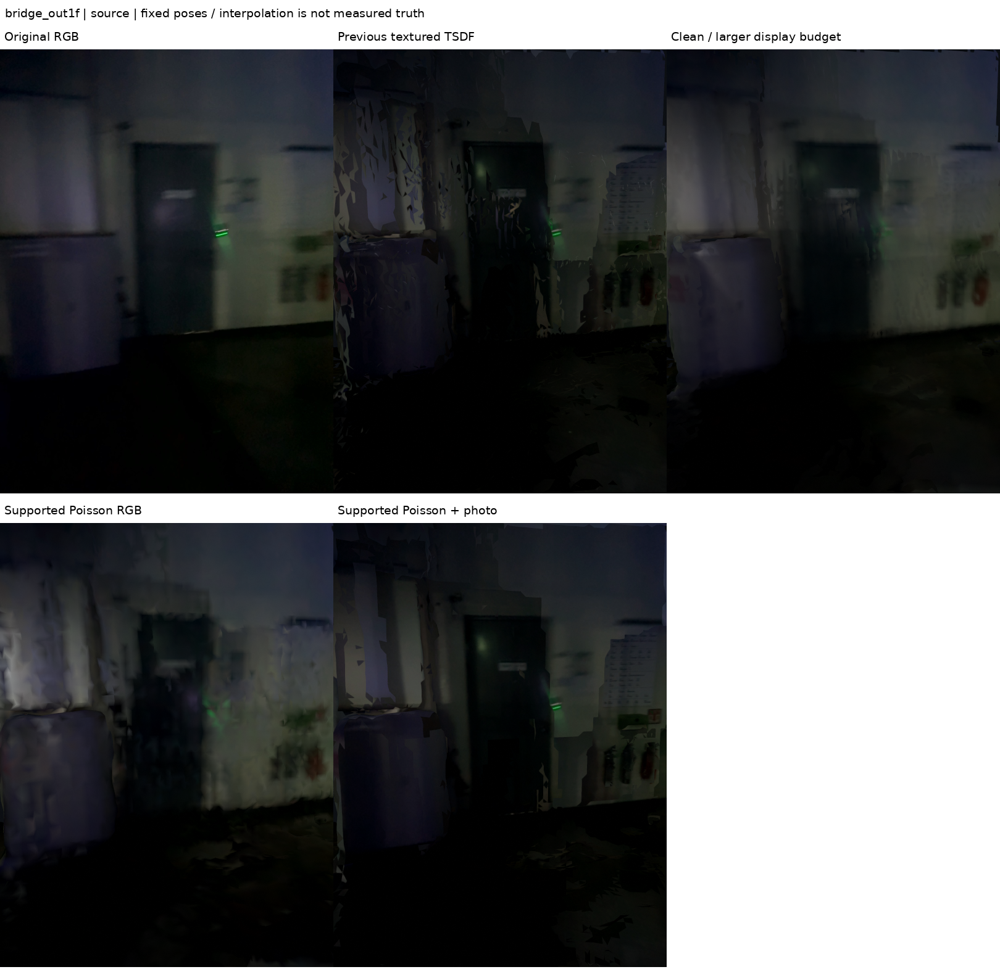
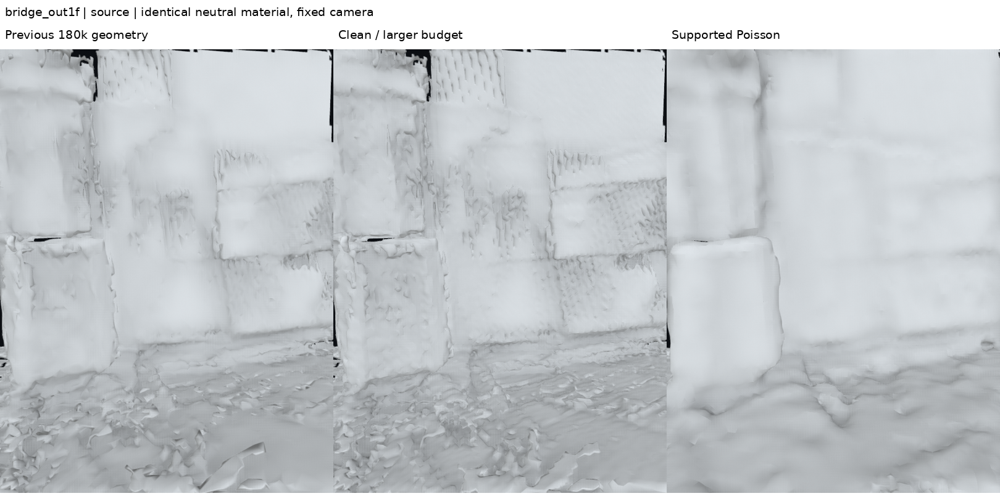

# 렌더링 파편화 진단과 연속 표면 후보

## 목적과 처리 범위

렌더링에서 표면의 과도한 파편화가 관찰되었다. 선택한 다섯 세션과 원본 DB는
유지하고, **표면 재구성·표시 단계만** 별도 후보로 개선한다. 기존 정합을 새로
풀거나 Gaussian을 재학습한 결과가 아니다. 관측에 없던 면을 만드는 보간은
측정값과 구분하며, 파편 수 감소를 길찾기 정확도 개선으로 주장하지 않는다.

## 확인한 원인과 분리 실험

원래 3cm TSDF 전체 메시의 분리 성분은 외부 10,068개, 로비 28,457개,
외부 브리지 2,495개, 2층 35,463개, 서브 계단 4,111개였다. 면적 0.02m² 미만의
작은 성분이 대부분이지만, 전체 면적에서 차지하는 비율은 각각
3.13 / 2.48 / 2.12 / 2.73 / 1.85%다. **작은 조각 삭제만으로 큰 구멍을
복원할 수 없다는 것**이 첫 번째 진단이다.

5cm TSDF의 분리 성분은 각각 1,996 / 4,754 / 534 / 6,849 / 882개였다.
기존 입력에서 3cm보다 거친 융합이 덜 분리되는 사실을 확인했다. 다만 이 차이를
특정 원인 하나의 증명으로 보지는 않는다. depth 누락·신뢰도 마스크·해상도·기존
프레임 어긋남을 각각 분리하는 전처리 ablation까지 수행한 것은 아니다.

표시 메시를 모든 기록에 18만 면으로 제한한 것도 과도한 단순화 조건이었다.
예를 들어 2층 3cm 전체 6,330,492면을 179,999면으로 줄였다. 이는 약 35:1 축약이다.
면 수 증가만의 효과와 새 표면 모델의 효과를 구분하기 위해 아래 중간 후보도 만들었다.
사진 간 노출·시점 경계 역시 파편처럼 보일 수 있어 **같은 회색 재질 비교**를 별도로 남겼다.

## 실행한 세 단계

### 1. 작은 성분 정리 + 표시 면 수 여유

- 원래 전체 3cm TSDF에서 edge-connected triangle component를 계산.
- 성분 전체 면적이 0.02m² 미만이면 표시 후보에서만 제외.
- 경계 가중치 10의 quadric decimation, 상한 600,000삼각형으로 표시본 생성.
- 원본 전체 메시·점군은 보존. 평활화나 구멍 메우기는 하지 않음.

이 후보는 파편 정리와 면 수 제한 완화의 **결합 대조**다. 두 변화 각각의 독립
효과를 주장하지 않는다. 작은 독립 문패/얇은 물체도 제거될 수 있으므로 이것을
모든 의미 정보를 보존한 지도로 채택하지 않는다.

### 2. 관측 지지 영역으로 제한한 Poisson 표면

별도 후보에서는 작은 성분을 제외한 **5cm TSDF의 oriented vertex/normal**을
6cm voxel로 정리하고 최대 300,000점으로 제한했다. Open3D Poisson 재구성을
depth 10, scale 1.03, linear_fit=True, CPU 2 threads로 실행했다.
이는 법선장을 통해 더 연속적인 암시적 표면을 추정하는 방법이다.
GPU Gaussian 학습이나 새 SLAM 최적화가 아니다.

Poisson은 관측되지 않은 면도 이어 만들 수 있으므로 다음을 함께 적용했다.

1. density 하위 1% vertex 제외.
2. **세 꼭짓점 모두와 면 중심**이 기존 선택 점군으로부터 0.10m 이내인 면만 유지.
3. 최대 삼각형 변 0.30m.
4. 원래 보정 RGB-D 시점에서 면 중심을 재투영해 free-space 검사.
5. 면적 0.02m² 미만 성분 제외.
6. 600,000면 표시 축약 후 관측 지지·free-space·성분 검사를 다시 수행.

면 중심만 실제 깊이보다 `0.12 + 0.02*z`m 이상 앞에 나타나면 빈 공간 침범
표를 준다. 최소 2개 시점이고, 가려지지 않은 관측의 60% 이상이 침범으로 판정하면
해당 면을 제외한다. 가려진 면은 빈 공간 위반의 근거로 세지 않는다.
이 시점들은 동일 촬영의 인접 사진일 수 있으므로 **서로 독립적인 두 번의
관측을 확보했다는 뜻은 아니다.**

이 검사는 출입구/계단을 무조건 안전하게 보존한다는 보증이 아니다. 면 중심만
검사하고 선택 RGB-D 프레임만 사용하기 때문에 놓치는 오류가 있다. 10cm 지지 영역
안에서도 모서리가 둥글어지거나 얇은 물체가 합쳐질 수 있다. 문 폭·계단 단차·천장고
검증과 길찾기 승인은 여전히 별도다. 기존 어긋난 벽도 이 알고리즘으로 정합한 것이 아니다.

공식 근거: [Open3D Poisson 재구성과 저밀도 영역 제거](https://www.open3d.org/docs/release/tutorial/geometry/surface_reconstruction.html),
[연결 성분·메시 단순화](https://www.open3d.org/docs/release/tutorial/geometry/mesh.html).
다른 방법의 결과를 전제로 한 미관 개선 실험이며, 측량 정확도 향상을 입증하지 않는다.

### 3. 원본 사진 재투영 + 공정한 시각 비교

새 표면에 앞선 실험과 **같은 원본 RGB 목록·깊이 검사·UV 선택 조건**을 적용했다.
원본 720×960 사진을 줄이지 않고 atlas에 붙이며, 맞는 사진이 없는 면은 vertex RGB를 쓴다.
글자 생성·보정된 모양에 맞춘 카메라 이동·이미지 인페인팅은 없다.

각 기록에서 원래 사진 시점과 UV에 쓰지 않은 인접 시점, 동일 3D 전체 시점을
렌더링한다. 메인·서브 계단 주변 시점도 따로 남긴다. 같은 회색 재질의 전/후 사진은
텍스처 경계와 실제 구멍을 구분하기 위한 자료다. **UV 미사용 시점도 전체 TSDF에
쓰였을 수 있으므로 geometry holdout이나 새로운 독립 검증은 아니다.**

## 결과와 시각자료

| 기록 | 이전 표시 성분 | 정리+면 수 여유 | 지지 영역 Poisson | 이전→Poisson 면적(m²) |
|---|---:|---:|---:|---:|
| 외부 | 950 | 391 | 83 | 441.8→433.1 |
| 로비 | 715 | 1,447 | 133 | 1,408.4→1,345.2 |
| 외부 브리지 | 977 | 78 | 18 | 192.2→169.0 |
| 2층·메인 계단 | 812 | 1,978 | 190 | 1,614.0→1,508.5 |
| 서브 계단 | 886 | 164 | 37 | 337.8→315.9 |

모든 기록에서 최종 후보의 성분 수는 줄었다. 하지만 일부 면을 제거하고 일부 면을
보간한 효과가 함께 있으므로 이 숫자만으로 품질을 승인하지 않았다. 특히 로비와
2층의 중간 후보는 오히려 성분이 증가했다. 전체 메시에서 작은 성분을 제외했어도
단순화 뒤 새 작은 성분이 생길 수 있으며, 면 수를 더 유지하는 효과도 섞인다.
최종 Poisson 후보에는 **단순화 후** 성분 검사도 적용했다.

같은 촬영의 UV 미사용 인접 시점(각각 264 / 38 / 81 / 1054 / 157번)에서 평가했다.
아래 coverage는 **유효 depth 픽셀에서 어떤 면이라도 ray가 맞은 비율**이다.
올바른 대응 면일 필요는 없으므로 정확도/완성률로 읽으면 안 된다. 구멍 뒤 다른
벽에 ray가 맞아도 포함된다. 오차는 그 첫 면의 카메라 Z와 센서 depth의 차이다.
기존 보고서의 동일 벽 간격·pose residual·측량 정확도와는 다른 지표다.

| 기록 | ray-hit coverage 이전→후 | 깊이 오차 중앙값(cm) | 깊이 오차 P90(cm) | 관측보다 앞선 hit 비율 이전→후 |
|---|---:|---:|---:|---:|
| 외부 | 84.73→92.41% | 16.05→13.16 | 25.39→23.94 | 0.12→0.07% |
| 로비 | 92.39→98.80% | 30.22→22.67 | **68.99→79.56** | 1.79→0.00% |
| 외부 브리지 | 81.67→82.07% | 5.97→5.41 | 122.69→79.46 | 0.36→0.00% |
| 2층·메인 계단 | 92.44→98.35% | **57.34→61.16** | 287.91→260.54 | 2.85→0.27% |
| 서브 계단 | 92.27→99.82% | 15.20→9.95 | 24.64→19.78 | 3.06→1.46% |

**채택 판단:** 미관 후보로 보존하되 원래 선택 지도를 자동 교체하지 않았다.
로비 P90과 2층 중앙값은 악화했다. 특히 2층은 매끈해진 사진만으로 채택할 수 없다.
인접 시점 두 개만의 국소 검사로 전체 세션을 승인하지 않는다. 메인·서브 계단
사진도 단차·통과 폭을 검증한 자료는 아니다.

실제 메인 계단 1078번 회색 재질 사진에서는 큰 파편이 줄지만 모서리도 둥글어져
단차가 뭉개질 수 있는 모습이 보인다. 계단은 이 후보를 보행 기하로 사용하지 않는다.

추가로 2층은 모듈별 관측/프레임 불일치·기존 정합·가림과 depth 누락의 영향을
구분하는 점검이 필요하다. 이번 지표 하나만으로 어느 원인이라고 단정하거나,
큰 구멍을 일괄 메우는 방식으로 덮지 않는다. 사용자 표시용으로는 연속 표면 후보와
원본 사진 확인을 병행하고, 계단/문패/통로는 원본 자료로 대조해야 한다.

아래 공개 manifest에는 기록별 성분 수·면적·사진 시점 깊이 오차·free-space
잔여 비율·모든 산출물 해시가 들어간다. 같은 시점에서 표면이 잡힌 비율뿐 아니라
깊이 오차를 함께 봐야 한다. 구멍을 임의로 덮으면 coverage만 높아질 수도 있기 때문이다.

- [그림·수치·출처 manifest](../assets/surface-continuity-review/manifest.json)
- [성분 수와 같은 관측의 depth coverage](../assets/surface-continuity-review/continuity_metrics.png)
- 외부: [사진 비교](../assets/surface-continuity-review/outside/source_comparison.png),
  [같은 회색 기하](../assets/surface-continuity-review/outside/source_geometry.png)
- 로비: [사진 비교](../assets/surface-continuity-review/lobby/source_comparison.png),
  [같은 회색 기하](../assets/surface-continuity-review/lobby/source_geometry.png)
- 외부 브리지: [사진 비교](../assets/surface-continuity-review/bridge_out1f/source_comparison.png),
  [같은 회색 기하](../assets/surface-continuity-review/bridge_out1f/source_geometry.png)
- 2층: [사진 비교](../assets/surface-continuity-review/floor2/source_comparison.png),
  [같은 회색 기하](../assets/surface-continuity-review/floor2/source_geometry.png),
  [메인 계단](../assets/surface-continuity-review/floor2/stairs_geometry.png)
- 서브 계단: [사진 비교](../assets/surface-continuity-review/bridge_12_sub/source_comparison.png),
  [같은 회색 기하](../assets/surface-continuity-review/bridge_12_sub/source_geometry.png),
  [계단 주변](../assets/surface-continuity-review/bridge_12_sub/stairs_geometry.png)





## 실행·보존

원래 선택 지도 포인터·포즈·DB와 이전 표면 후보는 바꾸지 않았다. 새 산출물은
`outputs/student_union_surface_continuity_v1/<session>/`에 분리했다.

- `clean_high_budget.ply/.glb`: 정리 + 면 수 제한 완화.
- `supported_poisson_full.ply`: 관측 지지/빈 공간 검사를 적용한 표시 축약 전 메시.
- `supported_poisson.ply/.glb`: 표시용 연속 표면 후보.
- `supported_poisson_textured.glb`: 최종 색공간의 원본 사진 텍스처 표시본.
- `summary.json`: 각 단계 수치·가드·출처·산출물 해시.

원본 입력과 처리 코드가 변하지 않았는지는 실행 전후 SHA-256으로 검사한다.
Open3D는 기존 프로젝트 로컬 runtime을 사용한다. Conda/PyTorch 패키지는 변경하지 않는다.

### 실행 중 진단 기록

외부와 로비 Poisson 단계에서 Open3D `Found bad data: 1` / `2` 경고가 있었다.
동일 입력 구성에 대한 추가 검사에서는 각각 0길이 법선 3개 / 4개, 비유한 법선
0개 / 0개가 확인됐다. 경고와 법선 이상 개수 사이의 인과관계는 확인하지 못했다.
경고를 실행 로그에 기록하고 생성 파일과 유한 좌표 여부를 별도로 검사했다.

전체 순차 실행이 2층 처리 도중 종료 코드 143으로 중단됐다. 원인을 추측해 OOM으로
단정하지 않았다. 완료된 세 기록은 보존했고, 비어 있던 2층 출력 폴더도
`floor2_interrupted_attempt1`로 옮겨 남겼다. 이후 2층은 개별 재개했고, 서브 계단은
별도 worker 경로에 같은 코드/설정으로 실행했다. 결과 취합은
`src/merge_surface_continuity_runs.py`가 공통 입력 해시·표시 budget·복사한 파일 해시를
검사한 뒤 수행한다. 별도 worker 원본도 삭제하지 않는다.

```bash
PYTHONPATH=outputs/surface_runtime/packages OMP_NUM_THREADS=2 OPENBLAS_NUM_THREADS=1 \
  /usr/bin/python3 -s src/repair_surface_fragmentation.py \
  --output outputs/student_union_surface_continuity_v2
```

현재 후보를 이전 방식과 함께 대화형 창에서 보려면:

```bash
bash scripts/view_surface_portfolio.sh \
  --continuity outputs/student_union_surface_continuity_v1
```

총 10개 표현 중 3개가 새 연속 표면 후보다. 이 옵션을 쓰지 않으면 이전 7개
비교 동작을 유지한다. native 창 화면의 실제 가시성 검증과 별도로, 위 사진들은
실제로 생성한 GLB/PLY를 같은 보정 카메라에서 렌더링한 결과다.

최종 검증: 새 사진 **35장**의 해시/PNG 읽기, 출력 파일 **58개**의 해시,
메시 **15개**의 유한 좌표/삼각형 인덱스 범위, 원본 입력 불변 검사를 통과했다.
전체 프로젝트 테스트는 **381 passed**다. 깊이 ray의 파라미터가 비스듬한 유클리드
거리 대신 camera-Z depth를 반환하는지도 알려진 평면으로 확인했다.
코드와 문서, 비교 사진을 함께 보관했다.

Gaussian의 파편화는 이번 메시 처리와 별개다. 앞선 고정 중심/최대 16만점/
densification 없는 appearance probe는 유지했다. 이 단계의 비교 대상은
**표시 메시의 연속성**이며 Gaussian refinement는 후속 실험으로 남겼다.
