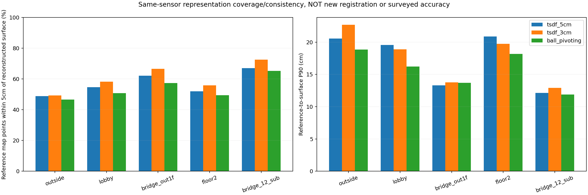
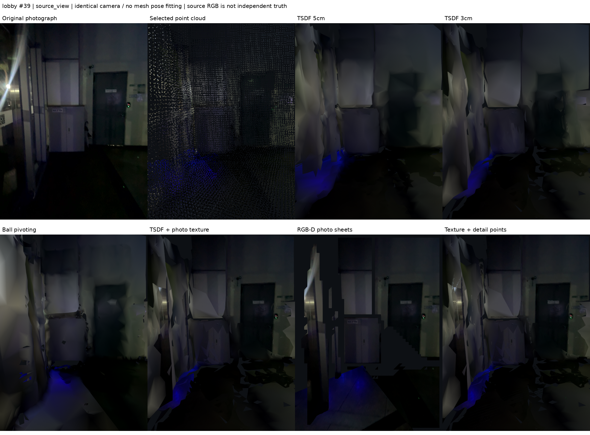

# 사용자 표시용 표면·사진·Gaussian 비교 실험

## 결론과 변경 범위

선택한 다섯 기록을 유지한 채 **TSDF 두 해상도, Ball Pivoting, 사진 UV 텍스처,
RGB-D 사진 시트, 세부 점 오버레이, CUDA Gaussian 표시 실험**을 실제 데이터로 실행했다.
현재 결과에서는 단순 표면 메시만으로 간판·문패를 보존하기 어렵다. 사진 텍스처는
로비 문틀과 표지 일부를 되살리지만, 유효 깊이가 없는 유리·반사면과 어두운 계단은
여전히 비거나 뭉개진다. Gaussian 실험도 아직 사용자용 주 표현으로 채택할 품질은 아니다.

**기존 지도·포즈를 새 표면으로 교체하지 않았다.** 이 단계는 정합 최적화가 아니라
같은 선택 지도에서 만드는 표시 방식 비교다. J04의 기존 국소 정합 문제나 세션 연결
오차가 메시/텍스처로 해결되었다고 해석하면 안 된다. 길찾기용 기하 승인도 하지 않았다.

| 기록 | 고정 후보 | 사용 프레임 | 원본 DB |
|---|---|---:|---|
| 외부 | J01 | 305 | `261016-234854-outside.db` |
| 로비 | N05 | 800 | `261017-000622-1f.db` |
| 외부↔로비 브리지 | H03 | 86 | `261017-011331-bridgeout1f.db` |
| 2층·메인 계단 | J04 | 925 | `261017-013501-2f.db` |
| 서브 계단 | H03 | 135 | `261017-013904-bridg12_2.db` |

총 2,251프레임. DB는 `data/raw/rtabmap/`에 있으며 읽기 전용으로 열었다.
선택 지도 manifest SHA-256은
`98cf1d77aa5ca3c82f9653ffcb4ee86d6f40ac4d8953f1c1171b0dfa307090b1`이다.
각 세션을 이미 선택한 world pose로 **독립 융합**했으며, 세션 사이에서 TSDF를
섞어 연결부 오차를 녹이지 않았다. 지면 평탄화·전체 평활화·구멍 메우기·새 포즈
최적화·새 동적 객체 제거는 실행하지 않았다.

## 1. 알고리즘별 처리

### A. TSDF 5cm / 3cm

선택한 전처리 프로파일을 각 RGB-D 프레임에 동일하게 적용하고, 보정된 카메라와
고정 포즈로 Open3D ScalableTSDFVolume에 적분했다. 부호 거리의 절단 범위를 두고
여러 관측을 융합한 뒤 삼각형 표면을 추출한다.

- 5cm 후보: voxel 0.05m, truncation 0.15m.
- 3cm 후보: voxel 0.03m, truncation 0.09m.
- 프레임별 유효 depth만 적분. 계단의 실제 Z 변화는 그대로 둔다.
- 전체 해상도 PLY와 최대 180,000삼각형의 표시용 단순화본을 별도로 저장했다.

3cm는 더 세밀한 후보이지 센서 정확도가 3cm가 되었다는 뜻이 아니다. 표시용
quadric decimation은 얇은 구조를 줄일 수 있으므로 전체 메시도 보존했다.
기법 근거: [Open3D RGB-D integration 공식 문서](https://www.open3d.org/docs/release/tutorial/pipelines/rgbd_integration.html).

### B. Ball Pivoting

이미 선택한 점군에서 법선을 추정하고, 구를 굴려 인접 점을 삼각형으로 연결했다.
법선 반경 0.18m/최대 이웃 30개, 구 반경 0.075·0.11m, 최대 삼각형 변 0.24m다.
거리를 두고 떨어진 점들을 임의로 큰 면으로 연결하지 않는다. 점군의 빈 곳은
빈 채로 남고, 중복 벽·노이즈도 원래 점군에 있으면 남는다.
기법 근거: [Open3D 표면 재구성 공식 문서](https://www.open3d.org/docs/release/tutorial/geometry/surface_reconstruction.html).

### C. 3cm TSDF + 원본 사진 UV

3cm 표시 메시와 같은 기하를 사용하며 색 표현만 바꿨다. 세션별 최대 사진 수는
외부 64/로비 80/외부 브리지 32/2층 96/서브 계단 48장, 총 320장이다.
원본 720×960 RGB를 축소하지 않고 4096² 무손실 atlas에 배치했다.

각 면에 대해 투영·시야·깊이 일치를 검사하고 가장 좋은 사진 하나를 선택했다.
최소 절대 view cosine은 0.35, 면 중심 depth 허용차는 `0.08 + 0.02*z`m,
꼭짓점 허용차는 `0.12 + 0.03*z`m다. 여러 사진의 글자를 평균내거나 생성하지 않는다.
조건에 맞는 사진이 없는 면은 vertex RGB로 남긴다. 실제 부착률은 아래 표처럼
25~58% 수준이다. 무조건 모든 면에 사진을 씌운 결과가 아니다.

이것은 **깊이 검사 기반 단일 사진 선택**이지 Open3D의 카메라/색상 동시 최적화를
실행한 결과가 아니다. 사진 경계, 노출 차이, 기존 자세 오차가 남는다.
관련 별도 기법: [Open3D color-map optimization](https://open3d.org/html/tutorial/pipelines/color_map_optimization.html).

### D. 원본 RGB-D 사진 시트

각 선택 사진의 depth 격자를 stride 4로 삼각화하고 원본 RGB를 붙였다. 프레임 사이
정점 결합이나 TSDF 평균은 없다. 유효하지 않은 깊이는 면을 만들지 않으며,
깊이 불연속 `0.10 + 0.02*평균깊이`m를 넘는 삼각형도 제외했다.
원래 촬영 시점 근처의 사진 세부를 유지하는 비교 후보지만, 겹친 면의 깜박임,
관측 사이 어긋남, depth 구멍은 그대로 나타난다. 측정되지 않은 간판에 임의 깊이를
넣어 메운 방식이 아니다.

### E. 텍스처 + 세부 점 오버레이

사진/깊이 경계에서 나온 점 중 3cm 메시와 거리가 0.025~0.25m인 후보를
1.5cm 복셀로 정리해 텍스처 메시 위에 함께 표시했다. RGB gradient 문턱 80,
depth jump 0.05m다. 총 198,915점이며 **간판을 인식한 의미 계층이 아니다.**
노이즈·반사·얇은 구조가 모두 섞일 수 있다. 모든 문패 보존이나 OCR 성공을 주장하지 않는다.

## 2. 메시 수와 사진·세부 적용량

| 기록 | TSDF 5cm 전체 면 | TSDF 3cm 전체 면 | BPA 전체 면 | UV 부착 면 비율 | 세부 점 |
|---|---:|---:|---:|---:|---:|
| 외부 | 536,671 | 1,611,984 | 278,916 | 42.87% | 43,472 |
| 로비 | 1,649,386 | 5,426,312 | 903,596 | 24.74% | 56,712 |
| 외부 브리지 | 196,635 | 626,966 | 114,333 | 58.19% | 10,361 |
| 2층·메인 계단 | 1,984,285 | 6,330,492 | 1,090,002 | 28.00% | 76,171 |
| 서브 계단 | 355,102 | 1,106,032 | 227,538 | 53.41% | 12,199 |

전체 TSDF 5cm 4,722,079면, TSDF 3cm 15,101,786면, BPA 2,614,385면이다.
사진 시트는 각각 171,582 / 247,039 / 112,058 / 299,283 / 167,078면이다.
위 TSDF/BPA 수는 **전체 PLY** 기준이다. 사진 비교와 대화형 창의 단순화된 GLB와 혼동하면 안 된다.


원래 점군→전체 표면 거리 중앙값(cm)은 다음과 같다. 같은 센서·포즈에서 만든
표현 사이의 거리이며 독립 정확도나 새 정합 개선 수치가 아니다. 작은 거리만으로
구멍이 많은 메시를 우승시켜서는 안 된다.

| 기록 | TSDF 5cm | TSDF 3cm | BPA | 3cm 표면의 기준 점 5cm 이내 비율 |
|---|---:|---:|---:|---:|
| 외부 | 5.18 | 5.13 | 5.69 | 49.26% |
| 로비 | 4.34 | 3.57 | 4.86 | 58.16% |
| 외부 브리지 | 3.66 | 2.90 | 3.65 | 66.51% |
| 2층·메인 계단 | 4.72 | 3.90 | 5.11 | 55.80% |
| 서브 계단 | 2.96 | 2.18 | 1.84 | 72.56% |



## 3. 실제 동일 시점 사진 비교

각 큰 사진의 첫 칸은 원본 RGB, 이후는 선택 점군/TSDF 5cm/TSDF 3cm/BPA/
UV 텍스처/사진 시트/텍스처+세부 점이다. 사진마다 동일 보정 카메라로 렌더링했다.
카메라를 방법별로 옮겨 맞춰 보이게 하지 않았다. 원본 사진을 쓴 시점과 UV에 쓰지
않은 인접 시점을 구분했다. 후자도 같은 촬영·포즈 계열이므로 새로운 독립 검증은 아니다.

| 기록 | 원본 사진 시점 | UV 미사용 시점 | 3D 전체 비교 |
|---|---|---|---|
| 외부 | [263번](../assets/surface-model-review/outside/source_view_comparison.png) | [264번](../assets/surface-model-review/outside/unused_texture_view_comparison.png) | [전체](../assets/surface-model-review/outside/oblique_comparison.png) |
| 로비 | [39번](../assets/surface-model-review/lobby/source_view_comparison.png) | [38번](../assets/surface-model-review/lobby/unused_texture_view_comparison.png) | [전체](../assets/surface-model-review/lobby/oblique_comparison.png) |
| 외부 브리지 | [80번](../assets/surface-model-review/bridge_out1f/source_view_comparison.png) | [81번](../assets/surface-model-review/bridge_out1f/unused_texture_view_comparison.png) | [전체](../assets/surface-model-review/bridge_out1f/oblique_comparison.png) |
| 2층·메인 계단 | [1055번](../assets/surface-model-review/floor2/source_view_comparison.png) | [1054번](../assets/surface-model-review/floor2/unused_texture_view_comparison.png) | [전체](../assets/surface-model-review/floor2/oblique_comparison.png) |
| 서브 계단 | [159번](../assets/surface-model-review/bridge_12_sub/source_view_comparison.png) | [157번](../assets/surface-model-review/bridge_12_sub/unused_texture_view_comparison.png) | [전체](../assets/surface-model-review/bridge_12_sub/oblique_comparison.png) |



로비 39번은 사진 텍스처에서 문틀과 문 안쪽 표지가 표면 색만 쓴 메시보다 잘 드러난다.
그렇지만 글자가 전부 판독된다는 검증은 없다. 사진 시트는 가까운 시점에서 사진을
살리는 대신 빈 곳과 계단식 경계를 보인다. 외부 유리 출입구도 비슷한 한계를 보인다.

계단 별도 사진: [메인 1078번](../assets/surface-model-review/floor2/stairs_view_comparison.png),
[서브 108번 주변](../assets/surface-model-review/bridge_12_sub/stairs_view_comparison.png).
메인 계단 원본부터 매우 어둡다. 새 표현으로 밝기/관측 정보를 생성하지 않았으며
구멍과 찢긴 표면이 남는다. 이 사진만으로 계단 보행 가능성을 승인할 수 없다.

### 색상 비교 공정성 수정

초기 GLB의 sRGB vertex 색을 glTF가 요구하는 linear `COLOR_0`로 변환한 **별도
표시본**을 만들었다. 좌표·면·atlas 픽셀은 바꾸지 않았다. 점군은 sRGB 색상
플래그를 사용했고, 모든 최종 렌더는 defaultUnlit/LINEAR tone mapping이다.
동일 회색 패치 실험으로 색상 경로를 확인했다. 후보마다 밝기를 따로 올리지 않았다.
근거: [Khronos glTF 공식 규격](https://github.com/KhronosGroup/glTF/blob/main/specification/2.0/Specification.adoc).
초기 색상/스크린 캡처 시도는 `outputs/`에 보존하고 최종 비교에서 제외했다.

## 4. Conda CUDA 환경과 실제 Gaussian 실행

처음 시스템 Python에서는 CPU torch가 보여 Gaussian을 실행하지 않았다.
CUDA 지원 **teamkai-yolo 환경에서 다시 확인한 뒤 GPU 학습을 실행했다.** 단순 활성화만으로는 `~/.local`의 CPU torch가
먼저 import되어 `PYTHONNOUSERSITE=1`과 `python -s`로 사용자 site를 배제했다.

- Conda Python 3.10.20, torch **2.13.0+cu130**, CUDA runtime **13.0**.
- GPU **NVIDIA GeForce RTX 5070 Laptop GPU**.
- 실제 GPU tensor 연산과 gsplat CUDA 순방향/역전파 유한 gradient 테스트 통과.
- gsplat 공식 소스 commit `512d366b67073d77ca099ede742683c165dfc23b`.
- Conda 패키지는 교체하지 않았다. 부족한 compiler/build 의존성은 프로젝트의
  `outputs/surface_runtime/`에만 설치했다. 초기 확장 링크의 libcudart 이름 문제도
  해당 로컬 runtime 안에서 해결했다.

CUDA probe는 5개 기록 각각 600 step, 총 3,000 step이다. 최대 160,000개씩,
외부 브리지는 153,559개로 총 793,559 Gaussian을 썼다.
**중심 위치와 카메라를 고정**하고 RGB/불투명도/스케일만 Adam으로 학습했다.
해상도 270×360, RGB·opacity lr 0.03, scale lr 0.004, scale 범위 0.008~0.10m다.
손실은 RGB L1 + 0.05×coverage + 0.02×clipped-depth L1 + 0.001×log-scale prior다.
각 8번째 RGB view는 gradient에서 제외했다. 다만 초기 점군은 동일 촬영에서
나오므로 이 audit도 측량 정답이나 완전한 미관측 테스트는 아니다.

| 기록 | 학습 사진 probe PSNR | gradient 미사용 RGB probe PSNR | 비교 사진 |
|---|---:|---:|---|
| 외부 | 27.01dB | 22.73dB | [263번](../assets/gaussian-display-review/outside/gaussian_263.png) / [217번](../assets/gaussian-display-review/outside/gaussian_217.png) |
| 로비 | 21.06dB | 12.72dB | [39번](../assets/gaussian-display-review/lobby/gaussian_39.png) / [542번](../assets/gaussian-display-review/lobby/gaussian_542.png) |
| 외부 브리지 | 32.15dB | 15.33dB | [80번](../assets/gaussian-display-review/bridge_out1f/gaussian_80.png) / [99번](../assets/gaussian-display-review/bridge_out1f/gaussian_99.png) |
| 2층·메인 계단 | 18.59dB | 8.36dB | [1055번](../assets/gaussian-display-review/floor2/gaussian_1055.png) / [708번](../assets/gaussian-display-review/floor2/gaussian_708.png) |
| 서브 계단 | 33.29dB | 21.33dB | [159번](../assets/gaussian-display-review/bridge_12_sub/gaussian_159.png) / [146번](../assets/gaussian-display-review/bridge_12_sub/gaussian_146.png) |

이 수치는 **유효 depth 영역의 최종 RGB PSNR**이며 방법 사이의 독립 평가가 아니다.
처음/학습 후 사진을 둘 다 저장했지만 위 표는 개선량이 아니라 최종값이다.
매 step의 학습 시점도 달라 history loss를 그대로 단조 수렴 곡선으로 읽으면 안 된다.


특히 2층 audit 708번은 결과가 좋지 않다. 학습 사진의 점수만으로 Gaussian을
최종 사용자 지도에 채택하지 않았다. **densification/pruning/중심 이동/카메라 조정/
view-dependent SH 없는 제한된 appearance probe이지, 완전한 3DGS를 끝낸 결과가 아니다.**
위치가 고정되어도 Gaussian 크기는 바뀌므로 충돌 판정용 메시로 사용할 수 없다.
공식 구현 근거: [gsplat](https://github.com/nerfstudio-project/gsplat),
[원 3DGS 구현](https://github.com/graphdeco-inria/gaussian-splatting).

표면 실행 당시 설정의 `gaussian_training_executed=false` 및 초기 CPU 감사 항목은
그 시점의 기록이라 덮어쓰지 않았다. 이후 CUDA 실행은
`outputs/student_union_gaussian_display_v1/manifest.json` 및
[Git 보관용 실행 기록](../assets/gaussian-display-review/manifest.json)에 별도로 남겼다.

## 5. 보기와 재현

프로젝트 루트에서 다음으로 메시 비교 창을 실행한다. GPU Gaussian 학습 환경과
Open3D 표시용 Python은 의존성을 분리했다. 창에는 세션 선택, 7개 표현 선택,
전체 보기/원본 촬영 방향 버튼이 있다. 기본 선택 지도 설정 파일은 변경하지 않는다.

```bash
bash scripts/view_surface_portfolio.sh
```

창 실행의 READY 상태는 확인했다. 현재 자동화 도구에서는 native 창 화면을 읽을 수
없어 **창의 실제 보임은 스크린샷으로 검증하지 못했다.** 사진 비교 자료는 별도
보정 카메라 렌더러로 생성·확인했다. 검은 화면 캡처는 결과 증거로 사용하지 않는다.

Conda를 현재 터미널에서 활성화하고 CPU torch 가림을 피하려면:

```bash
source /home/subin/anaconda3/etc/profile.d/conda.sh
conda activate teamkai-yolo
export PYTHONNOUSERSITE=1
python -s -c 'import torch; print(torch.__version__, torch.cuda.is_available(), torch.cuda.get_device_name(0))'
```

현재 설치된 프로젝트 로컬 gsplat/build runtime을 모두 적용해 Python을 실행하려면
`bash scripts/run_gaussian_probe.sh ...`를 쓴다. 이 wrapper가 실행하는 자식 프로세스는
Conda 환경을 사용하는 범위는 wrapper의 자식 프로세스다.

새 Gaussian 실행은 기존 산출물을 덮어쓰지 않는 새 경로로 한다:

```bash
bash scripts/run_gaussian_probe.sh src/train_gaussian_display_probe.py \
  --surfaces outputs/student_union_surface_portfolio_v1 \
  --output outputs/student_union_gaussian_display_v2 \
  --assets docs/assets/gaussian-display-review-v2 --steps 600
```

표면 생성→표시 레이어→사진 비교→검증 순서는 다음 코드에 구현되어 있다.
각 CLI의 `--help`와 실행 manifest를 함께 사용한다. 산출물 디렉터리는 새 경로를 써야 한다.

1. `src/reconstruct_surface_portfolio.py`: TSDF/BPA/UV/세부점/보정 원본 사진 export.
2. `src/refine_surface_display.py`: GLB 색공간 표준화와 RGB-D 사진 시트.
3. `src/render_surface_portfolio.py`: 같은 보정 카메라와 전체 시점의 7개 표현 비교.
4. `src/train_gaussian_display_probe.py`: 별도 CUDA appearance 학습.
5. `src/publish_surface_evidence.py`: 수치 도표, 원본/산출물 해시 검증.

Open3D 0.19.0은 `/usr/bin/python3 -s`와 로컬
`outputs/surface_runtime/packages`를 사용한다. CUDA 쪽은 torch가 이미 설치된
Conda와 gsplat 위 고정 commit, 로컬 CUDA compiler 13.0.88/runtime 13.0.96,
NVVM/CRT 13.0.88, CCCL 13.0.85, ninja 1.13.0을 사용했다.
빌드 옵션은 3DGS만 켜고 2DGS/3DGUT/부가 CUDA optimizer를 끄며,
`TORCH_CUDA_ARCH_LIST=12.0`, `MAX_JOBS=2`, `NUM_CHANNELS=3,4`다.
이 runtime 디렉터리는 Git에 포함하지 않으므로 다른 컴퓨터에서는 설치·빌드가 필요하다.

주 산출물:

- `outputs/student_union_surface_portfolio_v1/<session>/`: 전체 PLY, atlas,
  세부 점, native RGB/보정 pose와 최초 실행 기록.
- `outputs/student_union_surface_layers_v1/<session>/`: 최종 색공간 GLB 네 개와
  `depth_sheet_textured.glb`. 사용자에게 열어줄 GLB는 이 경로의 표시본이다.
- `outputs/student_union_gaussian_display_v1/<session>/`: `gaussians.ply`,
  `gaussians.splat`, `checkpoint.pt`, 학습 history/지표.
- [표면 비교 수치](../assets/surface-model-review/surface_metrics.json),
  [그림·카메라 출처](../assets/surface-model-review/manifest.json),
  [무결성 검증](../assets/surface-model-review/verification.json).

## 6. 검증과 남은 일

DB/선택 지도/소스 포함 입력 23개, 재구성 파일 403개, 렌더 101장과 수치 도표 3장,
별도 Gaussian 모델 15개와 사진 10장의 해시를 검사했다. 사진은 총 **114장**이다.
사진 시트는 생성 시 기록된 파일 크기를 확인하고 이번 공개 시점 해시를 별도로 기록했다.
원본 DB·선택 포즈·현재 지도 포인터는 그대로다. 프로젝트 테스트는 **375 passed**.
pytest 수집은 `tests/`로 제한하여 무시된 runtime 내 외부 패키지 테스트를 잘못
수집하지 않게 했다. 실제 CUDA 학습/렌더 실행 검증은 CPU 단위 테스트와 별도다.

현재 권장 방향은 **선택 점군 보존 + 필요한 구간의 사진 텍스처 표시 + 원본 사진으로
확인하는 기능**이다. 모든 세션을 한 매끈한 표면으로 바꾸는 최종 승인은 하지 않았다.
다음 단계는 표현 후보를 선택한 뒤, 표지/문패의 의미 노드·고해상도 사진
팝업·수동 검증 영역부터 만드는 것이다. 자동 간판 검출/OCR, 지도 클릭과 원본 사진의
연결 UI, 완전한 3DGS, 보행 가능 메시/경로 그래프는 이번 구현에 포함되지 않는다.
