# 육안 선호 후보: 알고리즘·원본 행·실제 정합 지표 대조

## 1. 육안 선별 후보와 해석 범위

2026-10-17 육안 비교에서 선별한 범위는 다음과 같다. 이는 최종 지도 승인이나
후보 하나씩의 확정이 아니라 **시각적 shortlist**다.

| 기록 | 육안 선별 범위 | 분석에 포함한 선호 후보 |
|---|---|---|
| 외부 | J계열 | J01/J02/J03/J04 |
| 로비 | H020304,N45,SE3 | H02/H03/H04,N04/N05/N06 |
| 외부 브리지 | H0203 | H02/H03 |
| 2층·메인 계단 | J04 | J04 |
| 서브 계단 | H020304,NEWSE3 | H02/H03/H04,N05/N06 |

`N45`는 N04/N05로,명확하지 않은 `SE3/NEWSE3`는 **N05·N06 모두**로 잠정 해석했다.
단일 SE3 후보를 최종본으로 지정하지 않고 선별 범위로 유지했다.
다른 후보는 반례·대조군으로만 포함했다. 원문과 해석은
`config/student_union_visual_shortlist_20261017.json`에 기록했다.

이번에는 optimizer를 새로 실행하거나 선택 포즈·기본 RViz·원본 DB를 변경하지 않았다.
기존 후보34개의 포즈와 고정 원본 관측을 다시 분석하고 그림16장을 추가했다.

## 2. 결론: 좋아 보이는 이유와 실제로 더 맞는 이유는 구분해야 한다

관찰은 다음 세 범주로 구분했다.

1. **직접 확인한 사실:** 같은 입력 점 hash,후보 포즈 차이,원본 품질 행,정보행렬과
   강건 가중치,변경하지 않은 패치의 거리·법선·예약 cloud 지표.
2. **알고리즘과 일치하는 해석:** 자세 prior가 작은 기울기 변형을 억제하거나,
   평면 제약이 목표 벽의 윤곽을 선명하게 만들 수 있다는 설명.
3. **확인되지 않은 것:** 어느 후보가 실제 건물 전체를 가장 정확히 복원했는지,
   계단 상승 높이가 실측과 맞는지,특정 센서 오류가 유일한 원인인지.

**일부 선호는 수치로 뒷받침되지만,선호한 모든 후보가 모든 지표에서 최선은 아니다.**
특히2층 J04는 목표 벽을 실제로 잘 맞추는 동시에 다른 벽을 크게 어긋나게 한다.
브리지 H02/H03와 몇몇 H/J 후보는 서로 다른 알고리즘 이름이지만 실제 포즈가
같거나 거의 같아,여러 개의 독립적인 성공 사례로 세면 안 된다.

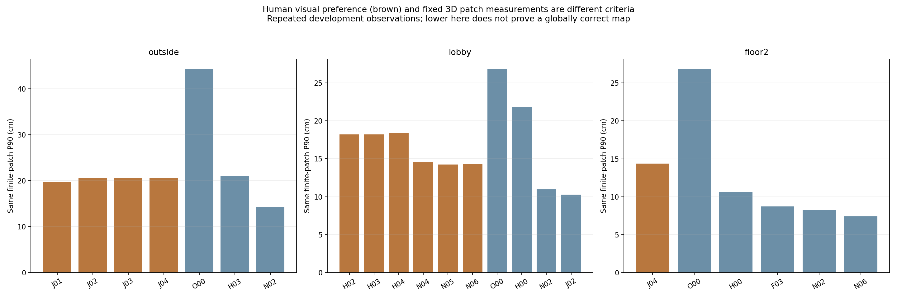

갈색은 육안 선별 후보, 파란색은 대조군이다. 낮은 P90도 반복 개발 관측에서의 지표이며
측량 정답이나 새로운 독립 검증은 아니다.

## 3. 먼저 확인한 공통 조건

각 기록의 H/N/F/J 후보들은 다음 조건이 같다.

- A/B 프레임 ID,전처리 후 카메라 좌표 입력 점,입력 점 수와 hash.
- depth 범위·confidence 정책·voxel5cm·사진의 축 범위와 높이 색 범위.
- 첫 공통 카메라에서 맞춘 단일 rigid 표시 gauge. 후보별 best-fit ICP 표시 정렬 없음.

따라서 H/N/J 사이의 차이는 **그림을 만들 때 벽을 더 지웠기 때문이 아니라 포즈와
최적화 모델의 차이**다. 단,voxel 결과와 표시 sampling은 포즈 변화에 반응한다.
거의 같은 포즈라도 voxel 경계와 scatter 선택 때문에 점무늬가 조금 달라질 수 있다.

J는 과거 **전체 프레임 변수**와 통합 가설을 사용한 결과,H는 독립 **submap anchor**를
푼 결과,N은 국소 depth 측정 일부를 재평가한 독립 submap 결과다. 초기값·측정·
노드 자유도·prior·solver budget까지 다르므로 “J가 좋아 보임=특정 loss 하나가
우수함”이라는 단일 원인 결론을 낼 수 없다.

고정 패치 평가는 후보의 필터를 거치지 않은 같은 원본 depth를 사용했다.
새 계산값이 이전 갤러리의 패치별 값과1µm 이내로 일치하는지도 확인했다.

## 4. 알고리즘의 실제 동작과 파라미터

### H02/H03/H04

H02는6DoF block-Huber,H03은6DoF DCS,H04는물리 구역 공유 switch다.
공통으로 native odometry는 항상 유지하고,선언한 비-odometry 구역 안에서는
측정 수로 목적함수를 평균해 반복 관측의 중복 투표를 줄인다.

이 구현에서 `χ² = eᵀΩe`이며,H02 가중치는 `min(1,3/sqrt(χ²))`,
H03 가중치는 `min(1,2φ/(φ+χ²))²`, `φ=5.991`다.
H04는 구역별 중앙 χ²에 대해 `s=10/(10+medianχ²)`,정보 가중치 `s²`를 사용한다.
H04는 이 프로젝트의 공유 구역 휴리스틱이며 원 논문의 모든 switch 변수를
동시에 최적화한 것과 같다고 부르지 않는다. 이 상수들은 센서 보정 결과도 아니고,
6DoF 잔차에 대해 실측으로 보장된95% 확률 문턱도 아니다.

| 기록 | 학습 비-odometry 수 | 최종 포즈에서 H02/H03의 최대 χ² | 최종 Huber/DCS가1% 넘게 감쇠한 수 |
|---|---:|---:|---:|
| 외부 | 17 | 0.439 | 0/0 |
| 로비 | 33 | 0.708 | 0/0 |
| 외부 브리지 | 5 | 약2.55e-28 | 0/0 |
| 서브 계단 | 5 | 0.0949 | 0/0 |

모두 Huber의 `χ²=9`,DCS의 `χ²=φ`보다 작다. **최종해 주변에서 H02/H03의
강건 감쇠가 작동하지 않아 같은 가중 최소제곱 문제에 가까웠다.**
이 표는 최종 포즈 기준이다. 모든 초기 반복에서도 단 한 번도 감쇠가 없었다고
일반화하지 않는다.
이것은 “두 알고리즘이 서로 다른 나쁜 루프를 성공적으로 제거했다”는 증거가 아니다.
큰 물리 오차도 저장된 공분산이 크면 χ²가 작을 수 있다는 기존 감사 결과와 연결된다.

DCS의 이상치 영향 억제 원리는 [원 논문](https://www.ipb.uni-bonn.de/wp-content/papercite-data/pdf/agarwal13icra.pdf),
관측 공분산에 따른 whitening 필요성은 [Ceres 공식 설명](https://ceres-solver.readthedocs.io/latest/nnls_covariance.html)을
참고한다. 위 수치와 구현별 설명은 우리 코드/실행 보고서에서 직접 확인한 것이다.

### N04/N05/N06

- N04: x/y/z/yaw를 수정하고 baseline roll/pitch는 고정한다. **Z를 고정하는2D SLAM은 아니다.**
- N05: SE(3) 수정과 baseline 자세 prior σ2°. 새 IMU 중력 측정이 아니라 seed 자세의 regularization이다.
- N06: N05에 조건부 국소 수평면 법선 σ3°를 추가한다. 로비28개·2층26개·서브 계단17개다.
  전역 바닥 높이는 고정하지 않으며 모든 디딤판을 같은 높이로 묶지 않는다.

H와 달리 N은 전처리한 방문 중심±1프레임의 국소 trimmed ICP로 재평가한 측정을
포함한다. 로비11개,서브 계단2개가 반영됐다. 따라서 H↔N 차이는 자유도뿐 아니라
관측·공분산 모델의 변경도 섞여 있다.

### J01/J02/J03/J04

J01은4DoF,J02는SE(3)+baseline 자세 prior,J03은여기에 수평 법선,
J04는같은 유한 평면2개를 추가한 과거 전체 프레임 최적화다.
전체 법선167개는 로비74·2층81·서브 계단12개이며,외부와 외부 브리지는0개다.
유한 평면2개는2층548↔981 벽과503↔961 국소 바닥이다.
거리 σ8cm·법선 σ3°의 모델로,평면의 법선·법선 방향 거리를 제한하고
**평면 접선 방향 이동은 직접 제한하지 않는다.**

## 5. 실제로 거의 같은 후보들

| 기록·후보 쌍 | 최대 카메라 위치 차이 | 최대 자세 차이 |
|---|---:|---:|
| 외부 J02↔J03 | 0.392mm | 0.00232° |
| 외부 J02↔J04 | 1.391mm | 0.00945° |
| 로비 H02↔H03 | 0.173mm | 0.000315° |
| 외부 브리지 H02↔H03 | **0** | **0** |
| 서브 계단 H02↔H03 | 0.000777mm | 0.00000522° |
| 서브 계단 H02↔H04 | 1.839mm | 0.01485° |

이는 같은 프레임/표시 gauge에서 포즈를 직접 뺀 값이다. 센서 정확도나 벽 두께가
이 수치로 보장된다는 뜻은 아니다. 사진 export voxel은50mm다.

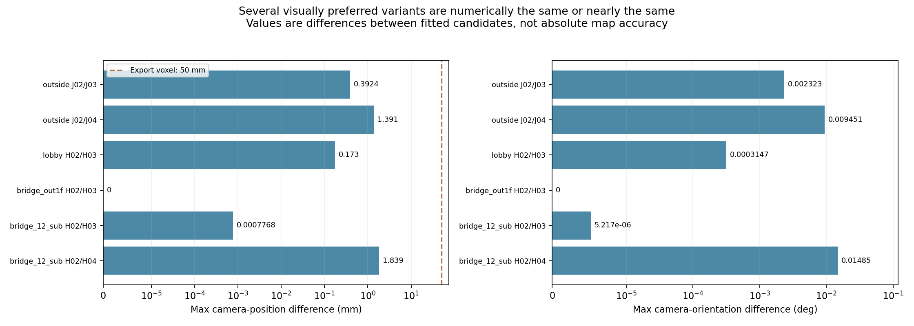

## 6. 외부: J계열이 좋아 보이는 이유와 실제 근거

**시각 해석:** 전체 프레임 자유도와 검증된 상대 관계를 함께 사용해 재방문 때의
외벽 윤곽을 조정하고,4DoF 또는 약한 자세 prior가 작은 기울기 변형을 제한하는
방식이 넓은 외벽·외부 경사의 모양에 맞았을 가능성이 있다. H의 고정 submap 내부
형상은 같은 정도로 프레임별 drift를 보정할 수 없다.

**확인된 사실:**16개 동일 패치에서 J01의 중앙값/P90/최대는
7.33/19.74/28.96cm,J02~J04는약7.87/20.59/28.96cm다.
H03의8.41/20.97/31.98cm보다 일부 개선되므로 선호를 뒷받침하는 국소 근거가 있다.
하지만 대조 N02는3.21/14.31/22.34cm로 이 패치 집계에서는 더 낮다.

예약2쌍에서는 J01의 clipped RMSE17.20cm·overlap33.72%,
앱 원본16.59cm·38.25%,N02는16.50cm·39.36%다. 따라서 **J가 모든 독립적인
관측에서도 가장 좋다고 결론낼 수 없다.** 이 예약 관측도 반복 개발 자료다.

외부는 J 그래프에서도 다른 세션과 분리된 성분이다. 법선·유한 평면 factor도 없다.
따라서 J03/J04가 좋아 보인다고 해서 “실내의 바닥 평면이 외부까지 보정했다”거나
“외부가 joint 연결 덕분에 개선됐다”고 설명하면 틀리다. J02/J03/J04의 외부 목적함수는
같으며 작은 차이는 전체 solver의 근사/종료 차이로 해석하는 것이 타당하다.

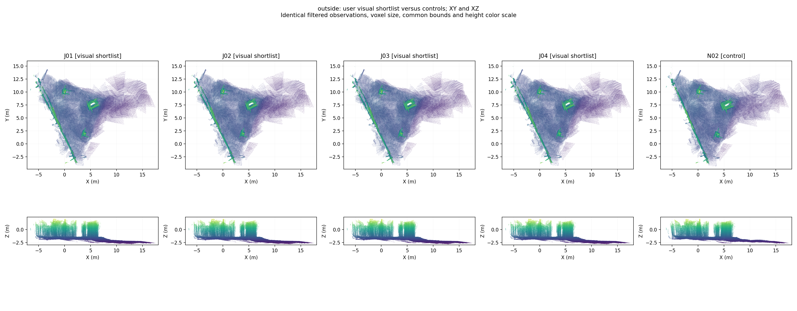

## 7. 로비: H02/03/04,N04/05,SE3

**시각 해석:** 로비는 같은 층의 넓은 벽·바닥이 반복되는 구역이다. 낮은 자세 자유도나
baseline 자세 prior는 불필요한 roll/pitch 변형과 높이 흔들림을 억제할 수 있다.
이 해석과 맞게 N04↔N05의 최대 차이는1.31cm/0.304°로 작다.
N05↔N06는최대36.63cm/1.16°이므로 N06까지 같은 결과라고 보면 안 된다.

| 로비 후보 | 패치 중앙값 | P90 | 최대 | 카메라 Z span |
|---|---:|---:|---:|---:|
| H02/H03 | 4.49cm | 18.22cm | 60.61cm | 약1.063m |
| H04 | 4.47cm | 18.37cm | 60.25cm | 1.063m |
| N04 | 4.56cm | 14.54cm | 46.71cm | 1.049m |
| N05 | 4.56cm | 14.22cm | 46.64cm | 1.043m |
| N06 | 3.99cm | 14.29cm | 50.75cm | 1.190m |
| N02 대조 | 4.96cm | 10.97cm | 47.28cm | **2.731m** |

N02의 Z span이 N05보다 훨씬 커서 전체 모습이 덜 안정적으로 보일 수 있다.
그러나 camera span이 작다고 실제 바닥 높이가 더 정확한 것은 아니다.
phone 촬영 높이 변화도 포함하므로 이는 **설명용 proxy**다.

N05는H03보다 P90/최대가 좋아졌지만,예약5쌍의 RMSE 중앙값은
17.00→17.36cm로 약간 악화하고 overlap은34.81→47.99%로 개선한다.
N02는예약 RMSE16.80cm/overlap54.35%다. 서로 다른 지표가 다른 후보를 지지한다.
N06도 중앙값은 좋아졌지만 최대 오차가N05보다 커져,법선 제약 추가가 모든 곳의
자동 개선은 아님을 확인했다. 비교용 J02의 P90은10.25cm지만 이는 과거 joint 모델이라
같은 측정에서 loss만 바꾼 대조 실험으로 비교해서는 안 된다.

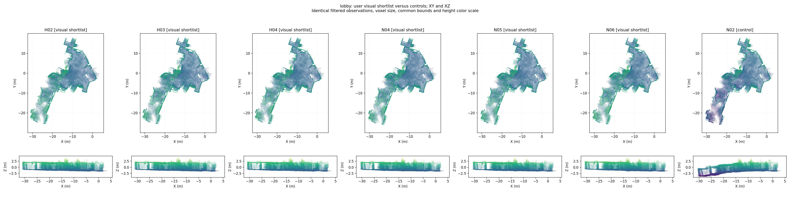

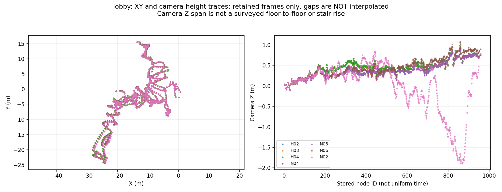

## 8. 외부 브리지: H02/H03

**확인된 사실:**두 후보의86개 표시 포즈는 완전히 같다.17개 submap/16개 학습
연결이 모두 단독 위상 연결이며,강건 가중치를 바꿔 골라낼 대체 cycle이 없다.
국소 χ²는약1e-28,새 N에서도통과한 재측정0개였다. 그래서 같은 지도가 나오는 것이다.

인접24개 이하 표본의 RMSE는H02/H03/N02 모두약13.39cm다. 그러나 재방문 예약
관측과 고정 비교 패치는0개다. **“보기에 좋고 잔차도 작음”은 연결을 자가 검증한
것이 아니며,전역 drift가 해결되었다고 판단할 수 없다.**

134개 앱 프레임 중86개만 같은 비교에 사용됐다는 coverage 차이도 원본과 대조해야 한다.
후보끼리는 같은86개이므로 H02↔H03 차이는 품질 프레임 제거 효과가 아니다.

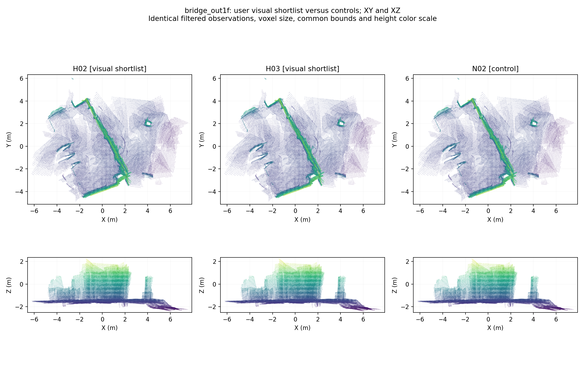

## 9. 2층·메인 계단: J04의 장점과 반례

**왜 좋아 보이는가:** J04는 먼저 검토한 548↔981의 동일 벽과 국소
바닥 관계를 직접 제약한다. 이 벽이 실제로 더 잘 맞으므로 크게 보이는 모서리·
복도 윤곽이 선명해진다는 평가는 타당하다. XY 투영에서는 Z가 사라지고,유한 평면은
접선 방향의 모든 오차를 제한하지 않아 다른 구역의3D 오차를 놓칠 수 있다.

| 같은 원본 유한 패치 | 기존 H00 | 선호 J04 | F03 대조 | N06 대조 |
|---|---:|---:|---:|---:|
| 548↔981 벽 | 23.28cm | **1.54cm** | 0.97cm | 7.06cm |
| 656↔1055 벽 | 4.05cm | **54.42cm** | 1.77cm | 2.39cm |
| 642↔1031 수평면 | 2.86cm | **18.06cm** | 7.93cm | 2.72cm |
| 620↔1025 수평면 | 0.98cm | **22.59cm** | 12.13cm | 5.57cm |

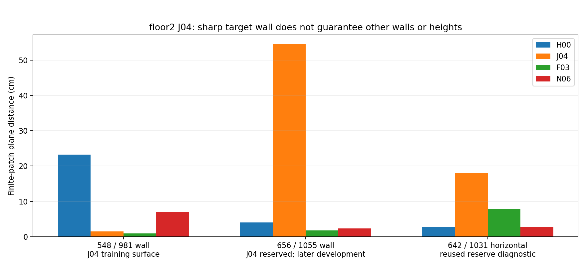

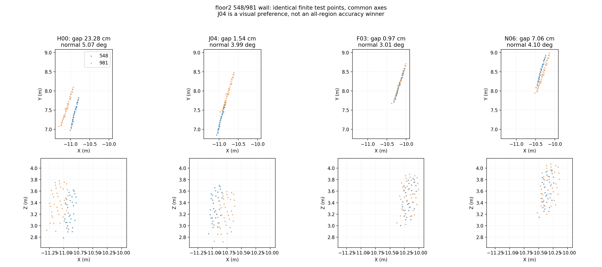

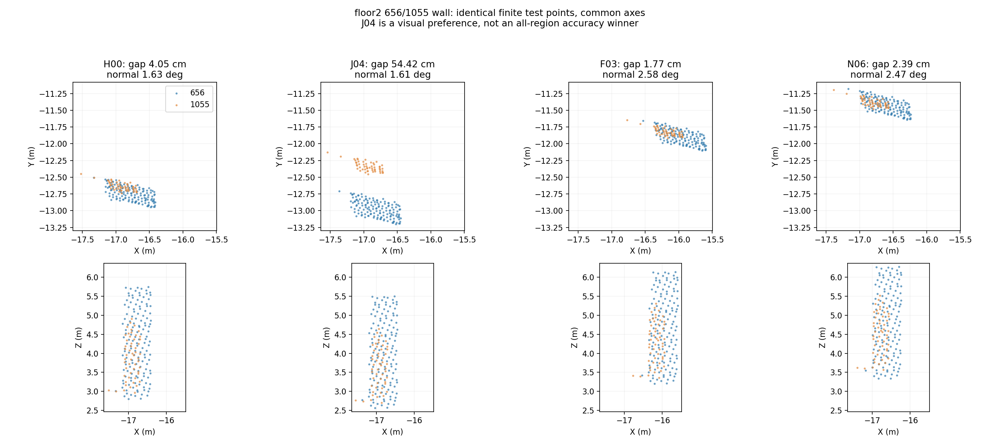

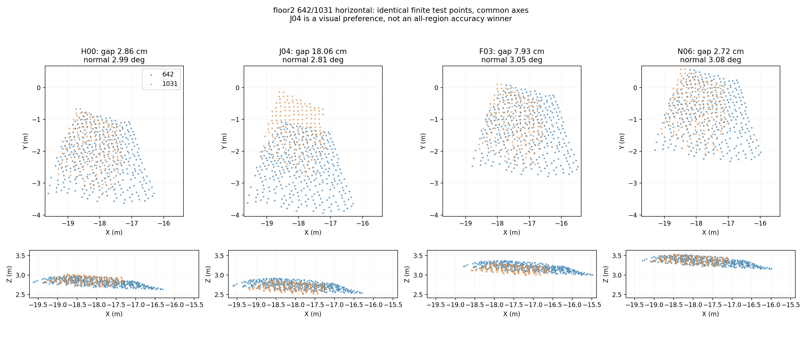

38개 고정 패치 P90/최대는 J04가14.36/54.42cm,H00이10.65/23.28cm,
F03가8.72/12.13cm,N06가7.41/23.97cm다. 즉 **J04는 이번 패치 전체 집계에서도
우승하지 않았다.** 반면 wall-normal P90은 J04가5.05°,N06가5.72°로 J04가 낮다.
법선 방향/윤곽은 좋지만 위치 offset이 큰 경우가 존재해 육안과 거리 지표가 갈릴 수 있다.

J04 시점의656 쌍은 예약 관계였으나 이후 BA에서 개발 학습으로 전환한 이력이 있다.
F03/N과 함께 비교하며 이를 새 독립 holdout이라고 부르지 않았다. 공통 예약5쌍에서는
정확히 학습한 pair의 합집합을 제외했지만,주변 관측과의 상관·반복 평가 한계는 남는다.

**판정:**J04의 좋은 목표 벽 관계를 활용할 근거는 있으나,현 상태를 전체2층의 최종
정확도 최선 또는 길찾기 지도 승인으로 기록하지 않는다. 이 턴에서는 보완 최적화나
X/Y/Z 성분 조립,다른 후보와의 자동 병합을 실행하지 않았다.

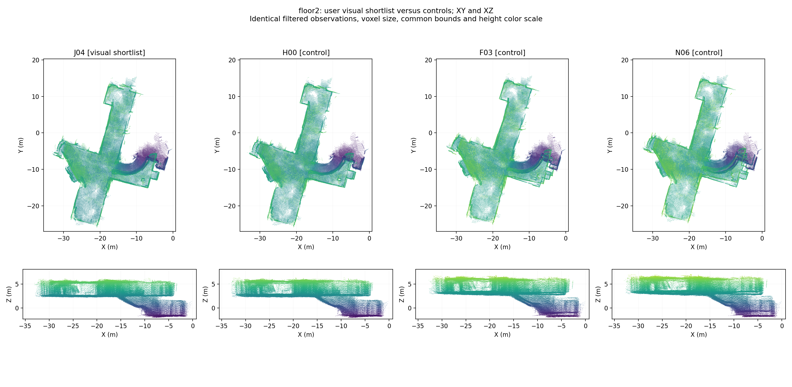

## 10. 서브 계단: H02/03/04와 NEW SE3

H02↔H03의 포즈 차이는 최대0.000777mm,H02↔H04도1.84mm여서 같은 좋은 형상으로
보이는 것이 자연스럽다. H04가 서로 다른 강건 보정을 크게 수행한 결과는 아니다.

H03↔N05는최대4.65cm/0.079° 차이다. SE3가 추가 자세 자유도를 허용해도 baseline
자세 prior 때문에 변화가 작아,H 계열과 비슷하게 안정적으로 보일 수 있다.
하지만 N05↔N06는최대14.40cm/1.35°이고,그중 Z 차이가최대14.03cm다.
같은 `NEW SE3`라고 묶어 선택하기 전에 N05/N06를 별도로 확인해야 한다.

| 실제 측정된 기존 학습 쌍75↔209 | 앱 O00 | H03 | N05 | N06 |
|---|---:|---:|---:|---:|
| clipped cloud RMSE | 17.77cm | **15.33cm** | 15.85cm | 15.64cm |
| overlap | 45.63% | **64.44%** | 60.78% | 61.58% |

이 쌍은 기존에 fitting한 추가 loop이며 **독립 예약 검증이 아니다.** 국소 지표는
H를 지지하지만,모든 계단과 층 연결 높이가 맞는지 입증하지 못한다. raw native loop는
별도로1개 있으나 공통 A/B 양쪽이 살아 있는 native 검사 pair는 없다는 점도 구분했다.

camera Z span은H03 4.626m,N05 4.650m,N06 4.612m다. 이를 실측 층고나 계단
상승 높이로 이름 붙이지 않았다. 촬영 높이·경로·기울기 오차가 섞인 proxy일 뿐이다.

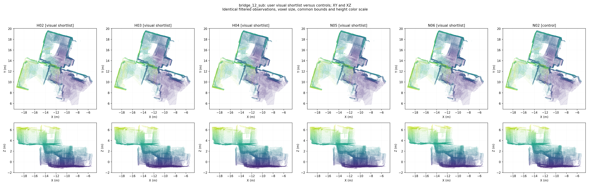

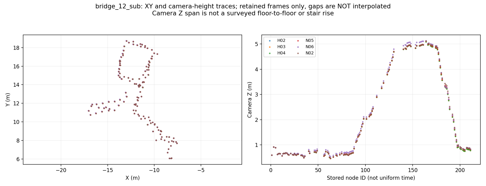

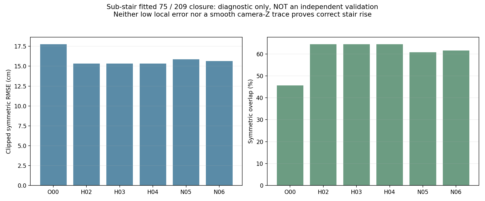

## 11. 원본/row 값은 무엇을 보여 주는가

`raw_quality_rows.csv`는 원본 RGB-D와 당시 **동결된 앱 포즈**로 계산했던
품질 검사2,875개 행을 보존한 것이다. 원본DB blob 그 자체도 아니고,순수
`Node.pose` odometry만의 행도 아니다. 행별 node ID·timestamp·품질 등급·
confidence·depth·흐림·노출·이동/회전·intrinsic 변화·submap 소속을 제공한다.

| 기록 | 전체 품질 행/C행 | 유효 depth 중앙값 | confidence100 중앙값 | 선명도 proxy 중앙값 | 앱 포즈 회전 step 중앙값 |
|---|---:|---:|---:|---:|---:|
| 외부 | 354/49 | 52.50% | 39.69% | 38.53 | 13.39° |
| 로비 | 958/158 | 57.10% | 45.92% | 38.61 | 13.39° |
| 외부 브리지 | 134/48 | 57.78% | 41.61% | 29.86 | 24.57° |
| 2층 | 1,218/293 | 62.34% | 51.33% | 22.15 | 15.98° |
| 서브 계단 | 211/76 | 75.48% | 54.43% | **9.19** | 21.39° |

선명도는640px 변환 영상의 Laplacian variance로 노출·내용에도 영향받는다.
회전 step은 **저장 노드 사이의 포즈 차이**이지 IMU 각속도나 동일 시간 간격의 흔들림이 아니다.
깊이 유효율·confidence도 센서의 미터 단위 오차 보증이 아니다.

자료는 외부의 낮은 depth coverage,브리지의 큰 저장-node 회전,서브 계단의 낮은
시각 선명도를 보여 준다. 약한 관측에서 제한된 자유도/자세 prior가 도움이 될 수 있다는
해석과 부합하지만,5개 서로 다른 장면의 이 통계만으로 알고리즘 선택의 단일 원인을
통계적으로 입증할 수 없다. 기하 퇴화·반복 벽의 오대응·센서 시간 동기/보정 오차의
분리 원인까지 이번 분석에서 검증했다고 주장하지 않는다.

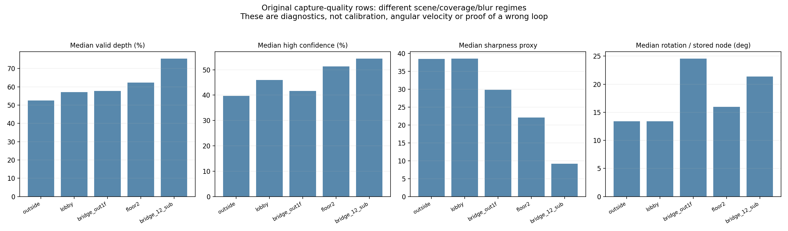

## 12. 산출물·재현·변경하지 않은 것

- [후보34개 행과 지표](../assets/visual-shortlist-review/candidate_rows.csv)
- [원본 기반 품질2,875개 행](../assets/visual-shortlist-review/raw_quality_rows.csv)
- [후보 쌍별 포즈 차이](../assets/visual-shortlist-review/pose_pair_differences.csv)
- [고정 패치별 실제3D 거리·법선·지지율](../assets/visual-shortlist-review/fixed_patch_rows.csv)
- [전체 분석·가중치·출처·한계](../assets/visual-shortlist-review/summary.json)
- [보충 동등성/서브 계단 학습 쌍](../assets/visual-shortlist-review/supplement.json)
- 그림16장의 출처/hash: `manifest.json`과 `supplement_manifest.json`.

기본 분석은 `src/analyze_visual_shortlist.py`,보충은
`src/supplement_visual_shortlist.py`다. 기본 출력은
`outputs/student_union_20261017_visual_shortlist_v2/`에 보존했다.
처음 Python/OpenCV 읽기 지연으로 중단한 초안은 `visual_shortlist_v1/`에,
보충 그림 제목 배치 보정 전 초안은 `visual_shortlist_v2/supplement_layout_v1/`에 보존했다.

```bash
OPENBLAS_NUM_THREADS=1 OMP_NUM_THREADS=1 MKL_NUM_THREADS=1 \
/usr/bin/python3 -s -u src/analyze_visual_shortlist.py \
  --output outputs/student_union_20261017_visual_shortlist_NEW \
  --assets outputs/student_union_20261017_visual_shortlist_NEW/gallery

OPENBLAS_NUM_THREADS=1 /usr/bin/python3 -s src/supplement_visual_shortlist.py \
  --assets outputs/student_union_20261017_visual_shortlist_NEW/gallery
```

`-s`는 사용자 site-packages를 제외하는 실행 환경 설정이다. 좌표·관측·optimizer를
바꾸기 위한 옵션이 아니다. 출력은 새 경로를 사용해야 한다.

검증:전체 테스트 **352 passed**. 기본 분석의 입력 DB·포즈·그래프·원본 지표 hash가
실행 전후 같았고,패치 재계산도 동결 갤러리와 일치했다. 새 테스트4개는 빈 관측을
오차0으로 해석하지 않기,미터/도 단위 분리,관측 support 불일치 거부,정확히 같은
포즈를 별도 개선으로 세지 않기를 검사했다.

이 단계는 **설명·기록·시각화 추가**다. 원본DB·후보 포즈·기본RViz·선택 지도를 유지했고 재최적화와 새 통합은 수행하지 않았다.
