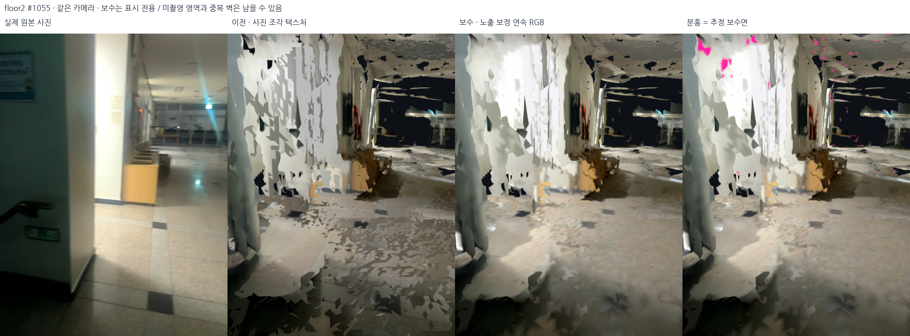

# 2층·메인 계단 표면 결손, 조각무늬, 로드뷰 및 OSM — 2026-10-18

## 결론과 적용 범위

검토 대상은 **2층·메인 계단**의 벽이다. 당시 화면과 카메라 포즈의 정확한 대응이 없어 같은 세션의 #1055, #1078 시점에서 비교했다.

다섯 기록 전체에 작은 구멍 보수 시험과 고정 포즈 밝기 보정을 실행했다.
밝기 조각무늬는 완화했지만 **빈칸/찢어진 기하의 완전 해결은 아니다.**
구멍 보수 후보 37,250면 중 3개 이상 시점의 깊이 지지를 통과한 면은 8면뿐이었다.
나머지는 작은 평면 구멍이라는 가정에 의존한다. 따라서 기본 표시에는 보수면을
넣지 않고 **색 보정만 한 원래 형상**을 사용한다. 보수면 포함 시험본과 분홍 표시본은
명시적인 비교 옵션으로 남겼다. 출입구·계단의 미관측 부분을 임의로 막지 않는다.

선택 지도/포즈/DB는 그대로다. `config/current_map.json`의 선택 manifest SHA-256은
`98cf1d77aa5ca3c82f9653ffcb4ee86d6f40ac4d8953f1c1171b0dfa307090b1`이다.
표시 후보는 `outputs/student_union_appearance_v2/`, 사진 이동 자료는
`outputs/student_union_roadview_v1/`에 별도로 저장한다. 내비게이션 승인이 아니다.

## 1. 왜 최적화 이후에도 깨져 보이는가

포즈 최적화, RGB-D 표면 융합, 표면에 사진을 입히는 과정은 서로 다른 단계다.

- 포즈를 고정해도 TSDF에는 깊이 결손, 반사/유리, 관측 간 불일치와 구멍이 남는다.
  기존 포즈를 최적화했다는 사실만으로 모든 표면이 일치한다는 보장은 없다.
- 이전 표시는 **면마다 가장 좋은 사진 하나**를 골랐다. 이 방식은 글자 해상도를
  유지하지만 인접 면의 사진이 바뀌면 노출·화이트밸런스·그림자·반사가 갑자기 바뀐다.
- 노출 차이와 실제 기하 찢김은 다르다. 이번 동일 카메라 사진에서 색을 연속적으로
  바꾼 뒤에도 벽의 굴곡과 검은 미관측 영역이 남았다. 조도만의 문제라고 할 수 없다.
- 겹친 면의 가림이나 z-fighting도 가능한 원인이지만, **첨부 벽의 원인으로 확정하지
  않았다.** 캡처만으로 어떤 면이 어느 프레임에서 생겼는지 판단할 수 없다.

예를 들어 #1055에서 기존 표면의 센서 대비 첫 교차 깊이 차이 중앙값은 약 43.69cm다.
이는 측량 오차나 포즈 오차가 아니라 **메시 ray-depth와 해당 RGB-D의 불일치**다.
보수 전후 공통 픽셀의 깊이 변화 중앙값은 0이다. 새로 채운 99픽셀은 오히려
센서 대비 약 2.32m 중앙 차이를 보였다. 그래서 단순히 검은 픽셀이 줄었다는 이유로
보수 후보를 기본 표시로 승격하지 않았다.

## 2. 작은 구멍 보수 시험

구현: `src/repair_visual_appearance.py`의 `fill_small_supported_holes`.

1. 기존 전체 5cm TSDF 표면에서 정점/기존 면은 보존한다.
2. Open3D CPU `TriangleMesh.fill_holes(hole_size=0.25)`로 경계 삼각분할을 제안한다.
   0.25m는 지름이 아니라 API가 정의한 **근사 최대 반경**이다.
3. 추가 면의 연결 성분별로 면적 ≤0.15m², 평면 최대 잔차 ≤1.8cm,
   3차원 bounding diagonal ≤0.6m를 요구한다.
4. 법선은 수직 벽 또는 수평 면 범위만 허용한다. 경사 계단을 전역 평면으로 펴지 않는다.
5. RGB-D에 투영해 `8cm + 2% × depth` 안의 지지 관측을 센다.
   관측된 빈 공간을 2개 이상 시점에서 가로막으면 기각한다.
6. 깊이 지지 3회 이상, 또는 면적 0.04m² 미만인 작은 추정 구멍만 시험 후보에 남긴다.
   **후자의 조건은 측정 증거가 아니다.** 모든 추가 면은 inferred로 표시한다.
7. 후보의 기존 정점/기존 면 좌표가 같은지 검사하고, 최종 기본 파일에서는 추가 면을
   전부 제거한다. 보수 포함 후보는 비교 전용이다.

| 기록 | 보수 시험 추가 면 | 그중 깊이 지지 ≥3회 | 시험 추가 면적 |
|---|---:|---:|---:|
| 외부 | 5,065 | 2 | 3.82m² |
| 로비 | 13,573 | 0 | 10.02m² |
| 외부 브리지 | 1,280 | 5 | 0.76m² |
| 2층·메인 계단 | 15,277 | 1 | 10.91m² |
| 서브 계단 | 2,055 | 0 | 1.40m² |

2층 경계 edge 수는 시험본에서 121,755→100,633으로 감소했지만, 이는 정확도나
실제 구멍 수가 아니다. 기본 색 보정본은 원래 면 집합을 그대로 사용한다.
큰 빈 곳까지 자동으로 완성하려면 물리 벽 경계와 문·통로 구멍을 구별하고,
더 많은 관측의 가시성/깊이 일관성을 검증해야 한다. 현재 시험만으로는 부족하다.

## 3. 밝기 조각무늬 완화

카메라와 기하를 움직이지 않는 자체 구현이다. Open3D의 카메라 color-map 최적화
API를 호출한 것으로 표현하지 않는다. [Open3D color-map 개요](https://www.open3d.org/docs/release/tutorial/pipelines/color_map_optimization.html)는
관련 배경이며 이번 구현은 더 제한된 **고정 포즈 노출 gain 그래프**다.

1. 기록당 최대 200,000개 표면 정점을 고정 seed로 표본화한다.
2. 기존 텍스처용 사진 64/80/32/96/48장에 투영한다. depth 0.25–4.2m,
   깊이 일치 `8cm+2%`, 시선 법선 cosine >0.3을 요구한다.
3. 두 사진에 같은 표면 표본이 40개 이상 있고, linear RGB가 0.015–0.85인
   대응만 노출 식에 사용한다. 포화/너무 어두운 색은 제외한다.
4. linear RGB의 로그 비 중앙값으로 프레임 간 방정식을 구성한다.
   12회 강건 IRLS, 로그 잔차 Huber 전환 0.12, 약한 0 중심 사전값을 사용한다.
   gain은 0.65–1.55로 제한한다. 포즈/깊이는 바꾸지 않는다.
5. 표면 표본의 20%는 gain 계산에서 제외하고 전후 차이를 확인한다.
6. vertex RGB를 `cosine³ / distance²` 가중 평균 65% + 최선 시점 35%로 굽는다.
   직접 재투영되지 않은 정점은 기존 융합 색을 유지한다.
   GLB vertex RGB는 sRGB→linear 변환 후 저장한다.

| 기록 | 보류 표본 사진쌍 표본 수 | 로그 RGB 차이 중앙값 전→후 | 직접 재색칠 정점 비율 |
|---|---:|---:|---:|
| 외부 | 330 | 0.574→0.490 | 46.3% |
| 로비 | 554 | 0.328→0.289 | 27.1% |
| 외부 브리지 | 2,322 | 0.481→0.430 | 63.7% |
| 2층·메인 계단 | 536 | 0.484→0.203 | 26.5% |
| 서브 계단 | 1,241 | 0.339→0.243 | 59.2% |

이 수치는 사진 간 밝기 차이의 로그 지표이지 cm 오차나 전체 화면의 시각 품질 점수가
아니다. 같은 촬영분 안의 보류 표본이며 독립 검증도 아니다. 가려진 면의 오대응,
그림자, 반사, 포화, 세션 사이의 밝기 차이를 모두 해결하지 못한다.
노출 그래프가 연결되지 않은 프레임은 gain을 억지로 추정하지 않는다. 정확한 연결 성분과
미제약 사진 수는 `review.json`에 기록했다. 2층은 96장 중 64장이 미제약이다.

연속 vertex RGB는 단단한 사진 경계를 줄이지만 **작은 글자를 흐리게 만든다.**
따라서 원본 사진 텍스처/원본 사진 로드뷰를 같이 유지한다.

첫 시도(v1)는 세계 표본 16,000개가 부족해 2층 노출 edge가 0이었다.
그 결과를 성공으로 채택하지 않았다. v1 결과와 당시 소스는
`outputs/student_union_appearance_v1/source_snapshot.py`에 보관했다.
v2는 200,000개로 늘리고 유효 표본 mask를 재사용해 계산 비용을 줄였다.

## 4. 사진·원본·보정·추정 면 증거

동일 카메라 비교판: 원본 사진 / 기존 UV / 작은 보수+색 보정 시험 / 추정 면 분홍.
네이티브 데스크톱 스크린샷이 아니라 실제 데이터의 고정 카메라 렌더다.



- [2층·메인 계단 주변](../assets/appearance-v2-review-20261018/floor2/stairs_comparison.png)
- [외부](../assets/appearance-v2-review-20261018/outside/source_comparison.png)
- [로비](../assets/appearance-v2-review-20261018/lobby/source_comparison.png)
- [외부 브리지](../assets/appearance-v2-review-20261018/bridge_out1f/source_comparison.png)
- [서브 계단](../assets/appearance-v2-review-20261018/bridge_12_sub/stairs_comparison.png)
- [카메라·해시·전후 깊이와 경계 edge 검사](../assets/appearance-v2-review-20261018/manifest.json)
- [이전 점군→표면 전체 20장](2026-10-18-pointcloud-to-surface-gallery.md)

## 5. 로드뷰 전작업과 로컬 프로토타입

`src/prepare_roadview_pack.py`, `src/audit_roadview_coverage.py`.

| 기록 | 고정 선택 포즈 | 실제 사진 시점 |
|---|---:|---:|
| 외부 | 305 | 164 |
| 로비 | 800 | 397 |
| 외부 브리지 | 86 | 49 |
| 2층·메인 계단 | 925 | 509 |
| 서브 계단 | 135 | 80 |
| 합계 | 2,251 | **1,199** |

- 키프레임 조건: 이전 선택 시점에서 1.2m 이동 또는 22° 회전 또는 3초 경과.
  각 기록의 처음/끝 포함. 원본 DB는 read-only로 연다.
- 사진 JPEG95, 미리보기 JPEG85로 로컬 파생본을 만든다. 원본 파일 바이트 보존본이
  아니라 디코딩 후 재인코딩한 사진이다. 원본 DB 자체는 유지한다.
- 각 사진에 원래 해상도, K, camera-to-world, FOV, 시간, 지도 위치/방향을 묶었다.
- 촬영 순서 연결 1,194개. 이는 **보행 가능 경로가 아니다.**
- 다른 세션의 1.2m 이내·높이 차 0.4m 이내 후보 1,357개는 검토 목록일 뿐이다.
  자동 전이 edge로 만들지 않았다. 계단/층/문 앞 연결은 사진 확인이 필요하다.
- 로컬 창에서 기록을 고르고 Previous/Next로 실제 사진을 이동한다.
  `Photo roadview / full-size actual photograph`는 원본 파생 사진을 크게 보여준다.
  `3D from current photograph`는 해당 사진의 카메라 방향으로 지도를 본다.

**이것은 perspective 사진 로드뷰이지 360° 파노라마가 아니다.** 2m XY/0.75m Z
공간 칸별 근사 수평 방향 커버리지 중앙값은 2층 약 32%다. 같은 카메라 중심의
구면 커버리지나 파노라마 스티칭 가능률이 아니다. 관측하지 않은 반대편을 생성해
실측 로드뷰라고 표시하지 않는다. 최대 촬영 순서 간격은 로비 약 5.54m, 2층 약
4.61m이므로 매끈한 연속 이동도 아직 보장하지 못한다.

공개 전 미완료 조건은 `coverage_audit.json`의 `release_blockers`에 있다:
얼굴/번호판 익명화와 수동 검수, 실내 층/세션 전이 검증, 보행 경로 검증,
OSM 위치 확인, 방향 결손 처리 정책. 현재는 **로컬 전용·미익명화**이며 공개 업로드는 하지 않았다.

## 6. OpenStreetMap 위 임시 배치

실외의 중복되지 않은 GNSS 290개만 사용했다. 실내 GNSS/고도는 사용하지 않았다.
선택 지도의 XY를 ENU에 회전+이동만 하는 고정 scale=1 SE(2)로 배치했다.
정확도 기반 가중 Procrustes와 잔차 5m 강건 IRLS, 20회 계산을 사용한다.
센서 정확도 25m/측정 나이 2초까지 허용한 것은 **표시 초기값**을 얻기 위한 것이며
기존 SLAM GNSS 제약의 신뢰도 기준을 완화한 것이 아니다.

- 기준 위경도: 37.5420513367, 127.0778674263.
- 회전 yaw 약 99.71°. 실외 센서 보고 정확도 중앙값 **14.25m**.
- 맞춤 잔차 중앙값 2.97m/P90 5.27m는 절대 위치 정확도가 아니다.
- 상관된 GNSS를 재표본한 yaw 변화 5–95백분위 약 -10.17°~+10.42°는 진단값으로,
  보정된 신뢰구간이 아니다. 건물 외곽에 맞춘 것으로 주장하지 않는다.
- 실제 선택 점군의 XY 윤곽과 다섯 궤적을 OSM 위에 겹친다. 층별 Z는 GNSS로 펴지 않는다.
- 별도 웹 페이지가 아니라 **네이티브 로컬 창의 OSM 보기**다. 창의 3D 보기와
  사진 보기를 버튼으로 전환한다. OSM 데이터 편집/지도·사진 업로드는 하지 않는다.

표시 범위에 맞는 zoom 19 타일 3×3을 가져온다. 식별 가능한 User-Agent,
HTTP cache/ETag/Last-Modified, 최소 7일 로컬 캐시, 항상 보이는 저작자 표기를 사용한다.
대량 다운로드·오프라인 지도 패키지·다른 줌 레벨 미리 받기를 구현하지 않았다.
[OSM 타일 정책](https://operations.osmfoundation.org/policies/tiles/)과
[저작자 표기](https://www.openstreetmap.org/copyright)를 따른다.

OSM 위 임시 배치의 원본 PNG/타일 메타데이터는
`outputs/student_union_local_view_v1/osm_selected_map.png`, `osm_viewport.json`에 있다.
일반 소스/문서 Git에는 타일 캐시와 로드뷰 원본 사진을 넣지 않는다.

## 7. 로컬 실행·재현·보관

```bash
# 현재 로컬 3D / 사진 이동 / OSM 비교 창 — 웹 서버 아님
bash scripts/view_local_roadview.sh

# 원래 점군 RViz도 독립적으로 유지
bash scripts/view_current_map.sh

# 새 폴더에만 생성. 원본 지도/DB를 덮어쓰지 않음
PYTHONPATH=outputs/surface_runtime/packages OMP_NUM_THREADS=2 OPENBLAS_NUM_THREADS=1 \
  /usr/bin/python3 -s src/repair_visual_appearance.py --output outputs/NEW_appearance
PYTHONPATH=outputs/surface_runtime/packages OMP_NUM_THREADS=2 OPENBLAS_NUM_THREADS=1 \
  /usr/bin/python3 -s src/finalize_appearance_bundle.py outputs/NEW_appearance
/usr/bin/python3 -s src/prepare_roadview_pack.py --output outputs/NEW_roadview
/usr/bin/python3 -s src/audit_roadview_coverage.py outputs/NEW_roadview
```

표시: CPU Open3D 0.19 프로젝트 격리 패키지. 기존 `teamkai-yolo` CUDA 환경을
삭제/변경하지 않았고, 이번 보정은 CUDA/3DGS 학습 작업이 아니다.
사진 비교는 단일 OffscreenRenderer를 사용한다. 여러 렌더러 컨텍스트의 teardown
문제를 피한다. `native_loaded.json`은 실제 다섯 모델이 로드된 뒤 저장하며,
`native_scene_render.png`는 네이티브 scene의 렌더 콜백 결과다. 전체 데스크톱 캡처는 아니다.

`outputs/`, `data/`, DB/PDF, 타일 캐시·원본 사진은 Git 제외 규칙 유지.
통과 테스트와 출력 해시/상태는 별도 실행 기록 및
manifest에 남긴다. 형상/노출/사진 연결/OSM 각각의 승인 범위를 혼동하지 않는다.

최종 검사: **395 tests passed**. `delivery_audit.json`은 20개 입력 해시, 원본 DB 5개,
원래 모든 면 좌표와 기본 GLB의 float32 좌표 동일성, 사진 1,199개 해시와 미검증
자동 전이 부재를 확인했다. 비교 사진은 7장이다. 현재 로컬 표시 버전과 각 manifest
해시는 `config/current_local_view.json`에 고정했다. 기존 웹 표시 설정은 과거 기록이며
이번 재실행 진입점은 위 네이티브 스크립트다.

### 후속: CU 출입구 기준의 화면 이동 후보와 전체 3D 시작 화면

미리보기에서 CU 쪽 출입구가 지도 끝에 걸리도록 표시 위치를 조정했다.
정확한 기준점/실측 이동량이 없으므로 우선 **동쪽 2m·남쪽 2m**의 표시 후보를
`config/osm_manual_preview.json`에 별도 저장했다. OSM 점군 윤곽과 궤적에만 같은
이동을 적용하며 원래 GNSS 맞춤, 3D 점군/메시/포즈와 축척/회전은 바꾸지 않는다.
사진의 CU 위치나 OSM 건물 윤곽에 정확하게 정합했다고 주장하지 않는다.

원래 `osm_selected_map.png`는 보존하고 `osm_manual_preview.png`로 따로 저장했다.
기존에 표시한 9개 타일 캐시를 재사용했으며 새로운 타일 요청은 하지 않았다.
수동 이동값과 불확실성/저작자 표기는 이미지에 포함한다.

로컬 창은 기본적으로 **다섯 보정 표면의 전체 3D**를 더 가깝게 보여주고 유지한다.
원치 않는 OSM 자동 전환을 없앴으며 버튼으로 전환할 수 있다.
OSM 시작을 명시적으로 원하면 `bash scripts/view_local_roadview.sh --start-view osm`.
3D 렌더 콜백 저장과 전체 다섯 모델 로딩을 확인했다. 후속 전체 테스트 **396개 통과**.
