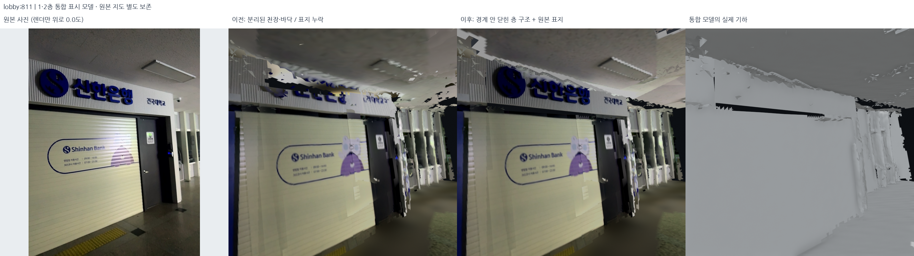
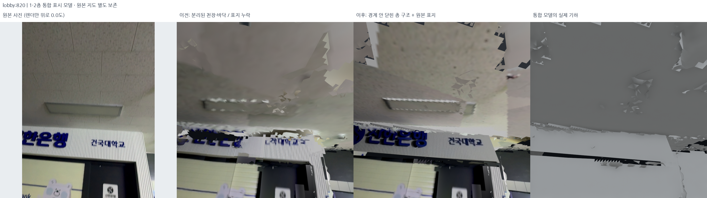
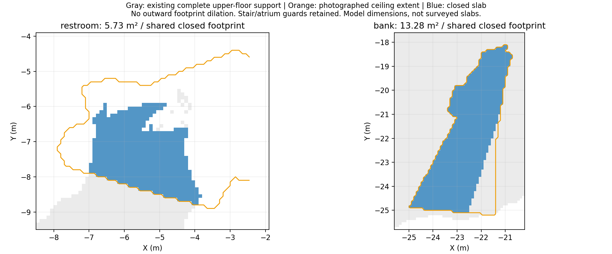
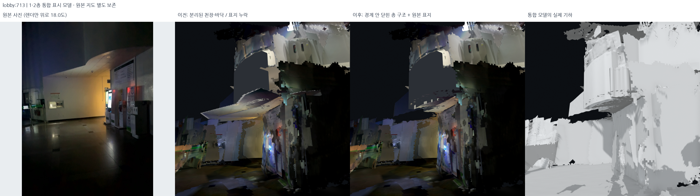
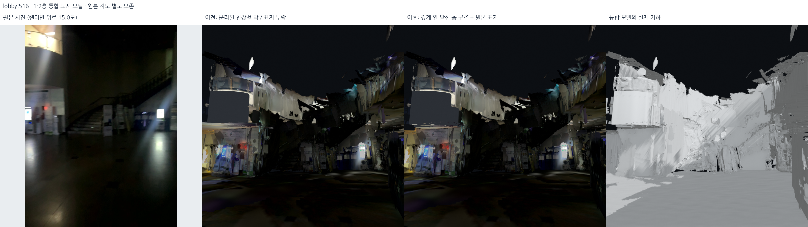

# 천장–바닥 사이 닫힌 층 구조와 신한은행 간판 — 2026-10-18

## 적용 결과

기존 통합 표시본 v4에서 좋다고 확인한 배치를 유지하고, **천장/바닥 사이의 노출된
빈틈과 신한은행 간판**만 별도 파생본으로 수정했다. 현재 로컬 기본 묶음은
`outputs/student_union_service_slabs_v3/`다. 원본 지도나 포즈를 다시 최적화하거나
원본 XY/Z를 바꾼 결과가 아니다. v4에서 유지한 면의 좌표는 이번 단계에서 그대로다.

- 1층 천장과 2층 바닥의 높이를 억지로 같게 만들지 않는다. 두 면 사이에 **같은
  경계의 측면**을 만들어 닫힌 표시 체적으로 연결한다.
- 천장 사진이 있는 구역과 **기존 2층 바닥의 완전한 셀**이 겹치는 영역만 사용한다.
  벽 밖으로 바닥/천장을 늘리거나 중앙 복층 로비를 덮지 않는다.
- 화장실 쪽 **5.73m²**, 은행 앞 **13.28m²**가 새 닫힌 층 구조의 XY 면적이다.
  건물 전체의 새로 메운 면적이나 관측 완성률이 아니다.
- 신한은행 상부 한글/로고/건국대학교 표지는 원본 로비 #811로 다시 입혔다.
  이미 읽을 수 있던 셔터의 영어 포스터는 기존 표시 면을 유지했다.





## 1. 신한은행이 이전 의미 복원에서 빠진 이유

이전 `config/photo_semantic_annotations.json`은 전 구역 자동 검출 결과가 아니라
수동 사진 검토 목록이다. 당시 25개 기록 중 로비는 엘리베이터 문/표시기,
음식점 포스터/벽 문구, 입구 유리, 서비스 문 **6면만** 등록했다. 신한은행 객체는
설정과 실제 `semantic_objects.json` 어느 쪽에도 없었다. 따라서 깊이 임계값 때문에
새 표지가 탈락한 것이 아니라 **복원 대상 자체가 누락**됐다.

기존 일반 벽/TSDF 텍스처에서 은행 글자가 보이는 것과, 고해상도 원본 표지 면을
별도 복원한 것은 다르다. 원본 #808/#811/#816/#820/#833을 대조했고 #811에는
간판 전체가 실제로 찍혀 있었다. 이 누락을 촬영 실패로 설명하지 않는다.

새 설정은 `config/verified_service_slabs.json`의 `lobby_shinhan_heading`이다.
기존 국소 벽 평면 0을 초기값으로, 해당 사진의 원본 depth로 표지 평면을 피팅했다.
지지점 **2,561개**, 같은 관측의 면 잔차 중앙값 **0.98cm**, P90 **2.13cm**다.
원본 카메라 보정값으로 광선–평면 교점을 만들고 Delaunay 삼각분할/원본 RGB UV를
적용했다. 표시 간격은 12mm다. 글자 모양이나 은행 로고를 새로 생성하지 않았다.

기존 통합 표시본과 일관되게 새 면에도 이전 단계의 표시 Z 변형만 적용했다.
사진 다각형 내부의 기존 수직 면 중 표지 지지 면에서 35cm 이내의 충돌 면만
교체한다. 이 한정 필터를 건물 전체나 계단에 적용하지 않았다.

실제 5개 메시를 함께 두고 원본 가상 카메라 광선을 검사했다. 사진 다각형 내부
1,172표본 중 새 간판 면을 먼저 만나는 비율은 **84.47%**이고, 단순 RGB 청색 조건으로
고른 글자/로고 표본은 **98.93%**다. 후자는 OCR 정확도나 독립적인 의미 평가가 아니다.
전체 다각형의 경계 부근에는 miss 130개와 기존 로비 면 가림 52개가 남는다.
새 층 구조가 가리는 표본은 0개다. 의미 면이 추가됐다는 것만으로 100% 가시성을
주장하지 않는다.

## 2. 따로 자란 천장과 바닥을 하나의 경계로 묶기

구현은 `src/complete_service_slabs.py`다.

### 원본 관측으로 아래 면 확정

- 화장실: 이미 검토한 #713/#167의 같은 처마밑 면을 사용한다.
- 은행: #811/#820/#808/#833에서 사진 속 천장 다각형을 지정한다. depth 상한 5.5m,
  결정적 RANSAC 320회, 4cm 지지, 6cm 재선택/SVD로 실제 수평 면 지지를 확인한다.
- 유효 지지 30개 이상, 55% 초과, P90 6cm 미만, 수평에서 20° 이내인 경우만 쓴다.
  사진 다각형을 광선 깊이 0.251–7.95m에서 유한하게 자른다.
- 두 구역을 임의로 같은 천장 높이로 묶지 않는다. 화장실 아래 면은 이전에 확정한
  표시 접합 높이 **1.48045m**, 은행은 네 사진 면 중심의 표시 높이 중앙값
  **1.75637m**다. 2층 윗면은 기존 공통 표시 바닥 **2.60m**를 유지한다.

### 바깥으로 늘리지 않는 공통 footprint

1. 기존 2층 바닥의 10cm 격자 중 실제 통합 v4 메시에서 **두 삼각형이 모두 남은 셀**만
   받는다. 단순 바운딩박스·볼록껍질로 건물 바깥을 메우지 않는다.
2. 이 셀과 원본 사진에 실제 천장이 보이는 다각형의 합집합을 교차한다.
3. 계단 보호/자유공간/복층 로비 핵심 개방 마스크는 제외한다.
4. 은행은 원본 간판의 지지 벽을 기준으로 실내 쪽에 있는 셀만 사용한다. 벽 반대편으로
   천장을 연장하지 않는다.
5. 둘러싸인 0.6m² 이하의 작은 격자 결손만 채울 수 있으며, 전체가 허용된 기존 바닥
   셀 안에 있어야 한다. **바깥 경계를 팽창시키는 dilation은 하지 않는다.**
6. 대각선 한 모서리로만 닿는 셀은 줄여 비다양체 접촉을 없앤다. 이때도 범위를 늘리지 않는다.
7. 0.25m²보다 작은 독립 셀 묶음은 제거한다. 화장실의 독립 조각 12셀/0.12m²를
   줄여 화장실/은행 각각 하나의 연결된 체적만 남겼다. 원래 바닥 셀은 그 자리에 유지한다.



회색은 기존 완전한 2층 바닥 지지, 주황은 검토한 천장 사진 범위, 파랑은 실제 새
체적의 공통 footprint다. 화장실의 이전 천장 합집합은 22.14m²였으나 이 전체를
층 구조로 인정하지 않았다. v3에서는 적합한 5.73m²만 남겨 넓게 튀어나온 처마밑 면을
줄였다. 격자 모서리의 10cm 계단형 경계는 남을 수 있다.

### 아래·위·옆을 한 닫힌 체적으로 생성

같은 격자 꼭짓점/XY 경계로 수평 아랫면과 윗면을 만들고, 외곽/내부 경계의 노출된
모든 격자 변마다 수직 측면을 한 번씩 생성한다. 윗면을 새로 공급하는 셀에서는 기존
추정 2층 바닥 두 삼각형을 제거해 중복 평면을 피했다. 아래 사진 차트와 충돌하는
기존 수평 파편도 그 한정 범위에서 교체했다.

새 윗면은 이전 바닥 텍스처를 같은 XY UV로 사용하고, 아랫면은 원본 천장 사진을
단일 차트에 투영한다. 사진 노출 gain은 0.85–1.5, 중첩 보정은 0.8–1.25로 제한한다.
측면은 기존 회청색 계열의 단색 표시 재질이다. **배관 자체를 복원했거나 이 체적
두께가 실제 설비층 두께라고 확인한 것은 아니다.** 원래 정합 잔차가 간격에 섞여 있을
가능성도 남는다. 이번 처리는 표시용 닫힘이다.



## 3. 실패와 수정 기록

| 시험 | 결과 / 처리 |
| --- | --- |
| service v1 | 상부 간판과 셔터 포스터를 각각 붙임. 포스터 경계가 기존 셔터와 어긋나 톱니/틈 발생 |
| service v1 | 화장실 격자에 대각 접촉 6곳이 남아, 열린 가장자리는 없지만 비다양체 체적이 됨 |
| service v2 | 읽을 수 있던 셔터는 그대로 유지하고 손상된 상부 간판만 교체 |
| service v2 | 은행 #808/#833의 실제 천장 관측 추가, 은행 벽의 실내 쪽으로 범위 제한 |
| service v2 | 대각 접촉을 확장 없이 제거. 두 층 구조 모두 열린 가장자리/비다양체 가장자리 0개 |
| service v3 | 화장실의 아주 작은 독립 조각 12셀 제거. 두 구역 모두 연결 성분 1개인 닫힌 체적으로 확정 |

초기 사진 보존 검사에서 로드뷰의 재압축 JPEG와 DB 추출 PNG의 픽셀을 직접 비교해
불일치했다. 이를 사진 변조로 판단하지 않고, **원본 DB를 다시 읽어 복원한 RGB와
저장 PNG를 비교**하도록 검사 대상을 바로잡았다. 최종 비교는 픽셀 단위로 일치한다.

## 4. 실제 파일 검사와 로컬 표시

`src/audit_service_slabs.py`는 생성 로그 대신 **실제 GLB/PLY**를 검사한다.

| 검사 | 화장실 | 은행 |
| --- | ---: | ---: |
| 공통 footprint | 5.73m² | 13.28m² |
| 연결 성분 | 1 | 1 |
| 열린 가장자리 | 0 | 0 |
| 비다양체 가장자리 | 0 | 0 |
| 실제 체적과 면적×높이의 일치 | 확인 | 확인 |
| 새 천장이 복층 로비 핵심 개방 구역을 덮는 셀 | 0 | 0 |

- 5개 기록 모두 유지한 기존 면의 XYZ가 v4와 정확히 같다. 실제 GLB/PLY 삼각형도 같다.
- 로비 33,804개와 2층 3,802개 삼각형을 국소 교체했다. 외부/외부 브리지/서브 계단은
  기존 파일 해시까지 같다. 기존 GLB 사진 스트림은 보존하고 새 표지만 추가했다.
- 원본 DB 5개·선택 지도 해시는 불변이다. 전체 구현 검사 **477개 통과**.
- 실제 로컬 창에서 다섯 기록을 함께 로딩했다. 시작 시점은 은행 #811이며, 간판을
  프레임 안에서 보기 위해 3D 시선만 12° 올린다. 원본 사진은 바꾸지 않는다.
- 메뉴 **Closed floor slabs + bank heading** / **Previous unified display / before slabs**로
  같은 카메라의 전후 비교를 한다. 회색 기하 모드로 사진과 형상을 따로 확인할 수 있다.

[실제 기하/체적/간판 가시성 검사](../assets/service-slabs-20261018/geometry_audit.json) ·
[로컬 로딩/파일 해시 검사](../assets/service-slabs-20261018/delivery_audit.json) ·
[동일 시점 비교 카메라/사진 해시](../assets/service-slabs-20261018/render_manifest.json).



모든 비교는 원본 촬영 사진 / v4 실제 GLB / service v3 실제 GLB / service v3 실제 PLY다. 동일한
렌더 카메라와 시선 변경을 기록했다. 이 사진은 기존 원본 기하의 남은 결손까지
감추는 결과가 아니다. **새 층 구조 자체의 닫힘**과 **전체 건물의 모든 결손 제거**를
구분한다. 미확인 천장, 원래 남아 있던 출입구 주변 결손/반사/파편은 별도 과제다.

## 재현

```bash
export PYTHONPATH="$PWD/outputs/surface_runtime/packages:$PWD/src"
export OPENBLAS_NUM_THREADS=1 OMP_NUM_THREADS=2
/usr/bin/python3 -s src/complete_service_slabs.py --output outputs/service_slab_reproduction
/usr/bin/python3 -s src/audit_service_slabs.py --bundle outputs/service_slab_reproduction --output outputs/service_slab_reproduction/geometry_audit.json
/usr/bin/python3 -s src/render_unified_presentation.py --bundle outputs/service_slab_reproduction --assets outputs/service_slab_reproduction_review --views lobby:811:0,lobby:820:0,lobby:833:0,lobby:713:18,lobby:516:15,floor2:728:0
bash scripts/view_local_roadview.sh --start-view bank
```

생성기와 설정은 manifest의 입력 SHA로 고정한다. v1/v2는 수정 전 역사적 시험으로 남기고,
현재 생성 코드/설정은 v3를 재현한다. 폴더를 덮어쓰지 않는다.

최종 표시 manifest SHA-256:
`5f6de8f4b0056d1359547f485712b9bb4b6d1dd6d2ea59740386a17c2b2df93d`.
원본 선택 지도 SHA-256:
`98cf1d77aa5ca3c82f9653ffcb4ee86d6f40ac4d8953f1c1171b0dfa307090b1`.
