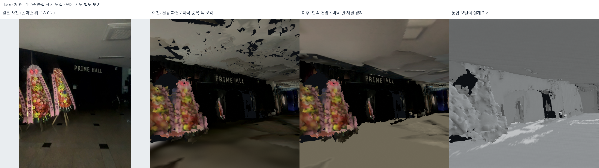
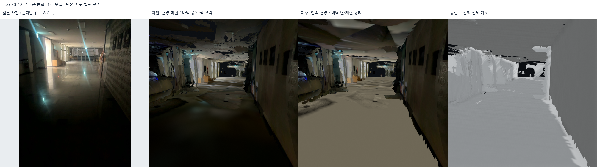
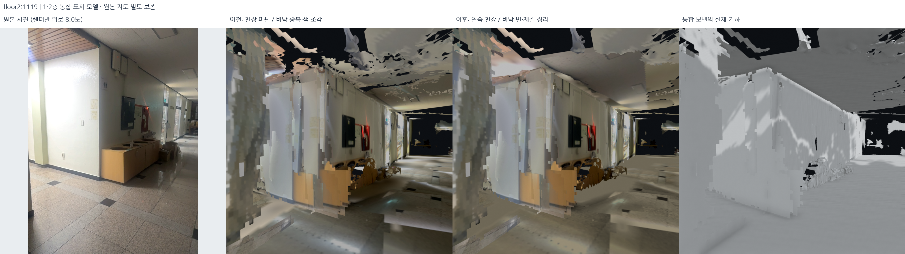
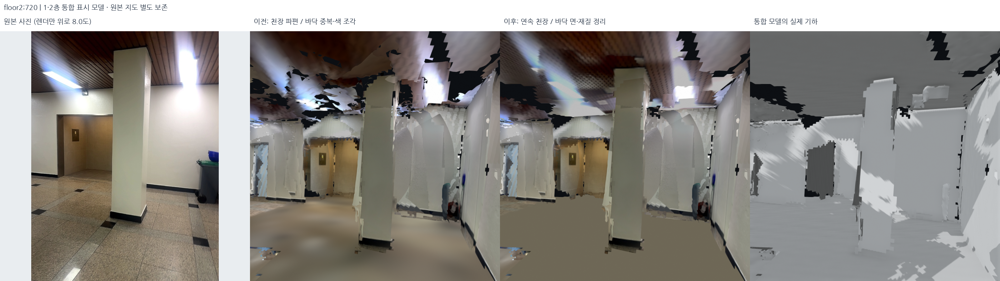
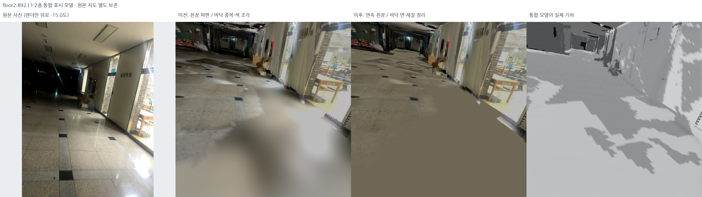
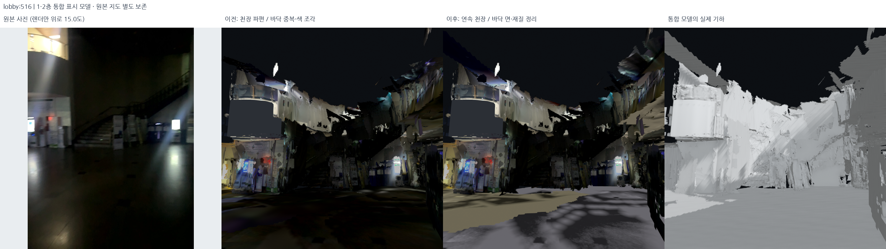
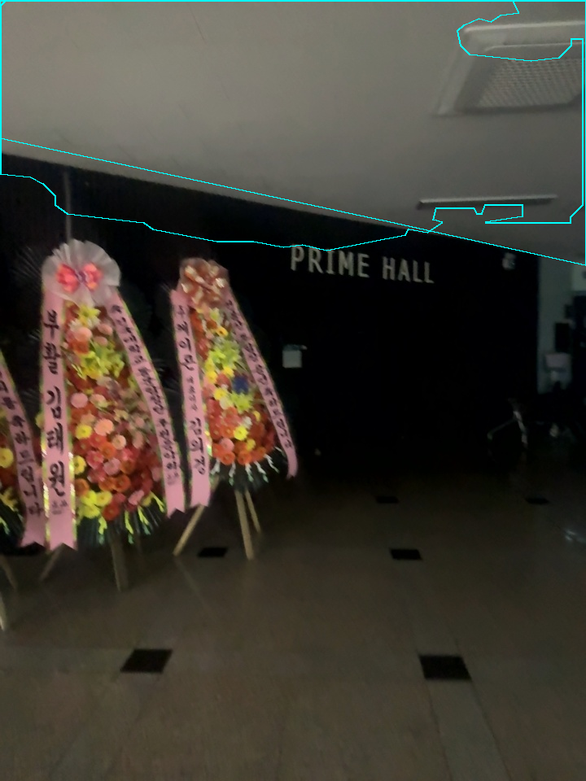
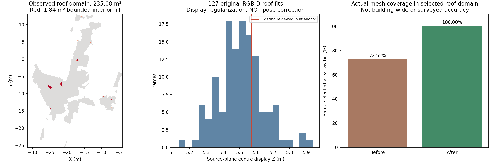

# 천장·바닥 파편 정리 — 2026-10-18

후속 시각 검토에서 **바닥 단색 재질 보정은 철회**했다. 아래는 당시 v5의 작업·
검사 기록이다. 천장·바닥 기하는 유지하되 현재 기본값은 사진 재질 복원 v6이다.
[철회 이유·현재 결과](2026-10-18-photographic-floor-restoration.md)를 먼저 참고한다.

## 결과와 범위

기준은 이전 승인 표시본 `outputs/student_union_service_slabs_v3/`다. 새 표시본은
`outputs/student_union_continuous_horizontals_v5/`이며, **원본 DB·선택 지도·포즈를
교체하지 않는다.** 유지한 기존 면의 XYZ도 그대로다. 이 단계는 SLAM 재최적화가
아니라 관측 범위의 표면 정리와 사진 재질 보정이다.

| 항목 | 실제 출력 검사 |
| --- | ---: |
| 원본 RGB-D 천장 검사 / 통과 프레임 | 227 / 127 |
| 연속 천장 면적 | 235.08m² |
| 위 면적 안의 작은 내부 천장 구멍 보완 | 1.84m² |
| 관측·사진 외곽 범위 밖으로 커진 천장 셀 | 0 |
| 새 천장 삼각형 / 유한 연결 구역 | 47,016 / 7 |
| 겹친 바닥 파편 제거: 로비 / 2층 / 서브 계단 세션 | 1,192 / 561 / 1,448개 삼각형 |
| 겹친 천장 파편 제거: 2층 / 서브 계단 세션 | 206,857 / 3,887개 삼각형 |
| 추가 바닥: 기존 범위 안의 작은 닫힌 구멍 | 0.01m² / 2개 삼각형 |
| 전체 구현 검사 | 486개 통과 |

면적은 표시 모델 좌표의 면적이다. 235.08m² 전체가 새로 메운 미관측 구멍이라는
뜻이 아니다. 대부분은 관측된 기존 파편을 연속면으로 교체한 것이다. 서로 떨어진
구역을 하나의 거대한 사각형으로 덮지 않았다. **중앙 복층 로비의 낮은 천장은 만들지
않았고, 기존 층간 닫힌 구조·계단·문·유리·신한은행 간판을 보존했다.**

## 실제 전후 사진

각 그림은 왼쪽부터 원본 사진 / 이전 표시본 / 새 표시본 / 새 회색 기하다.
전후 3D에는 같은 카메라를 사용했다. 천장 확인용 추가 시선 +8°, 바닥 −15°,
로비 +15°를 그림에 표시했다. 원본 사진은 그 시선으로 변조하지 않았다.













## 1. 왜 아직 쪼개져 보였는가

이전 단계의 천장은 화장실·은행 등 개별 사진 구역만 보완했다. 다른 2층 천장에는
기존 TSDF의 작은 면과 내부 구멍이 남았다. 바닥에는 평면 바로 위·아래에 겹친
기존 수평 파편도 남아 있었다. 이를 사진 재질의 밝기 경계와 구별해야 한다.
바닥의 큰 밝고 어두운 얼룩 중에는 **구멍이 아니라 신뢰도가 낮은 점군 색을 늘린
기존 텍스처**도 있었다. 폴리곤을 더 추가하는 것만으로 색 경계가 없어지지는 않는다.

## 2. 실제 RGB-D에서 천장 범위 추출

코드: `src/extract_observed_roof_regions.py`.
설정: `config/indoor_horizontal_continuity.json`.

1. DB를 읽기 전용으로 열고 선택 포즈·보정값으로 깊이를 역투영한다. 카메라 Z>3.3m
   프레임을 최대 220개 균등 샘플링하고 명시적 사진 구역을 더해 227개를 검사했다.
2. 깊이 상한 5.5m, 중앙 차분 이웃 깊이 점 간격 <25cm, 세계 법선 |nz|>0.90,
   원본 Z 4.65~6.5m 및 카메라보다 35cm 이상 높은 관측만 천장 후보로 쓴다.
3. 최소 80개 후보가 있는 프레임에서 결정적 RANSAC 320회, 4cm 지지점 선택,
   6cm 재선택과 SVD 평면 재피팅을 한다. 최소 지지점 30개·55%, P90 잔차 6cm,
   수평 대비 기울기 20°의 기존 `ceiling_fit` 검사를 사용한다.
4. 기존에 사진·벽 상단으로 승인된 두 교선 #726, #828의 표시 높이는 각각
   5.5470166m, 5.5955119m다. 중앙값 **5.5712643m**를 연속 표시 천장 높이로 쓴다.
   임의 층고나 바닥 footprint·높이 히스토그램으로 새 높이를 고른 것이 아니다.
   원본 천장 평면 중심의 표시 Z가 이 기준에서 45cm 넘게 다르면 제외한다.
5. 6cm 평면 지지 마스크에 3×3 닫힘을 적용하고 20픽셀 이상 윤곽을 추출한다.
   원본 RGB 사진의 명시적 천장 다각형도 추가하되 같은 깊이 평면 검사를 통과해야 한다.
   수동 후보 9개 중 #642는 지지점 부족으로 제외됐다. 주변 프레임은 별도로 사용된다.
6. 각 프레임의 **자기 원본 측정 평면**에 사진 광선을 교차시켜 XY 범위를 얻는다.
   광선 깊이 0.251~7.95m로 다각형을 자르고, 실제 꼭짓점은 0.25~8m에서 검사한다.

127개 통과 평면 중심의 원래 표시 Z 범위는 5.134~5.939m였다. 이를 동일 천장으로
정규화하는 것은 표시용 구조 사전조건이며, 센서 오차나 실제 천장 높이를 새로
측량한 결과가 아니다. 들뜬 원본 포즈 자체가 고쳐졌다고 해석하면 안 된다.



## 3. 유한 연속면과 겹친 면 정리

코드: `src/regularize_indoor_horizontals.py`.

- 원본 관측/사진 윤곽의 XY 합집합을 10cm 격자로 만든다. 외곽 팽창은 하지 않는다.
  완전히 둘러싸인 내부 구멍 중 면적 ≤3m²이고 관측면까지 최대 거리 ≤70cm인 것만
  채운다. 0.75m² 미만 고립 성분을 버린다. 실제 추가 채움은 1.84m²다.
- 선택된 셀마다 같은 Z의 두 삼각형을 만든다. 바닥에서 천장 footprint를 상속하거나
  보이지 않는 건물 외곽까지 덮지 않는다. 7개 유한 성분을 각각 유지한다.
- 새 천장과 겹치는 영역, 중심 높이 ±65cm, |nz|>0.5인 기존 천장 파편만 제거한다.
  수직에 가까운 기존 구조는 유지한다. 외부·외부 브리지 기하는 수정하지 않는다.
- 기존 1F −1.55m / 2F +2.60m 표시 바닥은 이동하지 않는다. 원래 바닥 허용 범위에서
  기존 평면이 덮는 셀의 ±24cm 내 수평 파편만 제거하고 정확한 평면은 남긴다.
  계단 보호 상자에 XY 10cm / Z 50cm 여유를 둬 계단·랜딩을 보존한다.
- 바닥 구멍은 기존 허용 범위, 자유공간/계단 보호 조건, 내부 닫힘, 면적 ≤0.6m²,
  거리 ≤40cm를 모두 만족해야 한다. 실제 새 바닥은 2F의 1셀뿐이다.

## 4. 원본 천장 사진을 연속면에 다시 투영

각 사진의 자기 원본 측정 평면으로 역투영하므로 표시 Z 정규화가 사진 광선 교차의
기준 평면을 몰래 바꾸지 않는다. 관측 방향·거리에 따른 가중치로 최대 28개 사진을
탐욕적으로 선택한다. 겹침의 RGB 로그 gain은 0.7~1.5로 제한한다. 사진 선택은
Potts 비용 0.55, 축소 단계 2, ICM 6회이며 전역 최적 graph-cut이라고 부르지 않는다.
경계는 2.5픽셀 feather, 이후 제한된 저주파 조명 보정을 한다.

천장 atlas는 1100×1544다. 선택 사진의 직접 유효 투영 비율은 **75.07%**이며 나머지
표면 texel은 가까운 원본 사진 색을 사용했다. 미관측 원본 질감의 복원이 아니라
표시 재질 추정이다. 생성형 이미지나 새로운 간판 글자는 사용하지 않았다.

## 5. 바닥 색 조각 처리와 실패 시험

코드: `src/level_floor_materials.py`, 설정: `config/floor_material_continuity.json`.
지오메트리와 사진 재질을 분리했다. 실제 원래 바닥 PNG의 해시가 일치하는 재질
참조만 새 PNG로 바꾼다. 기존 위치·법선·UV·삼각형 인덱스·이미지 스트림은 보존한다.
문·표지판·은행·벽 재질은 바꾸지 않는다.

선형 RGB에서 0.5m Gaussian 가중 평균으로 저주파 조명을 분리한다. 신뢰 사진의
밝기 25~85% 구간에서 바닥 돌 색 중앙값을 구해 목표 선형 휘도 0.28로 맞춘다.
원본 고주파 상세를 log 범위 [−2.3, +0.65]로 제한하고 35cm에 걸쳐 미관측 영역의
매끈한 돌 색으로 이어 준다. **원래 타일 줄눈·검은 장식 배치는 없는 곳에 만들지 않는다.**

| 시험 | 관찰 / 선택 |
| --- | --- |
| geometry v1 + 원래 바닥 사진 | 천장 기하는 개선. 바닥 색 덩어리는 남음. 비교 모드로 보존 |
| material v2: 제한 gain | 사진/보완 재질 사이 큰 밝기 경계가 남아 기본값으로 미채택 |
| material v3: RGB log 상세 | 2F는 개선됐지만 어두운 로비의 빨강·초록 잡음 증폭으로 미채택 |
| material v4: 어두운 색 잡음 억제 | 원본 휘도 0.05~0.20에서 색 상세→휘도 상세로 연속 전환. 현재 기본값 |
| delivery v5: 저장 형식 보정 | v4의 같은 기하·재질. 마지막 PNG 뒤 GLB chunk의 4바이트 정렬·길이를 보정하고 실제 파일을 재검사한 최종 묶음 |

[v2 바닥 경계 실패](../assets/continuous-horizontal-20261018/rejected_v2_floor_photo_boundary.png)
· [v3 어두운 사진 색 잡음 실패](../assets/continuous-horizontal-20261018/rejected_v3_dark_floor_chroma.png).
v4도 로비에 얼룩·경계가 일부 남는다. 모든 바닥이 원본처럼 사실적으로 복원됐다고
주장하지 않는다. 원본 바닥 사진 비교 모드와 회색 기하로 구멍/색 문제를 구분한다.

## 6. 실제 파일 검사와 한계



실제 PLY/GLB 삼각형을 읽어 검사했다. 유지한 면의 XYZ가 기준 표시본과 정확히 같고,
GLB/PLY 삼각형 순서·좌표가 같다. 보호된 계단·랜딩과 은행 간판을 유지했다. 재질
검사는 기존 GLB binary prefix·accessor·이미지와 비바닥 재질이 그대로인지 별도 확인한다.
DB 5개·선택 지도·입력 해시도 확인했다.

같은 새 천장 범위의 XY 8,000개에서 위로 쏜 광선이 1.5m 안에서 표면을 만나는
비율은 **72.525→100%**, 표시 천장 높이 2cm 내 첫 교차는 **8.2625→99.375%**다.
이는 의도한 면이 실제 출력에 있는지 확인하는 **구성/피복 자기일관성 검사**다.
채운 영역으로 고른 표본이므로 독립 검증, 건물 전체 완성률, 측량 정확도 개선 수치가 아니다.

**남은 결손:** #720의 벽-천장 외곽과 관측 없는 가장자리 일부, 일부 사진 seam·바닥
밝기 얼룩은 남는다. 연결 평면 내부의 기하 구멍과 다른 문제다. 출입구·복층 개구부를
막아 숫자나 외관을 좋게 만들지 않았다. 길찾기용 충돌·층 연결 검증은 별도다.

- [기하·원본 보존 검사](../assets/continuous-horizontal-20261018/geometry_audit.json)
- [재질만 변경한 검사](../assets/continuous-horizontal-20261018/material_audit.json)
- [실제 5세션 로컬 로딩·파일 바인딩 검사](../assets/continuous-horizontal-20261018/delivery_audit.json)
- [원본 관측·피팅·제외 사유](../assets/continuous-horizontal-20261018/roof_observations.json)
- [비교 카메라·그림·원본 RGB 해시](../assets/continuous-horizontal-20261018/render_manifest.json)
- [네이티브 창의 실제 렌더](../assets/continuous-horizontal-20261018/native_scene_render.png)

## 7. 로컬 열기와 재현

```bash
bash scripts/view_local_roadview.sh --start-view roof2f \
  --evidence outputs/student_union_continuous_horizontals_native_v5
```

기본 메뉴는 **Continuous ceilings + clean floors**다. **Continuous surfaces / neutral
geometry**, **Continuous roof + original floor photos**, **Previous split ceilings and
floors**로 같은 화면에서 비교할 수 있다. 각각 내부 모드 인덱스 6/7/8이다.
시작 사진은 2F #905, 시선 +8°다. 실제 다섯 세션을 로컬 Open3D 창에 로딩하고
렌더 콜백 이미지를 저장했다. 웹 업로드는 하지 않았다.

아래는 같은 저장 입력으로 단계별 새 출력을 만드는 명령이다. 기존 출력 폴더는
덮어쓰지 않는다. `floor_material_continuity.json`의 source_bundle은 검증된 geometry
v1에 고정되어 있으므로 그 명령은 새 observation/geometry 실험이 아닌 기존 v1에
재질 보정을 재현한다. 새 geometry를 쓸 때는 설정 복사본의 source_bundle을 바꾼다.

```bash
export PYTHONPATH="$PWD/outputs/surface_runtime/packages:$PWD/src"
export OPENBLAS_NUM_THREADS=1 OMP_NUM_THREADS=2
/usr/bin/python3 -s src/extract_observed_roof_regions.py --output outputs/roof_observations_repro
/usr/bin/python3 -s src/regularize_indoor_horizontals.py \
  --observations outputs/roof_observations_repro/roof_observations.json --output outputs/continuous_geometry_repro
/usr/bin/python3 -s src/level_floor_materials.py --output outputs/continuous_material_repro
/usr/bin/python3 -s src/audit_indoor_horizontal_continuity.py \
  --bundle outputs/student_union_continuous_horizontals_v5 --output outputs/roof_geometry_recheck.json
/usr/bin/python3 -s src/audit_floor_material_continuity.py \
  --bundle outputs/student_union_continuous_horizontals_v5 --output outputs/floor_material_recheck.json
/usr/bin/python3 -s -m pytest -q
```

현재 표시 manifest SHA256:
`61ca4728de76d62130a3a96e48630721e748d5bf0bb4fcbacfefd3fa668c962e`.
원본 선택 지도 SHA256:
`98cf1d77aa5ca3c82f9653ffcb4ee86d6f40ac4d8953f1c1171b0dfa307090b1`.
기본값은 `config/current_local_view.json`과 `config/structural_display_policy.json`에 묶었다.
