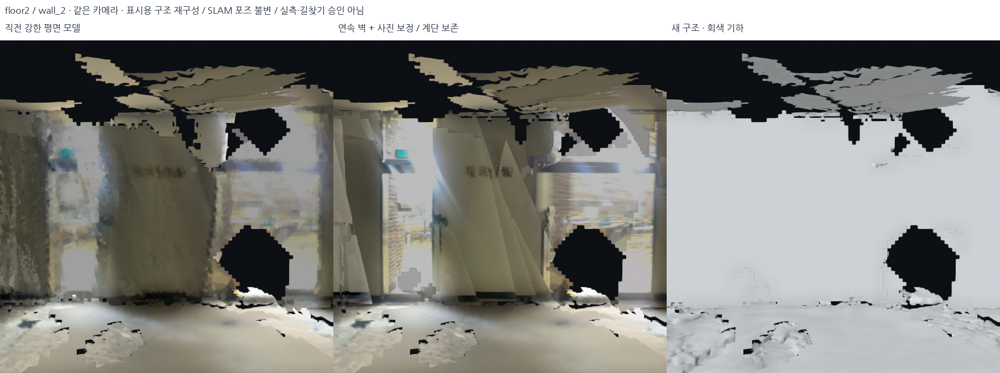
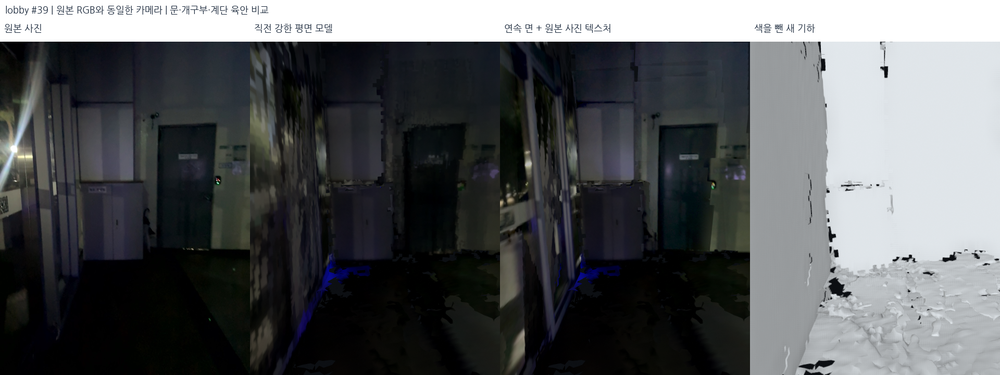
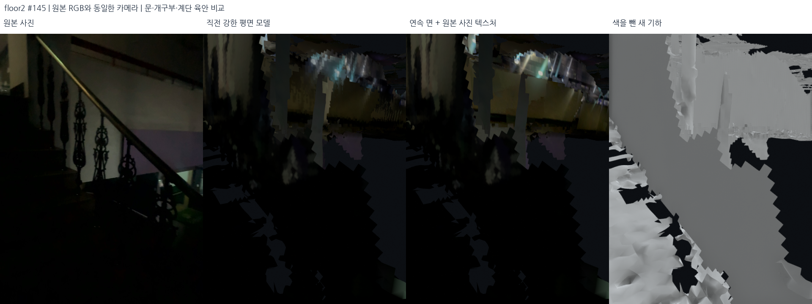

# 연속 벽 재구성과 원본 사진 텍스처 — 2026-10-18

## 목적과 입력

같은 벽을 연속 면으로 재구성하고 중복 면을 정리한 뒤 원본 사진으로 텍스처를 입힌다. 문·창·계단을 보존하며 전후 결과를 비교한다.

직전 표시 기준은 `outputs/student_union_structural_strong_floors_v1/`이다.
선택 지도는 `config/current_map.json`에 고정된 다섯 기록이며, 이번 처리의 직접 대상은
파편화가 두드러지는 2층·메인 계단 기록과 로비다. 외부 및 두 브리지는 이전 표시를
유지하여 다섯 기록 전체를 함께 볼 수 있게 한다. 원본 DB와 포즈는 입력으로 사용한다.

중단된 `student_union_continuous_planes_v1`에는 일부 텍스처와 마스크만 있다.
완성 모델로 사용하지 않으며, 이어서 정리한 실행은 `student_union_continuous_planes_v2`다.

## 이전 방식에서 바뀐 부분

이전에는 선택한 사진 96개(2층)·80개(로비)를 전체 구조에 공통으로 사용했다.
2층 구조 패치 77개 중 74개는 사진 커버리지 60% 조건을 통과하지 못해 점군 색을
사용했다. 이번에는 각 기록의 선택 포즈가 있는 모든 RGB-D 프레임을 검토하고,
벽별로 관측 범위와 각도가 좋은 사진을 선택한다. 사진이 확보된 텍셀에는 사진을
사용하고, 관측되지 않은 텍셀만 점군 색을 사용한다.

## 실제 알고리즘과 순서

1. **벽 후보와 묶음 생성.** 직전 모델의 수직 벽 패치를 사용한다. 법선 차이 5° 이하,
   양방향 평면 거리 12cm 이하, 패치 간 거리 60cm 이하일 때 묶을 수 있다.
   모든 구성원 사이의 평면 조건을 검사해 연쇄적으로 다른 벽까지 합쳐지는 것을
   막는다. 연결되지 않거나 다른 방향인 벽은 독립적으로 처리한다.
2. **연속 면의 관측 영역 복원.** 5cm로 다운샘플링한 선택 점군에서 유한 벽 범위와
   법선이 맞는 점을 모으고, 법선 방향 위치는 중앙값으로 맞춘다. 6cm 격자에서
   기존 작은 메시 조각 대신 같은 평면 위의 면을 생성한다. 새로운 전역 축 정렬은 없다.
3. **원본 깊이에 따른 빈칸 보완.** 최대 96cm closing 범위 안의 결손 후보를 찾고,
   서로 20cm 이상 떨어진 선택 카메라 중 두 개 이상에서 깊이 지지가 있을 때만
   보완한다. 깊이 허용치는 18cm + 거리의 2%다. 단순한 면적 한도만으로 큰 구멍을
   채우지 않는다. 이 허용치는 측정 정확도가 아니며 후보 표면 지지 판정 설정이다.
4. **문·개구부 보호.** 면의 뒤쪽을 관측한 빈 공간 표가 2개 이상이고
   `free >= 1.5 * (support + 1)`이면 해당 면 생성을 제외한다. 이 제외 영역을
   한 셀 확장한다. 깊이가 없는 미확인 결손에도 지지 조건을 적용한다.
   유리나 문을 의미 분할한 것은 아니므로 실제 사진과 함께 확인한다.
5. **중복 면 정리.** 새 면이 차지하는 범위에서 평면 거리 32cm 이내,
   법선 내적 절댓값 0.65 초과인 기존 벽 삼각형을 교체한다. 앞서 생성한 평면과
   겹치는 후속 평면 셀도 제외한다. 교체한 원본 삼각형 번호를
   `removed_source_faces.npy`에 기록하고, 나머지 기하와 재질은 그대로 유지한다.
6. **벽별 원본 사진 선택.** 전체 후보 사진을 실제 깊이·시야각으로 평가한다.
   벽마다 최대 32장, 카메라 위치 간격 최소 20cm를 사용한다.
   이미 충분히 덮인 영역의 점수는 낮춰 벽 전체를 덮는 사진을 선택한다.
7. **원본 사진 텍스처.** 카메라 보정값과 고정 포즈로 사진을 평면에 재투영한다.
   겹치는 유효 RGB의 로그 비율 중앙값으로 노출 gain을 풀고 0.5–2.0배로 제한한다.
   가장 많이 덮는 사진을 기준으로 한다. 텍스처 목표 간격은 1cm, 한 변 최대 2048px다.
8. **사진 경계 정돈.** 주변과 같은 사진을 선택하도록 Potts 비용을 두고,
   4px 격자·6회 checkerboard ICM으로 사진 라벨을 정돈한다. 이는 그래프 컷의 전역
   최적해가 아니다. 저주파는 경계를 부드럽게 연결하고 고주파 세부는 한 사진에서
   가져온다. 마지막으로 35cm 규모의 밝기 변화를 제한적으로 평준화한다.
   실제 그림자와 색 대비가 달라질 수 있으며 사진 간 남은 위치 오차도 존재한다.
9. **계단·원본 보존 확인.** 수평에 가까운 기존 면(`|normal.z| > 0.90`)이 좌표 그대로
   남았는지 검사한다. 교체 대상 밖의 모든 원본 삼각형 보존, GLB와 PLY의 실제
   삼각형 좌표 일치, 빈 공간 제외 마스크와 추가 면의 지지 조건도 검사한다.
10. **같은 시점으로 비교.** 직전 모델·새 텍스처·새 회색 기하를 같은 카메라로 렌더링한다.
    별도 비교판에는 원본 RGB도 포함한다. 원본 사진 시점과 큰 벽 시점을 함께 남긴다.

## 재현

```bash
PYTHONPATH=outputs/surface_runtime/packages OMP_NUM_THREADS=2 OPENBLAS_NUM_THREADS=1 \
  /usr/bin/python3 -s src/reconstruct_continuous_planes.py \
  --output outputs/NEW_continuous_planes

PYTHONPATH=outputs/surface_runtime/packages OMP_NUM_THREADS=2 OPENBLAS_NUM_THREADS=1 \
  /usr/bin/python3 -s src/audit_continuous_planes.py \
  --bundle outputs/NEW_continuous_planes \
  --source outputs/student_union_structural_strong_floors_v1 \
  --output outputs/NEW_continuous_planes/preservation_audit.json --finalize
```

소스: `src/reconstruct_continuous_planes.py`, `src/coherent_photo_charts.py`,
`src/append_plane_glb.py`, `src/audit_continuous_planes.py`,
`src/render_continuous_evidence.py`. 원본 포즈와 깊이의 잔여 불일치는 이 표시 처리만으로
해결되지 않는다. 깊이가 없는 개구부, 돌출 간판, 서로 다른 면의 접합은 비교 사진에서
계속 확인할 대상이다. 모델의 개구부 검사와 문/창의 의미 인식은 구분한다.

## 사진 경계 보정과 계단 보존을 추가한 최종 선택

연속 면에 원본 사진을 입힌 v2에서 문패가 선명해졌지만 일부 사진 경계의 위치와
밝기 차이가 드러났다. `aligned_photo_charts.py`에서 평면에 투영한 사진끼리 SIFT
특징을 찾고, 비율 검사 0.72·분산된 대응 12개 이상·인라이어 비율 50% 이상일 때
이동량 RANSAC과 Huber IRLS 그래프를 적용했다. 사진 좌표의 이동은 25cm로 제한한다.
벽 형상과 카메라 포즈는 이 텍스처 단계에서 바뀌지 않는다. 채택한 대응, 잔차, 사진별
이동량은 각 벽의 `texture_alignment`에 기록했다. 대응이 부족한 벽에는 이동을 주지 않는다.

최종 사진 라벨은 8px 격자·10회 ICM·이웃 비용 0.6을 사용한다. 한 사진의 세부를
유지하는 반경은 12cm, 저주파 경계를 섞는 반경은 20cm다. 한 장의 대표 벽에서
기본 합성, 특징 정렬, 넓은 밝기 경계 처리를 각각 시험한 출력은
`outputs/continuous_alignment_probe_wall1*`에 보관했다. 그래도 밝은 출입구 주변의
노출 차이·반사·촬영 방향 차이는 남는다. 모든 사진의 기하 정합이 해결됐다고 보지 않는다.

중간 v3에서는 원래 `stairs`라 명명된 #1078 주변의 일부 픽셀이 악화했다.
실제 계단 단과 난간이 보이는 #145, #1092, #1150을 원본 사진으로 추가 확인했고,
#1092에서 공통 픽셀 깊이 중앙값이 8.22→9.59cm로 악화한 것을 확인했다.
최종 v4는 `guard_stair_corridor.py`로 **그 계단 통로의 이전 기하와 재질을 유지**한다.
검토 프레임 근처의 중간 높이 궤적을 고르고, 카메라 중심에서 XY ±1.2m,
Z -1.8~+0.7m의 상자들을 합쳐 보호 범위를 정했다. 새 벽의 셀은 보호 범위와
접촉하면 제외하고 한 셀 여유를 둔다. 기존 보호 삼각형은 삭제하지 않는다.

이로써 계단 주변 **119,099개 삼각형**이 좌표 그대로 보존되고 새 벽 영역
49.44m²는 이번 교체에서 제외됐다. 모든 기록의 기존 수평·완만한 경사 면
(`|normal.z| > 0.90`)도 그대로 남는다. 기존 계단의 결손이나 가느다란 난간의
누락까지 복구한 것은 아니다. 두 브리지는 이전 선택 정책대로 기존 형상을 표시한다.

## 최종 수치

| 항목 | 2층·메인 계단 기록 | 로비 |
|---|---:|---:|
| 검토한 선택 포즈의 원본 RGB-D 프레임 | 925 | 800 |
| 입력 벽 패치 → 호환 묶음 | 66 → 66 | 75 → 72 |
| 실제 재생성한 벽 평면 | 58 | 65 |
| 최종 벽 면적 | 437.18m² | 407.03m² |
| 깊이 지지로 추가한 결손 면적 | 9.03m² | 8.26m² |
| 교체한 기존 벽 삼각형 | 262,107 | 238,832 |
| 벽 면적 가중 원본 사진 커버리지 | 87.34% | 90.50% |
| 특징 기반 사진 위치 보정이 채택된 벽 | 19 | 38 |
| 사진 좌표의 실제 최대 이동 | 13.71cm | 24.95cm |
| 관측 벽 격자 조각 → 최종 격자 조각 | 355 → 73 | 343 → 69 |

2층에서 입력 패치끼리 합쳐진 쌍은 없었다. 각 큰 벽 패치 안에서 끊어진 관측·메시
조각들을 연속된 면으로 재생성한 것이다. 로비는 세 쌍이 묶였다. 격자 조각 수는
처리한 벽의 연결 성분 합계이며 전체 지도 메시의 위상이나 방 개수가 아니다.

같은 카메라의 공통 유효 픽셀에서 센서 깊이와 표시 면 깊이의 차이 중앙값:

| 확인 시점 | 직전 강한 평면 모델 | 최종 v4 |
|---|---:|---:|
| 2층 #1055 | 13.15cm | 13.14cm |
| 2층 #1054 | 31.14cm | 30.40cm |
| 계단 입구 주변 #1078 | 6.13cm | 6.13cm |
| 실제 계단 #145 | 22.69cm | 22.84cm |
| 실제 계단 #1092 | 8.20cm | 8.20cm |
| 로비 출입문 #39 | 7.42cm | 7.00cm |
| 로비 #38 | 17.88cm | 16.50cm |

이 수치는 새 SLAM 정확도나 별도 측량 결과가 아니다. 픽셀별 악화도 있으며,
전체 분포·추가/누락 교차 픽셀은 사진 manifest에 기록한다. 실제 계단 시점 #145,
#1092의 추가 비교는 `photo_evidence.json`에 있다. 보호된 계단과 미관측 개구부를
보존한 만큼, 모든 큰 빈칸이 없어지지는 않는다.

## 저장된 비교 자료와 실행 결과

최종 모델: `outputs/student_union_continuous_selected_v4/`.
`student_union_continuous_planes_v2`는 연속 벽·기본 사진 합성,
`student_union_continuous_photos_v3`는 사진 좌표·밝기 경계 보정,
`student_union_continuous_selected_v4`는 계단 통로 보존을 추가한 기본 표시다.





- [같은 카메라 전후 비교 13장·깊이 지표](../assets/continuous-walls-selected-20261018/manifest.json)
- [원본 사진 비교·사진 커버리지·개구부 근거](../assets/continuous-walls-selected-20261018/photo_evidence.json)
- [기존 면·계단 통로·추가 면 지지 검사](../assets/continuous-walls-selected-20261018/preservation_audit.json)
- [원본 DB·실제 GLB·로컬 로딩 검사](../assets/continuous-walls-selected-20261018/delivery_audit.json)
- [기록별 표시 선택](../../config/structural_display_policy.json)
- [실제로 로컬에 불러온 다섯 모델의 장면](../assets/continuous-walls-selected-20261018/selected_overview.png)

동일 카메라 비교 13장, 원본 사진·깊이·개구부 근거 비교 13장,
실제 로컬 장면 1장으로 최종 시각 자료는 27장이다. 장면 이미지는 로컬 뷰어의
렌더 콜백에서 저장했으며 운영체제 전체 화면 캡처는 아니다.

`bash scripts/view_local_roadview.sh`로 로컬 3D 창을 연다. 기본은
`Continuous walls + photos / stairs protected`, 직전 모델은
`Previous strong planes / bridges protected`다. 두 모드를 바꿀 때 현재 카메라
시점을 유지하도록 수정했다. 회색 기하, 원본 사진 로드뷰, 점군 보기도 남아 있다.

최종 처리 재현은 위 연속 면 생성 후 아래 단계를 순서대로 실행한다.

```bash
# 모든 명령에 위와 같은 PYTHONPATH 및 스레드 환경을 사용한다.
/usr/bin/python3 -s src/retexture_continuous_planes.py \
  --source outputs/NEW_continuous_planes --output outputs/NEW_photo_charts
/usr/bin/python3 -s src/guard_stair_corridor.py \
  --source outputs/NEW_photo_charts \
  --baseline outputs/student_union_structural_strong_floors_v1 \
  --output outputs/NEW_selected_continuous
/usr/bin/python3 -s src/audit_continuous_planes.py \
  --bundle outputs/NEW_selected_continuous \
  --source outputs/student_union_structural_strong_floors_v1 \
  --output outputs/NEW_selected_continuous/preservation_audit.json --finalize
```

구현 검사 23개를 통과했다. 실제 출력에는 별도로 삼각형 좌표·계단 보호 영역·
빈 공간 마스크·추가 셀 지지 검사를 수행했다. 생성 단계의 한 통계가 Open3D의
변경 가능한 배열 참조를 다시 읽어 잘못 집계되는 문제를 발견해 수정했다.
저장한 삭제 마스크와 원본 메시를 독립적으로 읽어 수평 면 삭제 0개를 확인했고,
이전 통계와 정정 이유를 manifest에 남겼다. 당시 소스는 v2의
`reconstruction_source_snapshot.py`로 보관했다. 이 오류는 통계 집계에 있었고
메시 삭제 마스크에는 영향을 주지 않았다.
