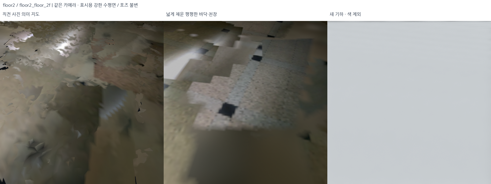
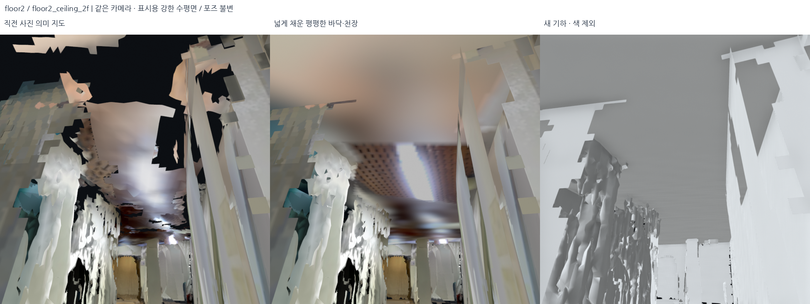
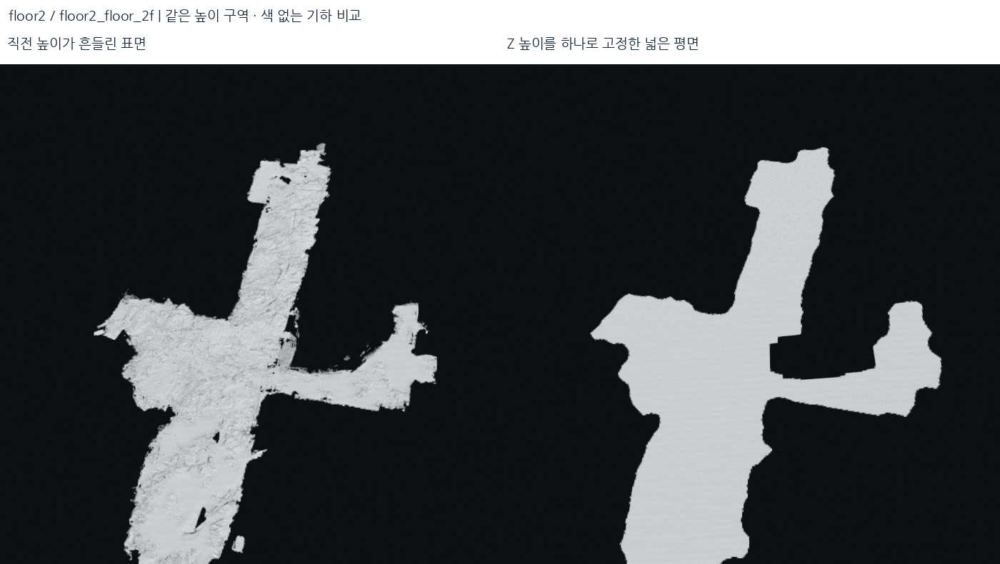
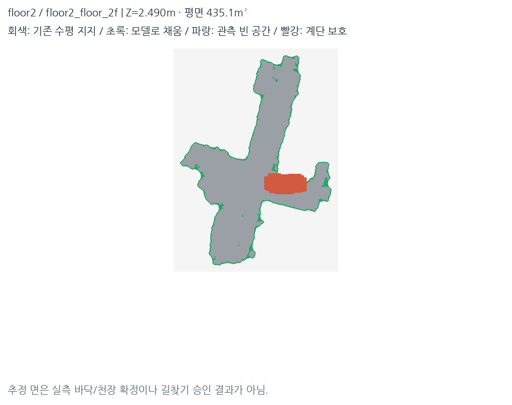
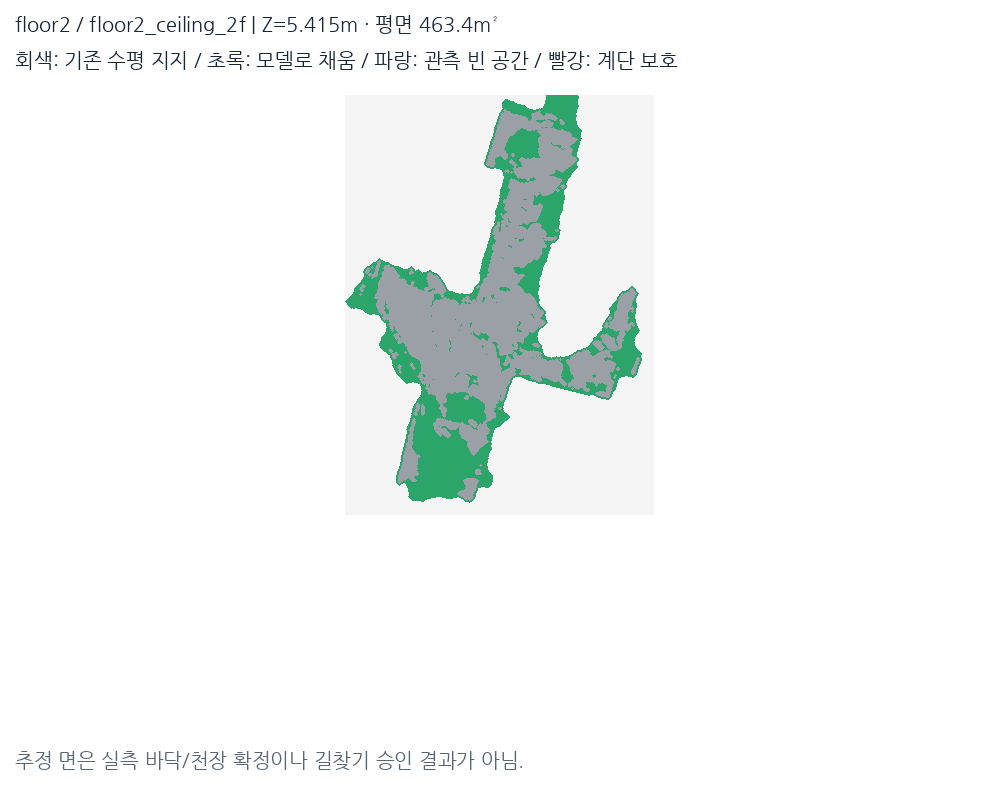
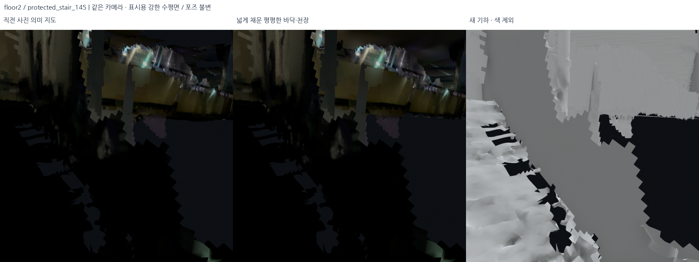
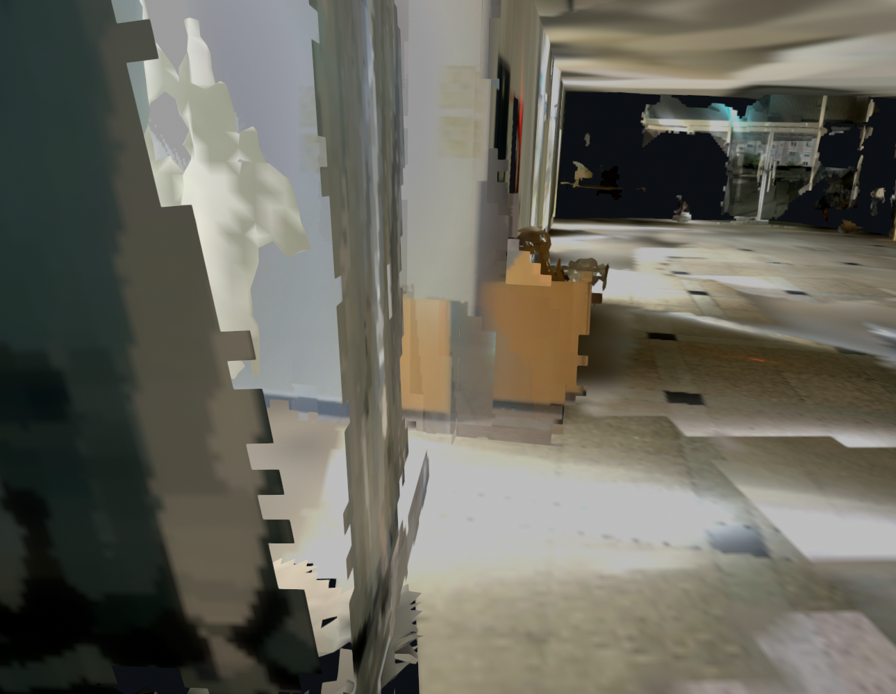

# 바닥·천장 강한 평면화와 넓은 채움 — 2026-10-18

이 문서는 이전 실험이다. 후속 시각 검토와 원본 사진으로 **같은 층의 독립 Z 고정에
따른 분리·복층 로비를 가린 저층 천장**을 확인했다. 현재 기본 표시는
[층간 위상 수정본](2026-10-18-multilevel-topology-repair.md)으로 대체했다.
아래의 당시 결과를 현재 건물 구조가 정확하다는 근거로 사용하면 안 된다.

## 결과

작은 구멍을 부분 보수하는 대신, 실내 바닥·천장을 **구역별 일정한 Z 높이의 넓은
수평 시트**로 교체했다. `outputs/student_union_flat_horizontal_v3/`가 당시 표시본이다.
기준은 직전 사진 의미 지도 v10이며, 두 브리지는 당시 실제로 표시하던
`balanced_only` 형상을 입력으로 사용했다. 과거 기각한 브리지 재구성본을 다시 쓰지 않았다.

**11개 시트**를 생성했다. 면적 합계는 바닥 **1,165.92m²**, 천장 **1,037.01m²**다.
여러 기록의 중첩과 바닥/천장을 합한 값이지 건물의 순면적이 아니다. 기존 수평 표면
래스터 밖을 모델로 채운 면적 합계는 **664.80m²**다. 원본 DB·선택 포즈·선택 점군은 유지했다.





## 기록별 적용

아래 높이는 현재 지도 좌표의 **표시용 대표 높이**이며 측량 고도가 아니다. 서로 다른
기록의 남은 Z 정합 차이를 고치는 작업은 아니므로 같은 층의 모든 기록을 하나의
전역 높이로 강제하지 않았다. 계단의 실제 상승·단차를 보존하기 위해 구역을 나눴다.

| 기록 | 새 시트 | 바닥 면적 | 천장 면적 | 모델 Z 높이 (m, 반올림) |
| --- | ---: | ---: | ---: | --- |
| 로비 | 2 | 504.94m² | 441.76m² | 바닥 −1.636 / 천장 1.660 |
| 2층·메인 계단 | 4 | 500.43m² | 493.74m² | 1F −1.600 / 1.553; 2F 2.490 / 5.415 |
| 서브 계단 | 4 | 95.02m² | 101.51m² | 1F −1.373 / 1.114; 2F 2.810 / 5.823 |
| 외부↔로비 브리지 | 1 | 65.53m² | — | 실내와 겹치는 바닥 −1.764 |
| 외부 | 0 | 기존 유지 | 생성 안 함 | 실제 경사·높이 변화 보존 |



## 1. 실제 표시 입력과 높이 구간 확인

`src/inspect_flat_surfaces.py`로 **실제로 선택돼 있던** PLY/GLB를 읽었다. 수평 법선
|nz|>0.9 삼각형의 면적 가중 높이 히스토그램(5cm bin, Gaussian sigma 1.5 bin)을 만들고
0.4m 이상 떨어진 주요 높이 모드를 찾았다. 로비·2층에 바닥과 천장 높이 띠가 있고,
기존 바닥이 여러 높이의 조각으로 남아 있음을 확인했다.

설정은 [flat_horizontal_surfaces.json](../../config/flat_horizontal_surfaces.json)에 고정했다.
현재 정책이 바뀌어도 기준 입력을 복원할 수 있도록
[photo_semantic_base_policy.json](../../config/photo_semantic_base_policy.json)도 보관했다.

각 설정 높이 구간에서 |nz|>0.85 기존 수평 면을 선택하고, 모드 힌트 ±20cm의
삼각형 면적 가중 높이 중앙값을 대표 Z로 쓴다. 평균으로 서로 다른 층을 섞지 않는다.
이는 강한 표시 prior이지 새로운 포즈 그래프 제약이나 센서 보정은 아니다.

## 2. 넓은 면의 경계와 빈칸 채움

구현: `src/flatten_horizontal_surfaces.py`.

1. 기존 수평 면 중심을 **10cm XY 격자**에 래스터화하고 한 셀 확장한다.
2. 반경 **1m 원형 closing**으로 찢김을 연결하고, 내부에 둘러싸인 구멍을 채운다.
   외곽을 **20cm** 확장하되 기존 수평 지지에서 **3m 이내**로 제한한다.
3. 연결 영역은 최소 **1.5m²**를 요구한다. 단순 전체 convex hull로 건물 외부까지
   덮는 방식은 쓰지 않는다.
4. 천장은 같은 기록의 대응 바닥 범위를 참고해 넓히되, 기존 천장 지지에서 3m 이내와
   계단/빈 공간 제외 조건을 함께 지킨다.
5. 외부 브리지 바닥은 로비 바닥 범위+25cm 안으로 제한해 외부 경사 구역 전체가
   같은 평면으로 바뀌지 않게 한다.
6. 모든 새 정점의 Z를 해당 구역의 한 값으로 고정한다. 바닥 앞면은 위, 천장은
   아래를 향하며, 물결·기존 높이장·경계 감쇠를 남기지 않는다.





## 3. 계단과 층간 개구부 보호

원본 depth의 관측 광선을 새 평면과 교차시켜, 면이 **이미 관측된 빈 공간을 가리는지**
검사한다. 카메라는 3D 위치가 약 55cm 이상 떨어진 대표 프레임을 선택하고 기록당
최대 180장을 사용한다. 각 프레임은 한 셀에 최대 한 표만 더한다.

- 센서 끝점이 평면을 **65cm 이상 지나가고**, 광선 구간 중간에 평면이 있다면 빈 공간 표로 기록.
- 빈 공간 표가 2개 이상이고 `free > 1.5 × support + 1`인 셀은 제외.
- 제외 경계를 약 15cm 요청값에서 격자 단위 올림한 **2셀(20cm)**로 확장.
- 메인 계단은 이전에 사진으로 확인한 보호 통로를 유지하고, 새 시트 생성 시 셀 모서리까지
  보호하기 위해 XY 여유를 추가한다. 기존 보호 삼각형 **119,099개**가 모두 같은 좌표로 남았는지
  이전 단계의 저장 마스크까지 직접 대조했다.
- 서브 계단은 카메라 높이의 국소 상승/이동 비율로 보호 영역을 추가했다. 5프레임 중앙값,
  ±3프레임 사이 상승 28cm 초과와 상승/수평 이동 비율 0.22 초과를 사용한다. 이는 **카메라
  궤적 기반 보호 장치**로 전수 계단 의미 인식이나 실측 판정이 아니다.

65cm 여유는 수십 cm의 잔여 깊이/모델 흔들림을 무조건 층간 개구부로 오해하지 않기 위한
표시 설정이다. 실제 작은 단차/구멍을 모두 검출한다는 뜻은 아니며, 길찾기에는 그대로 쓰지 않는다.



## 4. 바닥 위에 남던 작은 삼각형 조각 제거

첫 시트 시험(v2)은 새 면 자체가 평평해도 기존의 가파른 작은 바닥 조각이 남았다.
법선이 수직에 가까워 단순한 수평 면 필터에서 빠진 조각들이다.

최종 v3에서는 **벽·기둥·가구와 잔여 바닥 조각을 먼저 구분**했다.

- |nz|<0.65인 면들의 연결 성분 중 높이 범위 45cm 이상, 면적 0.015m² 이상인 구조는 보호.
- 기존 연속 벽 평면에 정확히 놓인 면과 모든 문·창·표지·벽 사진 면은 별도 보호.
- 그 외 새 바닥/천장 범위 안의 짧은 가파른 조각(정점 Z 범위 35cm 미만)도 교체 대상으로 포함.
- 메인/서브 계단 보호 영역과 보호된 수직 구조는 제거하지 않음.

기존 사진 의미 표면 중 국소 바닥/천장 2개는 새 넓은 시트로 대체했다. 원본 사진과
의미 관측은 보관하고 `superseded_by_flat_horizontal_sheet`를 표시했다. 나머지 문·창·표지·벽
**22개 사진 면**은 원래 삼각형과 재질을 유지했다. 열린 청소실 의미 관측도 유지한다.

## 5. 사진 질감과 미촬영 부분의 색

각 시트당 최대 36장의 실제 RGB-D 사진을 골랐다. 원본 카메라 보정/선택 포즈로 평면을
사진에 투영하고 다음 조건을 적용했다.

- 투영 깊이 0.3–6m, 관측 depth와의 차이 45cm 미만, 시선 입사 조건을 충족해야 사진 색 사용.
- 거친 격자의 노출 gain 추정 + Potts ICM 라벨로 사진 구역을 고르고 원본 RGB를 샘플링.
- 사진/색 대체 영역 경계는 12cm 안에서 혼합하고, 넓은 저주파 조명만 제한된 gain으로 보정.
- 텍스처 해상도 목표 2.5cm/px, 최대 변 길이 1,400px. 미확인 부분에 새로운 글자·무늬를 생성하지 않음.

**사진이 모든 새 면을 덮는 것은 아니다.** 직접 사진 투영 비율은 로비 바닥 약 28%,
로비 천장 약 20%, 2층 주 바닥 약 37%, 2층 주 천장 약 20%다. 나머지는 기존 수평 표면의
RGB를 부드럽게 확장한 표시 색이며 사진 해상도 복원으로 보고하지 않는다. 큰 밝기 차이와
타일 패턴의 경계는 일부 남는다. 평면 기하와 사진의 신뢰도를 구분해 별도 coverage PNG를 저장했다.

## 6. 검증과 로컬 표시

- 새 **11개 시트의 실제 삼각형 Z 범위 0**: 모든 정점이 해당 높이에 놓이는지 확인.
- GLB/PLY 실제 삼각형 좌표와 순서 float32 기준 동일.
- 선택하지 않은 기존 면, 보호된 수직 구조와 의미 표면의 좌표 유지.
- 새 시트와 계단/빈 공간 제외 마스크의 충돌 0.
- 원본 의미 사진 PNG 해시 유지, 원본 DB 5개·선택 지도/포즈 해시 유지.
- 관련 검사 43개, 전체 검사 **439개 통과**. 자동 테스트가 현장 치수/통행 정확도를 보장하지 않는다.

로컬 창은 다음과 같이 연다.

```bash
bash scripts/view_local_roadview.sh --start-view indoor
```

기본 **Flat floors + ceilings**에서 새 면을 보여준다. **Previous photo-semantic display**는
직전 v10 표시와 당시 두 브리지의 실제 선택을 복원한다. 같은 카메라를 유지해 비교할 수 있다.
**Ceilings: show / hide (cutaway)**는 새 천장만 표시에서 숨기는 버튼으로, 전체 지도 위에서
내부를 보고 싶을 때 사용한다. 실제 전체 모델에서는 천장이 삭제되지 않는다.

전후/계단/격리 기하 비교 24장, 채움 근거 지도 4장, 실제 로컬 장면 1장을 보관했다.
아래는 로컬 장면의 렌더링이며 데스크톱 전체 스크린샷은 아니다.



출력:

- [구역별 높이·면적·사진 비율·추정 면적](../assets/flat-horizontal-selected-20261018/summary.json)
- [실제 평면·원본 면·계단 보존 검사](../assets/flat-horizontal-selected-20261018/preservation_audit.json)
- [전후 카메라·사진·해시](../assets/flat-horizontal-selected-20261018/manifest.json)
- [원본 DB·선택 포즈·실제 출력·로컬 로딩 검사](../assets/flat-horizontal-selected-20261018/delivery_audit.json)
- 전체 모델: `outputs/student_union_flat_horizontal_v3/<session>/clean_textured.glb`
- 천장 숨김 표시본: 같은 폴더 `cutaway_textured.glb` — 원본 모델 수정이 아닌 보기용 파생본.

전후 사진은 같은 카메라로 저장했다. 바닥/천장을 잘 보도록 원래 촬영 방향에서 아래 22°/
위 27°를 추가한 시점은 `additional_camera_pitch_deg`에 기록한다. 원본 RGB와 같은 카메라라고
혼동하지 않는다. 회색 격리 시점은 천장이 바닥을 가리지 않도록 해당 높이 층만 따로 본다.

## 한계

이번 결과는 **강한 표시용 평면화**다. 면이 평평해졌다는 것이 모든 센서
depth와 더 잘 맞거나 위치 정확도가 좋아졌다는 뜻은 아니다. 시트 면적 안의 추정 구역,
실제 단차의 오분류, 세션 사이 높이 차이, 보호 영역 경계의 일부 기존 조각은 별도 확인이 필요하다.
실외의 실제 경사는 유지했다. 실측 설계도, 층 전수 의미 인식, 보행 가능 지도 승인 결과가 아니다.
기존 포즈 정합 문제를 새 최적화로 해결한 것도 아니다.

## 재현

원본 DB·선택 포즈·사진 의미 v10과 당시 선택 브리지 표시본이 필요하다. 환경의 로컬
Open3D 의존성은 `outputs/surface_runtime/packages`를 사용한다. 새 출력 폴더를 지정한다.

```bash
mkdir -p outputs/student_union_flat_inventory_v1
cp config/photo_semantic_base_policy.json outputs/student_union_flat_inventory_v1/source_policy.json
export PYTHONPATH="$PWD/outputs/surface_runtime/packages"
export OMP_NUM_THREADS=2 OPENBLAS_NUM_THREADS=1
/usr/bin/python3 -s src/flatten_horizontal_surfaces.py --output outputs/flat_horizontal_reproduction
/usr/bin/python3 -s src/audit_flat_horizontal_surfaces.py \
  --bundle outputs/flat_horizontal_reproduction --output outputs/flat_horizontal_reproduction/preservation_audit.json
/usr/bin/python3 -s src/build_flat_cutaway.py --bundle outputs/flat_horizontal_reproduction
```

시각화는 `src/render_flat_horizontal_review.py`, 요약/근거 지도는
`src/summarize_flat_horizontal.py`로 생성했다. 시험 v1의 대형 이미지 샘플링 한계는
배열 기반 bilinear 샘플링으로 수정했고, v2의 잔여 가파른 조각은 v3의 벽 인식 보호/
국소 레이어 정리로 수정했다. 중간 결과는 로컬 `outputs/`에 남기고 최종 사진만 문서에 연결했다.
