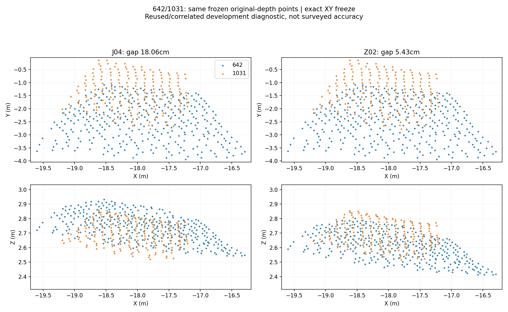
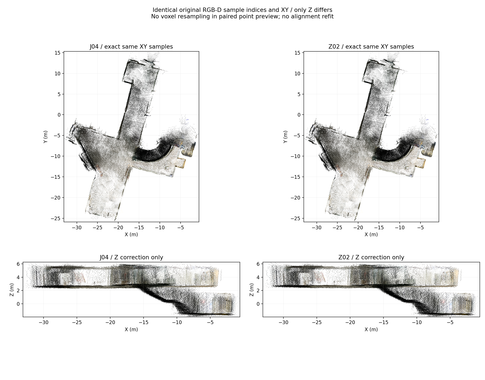
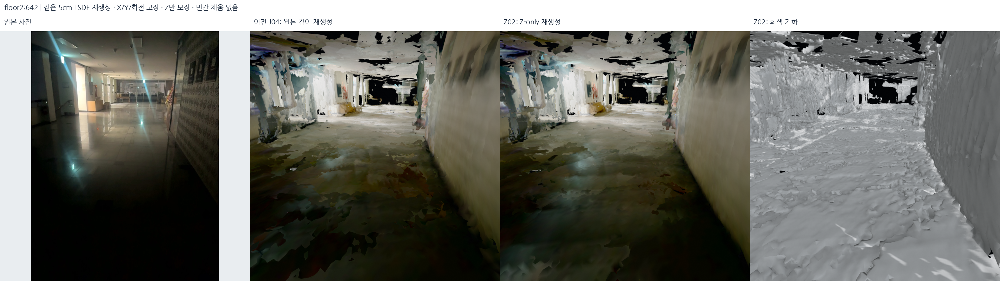
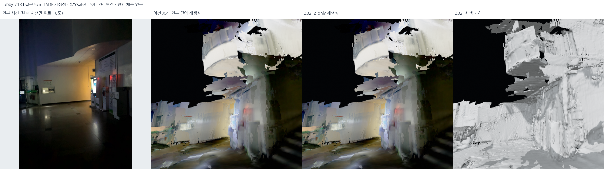

# J04의 X/Y·회전은 고정하고 Z만 재최적화 — 2026-10-18

## 목적과 비교 후보

J04의 XY 형상을 유지하면서 같은 층의 높이 편차를 줄이기 위해 **포즈 X/Y와 모든 회전을 고정**한 별도 후보
Z01/02/03을 만들었다. 카메라를 들고 움직인 Z를 일정하게 만드는 방법은 쓰지 않았다.

현재 로컬 비교는 균형형 **Z02**다. `config/current_z_only_candidate.json`은 비교 후보
안내이고, `config/current_map.json` 및 기존 확정 지도는 그대로다. 개선과 악화가 함께
있어 최종 정확도 승인이나 자동 교체를 하지 않았다. 다른 네 세션도 재최적화하지 않았다.

- 포즈 출력: `outputs/student_union_floor2_z_only_v1/`.
- 실제 재생성: `outputs/student_union_floor2_z_rebuild_v1/`.
- 로컬 확인 기록: `outputs/student_union_floor2_z_native_v1/`.
- [전체 최적화 수치·원본 SHA](../assets/floor2-z-only-20261018/optimization_report.json),
  [전체 재생성 manifest](../assets/floor2-z-only-20261018/reconstruction_manifest.json),
  [납품/원본/깊이/로컬 검사](../assets/floor2-z-only-20261018/delivery_audit.json).

## 정확히 고정한 것

1. J04 공통 925개 포즈의 **id/stamp/x/y/qx/qy/qz/qw CSV 문자열을 그대로 복사**한다.
   matrix→quaternion 재변환도 하지 않는다. 행렬로 다시 읽어 X/Y와 R이 정확히 같은지 검사했다.
2. Z 오프셋은 원래 포즈에 더하는 **단일 스칼라**다. yaw/roll/pitch·스케일·카메라
   calibration·depth pixel은 변수가 아니다. H00의 Z를 복사하거나 후보별 성분을 섞지 않았다.
3. 216~1055 사이에서만 오프셋을 허용한다. 양 끝 216/1055와 서브 계단 연결 프레임
   **553은 0으로 고정**했다. 기존 연결 프레임 14/51/66/553/1215도 실제로 모두 불변이다.
4. 기존 사진 검토된 메인 계단 촬영 노드 **133개**가 모두 같은 포즈인지 별도로 검사했다.
   낮은 층·계단의 원래 상승량과 원래 남아 있던 오류를 이번 처리로 몰래 바꾸지 않았다.

## 원본 바닥 확인과 제약 구성

구현 `src/optimize_floor2_z_only.py`, 설정 `config/floor2_z_only.json`.

- 기존 원본 깊이에서 결정론적으로 재현한 유한 평면을 후보 사용 전에 한 번 고정한다.
  각 후보에 맞게 새 평면을 쉽게 피팅하지 않는다. plane-index 0의 상층 바닥 중심 48개를
  사용했다. 2층 복도·화장실 앞·프라임홀 앞의 원본 사진에 평가 점을 표시해 바닥임을 확인했다.
  계단 시간 구간은 이 공통 층 높이 prior에서 제외한다.
- 같은 층의 작업상 중심 Z 띠 2.2~3.05m로 잘못된 층을 제외했다. 이는 포즈 좌표의
  선택 범위이지 건물의 실측 층고나 새 천장 높이가 아니다. 계단/복층 공간을 평면으로 채우지 않는다.
- 같은 유한 수평 패치의 공통 XY 지원(20cm 이내, 양쪽 각각 최소 25개 training 점)을
  확인한다. 두 법선 차이는 8° 이하이고 법선 Z 성분은 각각 0.97 이상이어야 높이 관측으로 쓴다.
  지원이 없는 패치를 단순한 높이 평균으로 억지 연결하지 않는다.
- 맞출 상대량은 **공통 XY 범위에서 두 원본 평면의 높이 차이**다. 점-to-plane 잔차를
  각 법선의 Z 성분으로 나누고 양방향 중앙값을 평균해 `offset_b−offset_a` 목표를 구한다.
  실제 두 카메라 Z가 같아야 한다는 제약은 없다.
- 직접 상대 높이 fitting은 **7쌍/6지역**이다:
  620↔1025, 644↔1034, 656↔1055, 789↔859, 828↔892, 927↔948,
  추가 화장실 바닥 282↔728. 280↔726은 인접 사진의 대조 관계다.
- 다른 수평 관계 15쌍을 직접 pair fitting에서 제외했지만, 일부 같은 프레임의 바닥 중심은
  공통 높이 prior에 사용된다. **독립 holdout이라고 부르지 않는다.** 모두 반복 사용한
  같은 센서/인접 장소의 개발 진단이다. 측량·새 재촬영 정답은 없다.

원본 바닥 검토 사진:
[1](../assets/floor2-z-only-20261018/floor_support_photos_0.png) ·
[2](../assets/floor2-z-only-20261018/floor_support_photos_1.png) ·
[3](../assets/floor2-z-only-20261018/floor_support_photos_2.png) ·
[4](../assets/floor2-z-only-20261018/floor_support_photos_3.png).

## 한 층의 Z 출렁임을 억제한 방법

Z 오프셋은 20프레임 간격의 **구간별 선형 스플라인**이다. 매 프레임을 자유롭게
위아래 움직이지 않는다. 고정 knot를 제외한 스칼라 오프셋만 추정한다.

목적함수는 다음 항으로 구성된다.

1. 검토된 동일 바닥 쌍의 상대 높이 잔차.
2. 실제 바닥 패치 중심이 하나의 공통 상층 높이와 크게 다르지 않도록 하는 **공유 잠재 층 높이**.
   실측 높이가 없으므로 기존 바닥 중심 중앙값에 약한 8cm gauge prior를 둔다.
3. 원래 J04에서 과하게 벗어나지 않도록 하는 오프셋 prior.
4. 원래 촬영 경로의 이동 거리에 비례한 인접 오프셋 차분 regularization.
   실제 계단/폰의 높이 변화가 아니라 **보정량의 급변만** 억제한다.

같은 지역의 여러 관측은 개수의 제곱근으로 나눠 중복 정보량을 평균화한다.
높이/층 prior에는 Huber delta 2.5의 IRLS를 적용하고, 매번 bounded sparse linear
least-squares(`lsq_linear`/LSMR)로 푼다. 파라미터는 센서 보정 공분산이 아니라
명시적인 모델 가정이다.

| 후보 | 상대 높이 sigma | 오프셋 prior sigma | 거리당 차분 sigma | 같은 층 높이 sigma |
| --- | ---: | ---: | ---: | ---: |
| Z01 보수형 | 4cm | 15cm | 3.5cm/√m | 10cm |
| **Z02 균형형** | **3cm** | **25cm** | **5cm/√m** | **6.5cm** |
| Z03 강한 층 높이 | 2.5cm | 35cm | 7cm/√m | 4cm |

모든 후보는 오프셋 ±35cm 제한, 인접 보정량 차이 3.5cm 이하, 같은 층의 P90−P10 및
최대−최소가 기존보다 0.5cm 넘게 악화되지 않는 guard를 검사한다. 세 후보 모두 통과했다.
Z02는 **감사 수치를 보기 전에 설정에 지정한 균형형**이며, 대조 점수가 가장 낮은 것을
사후 선택한 것이 아니다. Z02의 실제 최대 오프셋은 **20.92cm**, 인접 최대 변화는 **1.72cm**다.


## 개선과 남은 편차

| 같은 원본 관측 | J04 | Z01 | **Z02** | Z03 |
| --- | ---: | ---: | ---: | ---: |
| 바닥 중심 P90−P10 | 26.67cm | 18.03cm | **11.81cm** | 8.73cm |
| 바닥 중심 최대−최소 | 39.41cm | 33.92cm | **29.52cm** | 28.63cm |
| 수평 22쌍 중앙값 | 8.12cm | 3.15cm | **2.82cm** | 2.75cm |
| 수평 22쌍 P90 | 16.40cm | 6.80cm | **8.45cm** | 7.93cm |

중앙 80% 바닥 관측의 범위가 줄었지만 **2층 전체 바닥이 11.8cm 안으로 들어왔다는
뜻은 아니다.** 모든 48개 중심의 최대 범위는 여전히 29.5cm다. 특히 고정 연결 프레임 553의
바닥 중심 Z 2.8391m는 그대로 남는다. 계단/연결을 고정한 채 이것도 0cm로 만들었다고
주장할 수 없다. 또한 회전을 고정했으므로 한 프레임 안의 기울어진 깊이 평면 법선도 그대로다.

| 대표 관계 | J04 | Z02 | 해석 |
| --- | ---: | ---: | --- |
| 620↔1025 수평 | 22.59cm | **3.29cm** | 직접 높이 fitting |
| 642↔1031 수평 | 18.06cm | **5.43cm** | pair 직접 fitting 제외, floor prior와 상관됨 |
| 화장실 282↔728 수평 | 3.07cm | **1.86cm** | 직접 높이 fitting |
| 화장실 280↔726 수평 | 9.49cm | **6.03cm** | 인접 개발 대조 |
| 548↔981 목표 벽 | 1.54cm | 1.59cm | 원래 좋은 국소 벽 유지 |
| 656↔1055 문제 벽 | 54.42cm | 54.86cm | XY/회전 문제를 Z-only로 해결하지 못함 |

이전 282↔728의 **H00 대비 카메라 상대 Z 변화 21.67cm**를 그대로 되돌리지 않았다.
그 값은 정답과의 높이 오차가 아니었다. 실제 바닥 대응에서 필요한 상대 보정은 약
**−3.05cm**였다. 포즈 변화량과 관측 불일치를 구분해야 한다.



## 원본부터 실제 재생성

`src/rebuild_z_only_comparison.py`는 J04와 Z02에 **동일한 925 RGB-D 프레임과 전처리**를
사용해 각각 5cm TSDF(절단 15cm)를 생성했다. 28,595,643개의 유효 깊이 관측을
각각 적분했다. 이전 평면화/천장/사진 표면 모델을 변형한 것이 아니다.

- 모든 원본 샘플의 world X/Y가 전후 **정확히 동일**함을 프레임마다 검사했다.
- 매 4번째 깊이 행/열의 동일 인덱스를 추린 **1,777,733점**을 같은 순서와 RGB로 저장했다.
  이 두 PLY의 XY 해시가 같다. 3D 복셀 재샘플링으로 달라진 XY를 동일하다고 부른 것이 아니다.
- TSDF는 기존 기준과 같은 0.005m² 미만 성분 제거만 적용했다. 추가 구멍 채움/평활화/
  단순화는 없다. J04 1,950,307면, Z02 1,919,271면이다. 면 수 감소 자체는 정확도 지표가 아니다.
- TSDF의 등가면 꼭짓점은 Z 변화에 따른 복셀 융합 때문에 X/Y도 달라질 수 있다.
  이는 **포즈/센서 관측의 XY 재최적화와 구별**한다. 엄밀한 XY 보존 검사는 원본 점군으로 한다.
- 다른 네 세션은 같은 기존 깊이 기반 메시를 비교 양쪽에 그대로 표시했다.







이번 표면은 조건을 통일한 **원본 TSDF 비교**다. 이전의 매끈한 평면/사진 텍스처 표시본과
직접 미관 순위를 매기지 않는다. 큰 미관측 빈칸은 그대로다. Z-only 수정이 모든 빈칸을
없앴거나 이전 상부 벽 보완이 그대로 이 새 포즈에 맞게 갱신됐다고 주장하지 않는다.

## 원본 깊이 대조에서의 악화도 공개

각 후보의 실제 카메라에서 원본 깊이와 first-hit ray depth를 비교했다. 아래는 **두
모델 모두 관측과 hit가 있는 같은 픽셀**의 절대 중앙값이다. 전체 hit coverage 차이도
JSON에 남겼다. 모두 이미 적분에 쓴 같은 자료라 새 독립 포즈 정확도가 아니다.

| 원본 프레임 | J04 | Z02 | 관찰 |
| --- | ---: | ---: | --- |
| 620 | 26.00cm | 15.26cm | 개선, 여전히 큼 |
| 642 | 17.44cm | 8.13cm | 개선 |
| 726 | 8.67cm | 6.71cm | 개선 |
| 728 | 7.10cm | 5.26cm | 개선 |
| 828 | 3.91cm | **4.84cm** | 악화, P90 9.96→18.33cm |
| 1031 | 4.40cm | **6.34cm** | 악화 |
| 1/1078/1218 | 동일 | 동일 | 고정 구간 |

공통 층 높이/다른 재방문을 맞추는 보정은 원래 잘 맞던 국소 융합과 충돌할 수 있다.
면의 기울기·XY 차이는 고정한 상태이므로 스칼라 Z만으로 전부 만족시킬 수 없다.
이것이 **기존 지도를 자동 교체하지 않은 이유**다. 깊이 악화를 단순히 표시 문제라고
치부하거나 좋아진 관계만 골라 전체 정합 완료로 보고하지 않는다.

## 납품 검증과 재현

`src/audit_z_only_delivery.py`에서 CSV/행렬, 계단 133개, 연결점 5개, 원본 DB 5개,
1,777,733개 대응 샘플 XY/RGB/순서, 실제 GLB/PLY 좌표 및 12개 원본 깊이 시점을 검사했다.
로컬 창에 다섯 실제 파일이 로딩됐고 장면 callback 이미지를 저장했다. 데스크톱 캡처나
브라우저 화면이 아니다. 소스 지도 manifest는 여전히
`98cf1d77aa5ca3c82f9653ffcb4ee86d6f40ac4d8953f1c1171b0dfa307090b1`다.

```bash
PYTHONPATH=src OPENBLAS_NUM_THREADS=1 OMP_NUM_THREADS=2 \
  /usr/bin/python3 -s src/optimize_floor2_z_only.py \
  --output outputs/reproduce_floor2_z_poses_v1

PYTHONPATH=outputs/surface_runtime/packages:src OPENBLAS_NUM_THREADS=1 OMP_NUM_THREADS=2 \
  /usr/bin/python3 -s src/rebuild_z_only_comparison.py \
  --poses outputs/reproduce_floor2_z_poses_v1 --variants Z02 \
  --output outputs/reproduce_floor2_z_mesh_v1

bash scripts/view_z_only_candidate.sh
```

로컬의 **Before: J04 / After: Z02**는 카메라를 유지한 채 전환한다. 원본 점군·5cm TSDF·회색
기하를 선택할 수 있고 복도/화장실/층간 사진 시점 버튼이 있다. 기존 완성형 표시본을 다시
열려면 기존 `bash scripts/view_local_roadview.sh`를 사용한다. 후보 출력은 서로 덮어쓰지 않는다.

합성 테스트는 고정/외부 knot가 0인지, 오직 Z만 변하는지, CSV 비-Z 필드가 같은지,
평면 높이 상대 보정의 부호가 맞는지, 유한 XY 지원이 없을 때 fitting을 거부하는지 확인한다.
최종 전체 구현 검사 **465개 통과(5.41초)**, `git diff --check`도 통과했다.
검사 통과가 지도 정확도 승인은 아니다.
