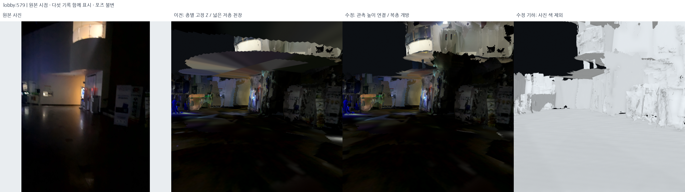
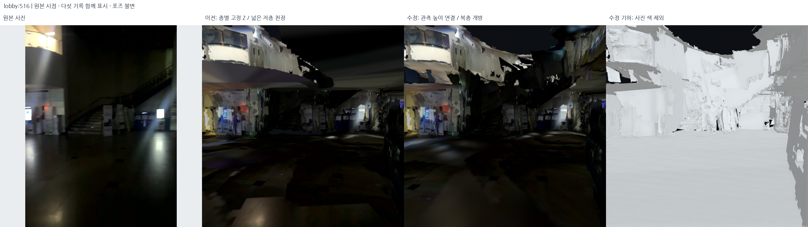
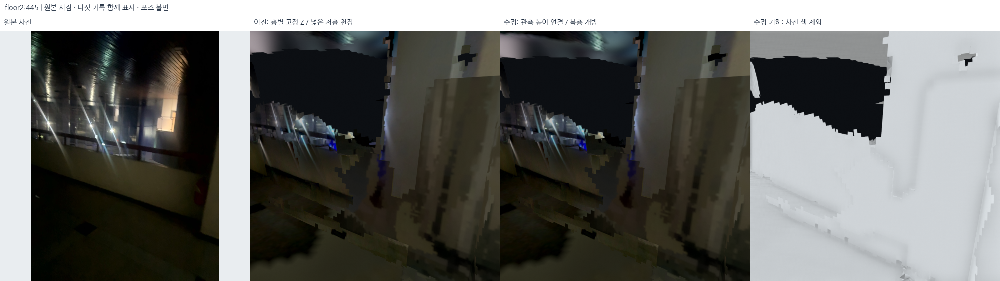
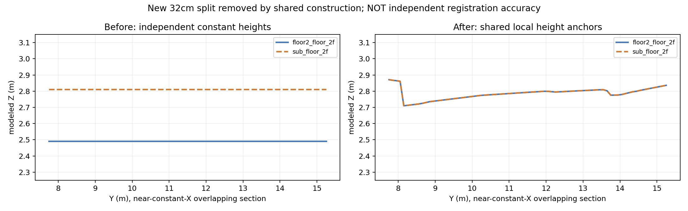
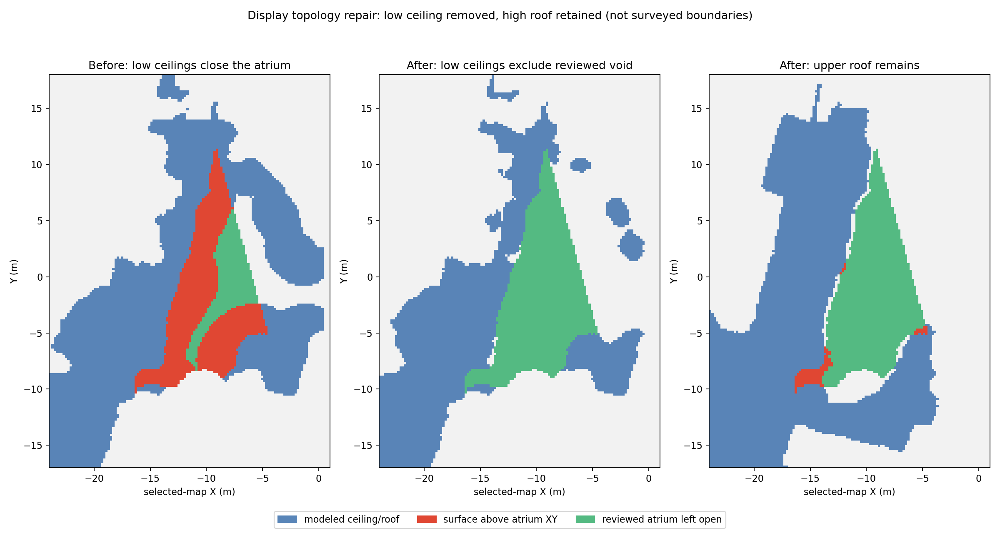

# 층간 높이 분리 회귀·복층 로비 천장 오채움 수정 — 2026-10-18

후속 검토에 따라 **이 단계에서 생성한 저층/상층 천장 시트를 모두 철회**했다.
중앙 복층만 비우고 다른 천장을 추정 높이로 남긴 판단도 충분하지 않았다.
현재 표시는 [기존 관측 천장만 복원한 결과](2026-10-18-withdraw-inferred-ceilings.md)다.
아래 내용은 실패 수정 이력이며, 천장 높이를 실제 구조에 맞게 검증했다는 뜻이 아니다.

## 결과와 범위

검토에서 확인한 **1·2층 사이 벌어짐과 메인 계단 옆 복층 로비 천장 오채움**을 조사했다.
직전 표시용 평면화의 잘못된 가정을 확인해 `student_union_topology_fixed_v2`로 교체했다.
원본 DB·선택 포즈·SLAM 지도 점군을 다시 최적화한 작업은 아니다.





비교 렌더는 **다섯 세션을 모두 함께** 표시하고, 원본 사진의 보정값·카메라 포즈와 같은
시점으로 계산했다. 천장 숨김 모드로 문제를 가린 이미지가 아니다. 회색 기하 패널도
같은 완전 모델이다. 모든 그림은 실제 모델 렌더/원본 사진이며 생성형 이미지가 아니다.

## 1. 원인 분리: 새 표시 오류와 원래 정합 불일치

`src/audit_multilevel_topology.py`가 직전 모델과 평면화 전 선택 표시본을 비교했다.
각 높이 띠의 수평면 삼각형 중심을 20cm XY 래스터로 묶고 같은 칸의 높이 중앙값을 비교했다.
이는 물리적으로 동일한 대응을 모두 인증한 평가나 측량 정확도 평가가 아니다.

| 비교 | 평면화 전 같은 XY 높이 차이 중앙값 | 직전 독립 고정 Z 차이 | 판단 |
| --- | ---: | ---: | --- |
| 메인 2층 바닥 ↔ 서브 계단 2층 바닥 | +1.85cm, 727칸 | +31.99cm | 새 표시 모델이 약 32cm 분리를 만듦 |
| 로비 1층 ↔ 메인 기록 1층 바닥 | +2.22cm | +3.65cm | 큰 새 분리의 주원인은 아님 |
| 로비 1층 ↔ 서브 계단 1층 바닥 | +24.09cm | +26.33cm | 원래 자료부터 남은 불일치; 별도 문제 |
| 로비 저층 천장 ↔ 메인 2층 바닥 | +86.81cm | +83.04cm | 큰 차이가 이미 있었음; 임의 슬래브 두께로 압축하면 안 됨 |

특히 1층 천장과 2층 바닥은 **같은 물리적 표면이 아니다**. 천장 속 공간·다른 구조물·
잔존 정합 오차를 분리할 증거 없이 붙여서 한 높이로 만들지 않았다. 위 수치가 실제 슬래브
두께라는 뜻도 아니다. 모든 층간 간격이 이번 변경만으로 해결됐다고 주장하지 않는다.

## 2. 복층 공간을 사진으로 확인

깊이/포즈 기반 후보와 원본 RGB를 함께 확인했다.

1. 메인 2층 바닥 범위의 convex envelope 안에서, 1층 바닥은 있지만 상층 바닥 지지가 없는
   곳을 찾았다. 상층 마스크 가장자리 40cm는 제외했다.
2. 후보 전체 112.76m² 중 가장 큰 연결 성분 **104.36m²**만 중앙 복층 로비 후보로 선택했다.
   작은 외곽 빈틈까지 자동으로 아트리움으로 분류하지 않았다.
3. `src/review_atrium_photos.py`로 원본 RGB 39장을 추출했다. 로비 510/512/516/579와
   메인 기록 284/445/512/593/599/1050/1066에서 계단·난간 너머의 개방 공간을 확인했다.
4. 검토 대상은 **메인 계단 옆 중앙 로비**로 확인했다. 다만 정확한 경계선은 실측한 것이
   아니라 기존 지도 지원 범위와 사진 판독을 결합한 표시용 경계다.



직전 방식은 천장 지지가 없어도 가까운 바닥 footprint를 상속했고, 큰 내부 구멍을 채웠다.
기존 depth 제한이 대체로 4m라 높은 복층 천장이 1층에서 깊이로 관측되지 않는 곳도 있다.
**깊이 없음은 천장이 있다는 증거도, 빈 공간이라는 단독 증거도 아니다.** 이번에는
사진으로 확인한 중앙 개방 영역을 명시적으로 보호한다.

## 3. 적용 알고리즘과 파라미터

설정: `config/multilevel_surface_topology.json`.
구현: `src/reconcile_multilevel_surfaces.py`.

### 3.1 원본 구조 보존·이전 표시 시트 교체

직전 v3의 geometry 순서는 원래 보존 구조 prefix + 새 수평 시트다. 원래 보존 구조
**전체 prefix를 좌표/순서까지 그대로 복사**하고, 새로 추가했던 수평 시트만 교체했다.
벽·난간·계단·문·창·표지판을 다시 전체 평면화하지 않았다.

| 기록 | 그대로 남긴 원래 구조 삼각형 |
| --- | ---: |
| 외부 | 272,119 |
| 로비 | 427,004 |
| 외부↔로비 브리지 | 116,838 |
| 2층·메인 계단 | 537,686 |
| 서브 계단 | 243,517 |

직전 보호 검사를 재실행해 메인 계단 119,099개 원래 삼각형 보존도 재확인했다.
새 모델의 보존 prefix가 그 직전 모델과 정확히 같으므로 이 계단 좌표도 유지된다.

### 3.2 독립 대표 Z → 공유 국소 평면 앵커

- 평면화 전 실제 선택 PLY의 높이 띠에서 `|normal.z| > 0.85`인 수평 관측을 사용했다.
  기존 보호 구조/계단 삼각형은 이 피팅 입력에서 제외했다.
- 20cm XY 칸마다 중앙값 표본을 만들어 삼각형 밀도에 따른 편향을 줄였다.
- 2m 간격의 공통 XY 격자에서 반경 2.3m 관측을 모았다. 부족하면 가까운 최대 32개를 사용했다.
- 거리 가중 국소 affine plane을 **Huber IRLS 6회, δ=6cm**로 피팅했다.
- 개별 피팅의 경사 제한만으로 이웃 앵커 사이의 경사가 제한되지는 않는다. 공통 격자의
  두 삼각형 gradient도 **4° 경사 원뿔** 안으로 반복 투영했다. 측량 경사로 단정하는 값이
  아니라 표시 모델의 완만함 제한이다. 실제 출력은 float32 허용오차 내 약 4° 이하다.
- 공통 앵커의 두 affine 삼각형을 보간해 10cm 표시 격자에 표면을 만들었다. 같은 격자
  꼭짓점을 공유하므로 패치 경계가 연속이다. 건물 전체를 하나의 Z로 누르지는 않는다.

공유 그룹은 실제로 같은 높이 영역에만 지정했다.

| 그룹 | 포함 표면 | 제한 |
| --- | --- | --- |
| main_floor_1f | 로비 1층 + 메인 기록의 1층 바닥 | 같은 층의 공통 국소 기준 |
| shared_upper_floor | 메인 2층 + 서브 계단 상층 랜딩 | 새로 생긴 32cm 모델 분리 제거 |
| main_lower_ceiling | 로비 저층 천장 + 메인 기록 저층 천장 | 중앙 복층 제외 |
| shared_upper_roof | 메인 상층 천장 + 서브 상층 천장 | 기존 상부 지지 범위 유지 |
| 나머지 독립 국소 그룹 | 서브 1층 바닥·저층 천장, 출입구 브리지 바닥 | 원래 불일치를 강제 전역 이동으로 숨기지 않음 |



수정 후 두 2층 표시 바닥의 **공통 XY 3,826곳 모델 높이 차이는 0**이다. 동일 공유 함수를
쓰므로 당연히 만족하는 구성 조건이다. 독립 검증 정합 오차 0cm나 포즈 그래프 개선 수치가 아니다.

### 3.3 천장/바닥의 위상 구분

- 중앙 복층 마스크를 1층 저층 천장 세 기록과 2층 바닥 두 기록에서 제외했다.
- **높은 상층 천장은 복층 제외 목록에 넣지 않았다.** 기존 상층 천장 footprint는 그대로다.
  그러나 원래도 관측/생성하지 못한 높은 지붕 부분까지 새로 덮었다는 뜻은 아니다.
- 저층 천장은 **실제 이전 천장 지지에서 80cm 이내**만 완성했다. 바닥 footprint 상속은 없앴다.
- 이전 금지/광선 빈 공간 마스크를 유지하고, 새 국소 높이의 셀 중심·네 모서리에서 계단
  보호 상자를 다시 검사했다. 이전 상수 Z로 만든 계단 마스크만 재사용하지 않았다.
- 개발 후보 v1은 이 재검사에서 일부 계단 보호 영역 침범을 보여 채택하지 않았다.
  최종 v2는 높이 인식 보호 마스크와 실제 삼각형 검사까지 통과했다.



가운데 패널은 낮은 천장이 중앙을 덮지 않음을 보여준다. 오른쪽의 초록은 원래부터 높은
천장 관측이 없는 영역도 포함한다. 이를 새롭게 뚫은 높은 천장이나 실제 지붕이 없다는
뜻으로 해석하면 안 된다. 높은 천장 지원 footprint는 변경하지 않았다.

### 3.4 실제 수정 높이로 원본 사진 재투영

기하만 바꾸고 이전 상수 높이의 텍스처 좌표를 그대로 재활용하지 않았다.
원본 DB의 보정값·선택 포즈로 수정된 각 표면의 XYZ에 RGB를 다시 투영했다.

- 시트별 최대 36개 공간 분산 카메라, 최대 1,400px 텍스처.
- 기존 깊이 일치/가림 조건과 원본 사진 선택 방법 유지.
- 선형 RGB의 겹침 기반 log gain 보정, Potts 공간 일관성 선택, 12cm feather.
- 제한된 저주파 밝기 보정과 기존 경계 leveling 적용.
- 사진으로 커버하지 못한 부분은 **기존 수평 RGB의 완만한 확장**이다. 새로운 실제 사진이나
  사라진 표지판을 생성한 것이 아니다. 표지·문·창의 원본 RGB 사진 면은 그대로 유지했다.

## 4. 변경 면적·실제 기하 검증

| 표면 | 직전 면적 → 수정 면적 | 그중 복층 때문에 제거 | 비고 |
| --- | ---: | ---: | --- |
| 로비 저층 천장 | 441.76 → 283.78m² | 76.92m² | 나머지는 천장 지지 거리 제한 |
| 메인 기록 저층 천장 | 30.34 → 18.78m² | 4.83m² | 계단/지지 거리도 검사 |
| 서브 기록 저층 천장 | 56.80 → 30.76m² | 10.90m² | 공통 XY에 덮인 면 제거 |
| 메인 상층 천장 | 463.40 → 463.40m² | 0 | 기존 범위 유지 |
| 서브 상층 천장 | 44.71 → 44.71m² | 0 | 기존 범위 유지 |

복층 위 저층 천장 제거 합계는 **92.65m²**이며 중첩 세션의 합이다. 중앙 공간 실측 면적이나
고유 삭제 면적이 아니다. 최종 표시 면적 합계는 바닥 1,159.96m²·천장 841.43m²,
기존 관측 래스터 밖의 모델 채움 합계는 473.12m²다. 역시 기록 중복을 포함한다.

`src/audit_multilevel_surface_repair.py`는 선언 JSON뿐 아니라 **실제 GLB/PLY 삼각형**을 검사한다.

- 다섯 기록 GLB와 PLY의 삼각형 좌표 float32 일치.
- 보존 prefix의 좌표/순서 정확히 유지; 원본 사진 의미 면과 RGB SHA 유지.
- 새 꼭짓점이 공유 앵커 함수에 붙는지 확인; 최대 편차 2µm 허용.
- 실제 새 삼각형의 경사·법선 방향·XY 면적과 마스크 일치.
- 새 면의 복층/기존 금지 영역 겹침 0, 계단 보호 상자 안 새 꼭짓점 0.
- 저층 천장 거리 제한 위반 0, 공유 2층 바닥 모델 간격 0.

`src/audit_structural_delivery.py`는 원본 DB 5개, 선택 지도와 입력 파일 SHA, 실제 출력 SHA,
**로컬 창이 실제로 읽은 다섯 GLB**까지 재확인했다. 원본 DB·선택 포즈는 불변이다.
기존 단일-Z 검사기를 느슨하게 바꾼 것이 아니라, 새 국소 앵커/복층 검사기를 별도로 만들었다.
전체 테스트 **446개 통과**; 새 구현 검사 7개가 포함된다.

원래 지원 표면에 대한 국소 피팅 P90 잔차는 여전히 약 8–29cm다. 피팅에 사용한 표본에
대한 값이며 독립 정확도가 아니다. 따라서 표면이 연속이어도 원래 지도 오차가 모두 사라진
것은 아니다. 구체 값은 [기하 검사](../assets/multilevel-topology-fixed-20261018/topology_audit.json)에 남겼다.

## 5. 로컬 확인·재현

```bash
# 기존 로컬 Open3D 창, 중앙 로비 원본 촬영 위치에서 다섯 기록 함께 표시
bash scripts/view_local_roadview.sh --start-view atrium

# 같은 시점 비교: Open atrium + anchored floors
#                 Previous flat display / before topology fix
# 선택적인 천장 숨김은 별도 버튼. 복층 수정은 숨김 없이 적용됨.
```

처리 실행은 출력 디렉터리 덮어쓰기를 허용하지 않는다. 새 출력 이름을 지정해야 한다.
기존 로컬 surface runtime을 사용한다.

```bash
export PYTHONPATH="$PWD/outputs/surface_runtime/packages"
export OMP_NUM_THREADS=2 OPENBLAS_NUM_THREADS=1

/usr/bin/python3 -s src/audit_multilevel_topology.py \
  --output outputs/student_union_topology_audit_v1
/usr/bin/python3 -s src/review_atrium_photos.py \
  --output outputs/student_union_atrium_photos_v1
/usr/bin/python3 -s src/reconcile_multilevel_surfaces.py \
  --output outputs/student_union_topology_fixed_REPLAY
/usr/bin/python3 -s src/audit_multilevel_surface_repair.py \
  --bundle outputs/student_union_topology_fixed_REPLAY \
  --output outputs/student_union_topology_fixed_REPLAY/topology_audit.json
/usr/bin/python3 -s src/build_flat_cutaway.py \
  --bundle outputs/student_union_topology_fixed_REPLAY
/usr/bin/python3 -s src/render_multilevel_topology_review.py \
  --bundle outputs/student_union_topology_fixed_REPLAY \
  --assets outputs/student_union_topology_fixed_REPLAY/review
```

재실행 후보를 현재 표시로 채택할 때는 전체 검증 후 manifest/cleanup/설정 SHA와
`config/current_local_view.json`·`config/structural_display_policy.json`, 뷰어 대상을 함께 갱신한다.
폴더 이름만 바꾸고 검증된 결과라고 취급하면 안 된다.

결과 자료:

- [동일 시점 7장·마스크 그림·높이 그림과 카메라/사진 SHA](../assets/multilevel-topology-fixed-20261018/manifest.json)
- [실제 구조 보존/공유 높이 검사](../assets/multilevel-topology-fixed-20261018/topology_audit.json)
- [원본과 실제 로컬 로딩 검사](../assets/multilevel-topology-fixed-20261018/delivery_audit.json)
- [로컬 렌더 콜백 이미지](../assets/multilevel-topology-fixed-20261018/selected_overview.png)

## 6. 남은 문제 구분

1. **기존 서브 계단 1층 쪽 약 24cm 불일치**는 이번 32cm 표시 회귀와 별개다. 계단 끝/바닥/벽의
   대응 확인 없이 서브 기록 전체를 수직 이동하면 고친 2층 쪽이 다시 틀어지므로 하지 않았다.
2. 1층 천장과 2층 바닥 차이를 임의의 슬래브 두께로 줄이지 않았다. 실측이나 동일 구조의
   대응 검증이 필요하며, 모든 층간 간격이 정확하다고 말할 수 없다.
3. 큰 미관측 상부·난간 결손, 조명/반사/텍스처 경계, 벽과 바닥의 기존 미세 불일치는 남는다.
   실제로 열린 복층과 센서 미관측 구멍을 같은 구멍 메우기 규칙으로 처리하지 않는다.
4. 이 모델의 평면/경사/공유 높이는 표시용 사전 조건이다. 보행 가능 바닥·충돌 판정·길찾기의
   정답 지도로 승인한 것이 아니다.

## 고정 해시

- 선택 지도 manifest: `98cf1d77aa5ca3c82f9653ffcb4ee86d6f40ac4d8953f1c1171b0dfa307090b1`
- 직전 평면 v3 manifest: `f297f9d281a69f9573676cc933f3017d904c08959663ce975e956f697339dbbb`
- 수정 v2 manifest: `acccd7a7fa5327720dd741f6c7ecd304ca2c68925a1bb8f7b0c82e61c0be4495`
- 수정 cleanup: `9532aabf9f76d84c760d0ef33ba494381a6b02a1892fcde98d90294dbb66177e`
- 복층 설정: `fc8b117d59f765d3d948162d607ed8400368d235bc64bb5f204627400bcc05f7`

웹 공개, 사진 업로드와 OSM 수정은 수행하지 않았다.
