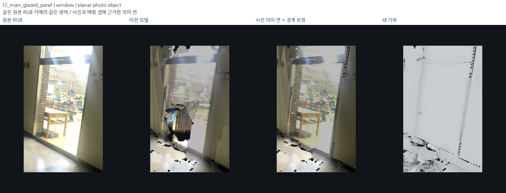
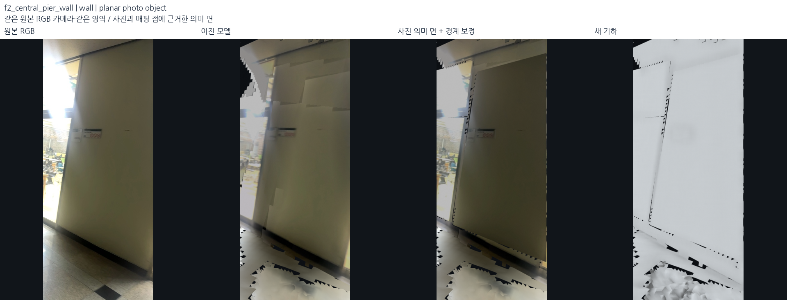
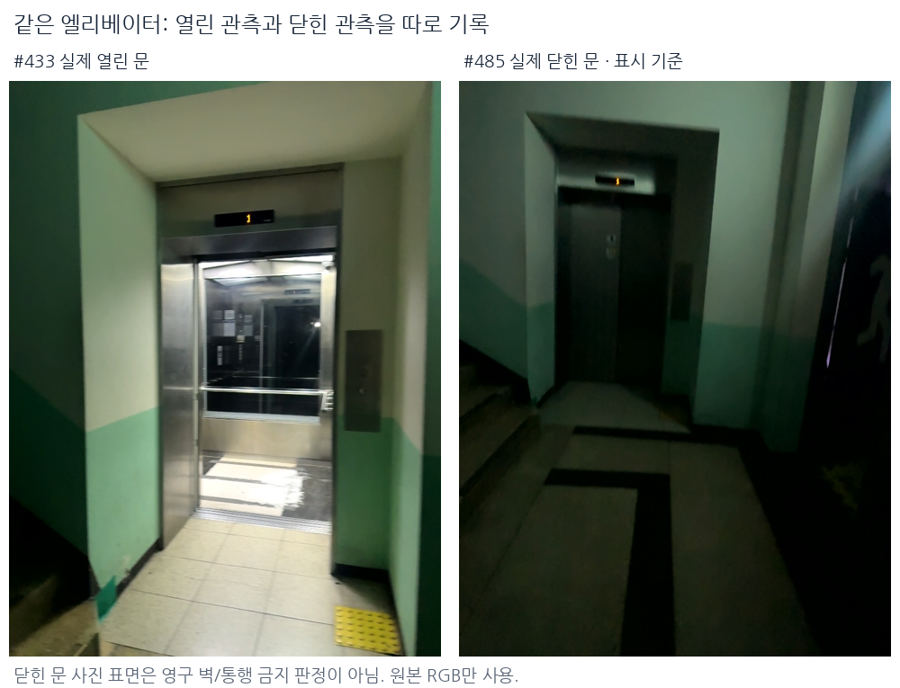
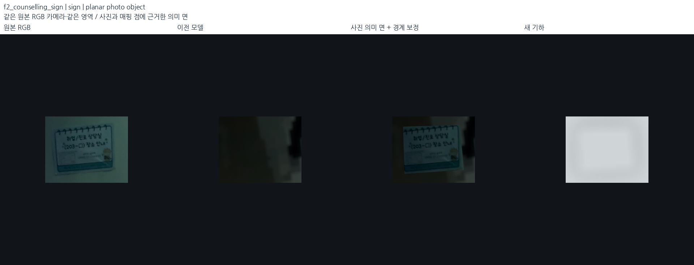
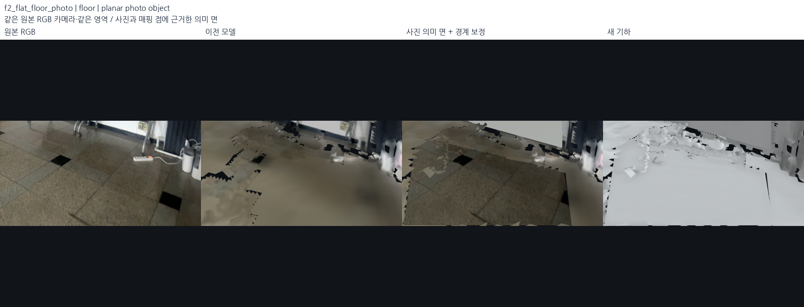
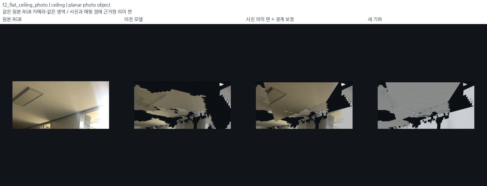
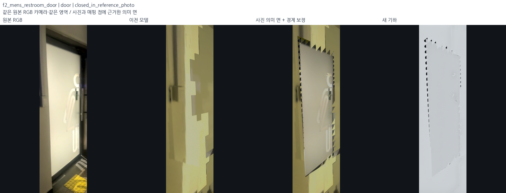
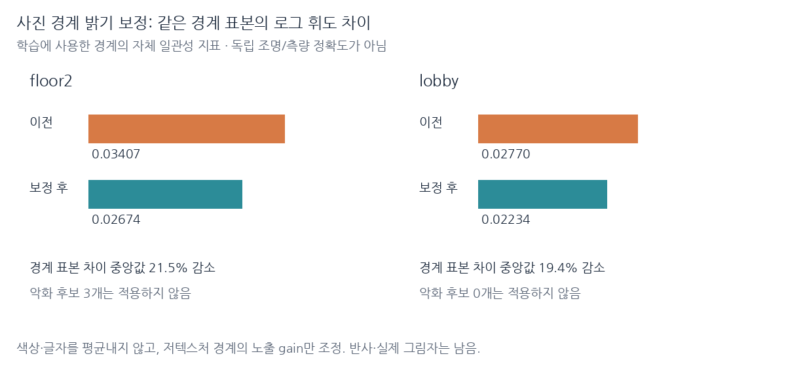
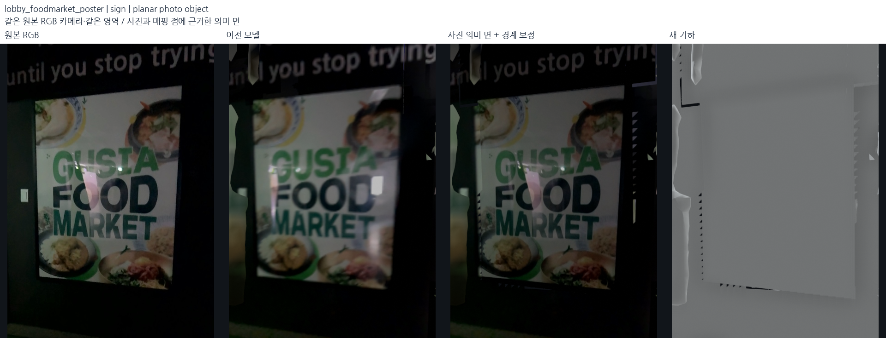
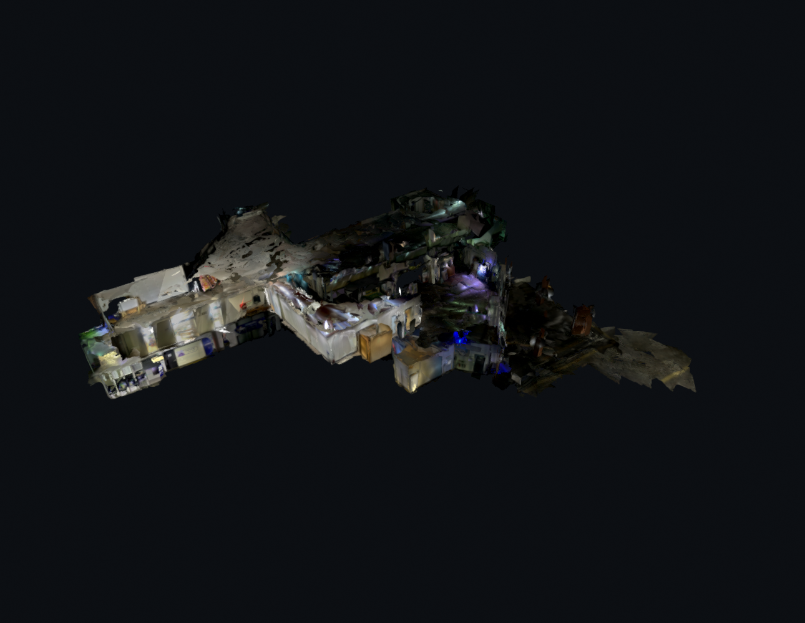

# 원본 사진·매핑 점을 사용한 의미 표면 복원 — 2026-10-18

## 결과와 범위

원본 사진에 문·창·표지판이 보이고 주변 면의 위치를 알고 있다면, 모서리마다
유효한 depth가 없어도 그 내용을 지도에 넣을 수 있다. 이전 재구성은 깊이 지지와
빈 공간 검사를 중심으로 벽을 만들었기 때문에 **사진에 보이는 유리면도 깊이가
없으면 빈칸으로 남겼고, 글자는 여러 사진의 색 혼합에 묻히곤 했다.** 이번 단계는
원본 RGB를 직접 확인하고 객체 종류·촬영 상태·평면 지지를 따로 기록해 보완했다.

최종 표시 묶음: `outputs/student_union_photo_semantics_v10/`.
이전 비교 기준: `outputs/student_union_continuous_selected_v4/`.
SLAM 선택 포즈, 원본 DB, 선택 점군, 지도 좌표는 바꾸지 않았다.

| 사진을 확인한 종류 | 기록 수 | 추가한 사진 면 |
| --- | ---: | ---: |
| 문·출입구 | 5 | 4 — 열린 청소실 출입구 1곳은 비워 둠 |
| 유리·상부 창 | 5 | 5 |
| 표지·문패·안내문·장비 전면 | 11 | 11 |
| 연속 벽·벽기둥 | 2 | 2 |
| 국소 바닥·천장 | 2 | 2 |
| 합계 | **25** | **24** |

로비 6면, 2층/메인 계단 기록 18면이다. 추가 면적 합계는 **42.88m²**지만 기존 면을
교체하거나 겹치는 부분도 있어 **새로 메운 빈칸의 순면적이 아니다**. 사진 판독은
assistant의 명시적 육안 검토이며 자동 의미 검출기나 사람의 현장 실측 결과가 아니다.
다섯 기록을 함께 띄우되 외부와 두 브리지의 기존 선택은 유지한다. 모든 지도 영역의
큰 빈칸을 완전히 없앴다는 뜻은 아니다.





## 1. 실제 사진으로 빈칸의 종류를 다시 구분

`src/review_photo_semantics.py`로 기존 평면의 큰 빈칸을 원본 RGB에 투영하고,
`src/semantic_plane_contact_sheet.py`로 같은 벽을 본 여러 프레임을 비교했다.
유리문·상부 창·엘리베이터·열린 청소실 입구를 발견했다. 특히 유리 너머의 배경
깊이를 문 자체의 깊이로 오해하지 않도록 주변 문틀 지지 구역을 별도로 지정했다.

명시적 판독 구역과 설명은 [photo_semantic_annotations.json](../../config/photo_semantic_annotations.json)에 있다.
예: 2층 #824·833·891의 유리, #14의 남자화장실 문/표지, #728의 여자화장실
표지와 열린 청소실, #219의 상담실/출구 안내, 로비 #485의 엘리베이터,
#575의 GUSTA FOOD MARKET 안내문이다. 읽기 어려운 호실 번호는 추정하지 않았다.
사진에 잘린 글자는 잘린 그대로 유지했다.

엘리베이터는 #433에서는 열려 있고 #485에서는 닫혀 있다. 닫힌 기준 사진을 표면으로
표시하되 `door`, `elevator`, 두 관측 상태를 함께 기록한다. 영구 벽이나 통행 불가
구역으로 확정하지 않는다. 유리의 고정창/여닫이 구분이 불분명한 곳도 통행을 추정하지 않는다.



## 2. 사진 픽셀을 지도의 평면에 배치

구현: `src/photo_semantic_surfaces.py`.

1. 원본 DB를 읽기 전용으로 열고 선택 포즈, 카메라 보정값과 RGB-D를 복원한다.
   RGB는 720×960, 해당 depth는 192×256이다. 실제 배열 크기로 보정값을 환산한다.
2. 사진 다각형 또는 지정한 문틀 띠의 유효 depth를 3D로 역투영한다.
3. 국소 RGB-D RANSAC은 96회 표본, 3.5cm 지지 거리, 65% 이상 일치로 후보를 만든다.
   선택 지도 점군과 최근접점 거리 중앙값 12cm 미만인지 확인한다. 그 뒤 국소 SVD로
   면을 정리한다. 힌트 평면 번호가 맞지 않으면 다른 지도 평면/국소 관측을 검토한다.
4. 평면 피팅의 P90 잔차 8cm 초과는 받지 않는다. 이 잔차는 같은 관측의 면 피팅
   적합도이지 독립적인 지도 정확도가 아니다.
5. RGB 광선과 지지 평면의 교점을 계산한다. **모서리 픽셀 자체의 depth는 필수가
   아니다.** 이것이 이전 3/8 depth 모서리 검사와 다른 점이다. 다만 사진에 찍힌
   대응이 유효하다는 것과 물리적 평면 위치가 정확하다는 것은 별도 조건이다.
6. 사진 좌표에서 Delaunay 삼각분할하고 원본 사진을 UV 텍스처로 쓴다. 작은 표지도
   면을 만들 수 있도록 다각형 모서리를 반드시 포함한다. 앞면은 기준 카메라를 향한다.
   교점은 카메라에서 0.25–8m, 문/창 면적은 6m² 이하로 제한한다.
7. 깊이 충돌을 피하는 표시 간격은 벽 3mm, 문/창 7mm, 표지 12mm, 바닥/천장 4mm다.
   원본 영상 파일은 PNG로 따로 저장하고 DB 복원 RGB와 픽셀 단위로 대조한다.

### 기존 지도 면을 사용하는 경우

바닥 한 장의 RGB-D를 그대로 평면화하면 선택 지도 바닥보다 기울어지는 문제가 있었다.
또 천장 기준 사진은 필터링 후 depth가 0개였다. 두 곳은 주변 프레임까지 반영된 **기존
국소 지도 바닥/천장 면**을 사용하고 원본 사진에서 확인한 범위만 확장했다. 후보의
수평 법선 성분은 |nz|>0.9, 최종 면은 >0.95, P90 잔차는 6cm 이하, 지지 면 30개
이상이다. 사용한 기존 삼각형 번호를 저장했다. 모든 층을 한 높이로 묶지 않는다.

계단 옆 상담실·출구 표지는 같은 프레임의 depth 면이 현재 표시 벽보다 각각
**28.61cm / 13.50cm** 뒤에 있었다. 표지 면만 추가하면 벽에 가려 보이지 않았다.
이 두 곳은 **기존 표시 벽에 사진을 재투영하는 decal 방식**으로 바꿨다. 기존 벽
삼각형의 법선/위치를 이용하며, 센서 깊이를 새로 측정했거나 포즈 오차를 고쳤다고
주장하지 않는다. 원래 RGB-D 피팅과 표시 면의 차이를 메타데이터에 함께 남겼다.







## 3. 사진을 넣어도 가려지던 중복 면 정리

추가 표면의 존재만 검사하면 불충분했다. 초기 시험에서는 남자화장실 문과 상담실
표지가 생성됐지만 앞쪽의 기존 벽 조각이 가렸다. 따라서 실제 메시의 첫 교차 면을
검사하는 `src/audit_semantic_visibility.py`를 추가했다.

원본 사진에서 가림 없이 물체가 보이는 구역 9곳에만 **명시적 사진 시선 정리**를
허용했다. 다각형 안에서 대상보다 앞에 있는 기존 수직 면만 제거하며, 허용 광학
깊이 차이는 객체별 0.22–1.05m다. 큰 상한 1.05m는 이미 크게 어긋난 화장실 문
전면의 기존 벽에만 사용한다. 전역 구멍 임계값을 이 값으로 바꾼 것이 아니다.
계단 보호 영역, 수평 면, 일반 벽 뒤 가구는 이 정리에서 제외한다.

계단 옆 두 표지는 기존 벽을 삭제하지 않고 위의 decal 방식으로 해결했다. 최종
검사에서 남자화장실 문 96.6%, 남자 표지 95.0%, 상담실 표지 100.0%, 출구 표지
97.9%, 큰 유리와 상부 창 각각 약 99.8%의 내부 표본 광선이 해당 사진 면을 먼저
만난다. **실제로 보이는지의 검사이지 면의 물리적 위치 정확도 지표가 아니다.**
로비 서비스 문은 81.7%로 일부 가림이 남는다. 가구 뒤 벽은 가구를 보존하므로
64.1%만 새 벽이 먼저 보이며, 이것을 빈칸 실패나 100% 완료로 계산하지 않았다.

빈칸 변화는 기존/새 메시의 같은 RGB 광선으로 따로 검사했다. 해당 천장 다각형에서
표면 교차 비율은 **54.9%→95.9%**, 큰 상부 유리창은 **76.6%→99.5%**였다.
다른 기존 표면이 앞에 보이는 광선도 포함하는 기하 커버리지로, 위의 해당 객체
첫 교차 비율과는 다른 지표다. 전체 지도 결손 제거율로 일반화하지 않는다.



## 4. 사진 조각의 밝기 경계 완화

`src/texture_boundary_leveling.py`는 같은 벽 안의 사진 label 경계를 검사한다.
암부·포화·실제 무늬 경계는 제외하고, 저텍스처 양쪽의 로그 휘도 차이를 강건하게
집계해 노출 gain 그래프를 푼다. gain은 0.6–1.6으로 제한하고 글자/색을 평균내지
않는다. 같은 경계 표본의 실제 출력 차이가 악화한 차트는 원래 색을 유지한다.

| 같은 경계 표본의 차트별 절대 로그 휘도 차이 중앙값 | 이전 | 최종 | 감소 |
| --- | ---: | ---: | ---: |
| 2층 — 경계 표본이 있는 40차트 | 0.03407 | 0.02674 | 21.5% |
| 로비 — 경계 표본이 있는 49차트 | 0.02770 | 0.02234 | 19.4% |

2층 악화 후보 3차트는 적용하지 않았다. 이는 학습에 사용한 경계의 자체 일관성
검사이며, 독립 조도 정확도나 전체 지도 모든 경계의 개선율은 아니다. 유리 반사,
과노출, 실제 그림자는 남는다. 큰 벽기둥은 여러 사진 조각 대신 한 장의 원본 사진을
사용해 모자이크를 줄였다. 가구 뒤 가려진 흰 벽의 색만 주변 벽의 강건 affine RGB
모델로 추정했으며 `occluded_wall_colour_inferred`로 표시했다. 글자를 생성하지 않았다.





## 5. 실제 출력·보존·로컬 표시 검사

- 원본 DB 5개와 선택 포즈/지도 해시: 변경 없음.
- 실제 텍스처 GLB와 PLY: 삼각형 좌표·순서 float32 기준 동일.
- 기존 보호 계단 삼각형 **119,099개**: 이전 단계에 저장한 전체 마스크까지 재검사해
  모두 같은 좌표로 보존. 새 공간 선택만으로 보호 집합을 줄이지 않았다.
- 기존 수평 면 교체는 사진으로 검토한 국소 바닥·천장 내부 **1,911개**에 한정.
  다른 수평 면과 선택하지 않은 원본 삼각형은 그대로 유지.
- 원본 RGB와 PNG 픽셀 일치, 사진 다각형의 3D→2D 재투영, 지지 점/지도 면 번호,
  실제 추가 삼각형 범위·면적·앞면 방향을 별도 검사.
- 원본 사진 + 이전 모델 + 새 모델 + 회색 기하를 **같은 RGB 카메라·같은 crop**으로
  25장 저장. 기본 큰 벽/전체 시점도 별도로 저장.
- 관련 구현 검사 **33개 통과**. 자동 테스트가 현장 의미/치수 정확도를 보장하지 않는다.

검사 기록:

- [요약·면적·밝기 수치](../assets/photo-semantic-selected-20261018/summary.json)
- [기하·계단·수평 면 보존](../assets/photo-semantic-selected-20261018/preservation_audit.json)
- [원본 RGB·지지·실제 사진 면](../assets/photo-semantic-selected-20261018/semantic_audit.json)
- [실제 첫 교차 가시성](../assets/photo-semantic-selected-20261018/visibility_audit.json)
- [객체별 전후 사진·카메라·해시](../assets/photo-semantic-selected-20261018/semantic_review.json)
- [전체/벽 시점·깊이 진단](../assets/photo-semantic-selected-20261018/manifest.json)
- [원본 DB·실제 출력·로컬 로딩](../assets/photo-semantic-selected-20261018/delivery_audit.json)

기존 진단 프레임에서도 같은 센서 픽셀로 깊이를 다시 비교했다. 2층 #1055 중앙값은
13.11→13.11cm, 메인 계단 #1078은 6.13→6.13cm로 유지됐다. 로비 #38은
16.45→16.08cm로 낮아졌지만 **#39는 6.80→8.21cm로 악화**했다. #39 공통 픽셀의
7.41%가 3cm 넘게 악화, 4.07%는 3cm 넘게 개선됐다. 따라서 모든 시점의 기하
오차가 줄었다고 보고하지 않는다. 사진/상태 기반의 표시 면을 추가한 결과이며,
원본 관측 간 상태·시점 차이와 잔여 정합 문제는 별도로 남는다. 이 변화만으로
포즈가 악화했다거나 정확한 원인이 유리라고 단정하지 않는다.

## 6. 로컬에서 보기

```bash
bash scripts/view_local_roadview.sh
```

기본은 **Photo semantics + boundary leveling**이며 다섯 기록을 함께 보여준다.
두 브리지는 이전 `balanced_only` 선택을 유지한다. **Previous continuous walls /
before semantics**로 같은 카메라에서 전후 비교할 수 있다. **Choose a mapped door /
glazing / sign**에서 객체를 고르면 기준 사진 시점과 실제 원본 RGB를 같이 보여준다.
라벨 표시 버튼과 전체 사진 로드뷰도 제공한다. 웹 서버로 띄우는 방식이 아니다.

최종 비교 사진은 객체별 25장, 큰 벽/전체/기준 시점 13장, 밝기·문 상태 2장,
실제 로컬 장면 1장으로 **41장**이다. 아래는 로컬 장면 렌더링이며 데스크톱
전체 스크린샷은 아니다.



전체 의미 기록은 `outputs/student_union_photo_semantics_v10/semantic_objects.json`이다.
각 객체에 종류·관측 상태·원본 세션/프레임·사진 해시·카메라 보정·월드 포즈·평면
지지·월드 경계·텍스처를 저장했다. 의미 정보는 현재 표시/후속 지도 작성용이며
`passability_verified=false`, `navigation_ready=false`다.

## 7. 남은 한계와 실패 시험

- 깊이 없는 유리/천장을 무조건 거절하던 방식은 사진+주변 면 지지로 보완했다.
  반대로 사진도 주변 지지도 없는 큰 미관측 영역은 여전히 미확정이다. 외곽 전체를
  임의의 닫힌 건물로 만들지 않았다.
- 초기 작은 표지의 격자 삼각분할·면 방향 오류는 모서리 포함 Delaunay와 앞면 검사로
  고쳤다. 그 뒤 “생성됐지만 안 보이는 면”을 발견해 실제 첫 교차 검사를 추가했다.
- 초기 바닥의 단일 프레임 깊이 면은 이미 정돈한 표시 바닥과 기울기가 달라 기각하고
  기존 국소 지도 면을 사용했다. 두 계단 옆 표지도 측정 면을 그대로 뒤에 두지 않고
  기존 표시 벽에 재투영했다. 후자는 **포즈 정합 문제의 해결이 아닌 표시 보완**이다.
- 문/유리 사진을 단일 평면에 입히므로 유리 너머 공간의 시차·반사·투명성을 완전히
  재현하지 못한다. 원본 사진을 함께 보관한다. 단면 가장자리의 작은 균열도 남는다.
- 25곳은 전 구역의 자동 전수 의미 인식이 아니다. 새로운 사진을 확인해 같은 명시적
  객체 형식으로 늘릴 수 있다. 기존 J04의 알려진 국소 포즈/벽 잔차도 별도 문제다.
- 얼굴·번호판 익명화와 통행 가능 검증 전이므로 공개 배포/길찾기 준비 완료가 아니다.

## 재현

기본 Python에 `outputs/surface_runtime/packages`의 Open3D 등 로컬 의존성을 사용한다.
원본/선택 지도와 연속 벽 baseline이 필요하다. 출력은 새 폴더여야 한다.

```bash
export PYTHONPATH="$PWD/outputs/surface_runtime/packages"
export OMP_NUM_THREADS=2 OPENBLAS_NUM_THREADS=1
/usr/bin/python3 -s src/photo_semantic_surfaces.py --output outputs/photo_semantic_reproduction
/usr/bin/python3 -s src/audit_continuous_planes.py \
  --bundle outputs/photo_semantic_reproduction \
  --source outputs/student_union_continuous_selected_v4 \
  --output outputs/photo_semantic_reproduction/preservation_audit.json \
  --allow-reviewed-horizontal-replacement --finalize
/usr/bin/python3 -s src/audit_photo_semantics.py \
  --bundle outputs/photo_semantic_reproduction --output outputs/photo_semantic_reproduction/semantic_audit.json
/usr/bin/python3 -s src/audit_semantic_visibility.py \
  --bundle outputs/photo_semantic_reproduction --output outputs/photo_semantic_reproduction/visibility_audit.json
```

사진은 `src/render_photo_semantics_review.py`, 큰 벽은 `src/render_structural_review.py`,
밝기 요약·엘리베이터 상태는 `src/summarize_semantic_review.py`로 저장한다.
전체 출력·입력 해시는 각 manifest/audit에 기록한다. 검사와 선택 변경 없이 재현 시험본을
기본 로컬 지도에 자동 연결하지 않는다.
