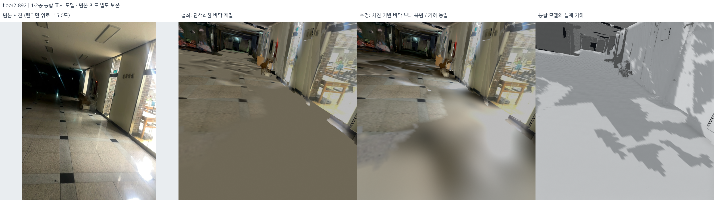
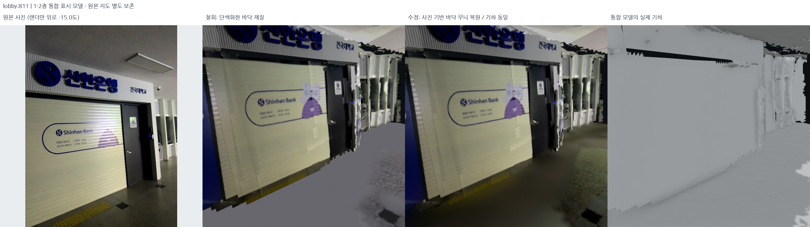
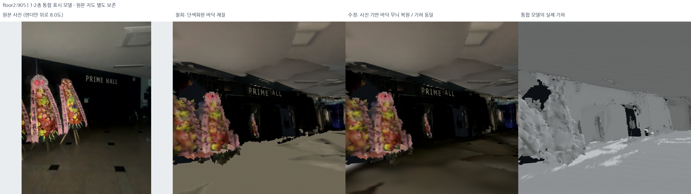

# 바닥 단색화 철회·사진 재질 복원 — 2026-10-18

## 바닥 무늬 손실과 수정

평평한 바닥 기하와 단색 바닥 재질은 별개다. 앞 단계는 사진이 부족한 부분을 원본
돌 색 중앙값으로 바꾸고 저주파 색 차이를 제거했다. 이 과정에서 실제 타일의 색,
장식 무늬, 넓은 색 변화까지 사라졌다. **타일 무늬 손실이 커 해당 재질 보정을
철회했다.** 천장·바닥 파편을 정리한 기하까지 철회하지는 않았다.

현재 기본 표시본: `outputs/student_union_photo_floors_v6/`.
단색 처리 직전의 사진 기반 바닥 atlas 5개를 **PNG 바이트/해시까지 동일하게**
복원했다. 새 색 평균화·탈색·대비 제거·무늬 생성은 하지 않는다.

- 로비 1F, 2층 세션이 본 1F/2F, 서브 계단 세션의 1F/2F 바닥 재질을 복원했다.
- 235.08m² 연속 천장, 작은 내부 구멍 보완, 기존 바닥 파편 제거는 그대로다.
- 실제 다섯 세션 PLY를 직전 v5와 비교해 **파일 바이트가 모두 동일**함을 확인했다.
- 문·창·벽·간판 재질, 유지한 위치·법선·UV·삼각형과 원본 지도·포즈도 그대로다.

## 전후 비교

왼쪽부터 원본 사진 / 철회한 v5 단색화 재질 / 사진 재질을 복원한 v6 / 동일 기하다.
같은 카메라로 렌더했다. 그림에 표시한 시선 변경은 3D에만 적용했고 원본 사진은
변조하지 않았다. 실측 정확도나 새 포즈 최적화의 비교가 아니다.







[2층 #720 — 기존 질감 결손이 남는 구역](../assets/photo-floor-restoration-20261018/floor2_720_presentation.png)
· [로비 #516](../assets/photo-floor-restoration-20261018/lobby_516_presentation.png).

## 정확히 무엇을 했는가

`src/restore_photo_floor_materials.py`와 `config/floor_photo_preservation.json`에 고정했다.
연속 천장·바닥의 geometry v1을 읽고, 색 평균화 전 `student_union_topology_fixed_v2`의
실제 원래 floor PNG 해시와 일치하는 바닥 재질만 연결한다. 새 출력 PNG는 원래
PNG의 정확한 복사다. 기존 GLB 이미지·accessor·재질을 보존하고 새 바닥 참조를
추가한다. 마지막 binary chunk의 4바이트 정렬도 검사한다. 새 표면 생성·최적화·
생성형 이미지·타일 패턴 합성은 없다.

재질 검사는 atlas source/new 해시가 모두 같고 실제 GLB의 바닥 재질이 그 이미지를
가리키는지 확인한다. 이전 PNG가 파일 안에 남아 있다는 사실만으로 복원을 주장하지 않는다.
전체 구현 검사 **487개 통과**. 5개 원본 DB/선택 지도와 모든 기하 보존 검사도 통과했다.

## 남은 한계 — 이번 수정이 해결하지 않은 것

**단색 처리 전의 사진 기반 atlas를 복원한 것이지, 촬영하지 못한 모든 타일을 새로
복원한 것은 아니다.** 기존 atlas에는 사진이 없는 곳의 흐린 점군 색 보완과 일부
조명 seam이 남는다. 특히 #720 바닥은 관측 부족으로 여전히 무늬가 부족하다.
단색화하지 않고 결손 상태를 유지한다. 원본 타일 전체를 복원했다고 부르지 않는다.
추가 개선은 원본 RGB-D 재투영의 유효 사진 범위를 늘리고 사진 간 노출만 제한적으로
맞춰야 하며, 이를 바닥 전체의 한 가지 재질/색으로 대체해서는 안 된다.

## 로컬 확인·재현

```bash
export PYTHONPATH="$PWD/outputs/surface_runtime/packages:$PWD/src"
export OPENBLAS_NUM_THREADS=1 OMP_NUM_THREADS=2
/usr/bin/python3 -s src/restore_photo_floor_materials.py --output outputs/photo_floors_repro
bash scripts/view_local_roadview.sh --start-view floor2floor \
  --evidence outputs/student_union_photo_floors_native_v6
```

기본 **Continuous ceilings + photographic floors**. **REJECTED: uniform floor materials**가
철회한 직전 v5다. 회색 기하 모드에서도 비교할 수 있다. 실제 로컬 창에 다섯 세션을
로딩하고 2층 바닥 #892, 시선 −15°로 시작했다. 브라우저 업로드는 없다.

- [기하·원본 보존 검사](../assets/photo-floor-restoration-20261018/geometry_audit.json)
- [실제 바닥 이미지 참조·PNG 동일성 검사](../assets/photo-floor-restoration-20261018/material_audit.json)
- [실제 로컬 5세션 로딩 검사](../assets/photo-floor-restoration-20261018/delivery_audit.json)
- [비교 사진·카메라·입력 해시](../assets/photo-floor-restoration-20261018/render_manifest.json)

현재 표시 manifest SHA256:
`d1ea10396eba7d961d295e6b0962f8fc8e9fa16a3ae552582ccbbddeb52abf33`.
