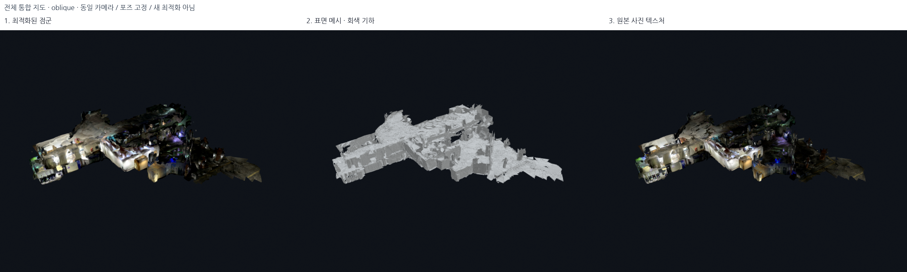

# 점군 → 표면 시각화 자료 보관

현재 로컬 RViz/Open3D에서 확인하는 지도와 같은 선택 데이터로 **점군 → 회색 표면
메시 → 원본 사진 텍스처 표면**을 나란히 저장했다. 새 웹 화면을 만든 것이 아니라,
기존 지도 파일을 같은 카메라로 렌더링해 남기는 정적 비교 자료다.

## 바로 보기



- [전체 통합 지도 3D 비교](../assets/pointcloud-to-surface-20261018/all/oblique_progression.png)
- [전체 지도 위에서 본 비교](../assets/pointcloud-to-surface-20261018/all/top_progression.png)

| 기록 | 전체 형상 3D 비교 | 촬영 시점에서 본 확대 비교 |
|---|---|---|
| 외부 | [3단계](../assets/pointcloud-to-surface-20261018/outside/oblique_progression.png) | [263번 시점](../assets/pointcloud-to-surface-20261018/outside/source_progression.png) |
| 1층 로비 | [3단계](../assets/pointcloud-to-surface-20261018/lobby/oblique_progression.png) | [39번 시점](../assets/pointcloud-to-surface-20261018/lobby/source_progression.png) |
| 외부–로비 브리지 | [3단계](../assets/pointcloud-to-surface-20261018/bridge_out1f/oblique_progression.png) | [80번 시점](../assets/pointcloud-to-surface-20261018/bridge_out1f/source_progression.png) |
| 2층·메인 계단 | [3단계](../assets/pointcloud-to-surface-20261018/floor2/oblique_progression.png) | [1055번 시점](../assets/pointcloud-to-surface-20261018/floor2/source_progression.png) |
| 서브 계단 | [3단계](../assets/pointcloud-to-surface-20261018/bridge_12_sub/oblique_progression.png) | [159번 시점](../assets/pointcloud-to-surface-20261018/bridge_12_sub/source_progression.png) |

계단 주변도 별도로 남겼다.

- [메인 계단 1078번 시점](../assets/pointcloud-to-surface-20261018/floor2/stairs_progression.png)
- [서브 계단 주변 108번 시점](../assets/pointcloud-to-surface-20261018/bridge_12_sub/stairs_progression.png)

전체 지도는 단계별 단독 PNG도 저장했다.

- 3D: [점군](../assets/pointcloud-to-surface-20261018/all/oblique_pointcloud.png) /
  [회색 표면](../assets/pointcloud-to-surface-20261018/all/oblique_surface.png) /
  [텍스처 표면](../assets/pointcloud-to-surface-20261018/all/oblique_textured.png)
- 위에서 보기: [점군](../assets/pointcloud-to-surface-20261018/all/top_pointcloud.png) /
  [회색 표면](../assets/pointcloud-to-surface-20261018/all/top_surface.png) /
  [텍스처 표면](../assets/pointcloud-to-surface-20261018/all/top_textured.png)

## 무엇을 비교하는 사진인가

1. **점군:** 이미 선택한 외부 J01/로비 N05/외부 브리지 H03/2층 J04/서브 계단 H03의
   최적화 점군이다. 앱 원본 raw와 새 최적화의 비교는 아니다. 전체 지도 사진은
   RViz의 통합 점군과 같은 `combined.ply`를 사용한다.
2. **표면:** 기존 전체 5cm TSDF를 바탕으로 면적 0.005m² 미만의 독립 성분만
   제외한 현재 형상 보존 표시다. retained face의 정점을 움직이지 않았고
   면 수 단순화·평활화·구멍 메우기·Poisson을 추가하지 않았다.
3. **텍스처 표면:** 두 번째와 같은 남긴 삼각형에 깊이 검사 후 원본 RGB 사진을
   입혔다. 글자를 새로 생성하거나 카메라를 옮겨 정합을 꾸미지 않았다.

2/3단계 사이에는 같은 표면을 쓴다. 다만 1단계 점군을 2단계의 삼각형과 일대일로
동일시하면 안 된다. TSDF는 이미 선택한 고정 RGB-D 포즈를 융합한 표현이며,
점군과 표면의 차이는 새로운 포즈 최적화의 개선량이 아니다.

각 비교판 안에서는 카메라/투영/렌더 해상도를 고정했다. 전체 보기의 시점은
선택 지도 bounds로 한 번 계산해 모든 단계에 동일 적용했다. 촬영 시점 사진은
원래 camera pose와 초점 비율을 유지하며, 900×720 화면에 맞춰 가로 시야를 넓힌
가상 viewport를 사용한다. 원본 RGB를 비등방 축소해 형태를 늘린 것이 아니다.

점군과 텍스처는 unlit sRGB 표시, 회색 기하는 동일 회색과 조명으로 구조를
읽기 쉽게 했다. **재질/조명 차이를 정확도 개선으로 해석하지 않는다.**
촬영 시점은 원본 텍스처를 제공했을 수 있으므로 독립적인 검증 사진도 아니다.
기존 구멍·노이즈·정합 문제를 지우거나 감추지 않았다.

## 파일과 재현 기록

저장 폴더는 `docs/assets/pointcloud-to-surface-20261018/`다.
3단계 비교판 **14장**과 전체 지도 단계별 단독 사진 **6장**, 총 **20장**이다.
각 단독 렌더는 900×720, 비교판은 2700×810 PNG이며 패널 픽셀을 재축소하지 않는다.

[manifest.json](../assets/pointcloud-to-surface-20261018/manifest.json)에 다음을 남겼다.

- 모든 PNG의 SHA-256, 세션/시점/단계.
- 전체/촬영 시점의 카메라 행렬·intrinsic·화면 크기.
- 원본 DB·선택 포즈·점군·표면 파일·현재 선택 파일·렌더 코드의 입력 해시.
- 기록별 선택 후보·점 수·면 수와 입력 불변 검사.

현재 지도와 표시 선택은 변경하지 않았다. 열린 로컬 시각화 창에도 손대지 않았다.
실제 데이터 렌더링이지만 **RViz/Open3D 창 테두리까지 캡처한 스크린샷은 아니다.**
초기 2-renderer 시도는 PNG 저장 후 Filament 리소스 종료 오류가 있어
`outputs/pointcloud_to_surface_render_attempt1/`에 보존했고, 단일 renderer로 고친
최종 실행은 별도로 재생성했다. 원본 파일을 삭제하지 않았다.

재현하려면 새 출력 경로를 쓴다. 기존 사진에는 덮어쓰지 않는다.

```bash
PYTHONPATH=outputs/surface_runtime/packages OMP_NUM_THREADS=2 OPENBLAS_NUM_THREADS=1 \
  EGL_PLATFORM=surfaceless /usr/bin/python3 -s src/save_pointcloud_surface_progression.py \
  --assets docs/assets/pointcloud-to-surface-next
```

현재 환경의 Open3D 0.19.0과 NanumGothic 글꼴을 사용했다. 모델을 새로 생성하거나
최적화할 필요는 없다. 전체 테스트 **387 passed**.
