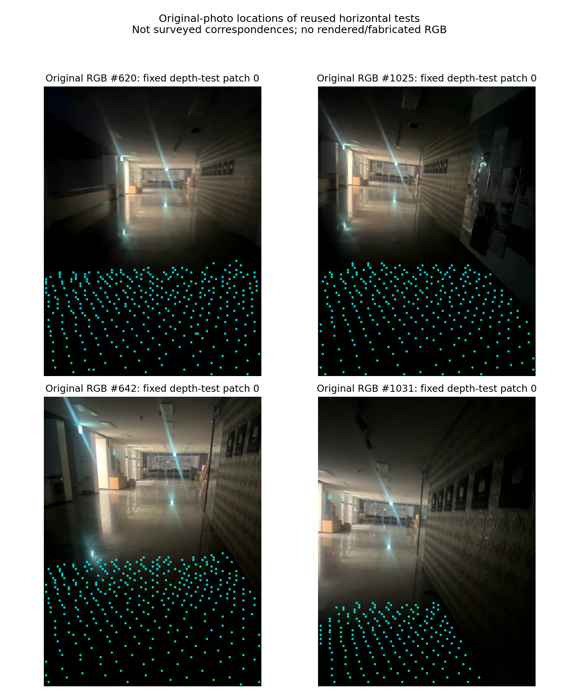

# 선택 포즈의 Z 변형 진단 — 2026-10-18

## 결론과 범위

**최적화 도중 구역별 Z가 다르게 변했는지**를 조사했다. 선택 J04에 이전 H00와 다른 내부 Z 변형이 있고, 일부 재방문 수평 패치도
더 벌어진다. 따라서 지금 문제를 미촬영/표면화 결손만으로 설명했던 것은 불충분하다.

다만 **H00가 측량 정답인 것은 아니다.** 최적화로 높이를 바꾸는 것 자체는 정상적인
보정일 수도 있다. 이 진단은 후보 사이의 실제 변화와 조건부 관측 불일치를 구분하며,
화장실 사진의 전체 간격이 전부 그 변화 때문이라고 단정하지 않는다.
사진으로 보완한 벽은 포즈 오류의 교정이 아니다. 추가 광역 채움은 멈췄다.

이번 진단은 DB·포즈·현재 표시 파일을 변경하지 않았다. 선택 지도 manifest SHA:
`98cf1d77aa5ca3c82f9653ffcb4ee86d6f40ac4d8953f1c1171b0dfa307090b1`.

## 입력과 공정한 대조

- DB: `data/raw/rtabmap/261017-013501-2f.db`, 읽기 전용 연결.
- 후보: `outputs/student_union_20261017_session_portfolios_v1/floor2/poses/`의
  O00(폰 앱), H00(이전 RViz), J04(현재 선택), F03, N06.
- 공통 포즈 **925개**만 비교한다. raw Node 포즈 1,215개와 직접 전체 통계를 섞지 않는다.
- 현재 통합 지도에 들어간 floor2 trajectory가 **J04와 실제로 같은 행렬**인지 검사했다.
  현재 floor2의 배치는 identity다. 세션 배치에서 2층 내부를 새로 휘거나 Z 스케일링한 것은 아니다.
- 유한 수평 패치 **20쌍**은 기존 원본 카메라 좌표에서 한 번 재현한 동일 점/평면이다.
  후보별로 쉽게 맞는 새 평면을 다시 피팅하지 않는다. 후보 5개에서 총 100행을 계산했다.
- 503번은 공통 925개에 없다. 과거 503↔961 수치를 이 공통 지지 집합에 억지로 추가하지 않았다.

재현 코드: `src/audit_selected_vertical_deformation.py`.
[입력 해시·전체 결과](../assets/vertical-deformation-20261018-v2/summary.json),
[프레임별 변화](../assets/vertical-deformation-20261018-v2/per_pose_changes.csv).

## 강체 배치와 내부 변형을 분리한 방법

1. 각 후보의 첫 공통 프레임을 H00의 같은 프레임에 SE(3)로 맞춘다. 단순 좌표계
   원점/방향 차이를 없앤 뒤 카메라 Z와 보정의 map X/Y 회전 성분·up 기울기를 기록한다.
   map X/Y 회전벡터 성분은 폰의 원래 roll/pitch 값과 다르다.
2. 각 프레임 쌍에서는 `H_a · inverse(C_a) · C_b`와 `H_b`를 비교한다.
   공통 전역 회전·이동은 상쇄된다. 두 프레임이 같은 장소/높이에 있다는 가정은 하지 않는다.
3. 모든 공통 카메라 위치를 한 번의 최선 강체 정렬(Kabsch/SVD)로 다시 맞춘 뒤 남는
   위치 잔차를 구한다. 한 번의 전역 이동/기울기로는 없어지지 않는 변화인지 확인한다.
   이 값은 H00와의 **차이**이지 절대 정확도도 후보 품질 순위도 아니다.
4. 원본의 같은 유한 패치에 point-to-plane 대칭 절대 중앙값과 법선 차이를 재계산한다.
   수평 패치의 두 평면 잔차를 각 법선의 Z 성분으로 나눈 수직 방향 진단도 병기한다.
   실제 패치 법선이 약 6–7° 기울어 있어 XY 이동과 회전 영향도 섞인다. 순수 Z 오차라고
   읽거나 이것만으로 실제 바닥을 완전히 수평으로 바꾸면 안 된다.


## 실제 수치

### J04와 H00의 상대 포즈 차이

| 프레임 쌍 | 상대 Z 변화 | 상대 up 기울기 변화 | 해석 |
| --- | ---: | ---: | --- |
| 1↔1218 | −0.11cm | 0.319° | 촬영 처음/마지막. 같은 물리 위치/폰 높이라고 가정하지 않음 |
| 7↔1197 | −1.50cm | 0.338° | 낮은 층의 왕복 구간 진단 |
| 14↔1196 | −1.05cm | 0.349° | 낮은 층의 다른 왕복 구간 진단 |
| 282↔728 | **−21.67cm** | 0.194° | 화장실 상부를 보는 서로 다른 촬영 구간. 실측 높이 오차가 아님 |
| 620↔1025 | −17.11cm | 0.295° | 역사적 수평 패치 쌍 |
| 642↔1031 | −12.94cm | 0.301° | 역사적 수평 패치 쌍 |

J04↔H00의 프레임별 Z 보정 범위는 **56.45cm**, 최대 절대 보정은 **41.99cm**다.
최선 단일 강체 위치 정렬 후에도 Z 잔여 차이의 절대 P90 **17.99cm**, 범위 **46.18cm**가
남는다. 따라서 이 차이 전체를 현재 지도의 전역 원점/회전 문제로만 설명할 수 없다.
최대 up 기울기 변화는 첫 프레임 정렬 후 **1.166°**다.

시간상 첫/마지막 포즈와 공간상 양 끝 구역은 다르다. 촬영 시작과 끝이 가깝게 맞아도 중간 구간의 변형은 남을 수 있다.

### 같은 수평 패치의 불일치

| 역사적 수평 패치 | 앱 O00 | 이전 H00 | 선택 J04 | F03 | N06 |
| --- | ---: | ---: | ---: | ---: | ---: |
| 620↔1025 | 3.32cm | 0.98cm | **22.59cm** | 12.13cm | 5.57cm |
| 642↔1031 | 2.40cm | 2.86cm | **18.06cm** | 7.93cm | 2.72cm |

수직 방향으로 표현한 같은 잔차 중앙값은 J04 **22.74/18.19cm**다. 이 값은 실제 두 점이
같은 XY에 있다는 뜻이 아니다. 경사 법선·접선 위치 이동이 섞이므로 위의 법선 거리와 함께 본다.
예를 들어 642↔1031은 H00 대비 상대 Y도 약 **84.17cm** 변했다. Z만 단독으로 끼워 맞추는
방식은 원래의 SE(3) 관측을 보존하지 못한다.



사진상 같은 복도/바닥으로 보이는 관계지만, 역사적 링크로 선택되고 반복 평가한
조건부 대응이다. 새로운 독립 holdout이나 실측 정확도라고 보고하지 않는다.
화장실 상부 282/728 자체의 독립 높이 측정은 아직 확보한 것이 아니다.

## 현재 최적화 구조에서 가능한 이유

실제 J04 원천은 `outputs/student_union_20261017_geometry_review/graph_final/`의
`pgo6_planes`다. 구현은 `src/optimize_geometry_stage.py`다.
해당 `report.json`에서 확인한 당시 전체 그래프의 구성은 다음과 같다.

- 활성 상대 포즈 edge **2,939개**. 6자유도 보정으로 연속/루프/연결 관측을 함께 절충한다.
- 아래쪽 수평 패치의 법선 제약 **167개**. `normal_residual()`에는 translation이 없다.
  **법선이 수평/수직으로 맞아도 서로의 높이는 다를 수 있다.**
- 같은 유한 평면 제약 **2개**, 그중 수평 높이 관계는 **1개**다. 모든 구역의 높이를
  묶는 분산된 실측 앵커가 아니다. 평면 제약은 접선 방향 위치도 완전히 제한하지 않는다.
- 자세 prior 2°, 법선 sigma 3°, 평면 거리 sigma 8cm, Huber block loss.
  자세 prior는 선택 baseline 정규화이며 **새로 읽은 독립 IMU 측정은 0개**다.
- 전역 실측 층고/절대 바닥 높이 제약 **0개**. 카메라 높이 고정을 넣은 것도 아니다.
- solver 수렴·5° tilt guard 통과는 목적함수 계산의 종료/범위 검사다. 전체 지도의 높이
  정확도나 서로 충돌하는 관측의 진실성을 보장하지 않는다.

이 구조에서는 국소 벽/바닥을 당겨 맞춘 보정이 다른 구역에 분산되고, 중간 구간의 Z와
약한 기울기가 달라질 수 있다. **어떤 edge가 주원인인지 이번 진단만으로 확정하지 않았다.**
특정 제약 제거/복원 실험과 원본 대응 검증이 필요하다. 앱 포즈도 끝쪽에서 큰 다른 변화를
보이므로 단순 앱 원복 역시 자동 정답으로 채택하지 않는다.

## 다음 수정의 순서와 승인 기준

1. J04는 육안 선택 baseline으로 보관하고, 광역 천장/벽 채움으로 높이 차이를 감추지 않는다.
2. 낮은 층 출입구·화장실 상하부·2층 랜딩·복도 반대편의 실제 같은 구조를 원본 다중 프레임
   RGB-D로 검증한다. **층별 동일 바닥은 묶되 계단·경사·복층 개구부는 분리**한다.
3. 구역별 높이 잔차와 법선/자세 잔차를 함께 측정하고, 의심 루프/교차 제약을 하나씩
   빼고 복원해 영향을 분리한다. 실제 틀린 관측과 가중치 불균형을 구분한다.
4. 분산된 같은-평면 높이 관계와 원본 RGB-D 대응을 넣은 별도 포즈 후보를 만든다.
   중력/자세 정보의 실제 출처를 확인하고, 약한 축에는 보수적 불확실성을 준다.
   Huber만 켜면 해결된다고 가정하지 않는다. Z·roll·pitch를 함께 검증하고 계단 상승량을 보존한다.
5. 후보 포즈로 **RGB-D부터 점군·TSDF·사진 텍스처를 다시 생성**한다. 이미 만든 메시의
   Z만 부분 편집하거나 후보별 X/Y/Z를 섞지 않는다.
6. 학습에 쓰지 않은 장소 관계, 양쪽 랜딩 높이, 층별 벽/바닥 중복, 계단 상승·하강,
   복층 개구부를 따로 비교한 뒤 현재 지도를 교체한다. 같은 구성 조건으로 강제 일치한
   0cm는 독립 검증값으로 쓰지 않는다.

이번에는 이 재최적화/지도 교체까지 실행하지 않았다. 기존 기록으로 문제를 분리하는
진단과 국소 표시 보완까지만 수행했다.

## 재현·검사

```bash
PYTHONPATH=src OPENBLAS_NUM_THREADS=1 OMP_NUM_THREADS=2 \
  /usr/bin/python3 -s src/audit_selected_vertical_deformation.py \
  --output outputs/reproduce_vertical_deformation_v1

PYTHONPATH=src OPENBLAS_NUM_THREADS=1 /usr/bin/python3 -s -m pytest -q \
  tests/test_vertical_deformation_audit.py
```

기존 출력 폴더는 덮어쓰지 않는다. 전체 입력 SHA의 전후 일치를 검사했다.
합성 테스트 3개는 전역 기울기/원점 변경만 있는 경우 내부 변형으로 오인하지 않는지,
국소 Z 변형은 최선 강체 정렬 후에도 검출되는지, 상대 변화가 candidate gauge에 무관한지 확인한다.
