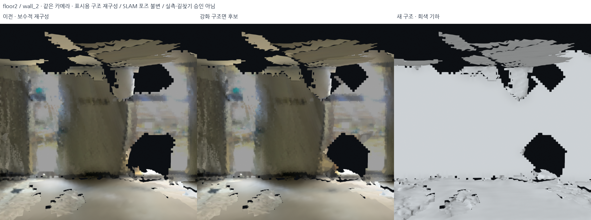
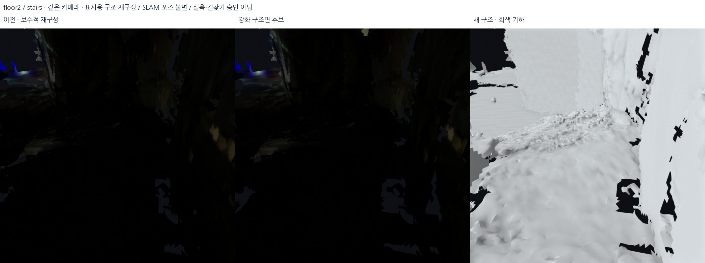
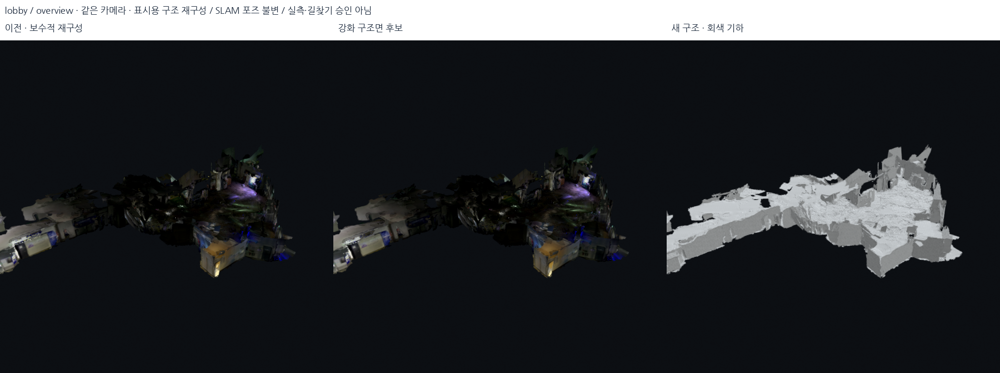

# 연속된 벽·바닥·천장에 더 강한 평면 prior — 2026-10-18

## 평면 prior와 적용 범위

연속된 큰 벽, 바닥과 천장은 관측별 표면 요철 대신 **같은 구조면이라는 사전정보**를 사용하는 후보로 모델링했다.
단, 실제 경사·곡면·다른 높이의 바닥·문/창/계단은 같은 제약으로 묶지 않는다.

이번 profile은 **실내 로비와 2층 기록**에만 강하게 적용한다. 외부는 기존 경사 보존
설정을 유지하고, 앞선 검증에서 악화한 외부 브리지·서브 계단은 기본 선택에서 기존
형상을 유지한다. 원본 DB·SLAM 포즈·수직 축척·선택 점군을 고치는 작업은 아니다.
추정된 새 면은 표시 기하이며 길찾기용 실측 사실로 승격하지 않는다.

큰 평면의 검출은 기존 [Open3D 유한 평면 패치](https://www.open3d.org/docs/release/tutorial/geometry/pointcloud.html#planar-patch-detection)를
계속 사용한다. 보정 강도와 경계 보호는 자체 구현한
`src/structural_prior_profiles.py`에 분리했다. 기존 임계값을 전부 낮추거나 전역
바닥 높이를 하나로 만드는 방식이 아니다.

## 무엇을 더 강하게 했는가

| 항목 | 기존 보수적 재구성 | strong-indoor 후보 |
|---|---:|---:|
| 좁은 결손 closing 반경 | 3셀(18cm) | 6셀(36cm) |
| 보완 후보 결손 면적 한도 | 0.24m² | 0.90m² |
| 기존 찢어진 면 교체 거리 | 평면에서 20cm | 강한 패치에 한해 32cm |
| 높이장 내부의 추가 평면 prior | 없음 | 95% 평면 인력, 경계에서는 taper |
| 측정 셀 높이 이동 한도 | 기본 평활화 ±6cm | 기본 ±6cm + 추가 ±18cm, 합계 최대 ±24cm |
| 큰 개구부/계단/경사 | 유지 목적의 검사 | 유지 목적의 검사를 계속 적용 |

이 수치는 cm 정확도가 아니라 **표시 모델을 얼마나 바꿀 수 있는지의 상한/설정**이다.
매번 해당만큼 이동한다는 뜻도 아니다. 실제 이동량은 실행 summary에 기록한다.

### 벽·기존 큰 수평 패치

이미 검출된 유한 패치 중 지지 점 ≥250, 관측 면적 ≥2.5m²,
원래 점의 평면 거리 P90 ≤15cm인 경우에만 더 큰 closing/교체 band를 사용한다.
벽을 새로 전역 축에 회전시키는 것이 아니라 기존에 채택한 국소 평면의 연속성을
강화한다. 큰 곡면이나 평면성이 나쁜 후보는 이 강화를 적용하지 않는다.

첫 강화 시험 `student_union_structural_strong_walls_v1`은 P90 8cm와 관측 면적
4m² 조건 때문에 2층에서 3개 패치에만 강화가 적용됐다. 큰 벽의 관측 산포를
충분히 포함하지 못한 결과라, 두 번째 후보는 위의 15cm/2.5m² 조건을 사용한다.
첫 소스는 해당 출력 폴더의 `source_snapshot.py`로 보관한다.

### 바닥·천장 내부

기존 단차 보호 마스크로 분리된 **연결 영역별로** 다음을 실행한다.

1. 면적 5m² 이상, 양쪽 공간 폭 0.5m 이상인 영역만 선택한다.
2. `z = ax + by + c`를 10회 강건 IRLS로 맞춘다. Huber 전환 잔차는 4cm다.
3. 피팅 P90 ≤12cm, 기울기 ≤8°일 때만 채택한다. 기울기 `a,b`를 0으로 강제하지
   않으므로 완만한 실제 경사는 보존할 수 있다. 큰 기울기는 이 추가 prior를 건너뛴다.
4. 내부는 맞춘 평면 쪽으로 최대 95% 이동하되 추가 이동량을 ±18cm로 제한한다.
5. 영역 경계에서 0.5m에 걸쳐 힘을 줄인다. 계단 랜딩이나 다른 높이와 갑자기 이어지는
   부분의 높이를 억지로 평면 중앙 높이에 맞추지 않는다.

강한 평면 prior의 잔차 감소는 이 모델이 더 평평해졌다는 뜻이다. **SLAM 위치 정확도가
독립적으로 좋아졌다는 지표로 사용하지 않는다.** 곡면을 평면으로 오분류할 가능성도
남으므로 원본 사진/이전 모델과 비교해야 한다.

## 개구부와 단차 보호

- 원래 점유 마스크의 닫힌 결손 중 면적 ≥0.20m², 짧은 변 ≥45cm,
  bounding rectangle 점유율 ≥60%인 것은 잠재적 문/창으로 간주해 보완에서 제외한다.
  이는 문/창 인식 모델이 아니라 보수적인 기하 휴리스틱이다.
- 기존 다중 RGB-D의 빈 공간 veto를 유지하고, 강화된 패치에서는 이 veto 영역을
  추가로 1셀 확장한다. 관측상 열린 부분을 더 큰 closing으로 막지 않으려는 장치다.
- 높이장 생성 전 12cm 초과의 일관된 단차를 검출하고 두 칸 확장해 보호한다.
  다른 높이 band는 겹치지 않게 병합/분리한다. 계단 전체를 하나의 평면으로 펴지 않는다.
- 보호 검사는 불완전하다. 깊이가 없는 유리나 관측되지 않은 좁은 문은 놓칠 수 있으며,
  실제 문·창·계단 통과 가능성은 별도 확인이 필요하다.

## 재현과 비교 자료

```bash
PYTHONPATH=outputs/surface_runtime/packages OMP_NUM_THREADS=2 OPENBLAS_NUM_THREADS=1 \
  /usr/bin/python3 -s src/rebuild_structural_display.py \
  --output outputs/NEW_strong_walls --profile strong-indoor
PYTHONPATH=outputs/surface_runtime/packages OMP_NUM_THREADS=2 OPENBLAS_NUM_THREADS=1 \
  /usr/bin/python3 -s src/refine_structural_heightfields.py \
  --source outputs/NEW_strong_walls --output outputs/NEW_strong_floors --profile strong-indoor
PYTHONPATH=outputs/surface_runtime/packages OMP_NUM_THREADS=2 OPENBLAS_NUM_THREADS=1 \
  /usr/bin/python3 -s src/clean_structural_fragments.py outputs/NEW_strong_floors
```

실행 결과: `outputs/student_union_structural_strong_walls_v2/`,
`outputs/student_union_structural_strong_floors_v1/`.
보수적 비교 기준은 `outputs/student_union_structural_floors_v4/`다.
기존 보수적 생성 코드는 각 이전 출력 폴더의 `source_snapshot_before_strong.py`에
별도로 보관했다. snapshot은 프로젝트 경로를 가정하므로 재실행할 때는 독립 프로젝트
복사본의 원래 `src/` 위치에서 사용해야 한다.

동일 카메라 비교 사진과 자세한 수치는
`docs/assets/strong-planar-review-20261018/manifest.json`에 남긴다.
평면 피팅의 잔차/채택 면적/실제 이동량은 각 기록 summary의 `plane_prior`에 기록한다.
기존 선택 지도 manifest와 원본 DB를 유지했다.

## 실제 적용 결과와 기본 표시 선택

| 기록 | 강화된 기존 패치 | 추가 높이장 평면 채택 | 측정 셀의 실제 최대 높이 이동 |
|---|---:|---:|---:|
| 2층·메인 계단 | 47 / 77개 | 11개 | 18.31cm |
| 로비 | 43 / 85개 | 13개 | 16.50cm |
| 외부·외부 브리지·서브 계단 | 강화 없음 | 강화 없음 | 이전 설정 유지 |

채택 영역별 평면 거리 중앙값들을 다시 중앙값으로 요약하면 2층은
**2.30→0.83cm**, 로비는 **2.33→0.69cm**다. 이는 추가 prior 적용 전후의
**자체 피팅 평면에 대한 평탄도**이고, 보수적 전체 메시와의 직접 정확도 비교나
독립적인 센서/포즈 정확도가 아니다. 2층의 한 후보는 P90 16.4cm로 기각됐다.
바닥 전체의 Z를 하나로 만들지는 않았다.

다음은 이전 보수적 재구성과 강화 후보를 **같은 센서 포즈·같은 공통 픽셀**로
비교한 메시 첫 교차 깊이와 센서 깊이 차이의 중앙값이다. 같은 촬영 데이터의 진단이며
별도 측량 검증이 아니다. 이전 실험 표와 공통 픽셀 집합이 달라 직접 혼합하지 않는다.

| 기록 / 확인 프레임 | 이전 보수적 | 강화 후보 | 3cm 초과 악화 픽셀 |
|---|---:|---:|---:|
| 2층 source #1055 | 14.15cm | 13.19cm | 1.2% |
| 2층 audit #1054 | 32.52cm | 31.21cm | 2.6% |
| 메인 계단 #1078 | 6.15cm | 6.13cm | 1.6% |
| 로비 source #39 | 7.35cm | 7.43cm | 1.0% |
| 로비 audit | 17.96cm | 17.68cm | 1.0% |

로비 source는 0.08cm 악화했고 일부 픽셀과 결손도 악화한다. 모든 영역이 개선됐다고
해석하지 않는다. 2층 source에서 새 교차 픽셀 55개에 비해 사라진 교차 픽셀은
499개여서, 중앙값 개선만으로 빈칸이 모두 줄었다고 말할 수도 없다.

큰 실내 평면을 더 정돈하려는 사용 목적과 위 진단에 따라 **로비·2층의 기본 표시를
강화 후보로 변경**했다. 외부 파일과 두 브리지의 재구성 파일은 이전 v4와 해시가
동일하다. 두 브리지는 재구성 자체의 이전 악화 때문에 이번에도 기본 표시에서
`balanced_only.glb`로 유지한다. 이전 보수적 모델과 그 선택 정책도 보관했다.

**보호 한계:** 문/창 직사각형 검사 코드는 합성 테스트를 통과했으나, 실제 두 기록의
희소 점유 마스크에서 보호 대상으로 검출한 직사각형은 **0개**였다. 따라서 문/창을
모두 인식·보호했다는 뜻이 아니다. 실제 관측의 빈 공간 veto는 2층 4.49m²,
로비 3.01m²에 적용됐지만, 미관측 개구부나 잘못 합쳐진 면은 여전히 검토해야 한다.
큰 빈칸, 일부 파편, 저해상도 색, 조도 흔적은 사진에서 계속 보인다.

## 저장된 시각 자료와 로컬 창

비교판의 왼쪽은 **이전 보수적 재구성**, 가운데는 **강화 구조면+색**, 오른쪽은
**강화 구조면의 회색 기하**다. 실제 초기 검토 사진의 카메라를 복원한 것은 아니며,
기록된 고정 카메라로 동일 시점 비교했다. 2층 7장·로비 6장, 총 13장이다.





- [13장 사진·카메라·세부 깊이 지표·해시](../assets/strong-planar-review-20261018/manifest.json)
- [5개 DB 보존·실제 GLB/PLY 형상·로컬 로딩 검증](../assets/strong-planar-review-20261018/delivery_audit.json)
- [실제 선택 모델의 로컬 장면 렌더](../assets/strong-planar-review-20261018/selected_overview.png)
- [현재 표시 버전](../../config/current_local_view.json) · [기록별 선택 정책](../../config/structural_display_policy.json)

`bash scripts/view_local_roadview.sh`는 웹이 아닌 로컬 3D 창을 연다.
기본 `Strong structure / bridges protected`에 다섯 기록을 불러온다.
`Previous conservative / bridges protected`로 직전 모델,
`Selected repair / neutral geometry`로 색 없는 구조를 비교할 수 있다.
`Save current problem view + camera`는 현재 문제 시점 저장 기능이다.
현재 모델은 관측을 보완한 표시 후보이지 최종 길찾기 기하가 아니다.

검증: 전체 **410 tests passed**. 이 테스트는 구현 동작 검사이며 실제 문/창 보존을
보증하지 않는다. 5개 최종 GLB의 삼각형 좌표는 PLY와 float32 기준 동일하고,
원본 DB·선택 지도 해시는 유지한다. 포즈 변경 0건, OSM/사진 업로드 0건이다.
