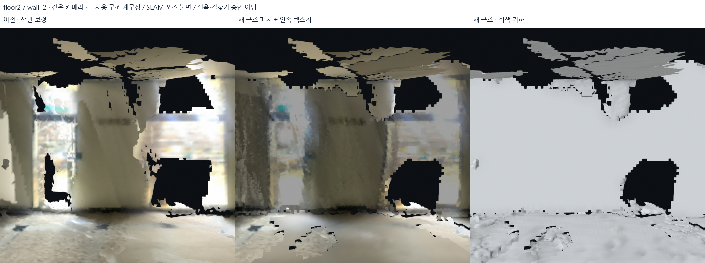

# 찢어진 벽·거친 바닥: 표시 기하 재구성 — 2026-10-18

## 무엇을 바꿨는가

2층·메인 계단의 긴 벽과 실내 바닥은 이전 노출 보정 뒤에도
찢김과 요철이 남았다. 색만 바꾸거나 작은 구멍에 몇 면을 추가하는 것으로는
충분하지 않았다. 이번에는 **큰 벽의 유한 평면 재구성 → 국소 높이장 → 작은
잔여 파편 정리**를 다섯 기록에 실행했다. 포즈 그래프를 다시 최적화한 것은 아니다.

새 기하는 관측과 평면/연속성 가정을 결합한 **표시 모델**이다. 원본 DB·선택 포즈·
선택 점군은 그대로이며, 출력은 별도 `outputs/` 아래에 있다. 새로운 면을 원본 센서
관측이나 길찾기 승인 기하로 취급하지 않는다. 모든 구멍·노출 차이를 해결하지는 못했다.

## 기본 표시와 기각한 구간

전체 재구성 시험본은 `outputs/student_union_structural_floors_v4/`다.
기본 로컬 창에는 아래 선택 정책을 적용한다. 사진 31장은 **전체 시험본** 비교이며,
기각한 두 기록의 사진도 실패 증거로 남긴다.

| 기록 | 기본 표시 | 선택 이유/남은 손해 |
|---|---|---|
| 외부 | 벽+국소 높이장 | source/audit 깊이 차이 중앙값 감소. 모든 픽셀이 좋아진 것은 아님 |
| 로비 | 벽+국소 높이장 | 구조 표시 후보. source 중앙값은 6.18→7.44cm로 소폭 악화, audit은 개선 |
| 2층·메인 계단 | 벽+국소 높이장 | source/audit 중앙값 크게 감소. 메인 계단 확인 시점 중앙값은 거의 동일 |
| 외부 브리지 | **기존 형상+색 보정 유지** | 재구성 audit 중앙값 5.22→10.95cm, 약 33% 공통 픽셀이 3cm 넘게 악화 |
| 서브 계단 | **기존 형상+색 보정 유지** | 재구성 stair 중앙값 3.44→7.03cm, 약 39% 공통 픽셀이 3cm 넘게 악화 |

정책: `config/structural_display_policy.json`. 이는 소수 동일 촬영분 시점의 진단과
육안 비교에 기반한 탐색적 표시 선택이며 측량/독립 정확도 검증은 아니다.
외부 브리지·서브 계단을 강제로 새 기하로 교체하지 않는다.

## 1. 유한 벽·큰 수평 패치 검출

구현: `src/rebuild_structural_display.py`.

선택 점군을 7.5cm voxel로 줄이고 반경 25cm/k40 이웃으로 법선을 추정한다.
Open3D의 강건 통계 기반 `detect_planar_patches`를 사용한다. 이 함수는 국소 검출,
성장/병합으로 유한 평면 OBB를 반환한다. 이번 API 사용의 근거는
[Open3D 평면 패치 문서](https://www.open3d.org/docs/release/tutorial/geometry/pointcloud.html#planar-patch-detection)다.
아래 격자·색 보정·교체·검증은 별도 자체 구현이지 해당 API가 자동 보장하는 기능이 아니다.

검출 설정: normal variance 35°, coplanarity 80°, outlier ratio 0.5,
최소 긴 변 0.8m, 최소 점 40, k40. 수직 벽 `|nz|<0.12` 또는 큰 수평 패치
`|nz|>0.985`만 선택한다. 전역 Manhattan 축이나 같은 Z 높이로 강제하지 않는다.
후보 OBB에서 법선 일치 >0.85인 근처 점을 모으고 3회 trimmed PCA로 다시 맞춘다.
좁은 계단 디딤판까지 하나의 바닥 평면으로 병합하지 않는다.

| 기록 | 최종 유한 패치 수 | 이 단계에서 교체한 기존 면 수 |
|---|---:|---:|
| 외부 | 18 | 331,201 |
| 로비 | 85 | 570,768 |
| 외부 브리지 | 4 | 129,816 |
| 2층·메인 계단 | 77 | 604,205 |
| 서브 계단 | 29 | 239,215 |

## 2. 벽의 찢어진 면을 교체

패치마다 6cm의 2D 점유 격자를 만든다. 반경 3칸의 국소 closing과 면적 0.24m²
이하의 작은 결손 보완을 사용한다. 큰 빈 영역과 열린 경계는 모두 채우지 않는다.
패치 최소 지지 면적 0.8m², 중복 평면은 법선/거리/기존 점유를 검사해 제한한다.

셀 중심을 기존 RGB-D 사진에 투영해 `10cm+2%×depth`로 지지/빈 공간 표를 만든다.
빈 공간 표 ≥3이고 지지보다 충분히 큰 셀은 제거한다. 이는 출입구를 보존하기 위한
부분적인 검사이며 **모든 문·창·계단 통로가 보존됐다는 증명은 아니다**.
기존 메시에서 새 마스크 안쪽, 평면 거리 20cm 이내의 면은 제거하고 새 격자로 바꾼다.
기존 찢어진 면 위에 새 면을 단순 중첩해 가림/중복을 늘리는 방식을 피했다.

## 3. 삼각형별 사진 대신 패치 단위 색 차트

벽마다 2cm 간격의 일관된 세계 좌표 색 차트를 만든다. 깊이/시선 조건을 통과한
원본 사진은 기존 gain과 함께 cosine⁴/distance²로 융합한다. 사진이 차트의 60%를
덮지 못하면, 그 몇 장을 패치 전체로 늘이지 않고 **전체 선택 점군의 융합 색**을
사용한다. 이 경우 차트의 texel 간격 2cm는 실제 광학 해상도 2cm를 뜻하지 않는다.

25cm 저주파 luminance 성분을 기준으로 0.7–1.4 gain 범위의 표시 정규화를 한다.
색 경계를 줄이지만 실제 그림자를 일부 바꾸고 작은 글자를 흐리게 만들 수 있다.
원본 사진 UV와 실제 사진 로드뷰는 별도 보존한다. 새로운 문패/글자를 생성하지 않는다.

첫 `student_union_structural_v1` 시험에서는 희소한 사진의 색을 멀리 전파해
늘어진 무늬가 생겼다. 이를 채택하지 않고 v2에서 위의 coverage 분기와 융합 색
fallback으로 수정했다. 최초 소스는 v1의 `source_snapshot.py`에 보관했다.

## 4. 바닥은 전역 평면이 아니라 국소 높이장

구현: `src/refine_structural_heightfields.py`.

1. 점군의 수평 법선 성분 `|nz|>0.7`에서 높이 histogram(6cm)을 만든다.
2. 강한 높이 mode만 찾고, 겹치는 ±0.5m band를 먼저 합친다. 같은 바닥을 서로
   다른 높이장 두 개로 겹쳐 생성하는 문제를 방지한다. 층을 모두 한 높이로 펴지 않는다.
3. XY 10cm 셀에서 지지 점 ≥2, 높이 P90–P10 <18cm인 셀의 중앙값을 사용한다.
4. 3×3 median guide로 고립 잡음을 줄인 다음, 높이 차 12cm를 넘는 경계를 찾아
   두 칸 확장해 **보정에서 보호**한다. 계단 모양이 사라진 뒤 차이를 검사하는 순서가 아니다.
5. 국소 Gaussian 정규화를 하되 측정 셀의 높이 이동은 ±6cm로 제한한다.
   작은 결손 ≤0.25m²만 제안하고 면적 ≥3m² 영역에 적용한다.
6. 네 모서리가 허용된 셀만 삼각형으로 연결한다. 보호된 단차를 가로지르지 않는다.
   같은 높이에서 20cm 이내인 기존 수평계 면만 교체하며 수직 계단 riser는 유지한다.
7. 높이장 색은 인접 측정 점 8개를 거리 가중 융합하고 bounded luminance 보정을 한다.

| 기록 | 높이장 XY 면적 합계 | 이 단계의 교체 면 수 |
|---|---:|---:|
| 외부 | 50.39m² | 47,646 |
| 로비 | 188.75m² | 194,668 |
| 외부 브리지 | 40.82m² | 25,170 |
| 2층·메인 계단 | 196.65m² | 227,584 |
| 서브 계단 | 24.28m² | 14,549 |

이 합계에는 검출된 바닥뿐 아니라 천장/큰 수평 구조가 포함된다. **2층 주 높이
band의 영역만 따로 보면 116.85m²**다. 모든 2층 바닥 면적이나 복원율로 부르지 않는다.
새 높이장의 Z span은 0이 아니며 외부 한 band에서는 약 1.24m다. 실제 경사/높이
변화를 유지하려는 방식이지만 실제 계단/단차의 측량 검증은 아직 필요하다.

버전 기록: floors_v1은 중단된 미완료 시도, v2는 좁은 band의 중복 가능성 확인,
v3은 band 병합, **v4는 median guide로 고립 높이 잡음과 실제 단차를 구분**한 후보다.
이전 실행 폴더를 삭제/덮어쓰지 않았다. v2/v3 실행 소스 snapshot도 해당 폴더에 남겼다.

## 5. 교체 뒤 남은 작은 파편 정리

`src/clean_structural_fragments.py`: 연결 성분 면적 0.02m² 미만을 표시에서 제거한다.
진짜 작은 고립 물체도 사라질 수 있어 원본을 유지한다. GLB는 이미지 atlas와
정점 좌표를 다시 굽지 않고 triangle index만 바꾼다. 기존 indexed/non-indexed
primitive 모두 처리한다. 최종 GLB와 PLY의 실제 삼각형 좌표가 float32 기준으로
동일한지 다섯 기록 모두 확인했다.

전체 재구성 시험본 최종 면 수는 3,158,075다. 기본 선택은 브리지 두 개를 기존
기하로 유지하므로 이 값과 다르다. 면 수 감소 자체를 정확도 개선으로 주장하지 않는다.

## 6. 같은 픽셀의 전후 검사와 악화 기록

첫 교차 깊이를 원래 RGB-D와 비교했다. before/after가 모두 닿는 **같은 픽셀**을
사용한다. 이는 표면 표시와 센서의 차이이지 측량 오차·포즈 그래프 정확도가 아니다.
같은 촬영분이므로 독립 검증도 아니다. 전후 픽셀 집합/새 hit/없어진 hit/분위수/
3cm 초과 악화 비율은 사진 manifest에 모두 남긴다.

| 기록/시점 | 기존 중앙값 | 전체 시험본 중앙값 | 기본 선택 |
|---|---:|---:|---|
| 2층 source #1055 | 47.90cm | 13.98cm | 재구성 후보 |
| 2층 audit #1054 | 55.21cm | 32.31cm | 재구성 후보, 악화 픽셀도 존재 |
| 2층 stairs #1078 | 5.99cm | 6.04cm | 거의 동일, 완전 보존 증명 아님 |
| 외부 source | 11.64cm | 9.61cm | 재구성 후보 |
| 로비 source | 6.18cm | 7.44cm | 구조 표시 후보, 국소 악화 기록 |
| 외부 브리지 audit | 5.22cm | 10.95cm | **기각, 이전 형상** |
| 서브 계단 stairs | 3.44cm | 7.03cm | **기각, 이전 형상** |

기존 J04의 특정 중복 벽 잔차 같은 포즈 제약 문제를 이 표면 재구성으로 해결했다고
보고하지 않는다. 선택 원본 지도 manifest SHA-256은 계속
`98cf1d77aa5ca3c82f9653ffcb4ee86d6f40ac4d8953f1c1171b0dfa307090b1`이다.

## 7. 시각 자료와 로컬 창

사진은 같은 카메라의 **기존 색 보정만 / 새 구조+색 / 새 회색 기하** 순서다.
보관 카메라에서 렌더링했으며 초기 검토 화면과 시점은 다르다.
관측되지 않은 큰 구멍과 일부 미세 요철, 사진 조도 흔적이 여전히 보인다.



- [2층 근거리 벽](../assets/structural-final-review-20261018/floor2/wall_4.png)
- [2층 source](../assets/structural-final-review-20261018/floor2/source.png)
- [2층 전체](../assets/structural-final-review-20261018/floor2/overview.png)
- [메인 계단 주변](../assets/structural-final-review-20261018/floor2/stairs.png)
- [외부](../assets/structural-final-review-20261018/outside/overview.png)
- [로비](../assets/structural-final-review-20261018/lobby/overview.png)
- [기각한 외부 브리지 시험](../assets/structural-final-review-20261018/bridge_out1f/overview.png)
- [기각한 서브 계단 시험](../assets/structural-final-review-20261018/bridge_12_sub/stairs.png)
- [31장 카메라·사진 해시·깊이 지표](../assets/structural-final-review-20261018/manifest.json)
- [DB/실제 GLB/PLY 좌표·출력 해시 검사](../assets/structural-final-review-20261018/delivery_audit.json)
- [실제로 로드된 기본 선택본 전체 3D](../assets/structural-final-review-20261018/selected_overview.png)
  — 네이티브 scene 렌더 콜백이며 전체 데스크톱 캡처는 아니다. 로드된 파일 목록도 위 검사에 있다.

```bash
bash scripts/view_local_roadview.sh
```

기본 `Selected repair / bridges protected`는 외부·로비·2층의 새 모델과 기존 브리지
기하를 함께 보여준다. `Selected repair / neutral geometry`는 조도 흔적과 기하를
분리해 보는 용도다. `ALL rebuilt trial / may distort stairs`는 기각한 브리지까지
포함한 비교 전용이다. 이전 UV/색 보정/점군/실제 사진 로드뷰도 유지한다.

정확한 다음 문제 시점을 재현하려면 창의 **Save current problem view + camera**를
누른다. 당시 실제 렌더 PNG와 카메라 model/projection/viewport/method를
`outputs/.../problem_views/`에 같이 저장한다. 화면만 보고 다른 시점을 비교하는
문제를 줄이기 위한 기능이다. 현재 기본 창은 전체 3D를 유지하며 웹으로 바꾸지 않는다.

## 8. 재현 순서·검증과 한계

```bash
PYTHONPATH=outputs/surface_runtime/packages OMP_NUM_THREADS=2 OPENBLAS_NUM_THREADS=1 \
  /usr/bin/python3 -s src/rebuild_structural_display.py --output outputs/NEW_walls
PYTHONPATH=outputs/surface_runtime/packages OMP_NUM_THREADS=2 OPENBLAS_NUM_THREADS=1 \
  /usr/bin/python3 -s src/refine_structural_heightfields.py --source outputs/NEW_walls --output outputs/NEW_floors
PYTHONPATH=outputs/surface_runtime/packages OMP_NUM_THREADS=2 OPENBLAS_NUM_THREADS=1 \
  /usr/bin/python3 -s src/clean_structural_fragments.py outputs/NEW_floors
PYTHONPATH=outputs/surface_runtime/packages OMP_NUM_THREADS=2 OPENBLAS_NUM_THREADS=1 \
  /usr/bin/python3 -s src/audit_structural_delivery.py --bundle outputs/NEW_floors --output outputs/NEW_floors/audit.json
```

실행은 기존 Open3D CPU 격리 패키지다. Conda/CUDA 환경은 변경하지 않았다.
**406 tests passed**: 단차 guard, 경사/절대 높이 보존, 고립 높이 잡음, band 중복
방지, 작은 구멍/출입구 마스크, indexed GLB 재필터링 등을 포함한다.
raw DB 5개 해시 불변과 GLB/PLY 삼각형 좌표 일치도 실제 출력에서 확인했다.
이는 관측 부족, 실제 문·계단 통과 가능성, 모든 노출 차이 또는 지도의 정확도를
해결했다는 뜻은 아니다. 미관측 큰 구멍·반사면·작은 글자 품질은 남은 과제다.
입력, 출력과 실패 중간본을 보관했다.
