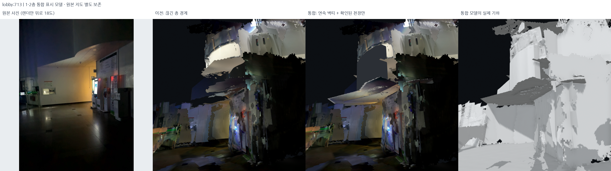
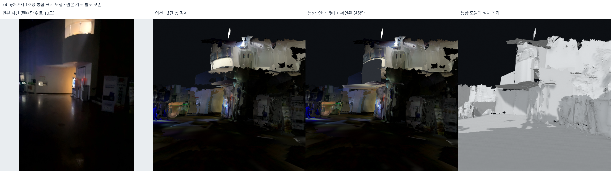
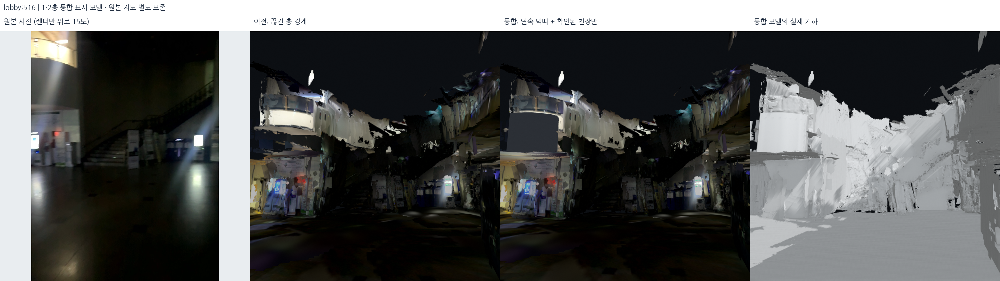
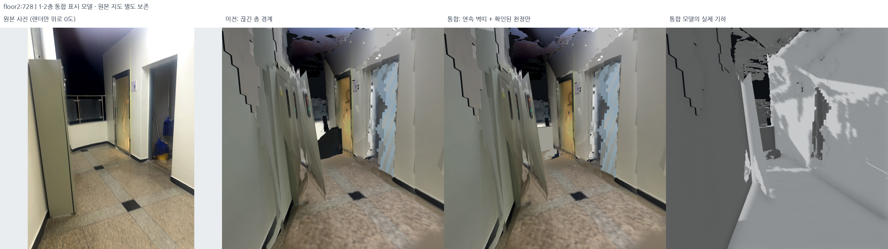

# 1·2층 보기용 통합 모델 — 2026-10-18

## 결과와 원본의 구분

**선택한 XY 배치를 유지한 하나의 건물 표시 모델**을 구성했다. 선택 지도/포즈는 교체하지 않고,
`outputs/student_union_unified_presentation_v4/`를 별도 표시 파생본으로 만들었다.
다섯 기록을 기존 로컬 Open3D 창에 함께 로딩했다.

- 기존 XY가 유지되는 면은 float32 기준 XY가 완전히 같다. 바닥·벽·계단의 **표시 Z는
  달라진다**. 원본 DB나 포즈의 Z를 다시 최적화한 결과는 아니다.
- 공통 표시 바닥은 1층 **−1.55m**, 2층 **+2.60m**다. 기존 바닥/랜딩 관측을 반올림한
  모델 기준이며 실제 측량 층고가 아니다. 임의로 손 높이 궤적을 평평하게 만들지 않았다.
- 화장실 앞 회청색 외벽띠와 안쪽 흰 벽을 하나의 닫힌 모델로 연결했다. 사진 속
  불투명 난간 상단까지만 만들고 그 위의 유리는 덮지 않았다.
- 천장은 실제 RGB-D/사진에 나온 한정 구역만 추가했다. 중앙 메인 계단 옆의 복층
  로비 핵심 개방 영역은 낮은 천장으로 막지 않는다.
- 큰 미관측 결손, 원래 남아 있던 파편과 일부 사진 경계까지 전부 해결한 것은 아니다.
  이 모델은 길찾기 충돌 기하나 측량 성과로 승격하지 않는다.





## 1. 공통 층 높이로 표시 Z만 정리

구현은 `src/presentation_geometry.py`, 설정은 `config/architectural_connections.json`이다.
이전의 국소 바닥 높이장 `main_floor_1f_anchors.npz`, `shared_upper_floor_anchors.npz`,
서브 계단 1층 높이장을 그대로 읽는다. 위치별 기존 하부/상부 높이를 `l(x,y), u(x,y)`라
하고 새 표시 층 높이를 `L,U`라 할 때:

```text
t = clip((z-l)/(u-l), 0, 1)
z_display = z + (1-t)*(L-l) + t*(U-u)
x_display = x, y_display = y
```

이 방식은 층 사이를 연속 변형하고 같은 XY 열에서 높이 순서를 유지한다. 계단을
지우거나 한 장의 바닥으로 대체하지 않는다. 다만 계단 단높이와 경사는 표시 모델에서
달라질 수 있으므로 이를 원본 계단 치수 보존이라고 부르지 않는다. 외부와 외부 브리지는
이 변형 대상에서 제외했다.

| 기록 | 유지한 꼭짓점의 최대 표시 Z 변화 |
| --- | ---: |
| 1층 로비 | 48.49cm |
| 2층/메인 계단 | 35.15cm |
| 서브 계단 | 49.27cm |
| 외부 / 외부 브리지 | 0 |

위 수치는 실제 포즈 오차 개선량이 아니라 **표시 기하의 변형량**이다. 공통 높이가
일치하는 것은 모델 구성의 결과이며 측량 정확도 검증이 아니다.

## 2. 원본 사진과 깊이로 천장 범위 선택

`src/probe_architectural_connections.py`로 원본 DB를 읽기 전용으로 열어 사진의
다각형과 depth를 확인했다. 실제 생성은 `src/build_unified_presentation.py`다.

1. 원래 카메라 보정/선택 포즈로 depth를 복원한다. 해당 구역 깊이 상한은 5.5m다.
2. 결정적 RANSAC 320회, 4cm 지지, 6cm 재선택 후 4회 SVD 정리로 국소 면을 찾는다.
3. 지지점 30개 이상, 전체의 55% 초과, P90 면 잔차 6cm 미만, 수평에서 20° 이내인
   관측만 표시 평면의 근거로 사용한다. 이 잔차는 관측 자체의 적합도다.
4. 원본 사진 광선과 면의 교점을 구하고 시선 깊이 0.251–7.95m로 유한하게 자른다.
   시선이 평면과 거의 나란한 모서리를 멀리까지 연장하지 않는다.
5. 실제 사진 다각형만 삼각분할한다. 바닥 footprint를 천장으로 무조건 상속하지 않는다.

v4에 넣은 구역은 로비 #713/#167의 같은 처마밑 면, 2층 화장실 #726,
서쪽 복도 #828이다. #642는 이웃 #620/639/643/644/656/1025/1031의 depth까지
검토했지만 지지 비율이 부족해 새 면을 만들지 않았다. 기존 관측 천장은 유지한다.

로비 두 사진은 4.5cm 래스터의 **단일 합집합 면/UV 차트**로 만든다. 노출 gain은
0.85–1.5, 사진 중첩의 추가 비율은 0.8–1.25로 제한한다. 원본 글자나 무늬를
생성형 이미지로 대체하지 않는다. 한 장을 우선 사용하고 추가 사진은 미커버 구역에
사용하므로 이 단계만으로 모든 밝기 경계가 사라진다고 주장하지 않는다.

## 3. 층 사이 벽띠와 난간의 앞·뒤를 구분

로비 #579에서는 같은 구조의 바깥쪽이 회청색이고, 2층 #282/#730에서는 안쪽이
흰색인 것을 확인했다. 기존 얇은 흰 면이 양면 렌더링되면서 바깥에서도 흰색이
비치는 문제가 있었다. 회청색 외피/흰 안쪽을 분리하고 위·아래·끝을 닫았다.

- #282/#730의 불투명 벽 depth에서 X 간격 3.5cm, 주변 8cm의 Y 97분위수와
  Gaussian sigma 1.5로 표시 외곽선을 정리한다. 바깥 스킨의 4cm 여유는 모델 가정이다.
- 뒷면 Y 간격 **28cm**는 미계측 표시 두께다. 벽체 두께를 실측했다고 주장하지 않는다.
- 하부 접합은 확인한 처마밑 면의 표시 높이 **1.48045m**다. 상부는 원래 불투명
  관측 상단 3.46713m를 같은 표시 변형에 따라 **3.39235–3.43910m**로 옮긴 경계다.
  2층 바닥에서 끊지 않고 유리 아래의 불투명 난간까지 연결한다.
- 기존 추정 2층 바닥이 이 외벽을 관통해 생긴 선반 모양의 면은 **191삼각형만**
  잘랐다. 이 작업은 추정 바닥 면 범위에 제한되며 원본 문·창·계단을 삭제하지 않는다.

## 4. 시험별 변화와 미채택 이유

| 시험 | 확인한 문제 / 다음 변경 |
| --- | --- |
| v1 | 바닥 가장자리에 잇는 경사 띠는 실제 벽이 아닌 램프처럼 보임. 천장 차트 중복도 남음 |
| v2 | 스침 각도의 천장 다각형이 8m 밖으로 뻗어 생성 중단. 유한 광선 다각형 클리핑 추가 |
| v3 | 앞/뒤 벽 색과 불투명 난간을 구분했지만 기존 2층 바닥 돌출이 새 벽을 가로지름 |
| v4 | 해당 추정 바닥만 잘라 연속 벽띠로 정리. 로컬 기본 통합 표시본으로 확인 |

v4의 배치를 유지한 상태에서 **신한은행 간판 누락과 층간 설비 틈, 천장 외곽 돌출**을 후속 수정 대상으로 정했다. 후속 표면 수정은 별도 `service_slabs` 파생본으로
기록하며, v4를 덮어쓰지 않는다.

## 5. 검증과 시각 자료

- 5개 기록 모두 실제 GLB와 PLY의 삼각형 좌표/순서가 일치한다.
- 유지한 원래 면은 선언한 Z 변형만 받았고 XY는 정확히 같다.
- 기존 GLB에 포함된 사진 바이트는 그대로다. 새 차트는 별도 추가다.
- 새 낮은 수평 면의 중심 중 복층 로비 핵심 개방 마스크 안에 들어간 수는 0개다.
  마스크 경계 60cm는 관측/분류 불확실 구역으로, 전체 로비를 현장 실측한 것은 아니다.
- 원본 DB 5개와 선택 지도 manifest 해시는 그대로다.
- v4 당시 전체 코드 검사 **472개 통과**. 구조/측량 정확도와는 별개다.

[기하 검사](../assets/unified-presentation-20261018/geometry_audit.json) ·
[실제 로컬 로딩/파일 해시 검사](../assets/unified-presentation-20261018/delivery_audit.json) ·
[사진별 카메라/원본 RGB 해시](../assets/unified-presentation-20261018/render_manifest.json).





모든 비교는 원본 사진 / 이전 실제 GLB / 이후 실제 GLB / 이후 실제 PLY이며,
같은 카메라를 사용했다. 원본 사진은 변조하지 않았다. 3D 시선을 올린 각도는 그림에
표시했다. 로컬 callback 사진은 데스크톱 전체 스크린샷이 아닌 실제 장면 렌더링이다.

## 재현

원본/이전 파생 자료가 필요하고 출력은 새로운 폴더여야 한다.

```bash
export PYTHONPATH="$PWD/outputs/surface_runtime/packages:$PWD/src"
export OPENBLAS_NUM_THREADS=1 OMP_NUM_THREADS=2
/usr/bin/python3 -s src/build_unified_presentation.py --output outputs/unified_reproduction
/usr/bin/python3 -s src/audit_unified_presentation.py --bundle outputs/unified_reproduction --output outputs/unified_reproduction/geometry_audit.json
/usr/bin/python3 -s src/render_unified_presentation.py --bundle outputs/unified_reproduction --assets outputs/unified_reproduction_review
bash scripts/view_local_roadview.sh --structural outputs/unified_reproduction --conservative outputs/student_union_verified_wall_delivery_v2 --start-view restroom
```

v4 manifest SHA-256:
`daa84193d7b7bd658e6ac12b3288d54fa7b341b538f40b97fd6a5c323cf311b9`.
선택 지도 SHA-256:
`98cf1d77aa5ca3c82f9653ffcb4ee86d6f40ac4d8953f1c1171b0dfa307090b1`.
