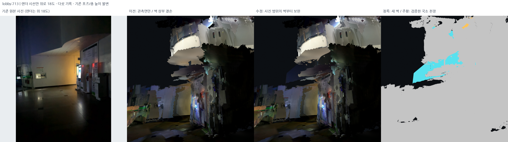
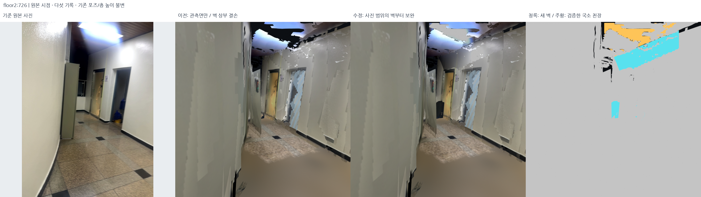

# 화장실 경계의 상부 벽 우선·국소 천장 접합 보완 — 2026-10-18

## 결과와 적용 범위

메인 계단 옆 화장실/복층 경계의 원본 RGB-D를 확인해 상부 벽 결손을 국소 보완했다.
**층간 정합 완료나 Z 드리프트 교정 결과가 아니다.** 후속 검토에서 제기된 포즈 높이
변형 가능성은 [별도 진단](2026-10-18-pose-z-deformation-audit.md)에서 실제 후보 차이와
수평 패치 악화를 확인했다. 이를 벽으로 가리며 광역 채움을 계속하지 않는다.

현재 표시본: `outputs/student_union_verified_wall_delivery_v2/`.
manifest SHA `80f0de13eae251a45fda918fb762c580890b5cc0c89852cae6abc0d1f107a2c3`.
기준 표시본은 `outputs/student_union_observed_ceilings_v1/`다.
기존 넓은 추정 천장은 다시 켜지 않았다.

| 국소 처리 | 추가 표시 면적 | 삼각형 | 근거/결정 |
| --- | ---: | ---: | --- |
| 로비 복층 경계의 곡면 띠 | 3.313m² | 1,329 | 원본 범위 프로파일을 따른 수직 곡면 |
| 같은 사진 왼쪽의 별도 평면 | 8.471m² | 954 | 원본 깊이 RANSAC+TLS, 사진 범위 안 확장 |
| 2층 화장실 상부 벽 | 1.834m² | 948 | 원본 벽 평면과 확인된 천장 교선까지 |
| 벽 상단과 만나는 국소 천장 | 0.970m² | 529 | 원본 천장 깊이 평면, 벽과 공유 교선 |
| 출입구 상부 벽 후보 | 0 | 0 | 기울어진/혼합 깊이, 적용 보류 |

벽 합계 **13.617m²**는 새 표시 모델 면적의 합이다. 고유 실측 면적이나 모든 면의
독립 깊이 관측 면적이 아니며, 사진 범위 내 모델 확장이 포함된다.
원본 벽 사진 2장에서 모순되는 **추가 바닥 72셀/144삼각형, 0.72m²만 철회**했다.
다른 기존 벽·계단·문·창·표지 좌표, 바닥 높이, 원본 DB 5개와 선택 포즈는 그대로다.



왼쪽은 원본 사진이다. 이 비교의 렌더만 시선을 위로 18° 올렸으며 제목에 명시했다.
사진이 가상 시점에서 새로 촬영된 것처럼 바꾸지 않았다. 나머지 패널은 같은 가상 카메라다.



## 원본 검토

- `src/inspect_restroom_gap.py`로 화장실 상하부/복층 벽 주변 원본 사진 접촉 시트를 만들었다.
  로비 713/167/303/579, 2층 282/280/726/728 등을 검토했다.
- `src/probe_upper_wall_support.py`로 사진 폴리곤의 원본 깊이와 법선/범위를 확인했다.
- 기존 전처리의 **최대 깊이 4m**에서 제외된 관측도 있었다. 로비 713의 곡면 띠
  폴리곤에서는 4m 726점, 5m 2,676점, 5.5m 3,188점이었다. 6m에서는 4,190점이지만
  6m 관측은 이번 보완에 쓰지 않았다. 즉 빈칸 전부가 실제 미촬영은 아니었다.
- 별도 왼쪽 평면은 4m에서 **0점**, 5.5m에서 491점이었다. 전역 깊이 제한을 풀지 않고
  이 검토 폴리곤만 5.5m로 다시 읽었다. 원본 DB를 고치지 않는다.
- 곡면 위쪽의 유리 난간/개구부를 막지 않도록 2층 282의 흰색 불투명 띠 아래 유리 경계를
  확인했다. 13개 깊이 샘플의 95백분위 Z **3.4671m**를 이 곡면의 불투명 상한으로만 썼다.
  전역 천장/층고가 아니다. 사진 의미 폴리곤은 수동 검토이며 자동 의미 인식 성능으로 주장하지 않는다.

## 알고리즘과 실제 파라미터

설정: `config/verified_upper_wall_completion.json`.
생성: `src/complete_verified_upper_walls.py`.

1. **곡면 유지**: 카메라 기준 방위각 1° bin의 깊이 범위 중앙값으로 `r(theta)`를 구하고
   PCHIP로 연결한다. 평면으로 눌러 곡선 발코니를 직선 벽으로 만들지 않는다.
   내부 미지원 각도 간격은 최대 4°, 끝단 외삽은 최대 2°로 제한한다.
2. 곡면 지원은 원래 4m 관측, 5.5m 범위의 confidence 100 관측 370점, confidence 50
   관측 중 다른 검토 뷰와 12cm 내 최근접 지원을 가진 109점 및 해당 사진 범위의 기존
   TSDF 수직 면 표본이다. 최종 프로파일은 2,537개 표본·25개 bin·26.69° 범위다.
   이 표본들은 중첩될 수 있으며 2,537개 독립 측정이라는 뜻이 아니다.
3. **별도 평면**: 결정론적 3D RANSAC 320회 후 trimmed TLS 4회.
   초기 3.5cm, 전체 재선별 5cm, 지지 비율 60% 이상·P90 6cm 이하·벽 방향 조건으로 검사한다.
   왼쪽 면은 491점 중 354점(72.1%), 피팅 P90 **3.44cm**다.
4. **상부 벽과 천장**: 2층 726 벽은 2,224점 중 2,181점, 피팅 P90 **0.878cm**.
   작은 천장은 746점, P90 **0.524cm**, 평면 중심 Z **5.5486m**다.
   이 피팅 수치는 같은 입력에 대한 평면성이지 독립 정합 정확도가 아니다.
5. 원본 벽-천장 경계 픽셀과 실제 평면에는 최대 약 8.6cm 차이가 있었다.
   측정 벽/천장 평면의 **교선**을 구해 사진에 재투영하고, 허용 15px 안에서 경계선만
   교선으로 맞췄다(기록된 검토점 최대 10.41px). 새 벽과 새 작은 천장은 그 교선을 공유한다.
   교선 잔차 약 1µm는 **구성상 일치**이며 센서 정확도 1µm라는 뜻이 아니다.
6. 사진 폴리곤 내부에 한정해 삼각형을 만들고, 현재 같은 세션 raycast에서 기존 표면이
   있거나 앞쪽 물체가 있는 부분은 추가하지 않는다. 결손/배경이 5.5cm 이상 뒤에 있는
   영역만 보완한다. 삼각형 최대 변 길이 55cm, 2mm 표시 오프셋을 기록한다.
7. DB의 원본 RGB에서 PNG를 잘라 텍스처로 쓴다. 보고서의 `source_rgb_sha256`는
   로드뷰 JPEG 검토본 해시이며, DB RGB 원본 자체의 해시라고 부르지 않는다. 원본 DB 해시와
   실제 출력 PNG 해시도 따로 남겼다. 새 사진이나 생성형 채움은 사용하지 않았다.

상부 출입구 후보(2층 722)는 수직 벽 후보의 최종 `abs(normal_z)=0.3098`로 조건을
벗어났다. 깊이의 혼합/기울기를 평평하게 강제로 바꾸지 않고 **적용을 보류**했다.

## 추가 바닥 돌출과의 모순 검사

`src/audit_restroom_floor_occlusion.py`가 로비 713/167의 수동 검토 불투명 벽 폴리곤에서
보완 벽으로 광선을 보낸다. 원본 사진에서 보이는 불투명 벽보다 추가 바닥 시트가 20cm
이상 앞에서 가리는 셀을 찾는다. 두 사진 모두에 모순되는 셀 72개만
`src/trim_verified_floor_occlusion.py`로 철회했다. 남은 바닥/기존 면은 이동하지 않았다.

이 판단은 **원본 RGB 2장 + 보완 벽 모델**에 조건부다. 독립 raw-depth-only 자유공간
실측 외곽과는 구분한다. 철회 후 같은 두 뷰에 동시에 걸리는 셀은
0개지만, 이는 그 셀을 제외한 구성 결과다. 한 뷰 충돌 광선은 여전히 490/13개다.
전체 돌출·모든 잘못된 정합이 없어졌다는 검증은 아니다.

## 남는 문제

- 전후 그림에도 큰 검은 빈칸·기존 TSDF 파편·일부 밝기 경계가 남는다.
- 단일 사진 모델 확장에는 가림/왜곡 위험이 있다. 유리 상한 제한과 사진 폴리곤이 모든
  의미 경계를 자동 증명하지 않는다. 특히 왼쪽 8.47m² 전체가 직접 측정된 것은 아니다.
- 기존 포즈를 그대로 썼으므로, 구역별 Z/기울기/교차 세션 오류는 그대로 포함된다.
  [높이 변형 진단](2026-10-18-pose-z-deformation-audit.md)을 먼저 해결한 새 포즈가
  나오면 현재 표시 면도 그 포즈로 원본부터 다시 만들어야 한다.
- 메인 계단 옆 복층 로비를 닫는 넓은 천장은 만들지 않았다. 현재 국소 천장 0.97m²를
  그 공간 전체에 복제/확장하면 안 된다. 외부/브리지/서브 계단은 이 단계에서 새 면을 추가하지 않았다.

## 실험 이력

| 실험 | 문제/변경 | 채택 |
| --- | --- | --- |
| upper walls v1 | 빈 폴리곤 boolean dtype 문제 | 실패, 회귀 테스트 추가 |
| v2 | 프로파일이 약 20°의 미지원 구간을 연결 | 기각 |
| v3 | 교차 지원 제한이 원래 4m 유효 관측까지 제외 | 기각 |
| v4 | 원래 관측+고신뢰도 지원 복구, 각도 제한 | 중간, 왼쪽 별도 면 부족 |
| v5 | 별도 왼쪽 면, 유리 경계, 작은 검증 접합 추가 | 면 생성 단계 채택 |
| delivery v1 | 바닥 셀 제외 후 flat-sheet 통계 미갱신 | 기각 |
| delivery v2 | 실제 면/마스크/면적 통계 일치 | 현재 국소 표시본 |

중간 출력은 `outputs/`에 보관했다. 최종 manifest가 실제 생성 코드·설정·전단계 입력의
SHA를 기록한다. 과거 실패 출력과 현재 소스는 별도 버전이다.

## 검증·로컬·재현

- [보존/폴리곤/방향/접합 검사](../assets/verified-upper-walls-20261018/geometry_audit.json):
  명시한 추가 바닥 144면 제외, 남은 기존 면의 좌표·순서 및 원본 벽/계단 좌표 불변.
  실제 GLB와 PLY 삼각형 좌표도 일치한다.
- [실제 파일·원본 DB/포즈·로컬 로딩 검사](../assets/verified-upper-walls-20261018/delivery_audit.json):
  DB 5개와 선택 포즈 불변, 웹이 아닌 로컬 창에 다섯 실제 GLB 로딩 확인.
  `selected_overview.png`는 native scene-render callback이지 데스크톱 전체 캡처는 아니다.
- [프레임별 전후 이미지/카메라/출처](../assets/verified-upper-walls-20261018/manifest.json),
  [철회 후 가림 진단](../assets/verified-upper-walls-20261018/floor_occlusion_after.json).
  로비 713(원시점/위18°)/167/579, 2층 726/728/282의 **7개 전후 그림**을 저장했다.
- 새 상부 벽 테스트 7개와 Z 진단 테스트 3개를 포함해 전체 **460개 통과(4.81초)**.
  처음에는 별도 Open3D 런타임 경로를 지정하지 않아 4건 import 실패/456건 통과였고,
  아래의 정확한 런타임으로 다시 실행해 전부 통과했다. 구성/파일 검사는 실측 정확도나
  길찾기 승인이 아니다.

```bash
PYTHONPATH=outputs/surface_runtime/packages:src OPENBLAS_NUM_THREADS=1 OMP_NUM_THREADS=2 \
  /usr/bin/python3 -s -m pytest -q
git diff --check
```

아래 생성 출력은 새 폴더로 재현한다. 기존 결과를 덮어쓰지 않는다.

```bash
export PYTHONPATH=outputs/surface_runtime/packages
export OMP_NUM_THREADS=2 OPENBLAS_NUM_THREADS=1
/usr/bin/python3 -s src/complete_verified_upper_walls.py \
  --output outputs/reproduce_verified_upper_walls_v1
/usr/bin/python3 -s src/audit_restroom_floor_occlusion.py \
  --bundle outputs/reproduce_verified_upper_walls_v1 \
  --output outputs/reproduce_verified_upper_walls_v1/floor_occlusion_audit.json
/usr/bin/python3 -s src/trim_verified_floor_occlusion.py \
  --bundle outputs/reproduce_verified_upper_walls_v1 \
  --audit outputs/reproduce_verified_upper_walls_v1/floor_occlusion_audit.json \
  --output outputs/reproduce_verified_wall_delivery_v1
/usr/bin/python3 -s src/audit_verified_upper_walls.py \
  --bundle outputs/reproduce_verified_wall_delivery_v1 \
  --output outputs/reproduce_verified_wall_delivery_v1/geometry_audit.json
```

기존 결과 열기: `bash scripts/view_local_roadview.sh --start-view restroom`.
**Verified upper walls + local joints**가 현재, **Previous observed-only surfaces**가 직전이다.
원본 포즈/층 높이를 고친 결과라는 표시를 하지 않는다. 현재 선택 manifest는 여전히
`student_union_selected_20261017_v1`이며 국소 표면 선택만 바뀌었다.
