# 바닥 밝기 경계·PRIME HALL·경계 마감 — 2026-10-18

## 판단 기준과 현재 선택

표면의 시각적 경계는 수치 점수 외에 실제 렌더로 확인했다. 실제 GLB를 같은 가상 카메라에서 렌더링한 800×800 원본과
네이티브 로컬 창을 직접 보았다. 원본 사진, 이전 표시본, 수정 표시본,
회색 기하를 함께 저장했다. 원본 사진 자체의 시점/밝기를 바꾼 것은 아니다.

v15를 재질 기준으로 선택하고 후속 처리는 톱니 모양 경계에 한정했다.
즉 **v15의 색감·재질은 유지**하고, 후속 처리는 면 외곽 톱니와 사진 조각 경계
둘 다에 한정한다. 이 선택은 건물 전체 완성이나 길찾기 정확도 승인이 아니다.

- 선택한 기준본: `outputs/student_union_joint_material_v15/`
- 전체 지도/포즈: 기존 선택본 불변. 표시 모델과 별도 보존.
- 실제 사진 로드뷰: 원본 RGB 그대로. 360도 파노라마 아님.
- 바닥은 **사진에서 유래한 보기용 재질**이다. 줄눈 띠·검은 돌 위치를 기존
  텍셀에서 가져오되 조명과 약한 관측부를 보완했다. 원본 바닥 색/배치를 완전히
  복원한 원본 영상이 아니며 보간 texel도 포함한다.

## 직접 본 결과: 실패한 후보도 남김

| 단계 | 적용 방법 | 실제 화면에서 본 판단 |
|---|---|---|
| v6 | 단색 처리를 철회하고 원래 사진 바닥 PNG 복원 | 무늬는 돌아왔지만 흰 반사 띠·검은 조명 얼룩이 심함 |
| v7 / v9 바닥 | 다중 RGB-D 재투영, 공유 높이 앵커, 노출 그래프, Potts ICM 사진 선택, 멀티밴드 | 일부 경계 수치가 좋아져도 큰 밝기 띠가 여전히 보임. 외관 해결로 인정하지 않음 |
| v9 간판 | 원본 floor2:781 전체 간판 평면 재구성 | PRIME HALL의 H와 나머지 글자가 함께 보임. 이후 단계에서도 보존 |
| v10 | 프레임별 바닥 평면, 동일 위치 다중 영상 조명 합의, 국소 gain | 타일 정보는 늘었지만 2층 오른쪽 흰 띠·로비 얼룩이 남음 |
| v11 | 스칼라 저주파 조명 분리 | 회색 띠/검은 섬이 남음 |
| v12 | 조명 색까지 분리 | 2층 띠는 줄지만 어두운 로비의 얼룩이 남음 |
| v13 | 저조도 강한 gain·노이즈 완화 | 로비에 빨강·노랑·초록 얼룩이 생김. 탈락 |
| v14 | 실제 돌 입자+유한 검은 장식점으로 재질화 | 밝기 얼룩은 줄지만 줄눈이 약해지고 너무 밋밋함. 탈락 |
| v15 | 관측된 국소 줄눈 띠 보존 + 대비 제한 + 실제 돌 입자 | 흰/검은 큰 띠가 줄고 무늬가 남음. 흐림과 국소 얼룩은 남지만 육안 검토에서 선택 |

사진 모자이크의 UV 방향과 실제 참조 재질도 픽셀 raycast로 확인했다.
`inspect_floor_pixel_materials.py`는 화면 픽셀이 맞은 삼각형의 재질·UV·PNG를 역추적한다.
이 시점들의 큰 바닥 얼룩은 잘못된 atlas나 V축 뒤집힘이 아니라 **RGB에 이미 담긴
반사광·그림자·노출 차이**였다. 이 진단을 건물 모든 픽셀로 일반화하지는 않는다.

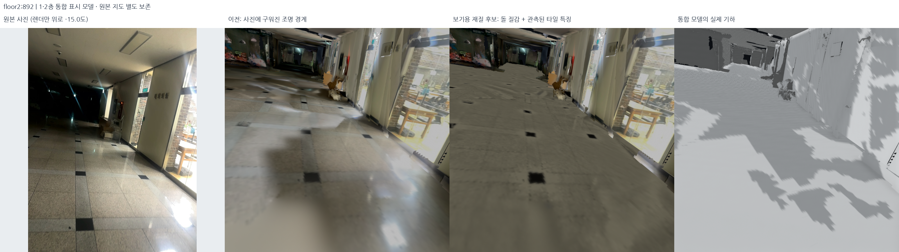

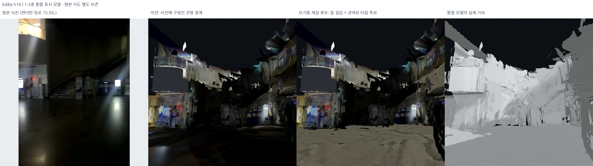

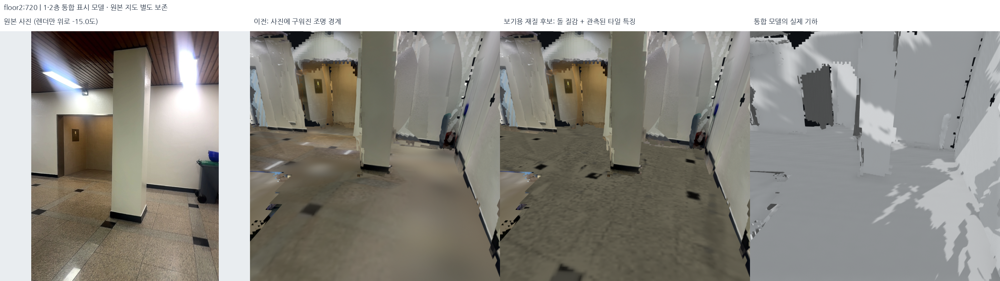

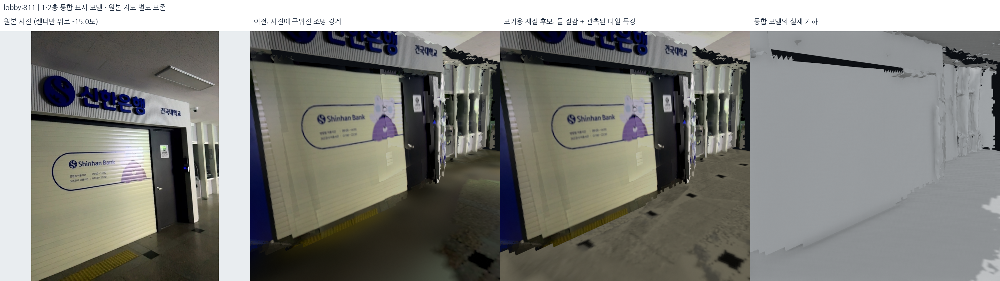

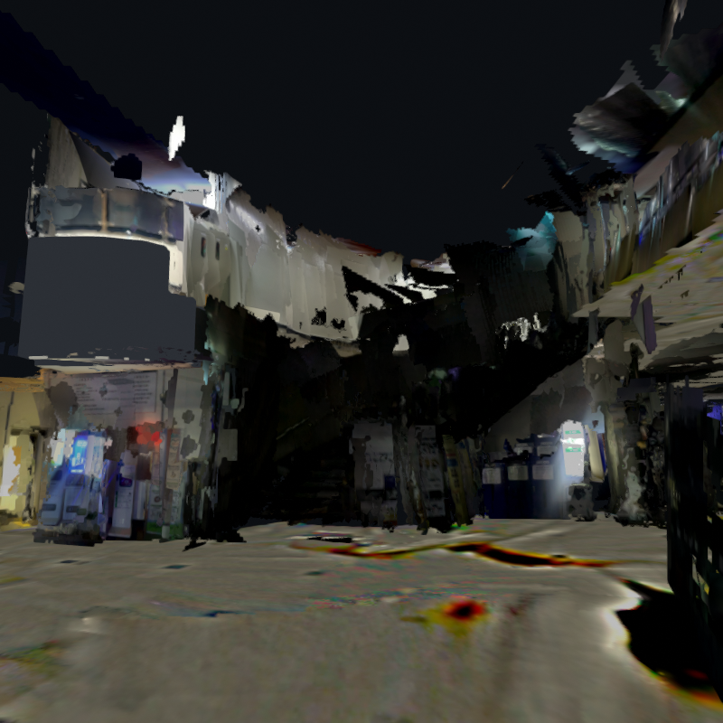

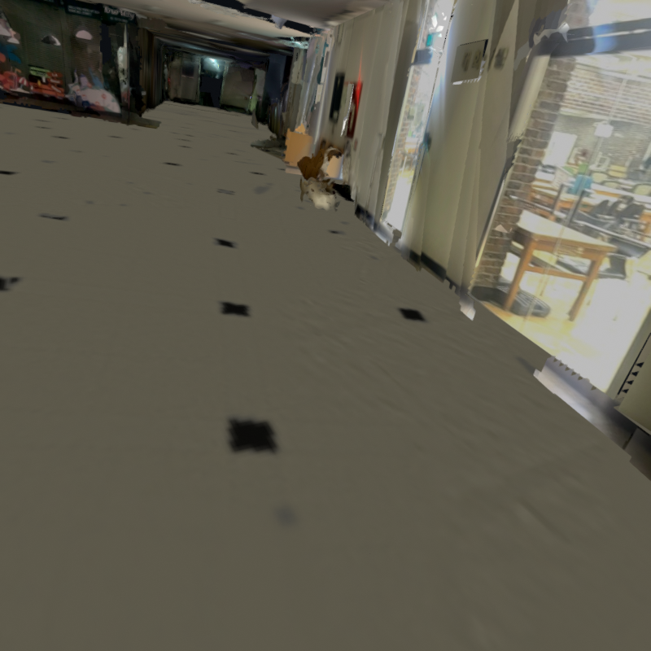

## 알고리즘·입력·설정

### 사진 경계와 조명

1. `blend_photographic_floors.py` + `photographic_surface_finish.json`
   - 기존 원본 높이 앵커에서 RGB-D 바닥 재투영. depth/바닥 높이 차이 25cm gate.
   - 세션·층당 최대 120프레임에서 공유 모자이크 사진 최대 48장 선택.
   - 선형 RGB, 강건한 스칼라 노출 그래프, gain 0.75–1.33.
   - Potts ICM 연속 사진 라벨, 4픽셀 feather, 5단 멀티밴드.
   - 유효 사진이 없는 곳은 기존 텍스처 유지. 점수 향상은 외관 합격이 아님.
2. `visually_coherent_floor_textures.py` + `visual_floor_illumination.json`
   - 프레임별 RANSAC/SVD 바닥 평면은 **텍스처 투영에만** 사용. 포즈/면 이동 없음.
   - 동일 세계 위치의 다중 영상 중앙값으로 국소 조명 field 추정.
   - 사진에서 검토한 floor2:720/892 바닥 다각형은 depth 결손의 외관 보완에만 사용.
     원본 depth 전경 가림 검사는 유지. 사진 밖 구조물·통로를 생성하지 않음.
3. `intrinsic_floor_material.py`의 v11–v15 파라미터 실험
   - 설정별로 원본 바닥 모자이크의 저주파 luminance/chromaticity 분리,
     저조도 gain, 돌 입자, 관측 무늬 보존을 비교. v13·v14는 위 이유로 탈락.
   - v15 설정: `joint_preserving_floor_material.json`.
     16cm 국소 log-luma 띠를 보존하고 대비를 0.65–1.25로 제한.
   - 20cm morphological closing과의 차이로 국소 어두운 선/유한 장식점 추출.
     큰 그림자 덩어리를 검은 타일로 승격하지 않는다. 긴 선과 붙은 장식점이 약해질
     가능성은 남아 있다. 반복 타일 격자나 새로운 장식 위치를 만들지는 않았다.
   - 돌 입자 원본: floor2:892의 `[30,770,170,900]` crop에서 영평균 고주파만 사용.
     약한 관측부의 입자 보완은 **추론한 외관**이며 직접 관측 타일 배열이 아니다.

### PRIME HALL

`rebuild_prime_hall.py` + `prime_hall_photo_finish.json`.
floor2:781의 원본 RGB에서 완전한 간판 띠를 가져왔다. 글자를 새로 쓰거나 AI로
합성하지 않았다. 같은 프레임 주변 depth의 offset histogram + SVD 평면 지지가
최종 채택되었다. 최종 간판 fit을 “RANSAC이 검증했다”고 부르지 않는다.

간판 다각형 `[[0,193],[719,277],[719,363],[0,314]]`, 검토 글자 ROI
`[[125,239],[490,273],[490,335],[125,302]]`를 사용했다. floor2의 해당 유한 수직면
조각만 대체했다. 바닥·천장·다른 세션의 면을 간판 때문에 제거하지 않았다.
원본 crop 픽셀 일치와 9개 글자 성분의 가시성을 검사했다. 성분 분석은 OCR이 아니다.

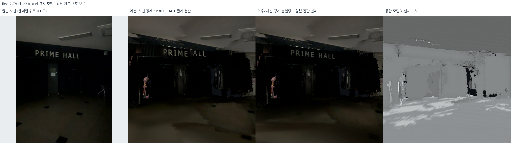

원본 crop·선정하지 않은 원본 시점 contact sheet도
`docs/assets/photo-finish-20261018/`에 남겼다.

## 보존·제한과 재현

- 선택 지도 manifest SHA-256:
  `98cf1d77aa5ca3c82f9653ffcb4ee86d6f40ac4d8953f1c1171b0dfa307090b1`.
- v15 manifest SHA-256:
  `e63da706e258ce150914e3cac12f38dd5c39dd4beef03b795bd872424404340f`.
- v10–v15 사이에는 실제 기하와 UV가 동일하며 바닥 재질만 달라진다.
  원본 DB 5개, 선택 포즈, 현재 지도 원본을 수정하지 않았다.
- 원본 사진의 픽셀·SLAM 포즈와 보기용 카메라를 구분한다. 렌더 카메라는 이미 사용하던
  표시 높이 보정과 명시한 pitch를 사용하며, 전후에는 같은 카메라를 쓴다.
- 기하/재질/로컬 파일 해시 검사는 **보존 계약** 확인이다. 외관 품질, 측량 정확도,
  모든 위치의 완성도를 보증하지 않는다. 이 단계 전체 구현 검사 498개 통과.
- v15 로컬 창의 실제 렌더도 저장했다. 전체 지도 외곽 결손·벽/천장 색 경계와
  부드러운 바닥 줄눈은 여전히 존재한다. 이후 경계 마감에서 색감은 다시 바꾸지 않는다.

```bash
PYTHONPATH=outputs/surface_runtime/packages:src OPENBLAS_NUM_THREADS=1 OMP_NUM_THREADS=2 \
  /usr/bin/python3 -s src/intrinsic_floor_material.py \
  --config config/joint_preserving_floor_material.json --output outputs/reproduced_v15

PYTHONPATH=outputs/surface_runtime/packages:src OPENBLAS_NUM_THREADS=1 OMP_NUM_THREADS=2 \
  /usr/bin/python3 -s src/render_unified_presentation.py \
  --bundle outputs/student_union_joint_material_v15 --assets outputs/reproduced_v15_review \
  --views floor2:892:-15,floor2:720:-15,lobby:811:-15,lobby:516:15,floor2:781:0

bash scripts/view_local_roadview.sh --start-view floor2floor
```

재현 출력 폴더는 새 이름이어야 한다. 각 생성 manifest에는 실제 입력·코드·사진
해시를 기록했다. 실패 후보를 성공본으로 덮어쓰지 않는다.

## 후속: 색감 유지·두 종류 경계만 마감 — 2026-10-19

후속 마감 대상은 면의 외곽 톱니와 사진 조각 및 색 경계 **두 가지**다. v15의 전체
재질·조명은 다시 조정하지 않았다. 후속 표시본은 `outputs/student_union_edge_finish_v18/`.
비교 메뉴 **Before edge finish: preferred v15**는 바로 그 선호 기준본을 읽는다.

### v16 탈락 → v17 수평면 전체 고정

`refine_display_edges.py`, `display_edge_finish.json`:

1. GLB 삼각형의 정확한 XYZ가 같은 UV/재질 중복 정점은 경계 판별용으로만 묶는다.
   모서리 출현 횟수가 1인 경계와 경계 이웃이 정확히 2개인 정점만 검사한다.
2. 인접 법선의 일관성이 0.95 이상인 거의 평면 부위, 짧은 양쪽 변(최대 30cm),
   극단적으로 퇴화하지 않은 각도에서만 이웃 중점 방향으로 제한 이동한다.
   실제 3D 모서리·내부 정점은 움직이지 않는다. 면 내부 방향 조건으로 작은
   볼록 가시를 잘라내며 큰 오목 결손을 새 면으로 덮지 않는다.
3. 4회, 이동 비율 0.35, 원래 위치에서 누적 최대 5cm. 뒤집힘/면적 급감이 생기는
   정점은 원래 좌표로 돌려놓는다. 새 삼각형·제거 삼각형은 모두 0이다.
4. 수동 의미 면의 AABB+8cm, 기존 사진 기반 계단 guard로 보호한다. 간판/문/창의
   원본 수동 매핑 사진 PNG는 경계 필터 대상에서 제외한다.

**v16은 탈락했다.** 실제 렌더링에서 바닥에 파란 작은 삼각형 틈이 생겼다.
서로 닿아 있지만 같은 tessellation을 공유하지 않는 수평 패치의 경계를 각자
당기면 접촉이 벌어질 수 있었다. 따라서 v17 이후에는 **수평 삼각형에 닿는 정점의
XYZ 전체를 고정**한다. 단지 바닥 높이 Z만 고정한 것이 아니다. v18 실제 출력에서
기존 수평면·XY 외곽이 모두 동일함을 확인했다.

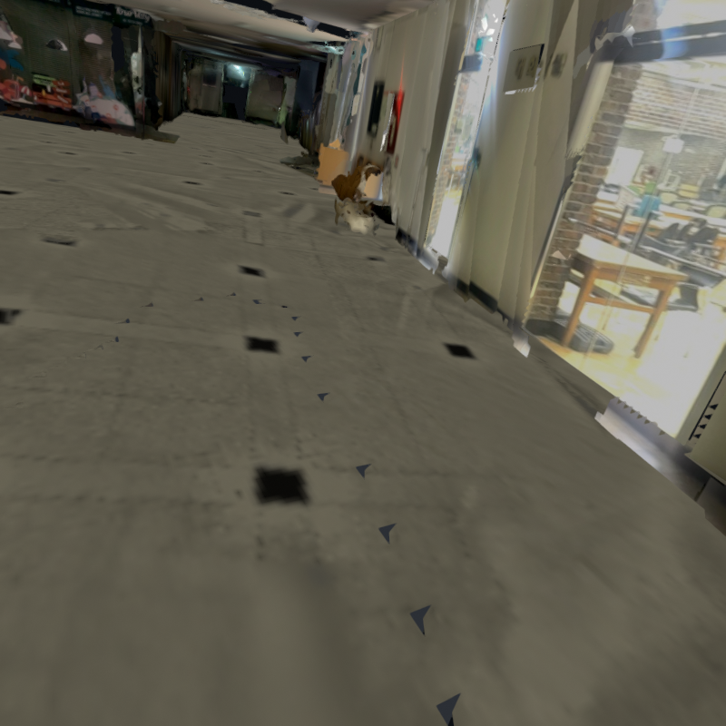

### 사진 경계의 두 단계 처리

- 일반 atlas: luminance gradient가 있는 좁은 띠만 0.75픽셀 Gaussian 결과와
  0.35 이하로 섞는다. 선형 색 차이와 sRGB 채널 차이를 각각 제한하며 채널 최대
  변화는 16/255다. 띠 밖은 원본 바이트 그대로, 전체 gain/화이트밸런스 변경 없음.
- 2층 천장: 기존 생성 단계의 **실제 사진 라벨 PNG**를 이용한다.
  `soften_display_photo_boundaries.py`, `photo_boundary_finish.json`에서 라벨 변경선의
  16cm 띠만 저주파 feather한다. 10cm 저주파와 원래의 1.2픽셀 고주파를 분리해
  작은 표면 무늬는 남긴다. 채널 변화 최대 24/255, 띠 밖 천장 픽셀은 그대로다.
  이는 새 천장 생성이나 사진 바깥 확장이 아니라 기존 atlas의 국소 마감이다.
- 로컬·증거 렌더 모두 FXAA와 MSAA 4샘플을 명시했다. 전후 같은 설정을 사용하므로
  안티앨리어싱을 켠 것만으로 기하 수정을 과장하지 않는다.

### 실제로 본 최종 결과와 남은 경계

6개 시점의 800×800 전후 원본과 네이티브 창을 직접 확인했다.

- floor2:892: 선택한 바닥 색/무늬 유지, v16의 새 삼각형 틈은 없음.
- floor2:720: 기둥 주변 작은 가시는 제한적으로 줄었지만 문 위 큰 미관측 윤곽은 남음.
- floor2:905: 천장 접합선이 조금 부드러워짐. 넓은 색 조각 윤곽 자체는 일부 보임.
  꽃 장식처럼 실제로 복잡한 물체를 평평하게 펴지는 않았다.
- floor2:781: PRIME HALL 글자와 H가 그대로 보임.
- lobby:516: 기존 복층 개방부 유지. 상단의 큰 관측 종료 경계를 직선 벽으로 발명하지 않음.
- lobby:811: 신한은행 간판과 바닥 전체 색감 유지.

**모든 경계가 매끈해졌다는 판정은 아니다.** 작은 톱니의 완화이며, 큰 결손과 일부
사진 조각 윤곽은 남아 있다. 수치와 함께 이 시각적 결손도 기록했다.

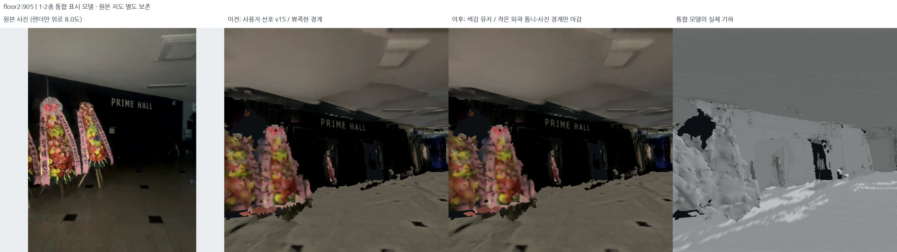

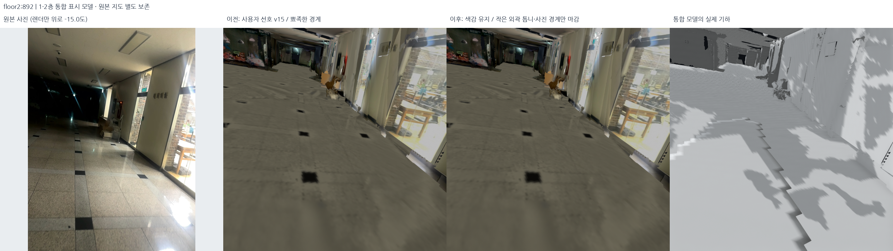

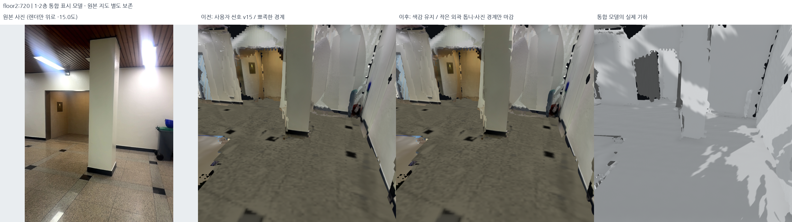

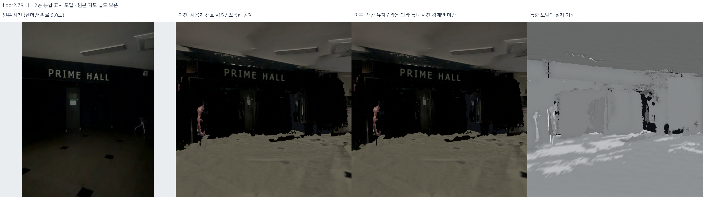

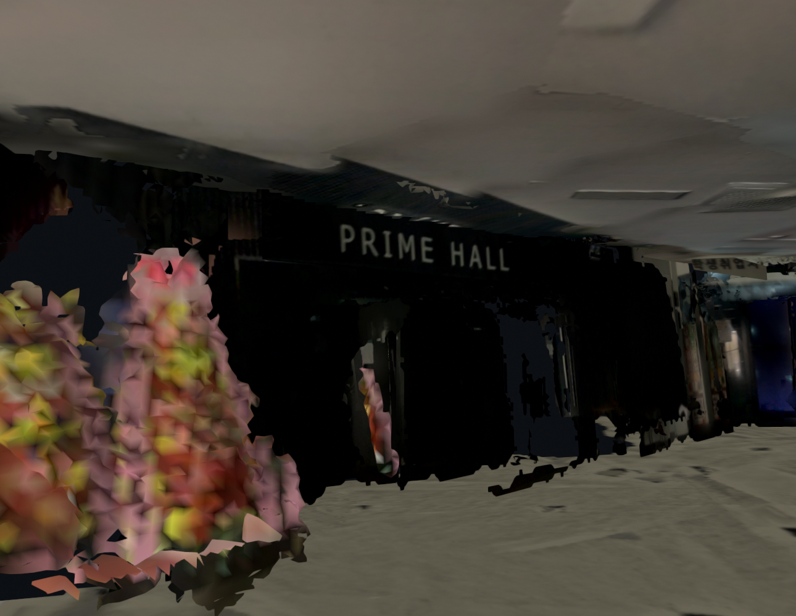

### 후속 보존 검사·실행

`audit_display_edge_finish.py`가 **실제 출력**과 선택한 v15 GLB를 비교한다.
수평면 XYZ/외곽, 보호 정점, 내부 정점, UV/normal/index, 의미 사진, GLB–PLY 일치,
새 면 없음, bounded 이미지 변경을 검사한다. 최종 원본 DB/선택 지도와 입력 바인딩도
재검사했다. 외관 판정은 위의 직접 시각 검토이며 이 검사는 보존 계약일 뿐이다.
최종 전체 코드 검사는 501개 통과했고 로컬에서 실제 5세션 파일 로딩까지 확인했다.

- v18 manifest SHA-256:
  `932753cd3d5d1a5d22df350aea4ccc14a98d3a9112fe954c8ac4c525430442bd`.
- [실제 기하·재질 보존 검사](../assets/display-edge-finish-20261019/geometry_audit.json)
- [로컬 5세션 로딩·파일 바인딩 검사](../assets/display-edge-finish-20261019/delivery_audit.json)
- [카메라/렌더/원본 사진 해시](../assets/display-edge-finish-20261019/manifest.json)

```bash
PYTHONPATH=outputs/surface_runtime/packages:src OPENBLAS_NUM_THREADS=1 OMP_NUM_THREADS=2 \
  /usr/bin/python3 -s src/refine_display_edges.py --output outputs/reproduced_edge_v17

# 다음 명령은 저장된 기존 v17을 사용한다. 위에서 새로 재현한 v17을 연결하려면
# photo_boundary_finish.json의 source_bundle을 새 경로로 지정한 설정을 --config로 전달한다.
PYTHONPATH=outputs/surface_runtime/packages:src OPENBLAS_NUM_THREADS=1 OMP_NUM_THREADS=2 \
  /usr/bin/python3 -s src/soften_display_photo_boundaries.py --output outputs/reproduced_edge_v18

bash scripts/view_local_roadview.sh --start-view roof2f
```

v16의 거절된 출력과 v17 중간본도 덮어쓰지 않았다. 원본 포즈/SLAM 지도는 여전히
별도이며, 미관측 공간을 길찾기 가능 영역으로 승인하거나 OSM에 업로드하지 않았다.
