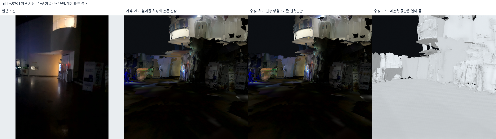
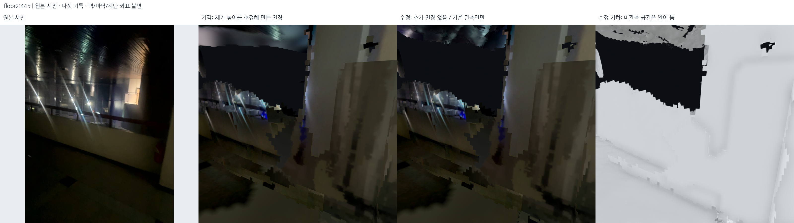

# 임의 높이의 추가 천장 철회·기존 관측 표면만 복원 — 2026-10-18

후속 단계에서는 상부 벽을 먼저 보완하고,
[사진/깊이로 확인한 0.97m² 국소 접합](2026-10-18-verified-upper-wall-junctions.md)만 추가했다.
아래의 광역 추정 천장 철회는 유지한다. 현재 표시본은 해당 후속 기록을 따른다.

## 추정 천장의 문제

이전 변경은 수평면의 높이 띠와 국소 피팅을 천장으로 해석해 넓은 시트를 만들었다.
그러나 수평 조각의 존재만으로 같은 물리적 천장이나 벽 상단 접합을 판단하기 어려웠다.
복층 공간만 마스킹하고 나머지 높은 천장 시트를 남긴 것도 충분한 해결이 아니었다.

관측 근거가 부족한 높이와 경계를 새로 만들지 않도록 추가 천장을 전부 철회했다.

## 결과

현재 표시: `outputs/student_union_observed_ceilings_v1/`.

| 기록 | 제거한 추가 천장 삼각형 | 원래 좌표로 복원한 기존 깊이 기반 TSDF 면 |
| --- | ---: | ---: |
| 로비 | 56,756 | 151,887 |
| 2층·메인 계단 | 96,436 | 275,540 |
| 서브 계단 | 15,094 | 19,664 |
| 외부↔로비 브리지 | 0 | 0 |
| 외부 | 0 | 0 |
| 합계 | **168,286** | **447,091** |

**벽 높이·바닥·계단·문·창·표지·선택 포즈는 바꾸지 않았다.** 모든 새 천장 시트를 활성
메시에서 제거했다. 천장 숨김 토글이나 카메라 가림으로만 문제를 감춘 결과가 아니다.
미관측 부분은 열린 상태로 둔다.





사진 시점 비교는 다섯 기록을 모두 함께 표시했다. 추가 위쪽 시점 비교는 촬영 위치를
유지하고 렌더 시선만 30°/35° 올렸으며, 제목/그림 JSON에 명시했다. 이때 왼쪽 원본 사진은
기준 사진과 시선을 올린 가상 렌더의 시점은 다르다.

## 실제 처리

구현: `src/withdraw_inferred_ceilings.py`.

1. 직전 `student_union_topology_fixed_v2`의 활성 GLB/PLY에서 기록된 삼각형 범위를 따라
   **`kind=ceiling`인 추가 시트만 전부 제외**한다. 층별 대표 Z도 국소 천장 앵커도 재사용해
   새 천장을 생성하지 않는다.
2. 남은 면의 좌표·순서·원본 텍스처/재질을 유지한다. 바닥·벽·계단을 이동하거나 높이를
   다시 피팅하지 않는다. 기존 사진 의미 면의 원본 PNG와 삼각형 좌표도 유지한다.
3. `student_union_preserved_display_v1/<session>/preserved_geometry.ply`에서 천장 높이 띠
   안의 기존 수평 삼각형을 고른다. 높이 띠는 **기존 면을 선택할 범위**일 뿐 새 높이를
   만드는 식이 아니다. 이미 남은 면과 정확히 같은 것은 중복 추가하지 않는다.
4. 선택한 면을 `student_union_appearance_v2/<session>/balanced_only.glb`의 원래 사진 재질과
   함께 복원한다. 두 기존 파일의 실제 삼각형 좌표가 같은지 먼저 검사한다.
5. GLB를 결합할 때 buffer/accessor/image/texture/material 인덱스만 재배치한다. 실제 위치나
   이미지 픽셀은 바꾸지 않는다. 복원 면의 좌표 이동량은 **0m**다.

기존 preserved TSDF는 깊이 기반 5cm 표면 재구성이다. 원본 센서의 모든 점 자체나 측량
정답은 아니며 원래 정합 오차·TSDF 근사도 포함한다. 다만 이번 처리로 임의 높이의 천장
꼭짓점이나 미관측 영역을 가로지르는 새 면을 생성하지 않았다.

## 검증

`src/audit_observed_ceilings.py`가 활성 GLB/PLY를 다시 읽어 확인했다.

- 실제 GLB/PLY 삼각형 좌표 일치.
- 철회 대상이 아닌 **벽·바닥·계단 좌표 전부 이전과 동일**.
- 복원 면이 기존 TSDF의 정확한 삼각형 부분집합이며 높이 이동 0m.
- 새로 복원한 면뿐 아니라 보존 prefix 안의 기존 천장 후보 면도 원래 TSDF와 대조.
  로비 6개·메인 4,579개·서브 6,697개 모두 기존 면에 해당하며 잔존 추정 천장 없음.
- 채택된 추가 천장 시트 0개, 새로운 천장 높이 추정 0개.
- 원본 RGB SHA와 문·창·표지 좌표 유지.

`src/audit_structural_delivery.py`로 원본 DB 5개·선택 지도·입력 SHA와 실제 로컬 창이 읽은
다섯 GLB를 검사했다. 기본 표시가 추정 천장 버전으로 몰래 되돌아가지 않도록
`config/ceiling_completion_policy.json`과 뷰어 로딩 검사를 추가했다.

전체 구현 테스트와 구체 검증은 아래 자료에 남겼다.

전체 구현 검사 **450개 통과**. 철회 범위·예상치 못한 면 배치 거부·GLB 결합 좌표/재질
인덱스·추정 천장 생성 금지 조건을 확인하는 새 검사 4개가 포함된다.

- [기존 면과 직접 좌표 대조](../assets/observed-ceilings-only-20261018/observed_ceiling_audit.json)
- [제거/복원 기록](../assets/observed-ceilings-only-20261018/ceiling_withdrawal_audit.json)
- [원본 DB·실제 출력·로컬 창 검사](../assets/observed-ceilings-only-20261018/delivery_audit.json)
- [원본 사진·렌더 카메라·이미지 SHA](../assets/observed-ceilings-only-20261018/manifest.json)

## 이후 적용할 금지 조건

설정: `config/ceiling_completion_policy.json`.

- 수평 법선이나 높이 히스토그램만으로 천장이라고 판단하지 않는다.
- 깊이/사진이 없다는 이유로 빈 곳을 천장으로 덮지 않는다.
- 바닥 footprint를 천장으로 상속하지 않는다.
- 이미 일관된 벽 높이를 천장 모델에 맞춰 바꾸지 않는다.
- 추후 천장 재구성을 하더라도 **실제 벽 상단–천장 접합부와 원본 RGB-D 대응**이
  확인된 곳에서만 검토한다. 이번에는 새 천장 모델링을 하지 않았다.

## 로컬 확인·재현

```bash
bash scripts/view_local_roadview.sh --start-view atrium
# 기본: Observed ceilings only / floors kept
# 비교: Previous inferred ceilings / REJECTED
```

```bash
export PYTHONPATH="$PWD/outputs/surface_runtime/packages"
export OMP_NUM_THREADS=2 OPENBLAS_NUM_THREADS=1
/usr/bin/python3 -s src/withdraw_inferred_ceilings.py \
  --output outputs/student_union_observed_ceilings_REPLAY
/usr/bin/python3 -s src/audit_observed_ceilings.py \
  --bundle outputs/student_union_observed_ceilings_REPLAY \
  --output outputs/student_union_observed_ceilings_REPLAY/observed_ceiling_audit.json
/usr/bin/python3 -s src/render_ceiling_withdrawal_review.py \
  --bundle outputs/student_union_observed_ceilings_REPLAY \
  --assets outputs/student_union_observed_ceilings_REPLAY/review
```

원래 자료와 이전 결과를 보존했다. 이 단계는 추정 천장의 철회이며 원래 정합 오차와 텍스처 결손은 남아 있다.

선택 지도 SHA: `98cf1d77aa5ca3c82f9653ffcb4ee86d6f40ac4d8953f1c1171b0dfa307090b1`.
현재 manifest SHA: `027330f5e5d18970b8795d6d43019cea115c795b2f0701d423dd84b2163c7ba5`.
