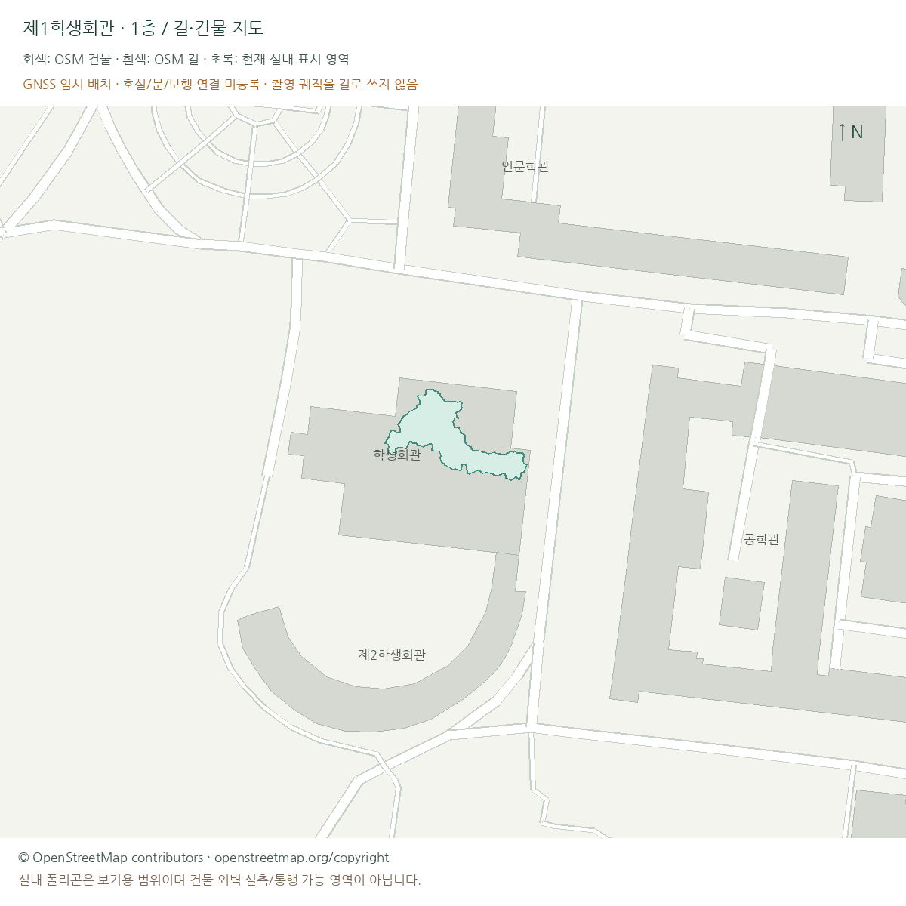
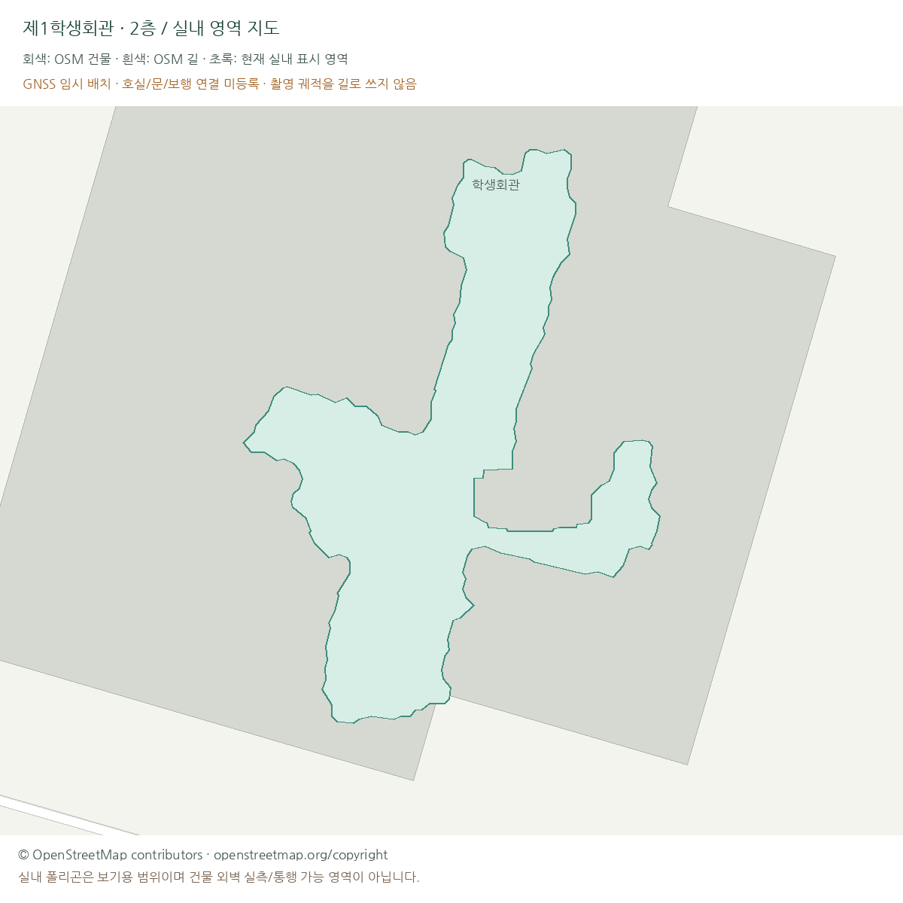

# 길·건물 지도 / 인과적 SLAM 기록 재생 / Windows 인계

## 기록 재생의 구성과 범위

주변 길과 건물을 지도 레이어로 구성하고, 순차 관측과 루프 갱신을 ROS 그래프 및 영상으로 기록했다. 최종 표시 모델 `student_union_final_mesh_v9`는 별도 오프라인 제작 단계로 제시한다.

폰 DB의 RGB-D·VIO를 순서대로 읽고, 양쪽 프레임이 도착한
저장 루프 후보를 재검증한 뒤 prefix 그래프를 다시 푼다. 새 포즈로 이전 점을 다시
투영한다. 이 8개 ROS 노드와 RViz의 실제 DDS 연결을 rqt_graph로 캡처했다.

재생 입력은 저장된 RGB-D, VIO와 루프 후보다. 새 센서 스트리밍, VIO 재추정과 신규 재방문 검색은 수행하지 않는다. RTAB-Map ROS 패키지 대신 이 프로젝트의 기록 재생 및 재최적화 노드를 사용했다. 저장 루프 후보에는 앱이 수집 전체를 본 뒤 만든 정보가 포함되어 있다.

## 1. 일반 지도 구조

3D 메시를 일반 지도 하나로 취급하지 않고 아래 레이어로 분리했다.

| 레이어 | 이번 데이터 | 통행·위치 한계 |
|---|---|---|
| 주변 길·건물 | OSM 실제 way 101개: 건물 Polygon, 길 LineString | 자체 보행 승인이나 네이버 길찾기 연동은 아님 |
| 층별 실내 표시 영역 | 최종 표시본의 1/2층 마스크 → 구멍을 보존한 다각형 | 호실 외벽 도면/실측/보행 영역이 아님. 추론 메움 포함 |
| 장소·호실·문 | 별도 원장에 넣을 구조 | 이번에는 이름·출입구를 임의로 새로 만들지 않음 |
| 보행 그래프 | 검증된 노드/edge 전용 필드 | 아직 비어 있음. 촬영 궤적을 도로로 변환하지 않음 |
| 3D 보기 | 확정 v9의 원래 GLB 5개 | 위치·색·기하를 이번 작업에서 바꾸지 않음 |





`map_vectors.json`은 로컬 미터 좌표의 자체 형식이다. `*.geojson`은 WGS84
경도·위도이며, 실내 GeoJSON에는 기존 coarse GNSS + 미리보기용 표시 이동
동2m/남2m를 명시했다. 센서 보고 정확도 중앙값14.25m이므로 실측 정합으로 부르지
않는다. 주변 지도는 북쪽 위, 층별 확대 지도는 기존 로컬 XY 방향이다.

OSM Overpass 요청이 timeout/서버 오류로 실패했다. 이를 임의 건물로 대체하지 않고
공식 OSM read API의 작은 캠퍼스 bbox를 한 번 받아 사용했다.
`https://api.openstreetmap.org/api/0.6/map?bbox=127.0756,37.5405,127.0797,37.5434`
원본 XML·원소ID·원본 태그·해시를 보존했다. OSM에 업로드/수정하지 않았다.
OSM 자료는 [ODbL 및 표시 조건](https://www.openstreetmap.org/copyright)을 따른다.
실내 파생 데이터는 별도 파일로 유지한다.

## 2. 실제 ROS 처리 노드

| 실행 노드 | 실제 처리 |
|---|---|
| capture_db_replay | DB 프레임 인덱스를 촬영 순서로 전달. ACK 전 다음 batch를 보내지 않음 |
| rgbd_confidence_filter | RGB/depth/보정값 실제 decode, confidence≥50, 0.25–4m, stride6 역투영 |
| stored_loop_reverification | 도착한 두 관측만으로 양방향 trimmed point-to-point ICP 검사 |
| incremental_prefix_optimizer | 도착한 odometry/통과 루프만 사용한 중력 보존 xyz+yaw 4DoF 풀이 |
| prefix_cloud_assembler | 현재까지의 각 관측을 현재 포즈로 다시 투영, RViz PointCloud2 발행 |
| evidence_recorder | 실제 prefix 포즈·점군·루프·시간·검사 결과를 저장하고 ACK |
| offline_final_artifact_loader | 재생 종료 뒤 **이전에 만든** 최종본의 버전 참조를 전달. 메시 생성 노드 아님 |
| final_reference_recorder | 오프라인 최종본 참조와 온라인 재생의 구분을 기록 |

단일 프로세스의 SingleThreadedExecutor에서 기능별 실제 ROS Node 8개를 실행했다.
프로세스가8개라는 뜻이 아니며, node를 나눴다고 병렬 실시간 성능이 생기는 것도 아니다.
`rqt_graph`는 ROS 처리 노드/토픽 연결이고, 영상 아래의 프레임 그래프는 별도로
누적되는 카메라 노드/루프 제약이다. 과거 오프라인 Python 스크립트를 실행 중인 ROS
노드인 것처럼 그리지 않는다.


[확대 가능한 전체 그래프 SVG](../assets/mapping-demo-20261019/rqt_graph.svg) ·
[실제 노드·발행/구독 토픽 원장](../assets/mapping-demo-20261019/ros_graph_inventory.json).
영상 오른쪽의 짧은 이름 도식은 이 실제 원장에서 생성한 **배치·표기 축약본**이며
rqt 스크린샷이라고 부르지 않는다.

## 3. 알고리즘과 실패 후 수정

- 루프는 저장 type1/2 제안만 사용한다. 미래 끝점이 있는 edge는 넣지 않는다.
- 깊이 confidence 누락/형식 오류를100으로 가정하지 않고 해당 프레임을 보류한다.
- 양방향 ICP overlap≥0.45, RMSE≤7.5cm, 보정≤25cm/5°, cycle≤10cm/2°를
  사용한다. 기존 `optimize_session.py`의 실제 판정이며 학습된 정확도 보증이 아니다.
- Graph는 전체 covariance whitening 후 **블록 Huber δ3**. VIO 모델 잡음
  4cm/1°를 odometry covariance에 추가한다. 바닥 전체를 평면화하지 않는다.
- 각 odometry 연결 성분의 첫 포즈를 고정한다. 추적 단절을 node번호 근접성만으로
  이어 붙이지 않는다. 새 프레임의 초기 보정은 실제 odometry 연결 안에서만 전달한다.
- 새 풀이가 수렴하고 경계에 걸리지 않을 때만 갱신한다. 영상용 강제 snap이나
  포즈 morph는 없다. 바뀐 포즈로 기존 관측을 다시 투영한다.

### 실패 v1 → warm-start v3

첫 실행은 매 루프마다 raw VIO에서 재시작하고 풀이 한도를70으로 두었다.
로비·2층의 여러 prefix가 한도에 걸려 적용을 보류했다. 해결된 것처럼 연출하지 않고
`outputs/student_union_slam_replay_v1/`의 실제 실패 기록을 남겼다.

이전까지 수렴한 해와 새 관측을 초기값으로 쓰는 **incremental warm start**로
바꾸고 한도를180으로 늘렸다. 두 실행 인자가 함께 바뀌었으므로 개선 전부를
warm start 한 요소의 효과로 단정하지 않는다. 중간 v2는 이전 실행의 transient
토픽이 섞여 실패해, run UUID 필터와 별도 ROS_DOMAIN_ID83을 적용했다.
최종 v3의20번 풀이가 모두 수렴했다. 후보 측정·임계값을 영상에 맞춰 조작하지 않았다.

| 촬영본 | 읽은 프레임 | 기하 통과 저장 루프 |
|---|---:|---:|
| 외부 |354|11|
| 로비 |958|36|
| 외부–로비 브리지 |134|1|
| 2층·메인 계단 |1,218|42|
| 서브 계단 |211|1|
| 합계 |2,875|91|

40프레임씩74묶음,160프레임 간격 및 세션 끝에서 필요한 재최적화를 실행했다.
실행 벽시계 약95.36초(초기 대기12초 포함), 개별 graph 풀이 최대약9.29초였다.
원기록 합계 약48.73분이며 세션 사이 긴 공백은 제외한다. 이는 DB 읽기 기반의
가속 재생 성능이고, 새 센서/특징 검색/모바일 전송/표면 마감까지의 실시간 성능이 아니다.
수렴은 그래프 목적함수의 수렴이지 실측 정확도나 불량 루프가 없다는 인증도 아니다.

최종 지도는 원래 선택한2,251포즈와3,493,208점을 그대로 유지했다. 위2,875개
원기록 prefix의 단순4DoF 결과를 기존 J01/N05/H03/J04/H03 선택 대신 채택하지 않았다.


독립 검사는 도착 순서/미래 edge 차단/실제 원포즈/통과 루프/수렴한 갱신만 적용/원본
RGB-D 지지 샘플/원본 DB와 최종 지도 해시를 확인한다.
[실제 독립 검사 결과](../assets/mapping-demo-20261019/replay_audit.json).

## 4. 영상

[113초 1920×1080 MP4](../assets/mapping-demo-20261019/mapping_story.mp4).
12fps 편집 영상이며 동작 재생과 계산 시간은 구분되어 있다.

1. 범위 설명과 실제 rqt_graph.
2. 다섯 촬영본 각각의 점군 누적·포즈/루프 갱신, 원본 RGB, 실제 처리 시간.
3. 명시적인 오프라인 챕터 전환.
4. 선택 포즈/세션 통합 → 점군·표면 비교 → 층/사진/메시 마감의 실제 과거 시각자료.
5. 확정 v9 및 일반 지도 레이어.

원본을 모르는 면을 AI로 그리거나, 최종 점군을 서서히 공개하는 것을 SLAM이라고
부르거나, 수동 마감을 실시간 자동화로 포장하지 않았다. 후반은 단계별 결과 기록이며
오프라인 전체를 이번에 처음부터 다시 계산해 녹화한 영상은 아니다.
첫 영상 렌더는 시스템 Pillow의 Resampling API 차이로 중단되어 호환 처리를 추가했다.
다음 영상은 실제 rqt 그래프를 작은 패널에 넣으니 읽기 어려웠다. 원본 그래프는
별도로 유지하고, 영상에만 실제 DDS 연결의 짧은 이름 배치를 추가해 직접 확인했다.

## 5. Windows로 옮기는 것

인계 묶음: `outputs/student_union_windows_handoff_20261019.zip`.
최종 GLB5개·상대경로 release.json·로컬 native viewer·길/건물/층 지도·영상·원본 해시를
넣었다. 원본 DB/전체 outputs/conda 환경/자격증명은 넣지 않았다. 압축을 전부 풀어야 한다.
기록 재생 최소 코드는 `replay_tools/`에도 포함했다. 이 ZIP은 표시와 재생용 묶음이며 전체 개발 백업과는 별도다.
별도 [전체 개발·원본·출력·채팅 인계](../windows_full_development_handoff.md)를 추가했다.

| 작업 | 권장 실행 위치 |
|---|---|
| 확정3D 보기 | Windows Python + Open3D, ROS/CUDA/PyTorch 불필요 |
| 길·건물·층 지도 초안 보기 | cartographic/index.html 더블클릭, 별도 서버 없음 |
| 장소·문·보행노드 편집/서비스 UI/검색 | Windows 개발 환경 |
| DB 재생/ROS2/RViz/rqt_graph 재처리 | WSL2 Ubuntu22.04 + ROS2 Humble 또는 현재 Ubuntu |
| 센서 실시간 송신·새 재방문 인식·지속 매핑 | 아직 별도 구현/기기 실증 필요 |

Windows PowerShell에서 압축을 푼 폴더로 이동한다.

```powershell
py -3.10 -m venv .venv
.\.venv\Scripts\python.exe -m pip install -r requirements-viewer.txt
.\.venv\Scripts\python.exe view_release.py --check-only
.\.venv\Scripts\python.exe view_release.py
```

ROS 개발까지 옮기려면 관리자 PowerShell에서 설치 가능 목록을 확인한 뒤 WSL2
Ubuntu22.04를 설치한다. `replay_tools/`를 Linux 홈으로 복사하고 그 아래
`data/raw/rtabmap/`에 원본 DB5개를 별도 복사한다. ROS2와 처리 의존성은 새로 설치한다.
Git clone만으로 data/outputs가 따라오지 않는다. Ubuntu conda 환경을 Windows로
복사하지 않고 환경을 새로 만든다. 과거 절대경로 manifest를 덮어써 hash를 바꾸지
않는다. 이 인계 묶음은 정확한 보기용 export와 기록 재생 도구이며 과거 전체
오프라인 실험의 자동 재현 환경은 아니다.
[Microsoft WSL 설치](https://learn.microsoft.com/en-us/windows/wsl/install),
[WSLg GUI 지원 조건](https://learn.microsoft.com/en-us/windows/wsl/tutorials/gui-apps).

**Windows 기계에서의 실행 검증은 아직 하지 않았다.** 현재 Ubuntu에서는 상대경로
파일 해시 검사와 실제 native viewer 로딩을 확인한다. 추후 Windows에서 GPU/화면/
Python 설치를 점검해야 한다. 확인되지 않은 플랫폼 검증을 완료로 적지 않는다.

## 6. 재실행

아래 예시는 서로 다른 터미널에서 실행한다. output 경로는 새 이름이어야 한다.

```bash
ROS_DOMAIN_ID=83 bash scripts/with_ros.sh /usr/bin/python3 -s src/run_slam_replay.py \
  --output outputs/student_union_slam_replay_next --batch 40 --max-evaluations 180 --hold 600
ROS_DOMAIN_ID=83 bash scripts/with_ros.sh rviz2 -d config/slam_replay.rviz
ROS_DOMAIN_ID=83 bash scripts/with_ros.sh /usr/bin/python3 -s src/capture_rqt_replay_graph.py \
  --output outputs/student_union_slam_replay_next/graph_delivery --hold 120
```

한 프레임씩 확인하려면 `--batch 1`을 사용한다. 이번 영상은40프레임 묶음이다.
batch1은 저장 파일 수·메시지·누적 재투영 비용이 커진다. 폰 실시간 촬영이 되는
명령으로 오해하지 않는다. 이전 실행과 같은 도메인을 동시에 실행하지 않으며
run UUID가 다른 transient 메시지는 처리하지 않는다.

실제 온라인 완성본을 입증하는 다음 실험은 **새 폰 RGB-D/보정/VIO 수신 → 시간 동기
→ 새 후보 검색 → 실제 기하 검증 → bounded incremental optimization → 경량
점군/TSDF 갱신**이어야 한다. 수동 문/개방 로비/간판 마감은 별도 작업으로 남긴다.
RTAB-Map의 역할 구분은 [공식 ROS 패키지](https://github.com/introlab/rtabmap_ros)를
참고했다. 현재 선택 v9를 이 새 실험으로 자동 교체하지 않는다.
