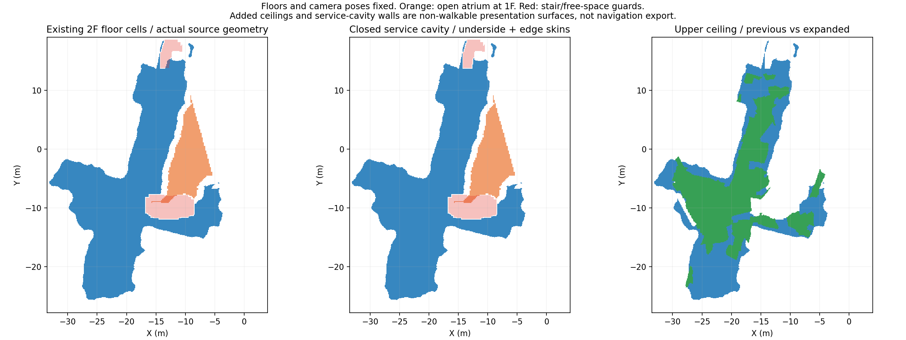
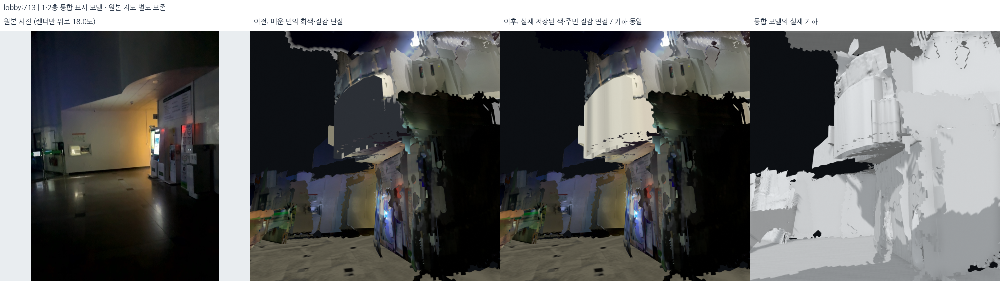
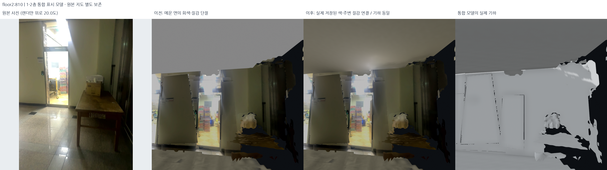
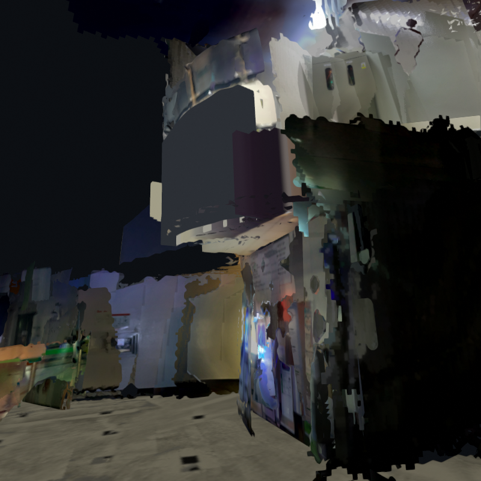
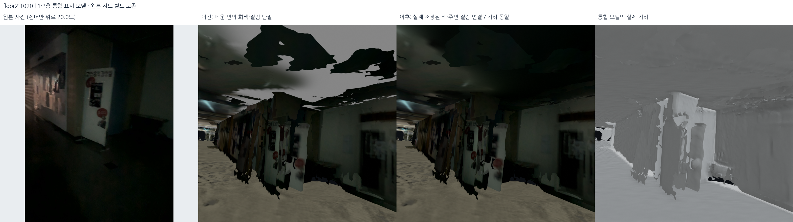
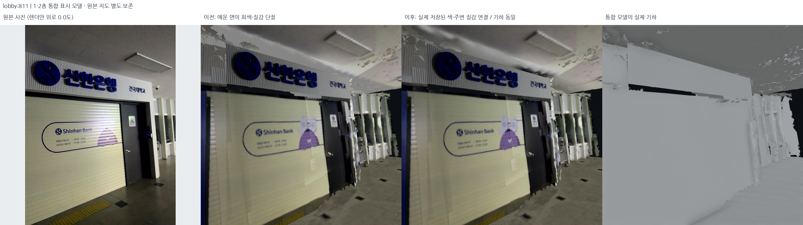
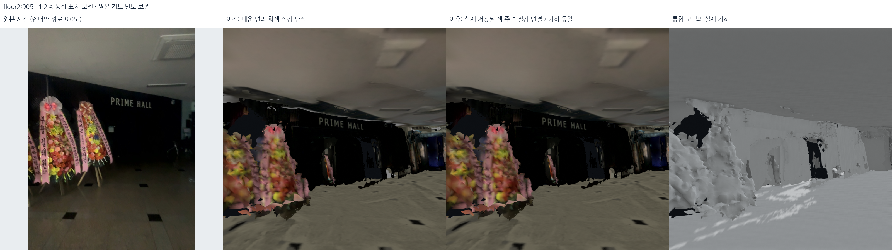
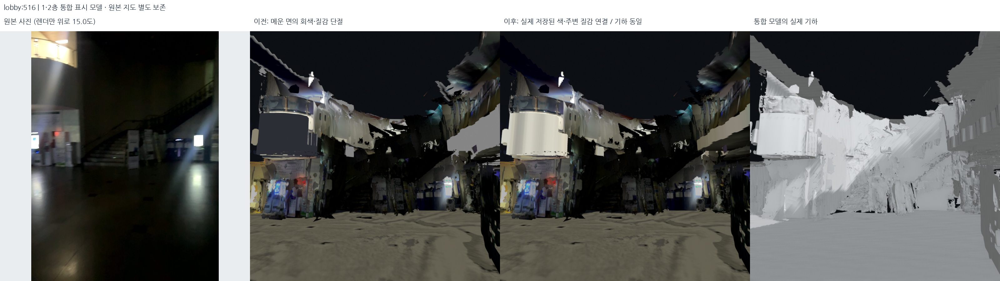
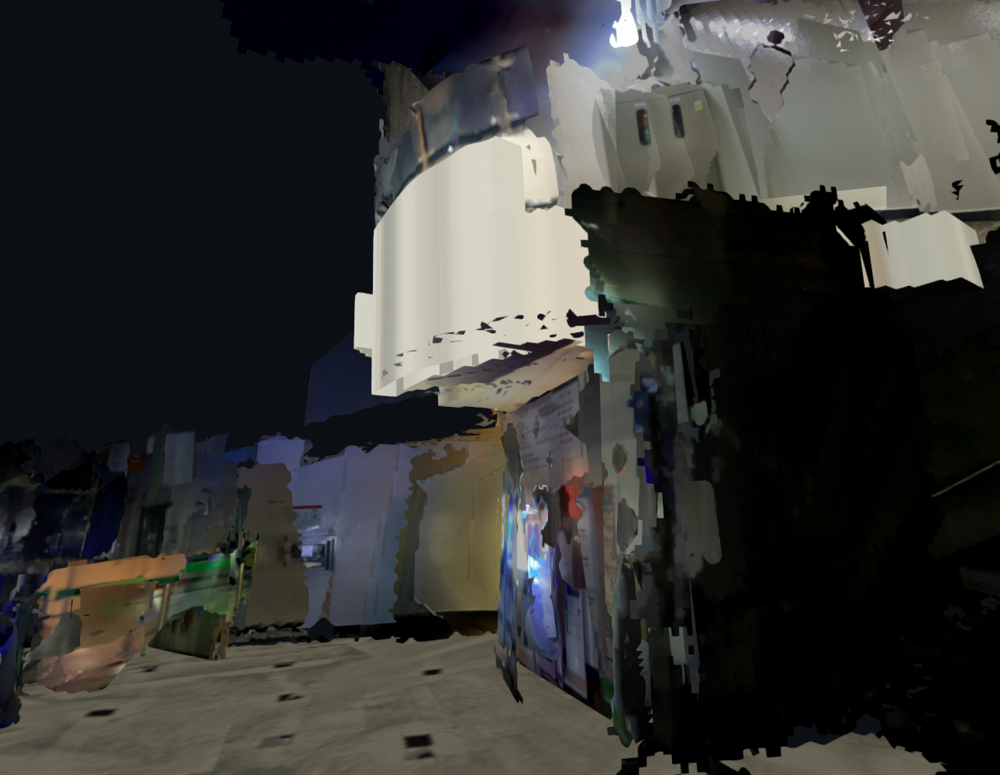

# 천장 확장과 닫힌 설비 공간, 메움 재질 연결 — 2026-10-19

## 설계 조건

1층 천장과 2층 바닥 사이의 설비 공간은 높이를 유지하면서 닫힌 표시 구조로 구성한다. 천장과 바닥을 같은 높이로 붙이지 않으며, 추가 면은 주변의 실제 사진 재질과 연결한다.

- 원본 선택 지도, 포즈, DB 및 길찾기 데이터는 변경하지 않는다.
- 이미 선택한 바닥 높이와 XY, 기존 천장 밑면 높이를 옮기지 않는다.
- 중앙 메인 계단 옆 복층 로비와 실제 계단 구멍은 유지한다.
- 바닥 무늬·신한은행·PRIME HALL·문·창의 원래 사진은 보존한다.
- 추가 천장/층간 옆면은 비보행 표시 면이다. 설비 공간을 새 층이나 이동 경로로
  해석하지 않는다. 이 표시 메시에서 자동으로 길찾기 망을 추출하면 안 된다.

기준 표시본은 `outputs/student_union_lower_ceiling_clearance_v22/`,
현재 표시본은 `outputs/student_union_closed_ceiling_material_v5/`이다.

## 1. 실제 바닥 지지 영역 추출

`src/extend_closed_ceiling_bodies.py`, `config/ceiling_expansion_and_closure.json`:

1. 다섯 세션의 실제 GLB 삼각형을 읽었다. 마스크에 있다고 바닥을 새로 가정하지 않았다.
2. 기존 2층 높이 z=2.60m, 10cm 격자의 두 상보 삼각형이 **실제로 모두 있는 셀**만
   완성 바닥으로 인정했다. 같은 반쪽 삼각형을 두 번 본 것은 완성 셀이 아니다.
3. 세션 간 중복은 합집합으로 처리하고, 검토된 복층 로비·계단·자유공간 마스크를 제외했다.
4. 체크무늬 대각 접촉만 안쪽으로 제거하여 부피 외피의 비다양체 접촉을 피했다.

완성 바닥 지지 영역 436.47m² 중 층간 외피 적용 영역은 435.46m²이다.
이는 현재 **표시 모델**의 면적이며 건물 실측 면적이 아니다.



## 2. 층 높이는 독립, 공간의 경계만 폐쇄

`closed_slab_arrays()`를 사용하되 윗면 바닥을 중복으로 렌더링하지 않았다.

- 윗면: 기존 실제 2층 바닥 삼각형을 그대로 재사용한다.
- 아래: 새 천장 밑면을 추가한다.
- 둘레: 외곽과 내부 구멍의 노출 경계마다 옆면을 만든다.
- 바닥을 새로 덮지 않으므로 기존 무늬를 잃거나 중복 바닥이 깜박이지 않는다.

기존 표시 바닥은 1층 −1.55m, 2층 +2.60m로 유지했다. 기존 화장실 천장
1.480454m와 은행 천장 1.98m도 움직이지 않았다. **추가 하부 메움 면**은 앞서
간판 간섭을 피하도록 승인된 은행의 1.98m를 재사용했다. 추가 범위 전체의 천장을
새로 실측한 높이가 아니다. 이 가정과 기존 더 낮은 밑면의 보존을 설정에 명시했다.

새 외피의 1.98–2.60m 사이 간격은 그대로 남는다. 즉 62cm의 보기용 설비 공간이
닫힌 것이지 두 면을 붙인 것이 아니다. 이 수치가 실제 모든 곳의 설비 공간 두께라는
뜻도 아니다. 기존 더 낮은 천장이 있는 곳에는 그 높이와 구조가 그대로 남는다.

## 3. 2층 천장 확장

기존 관측 천장 영역과 실제 상부 바닥이 만드는 유한 범위 안에서만 확장했다.
상부 천장 높이는 기존 벽-천장 교선에서 사용하던 **5.571264m 그대로**다.
새 높이를 히스토그램으로 다시 고르거나 벽 밖으로 무한히 늘리지 않았다.

- 기존 상부 연속 천장: 235.08m²
- 확장 후 표시 천장: 445.11m²
- 추가 영역: 210.03m² — **미관측을 포함한 명시적 추론 표시 면**
- 같은 높이의 이전 면만 교체하고, 1·2층 바닥은 전부 유지했다.
- 등록된 상부 간판의 사진 ray가 새 천장에 가려지지 않도록 유한 보호 영역을 뒀다.

중앙 복층 로비에는 낮은 천장을 추가하지 않았다. 촬영된 지도 외곽과 연결되어
닫힌 상부 범위를 입증하지 못하는 큰 부분은 여전히 열려 있다. 이번 검사를
건물 전체의 완전한 폐곡면 판정으로 확대하면 안 된다.

## 4. 왜 새 면이 회색·다른 질감이었나

첫 후보 `student_union_closed_ceiling_extension_v1`의 재질 샘플러는 PNG 텍스처만
읽었다. 기존 메시 중 일부는 PNG가 아니라 glTF **선형 RGB 정점 색 `COLOR_0`**에
실제 외관이 들어 있었다. 그 경우를 RGB=0.72로 대신 처리하면서 주변이 어두운
구역에도 밝은 회색 메움이 생겼다. 전역 밝기 분위수로 어두운 색을 제외한 것도
실제 어두운 복도와 맞지 않았다. 포즈/깊이 최적화가 다시 나빠진 문제가 아니다.

또한 이전 층간 마감에는 8×8 또는 16×16의 균일 RGB(64,69,77) 이미지가 있었다.
이 짙은 회색 표시용 마감이 화장실 앞 큰 면에서 특히 눈에 띄었다.





## 5. 실제 색·사진·질감으로 연결

`src/match_ceiling_extension_materials.py`, `config/ceiling_material_continuity.json`:

1. 정점 색은 glTF 선형 RGB 그대로 읽고 재질의 `baseColorFactor`를 곱한다.
   PNG는 선형 RGB로 변환한 뒤 동일하게 처리한다. PNG가 없다는 이유로 회색을 쓰지 않는다.
2. 기존 은행/화장실/상부 연속 천장 사진 면과 옛 조각이 겹치면 **승인된 사진 면을 우선**한다.
   더 낮은 옛 조각의 검은 간판 가장자리 등을 천장에 잘못 가져오지 않기 위해서다.
3. 알려진 색은 유지하고, 없는 부분은 주변 색을 경계 조건으로 **로그 선형 RGB
   조화 보간(라플라스 방정식)**한다. 전역 흰색·회색 평균으로 바꾸지 않는다.
   10cm 해상도에서 풀고 원래 atlas 크기로 보간하며, 관측 경계 24cm를 부드럽게 잇는다.
4. 원본 천장의 저대비 고주파 샘플에서 미세 질감의 스펙트럼만 가져온다. 무작위
   위상으로 반복 모티프를 없애고, 어두운 부분에는 질감 진폭도 줄인다. 조명·글자·
   문양을 미관측 공간에 복제하지 않는다. 이는 **추론한 미세 재질**이지 숨은 원본의 복구가 아니다.
5. 층간 옆면에는 천장 사진을 XY로 억지 투영하지 않았다. 인접한 실제 상부 벽의
   색을 모아 어두운 글자/문틀 표본을 제외하고 국소 벽 색으로 연결했다.
   이 방식으로 기존 인공 회색 마감 3개와 새 옆면을 맞췄다.
6. 바닥·간판·문·창 사진의 이미지/UV/색 스트림은 변경 대상이 아니다.

## 6. 중간 후보를 눈으로 보고 제외

| 후보 | 실제 시각 판정 | 처리 |
|---|---|---|
| 외피 v1 | 공간은 닫혔지만 새 천장이 회색으로 튐 | 기하 기준으로만 사용 |
| 재질 v2 | 실행 중 사용자 중단, 하부 PNG만 생성 | 완료 결과로 사용하지 않음 |
| 재질 v3 | 회색은 줄었지만 미세 패턴이 반복되고 옆면에 보라색 경계가 생김 | 제외 |
| 재질 v4 | 반복 패턴·보라색은 개선, 16×16 회색 큰 마감은 남음 | 추가 진단 |
| 재질 v5 | 16×16 마감도 인접 벽 색으로 연결, 기존 사진 천장 우선 | 현재 표시본 |

v3/v4 처리 코드 snapshot은 각 출력 폴더에 남겼다. 중단되거나 후보 코드가 바뀐
상태의 검사를 최종 합격 기록으로 쓰지 않았다. 최종 v5를 별도로 검사했다.



## 7. 실제 전후 렌더와 남은 한계

동일한 원본 RGB K·표시 카메라·pitch로 다섯 세션 전체를 렌더링했다.
원본 사진 / 회색 외피 v1 / 재질 v5 / 회색 기하의 네 칸이다.
사진은 원래 시선이고 렌더에만 추가 pitch가 있으므로 맨 왼쪽은 완전한 픽셀 대응이 아니다.
중앙 두 전후 렌더는 같은 카메라다. 바닥·신한은행·PRIME HALL·복층 개방부도 확인했다.









새 면의 인공 회색과 반복 질감은 수정했지만 **전체 스캔의 재질 차이까지 완전히
제거했다고 하지 않는다.** 원본에 남은 저조도 얼룩, 조명 반사, 옛 파편의 외곽과
아주 다른 높이에서 겹치는 관측 조각은 일부 남아 있다. 미관측 면에는 실제 설비,
실제 천장 패턴을 복원한 것이 아니다. 바닥을 단색으로 만들거나 간판을 흐려 이런
차이를 감추지 않았다. 원본 사진 로드뷰는 계속 그대로 볼 수 있다.

## 8. 기하·재질 보존 검사는 별도로 수행

`src/audit_closed_ceiling_extension.py`:

- 실제 원본 상부 바닥 + 추가 아래/옆면을 합쳐 검사했다. 분석용 예시 윗면만
  검사하고 실제 모델도 닫혔다고 가정하지 않았다.
- float32 내보내기 오차만 0.01mm로 용접한 외피의 경계 edge 0, 비다양체 edge 0.
- 외피 내부 각 셀의 6방향 261,276개 ray가 모두 경계를 만난다.
- 아래에서 올려 본 43,546개 ray가 2층 바닥보다 먼저 천장 밑면을 만난다.
- 원본 바닥 삼각형 전부와 보존 영역 XYZ가 동일하고, 실제 GLB/PLY도 일치한다.
- 복층 로비/계단 보호 영역에 추가 낮은 천장 셀 0.
- 원본 DB 5개와 선택 지도 해시를 다시 대조했다.
- 현재 직접 입력은 재검사했다. 과거 중간본 전체 약 22GB의 해시는 매번 다시
  읽지 않고 이력으로 승계했다. 필요하면 `--full-history-hashes`로 전부 재검사한다.
  승계한 목록과 이번에 실제 읽은 목록을 JSON에서 구분했다.

`src/audit_ceiling_materials.py`:

- 재질 수정 전후 PLY 파일·모든 GLB 삼각형 좌표/순서 동일.
- 원래 binary prefix와 POSITION/NORMAL/UV 스트림이 그대로다.
- 새 천장 재질과 명시된 인공 회색 마감 외에 primitive 재질 변경이 없다.
- 기존 바닥 primitive 재질 및 간판/바닥 사진 descriptor가 동일하다.
- **바닥 재질 변경 0, 간판 사진 변경 0, 재질 단계의 기하 변경 0.**

전체 코드 검사 **510개 통과**. 이것은 외관 합격이나 건물 전체의 측량/길찾기
승인을 대신하지 않는다. 추가 면의 `walkable=false`, `navigation_exported=false`는
생성 manifest와 현재 표시 설정에 함께 기록했다.

- [실제 기하 검사](../assets/closed-ceiling-material-20261019/geometry_audit.json)
- [실제 재질 스트림 검사](../assets/closed-ceiling-material-20261019/material_audit.json)
- [전후 카메라·원본 사진 해시](../assets/closed-ceiling-material-20261019/manifest.json)
- [실제 로컬 5세션 로딩 확인](../assets/closed-ceiling-material-20261019/delivery_audit.json)

## 로컬 확인과 재현

```bash
bash scripts/view_local_roadview.sh --start-view restroom

PYTHONPATH=outputs/surface_runtime/packages:src OPENBLAS_NUM_THREADS=1 OMP_NUM_THREADS=2 \
  /usr/bin/python3 -s src/extend_closed_ceiling_bodies.py --output outputs/reproduced_closed_ceiling

# 기본 재질 설정은 저장된 외피 v1을 입력으로 사용한다. 새 외피 재현본에 연결하려면
# source_bundle만 바꾼 별도 설정을 --config로 전달한다.
PYTHONPATH=outputs/surface_runtime/packages:src OPENBLAS_NUM_THREADS=1 OMP_NUM_THREADS=2 \
  /usr/bin/python3 -s src/match_ceiling_extension_materials.py --output outputs/reproduced_ceiling_material
```

기본 메뉴는 **Matched ceiling materials + closed service cavities**, 재질 전 비교는
**Before material match: grey additions (v1)**다.


