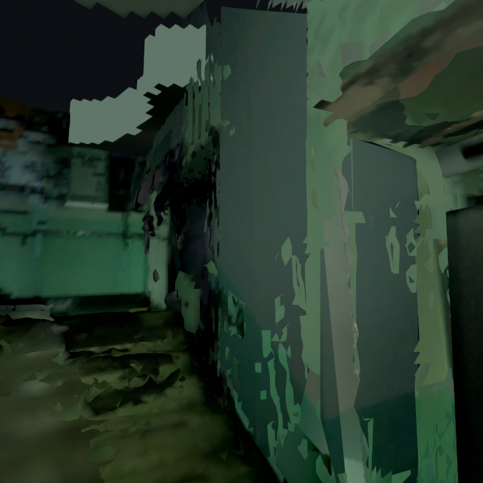

# 이용자 시점 메시 마감 — 2026-10-19

## 목적과 기준

렌더에서 겹쳐 깜박이는 면, 분리 조각과 불연속 메시를 정리해 최종 표시본을 구성했다. 실내 장소 원장과 표시 메시의 연결 방식도 함께 정리했다. 입력은 직전 색 유지 후보 `student_union_shadow_colour_v3`이며,
SLAM 포즈·원본 DB·실제 사진은 바꾸지 않는다. 새 전역 색 보정도 하지 않는다.

이는 **표시 메시 마감**이다. 모든 건물 표면을 측량 정확도로 복원하거나, 미촬영
공간을 안다고 가정하거나, 현재 보행 안내를 승인한 작업으로 바꾸어 부르지 않는다.

**최종 선택(2026-10-19):** 렌더와 전체 형상 검토를 거쳐
`student_union_final_mesh_v9`를 최종 작업 지도로 고정했다.
[확정 기록](../../config/final_map_selection.json)에 원래 기하 지도와 표시본의
manifest 해시, 5개 세션의 포즈 선택, 남은 한계를 기록했다. 이제 표시본 선택을
기다리는 후보가 아니며, 다음 작업의 기준 버전이다. 실측/보행/공개 배포 검증은 별도다.

## 1. 수치와 실제 화면을 같이 확인

다섯 세션을 동시에 띄워 로비39/167/414/445/594/713/811, 2층282/548/644/730/
781/828/905/1020, 서브159, 외부브리지80, 외부69/263의 **19개 고정 카메라**를
렌더했다. 요청한 번호가 사진 묶음에 없으면 가장 가까운 실제 노드를 쓰고 그 번호를
그림에 기록한다. 원본사진은 원래 시선, 렌더는 제목의 추가 pitch이며 중앙 전후는
같은 시점이다. 회색 기하도 따로 보아 색 경계를 메시 구멍으로 오인하지 않게 했다.

초기 정확 XYZ 용접 분석에서 로비5,426개, 2층6,188개 연결 성분이 나왔다.
이것이 모두 잘못된 조각은 아니다. 실제 표지·문틀·다른 면과 UV가 분리된 패치도
포함하므로 큰 성분 하나만 남기는 방법은 쓰지 않았다.

## 2. 전역 정리: 보존 대상과 제거 대상을 먼저 구분

[설정](../../config/final_mesh_finish.json), [구현](../../src/finalize_display_mesh.py).

1. **보호**: 등록 의미 물체 주변10cm, 기존 계단 보호 범위, 1층/2층 고정 바닥,
   기존 층간 설비 공간의 밑면·옆면·상부 및 최종 지붕을 고정한다.
2. **작은 분리 조각**: 연결 성분 면적0.02㎡ 미만, 공간 대각선0.45m 미만에서
   보호 물체를 포함하지 않는 조각만 제거한다. 점 개수만으로 실제 표지를 버리지 않는다.
3. **기존 면이 완전히 덮는 옛 잔여 면**: 삼각형 꼭짓점3개+변 중점3개+중심1개를
   검사한다. 바닥/천장의 실제 존재 셀로 모두 덮이는 작은 높이대의 잔여 면만 제거한다.
   벽은 유한한 기존 평면 패치와 거리6cm·법선일치0.96 조건을 모든 표본에서 확인한다.
   새 큰 빈칸이나 문/로비를 채우는 연산이 아니다.
4. **중복 삼각형**: 10µm 좌표 키는 중복 분석에만 사용한다. 지도 전체를 격자로
   이동시키지 않는다. 같은 삼각형은 의미 사진·구조면·선택 세션 우선순위로 하나만 남긴다.
5. **삭제 후 재검사**: 겹친 면 제거로 새로 떨어진 작은 조각을 한 번 더 정리한다.
   첫 후보v2는 이 후처리가 없어 일부 영역의 조각 수가 다시 늘었고 v3에서 보완했다.
6. **좁은 접합**: 서로 다른 연결 성분의 경계에서 상호 최근접·동일 평면·법선일치
   조건을 만족하는 1.8cm 이내의 틈만 쌍으로 맞춘다. 정점 이동은 최대약9mm다.
   뒤집힘/면적 급감은 쌍 전체를 되돌린다. 수평 높이와 보호 대상은 고정한다.

전역v3에서 삼각형 **140,267개**를 제거하고 경계639쌍을 접합했다. 이는 품질 점수가
아니며 그림으로 개선/손실을 별도로 봤다. 2층 성분6,188→1,861, 로비5,426→637,
서브473→178, 외부브리지147→46, 외부265→246이다. 모든 성분을 강제로 한 덩어리로
만드는 것이 목표는 아니다.

## 3. 직접 보니 남은 문제: 메인 계단 옆 두 벽

전역 정리 뒤 서브 계단159의 문/안내문은 가리는 면이 줄어 더 또렷해졌지만,
로비445의 계단 옆 벽은 큰 거친 면이 남았다. 작은 조각 삭제만으로 해결하지 못했다.

원본445를 직접 확인하고, 문·계단·난간과 구분되는 두 벽을 따로 지정했다. 하나의
평면을 실제 꺾인 코너 너머까지 적용하지 않는다. 원본 RGB-D의 RANSAC 평면으로
지지되는지 다시 검사했다. 최종 넓은 영역의 depth inlier는 약99.3%/95.6%,
p90 평면잔차 약1.3/1.6cm다. 이는 같은 촬영의 평면 일관성이지 독립 측량 정확도가 아니다.

### 실패를 남김: 안쪽 사각형만 사진으로 붙이기

v4/v5는 벽 안쪽의 좁은 영역만 바꿨다. 렌더에서 어두운 사각형 경계가 새로 보여
**기각**했다. 한 촬영본만 바꾸었기 때문에 다른 세션의 옛 면도 새 벽 앞을 가렸다.
실제 광선 검사에서 두 표본의 서브 세션 벽이 새 로비 벽보다 약8.9cm/5.1cm 앞에
있었다. 해당 시점에서 실제 교차 면을 확인하고 수정했다.

v6은 같은 범위를 다른 세션에서도 정리했으나, 임의의 내부 사각형이라는 경계 문제는
남았다. 이것도 최종 색감으로 자동 채택하지 않았다.

### 수정: 실제 보이는 벽 경계까지, 동일 장소의 중복 면을 함께 정리

[사진 영역 설정](../../config/final_reviewed_wall_patches_wide.json),
[구현](../../src/repair_reviewed_wall_finish.py).

v7은 사진의 실제 문틀·벽 코너·계단 경계에서 끝나는 영역으로 바꾸었다. 문/계단
개구부를 가로지르지 않도록 오목한 사진 다각형 삼각형의 꼭짓점·중점·중심도 검사한다.
등록된 문·표지·창, 고정 바닥과 층간 설비층 외피는 보존한다. 원본사진은 덮어쓰지 않고
두 벽에 한해 원본 crop을 같은 약한 암부 규칙으로 표시한다. 일반 바닥/간판을 재색칠하지 않는다.
같은 사진 영역/평면대 안의 옛 벽을 로비와 서브 세션에서 함께 제거한다.

v7에서도 남는 일부 조각이 있었고, v8에서 실제 새 메시의 7개 표본 광선 교차로
삭제 범위를 다시 확인했다. v9에서는 **이 두 장의 확인된 맨벽 영역 안에서만** 잘못된
삼각형 법선을 벽/계단 분류의 근거로 삼지 않았다. 수평처럼 보이는 작은 벽 잡음도
있기 때문이다. 실제 보행 바닥/설비 외피/등록 물체/사진의 난간 보호 구간은 유지하며,
모든 삭제 면이 실제 새 벽 메시로 덮이는지를 독립적으로 다시 확인했다. 원래 계단
전체를 평면으로 바꾼 것이 아니다. 이 국소 예외를 건물 전체에 적용하지 않는다.

채택한 보기용 정리본은 **`outputs/student_union_final_mesh_v9/`**다. 벽 보완 단계의
제거는12,170면(로비3,966/서브8,204), 새 사진 지지 벽은5,100면이다. 전역 정리와
합쳐 순감소147,337면이다. 이 범위 밖의 미관측 벽·천장까지 확장하지 않는다.
실패 후보는 출력 폴더에 보존했다.

## 4. 실제 결과와 보존 검사

[전역 독립 검사](../../src/audit_final_mesh_finish.py)는 실제 GLB/PLY의 같은 좌표,
원래 이미지·UV·색·재질 바이트 보존, 의미/고정 면의 유지, 접합 이동/뒤집힘을 검사했다.
실제 상부 바닥·밑면·옆면이 합쳐진 설비 외피의 열린 변/비다양체는0개이고 내부
6방향 광선261,276개가 통과했다. 이는 건물 전체가 닫혔다는 뜻이 아니다.
[벽 후처리 독립 검사](../../src/audit_reviewed_wall_finish.py)는 실제 최종 파일에서
남긴 원본 좌표/색, 수평 계단·바닥, 외피, 이전 의미 물체와 새 사진 crop을 다시 검사한다.
여기서 바닥/외피 보존과 사진으로 지정한 벽 안의 잘못된 법선 조각 제거는 구별한다.
실제 삭제된12,170면 전부의7개 표본이 새 벽에 덮임을 확인했다. 단순히 정상 법선만
남겨 거친 벽의 잡음을 그대로 보호하는 실수도 피했다.

작은 카메라 좌우 이동±1cm/회전±0.8°에서도 동일 조건의 실제 전후 렌더를 저장했다.
이는 실제 보행 경로나 모든 시점의 깜빡임이 없다는 인증이 아니다.
[렌더 코드](../../src/render_mesh_motion_review.py).

[메인 계단 벽의 실제 전후 움직임](../assets/final-mesh-cleanup-20261019/lobby_445_motion.gif),
[2층 복도의 실제 전후 움직임](../assets/final-mesh-cleanup-20261019/floor2_828_motion.gif),
[실제 열린 로컬 창의 렌더](../assets/final-mesh-cleanup-20261019/native_scene_render.png),
[최종 파일/현재 포인터/원본 지도 일치 검사](../assets/final-mesh-cleanup-20261019/delivery_audit.json),
[의미 물체ID/원본사진/무효화된 face index 검사](../assets/final-mesh-cleanup-20261019/semantic_binding_audit.json).
메시 마감 당시 전체 테스트537개, 최종 선택 기록의 일관성 검사 추가 후539개가
통과했다. README와 이번 문서의 로컬 파일 참조도 확인했다.

## 5. 남는 한계와 최종본의 의미

현재 색감을 유지한 **보기용 정리본**과 원래 센서 지도는 별도 버전이다. 일부 큰
미관측 외곽, 계단의 깊이 잡음, 사진에 구워진 조명 경계는 남는다. 특히 회색 기하는
평평한데 색만 조각처럼 보이는 천장은 메시 삭제를 더 해서 해결할 문제가 아니다.
바닥과 천장의 원래 재질 및 전역 밝기는 유지했다.

따라서 “공개 이용자에게 모든 구간이 완전하게 보이는 서비스 최종판”이나 안전한
길찾기 지도라는 승인은 하지 않는다. 웹용 경량화/LOD, 개인정보, 보행 연결 검증도
별도 남는다. 새 큰 관측을 꾸며내지 않고 확인 가능한 범위에서 정리한 표시 버전이다.

## 6. 실내 주소는 메시 바깥에 저장

메시 삼각형 번호는 이번 정리에서도 바뀌므로 영구 주소로 사용할 수 없다.
기존 `current_triangle_indices`는 원본 이력에 남기고 최종 파생본에서 무효화했다.
안정적 object_id·world_boundary·원본사진은 보존했다.

**건물 → 층 → 호실·매장** 주소 원장은 별도 SQLite에 두고 웹으로 JSON을 내보내는
방식을 제안한다. 표식 위치와 실제 출입문/보행 노드를 분리하고 지도 버전에 연결한다.
촬영 세션은 층이 아니며, 표시용 Z나 최근접 삼각형으로 접근 가능성을 결정하지 않는다.
[필드·테이블·JSON 예시·입력 순서](../indoor-address-storage-plan.md).
이번에는 주소 DB를 새로 만들거나 임의 호실번호/문 연결을 등록하지 않았다.
