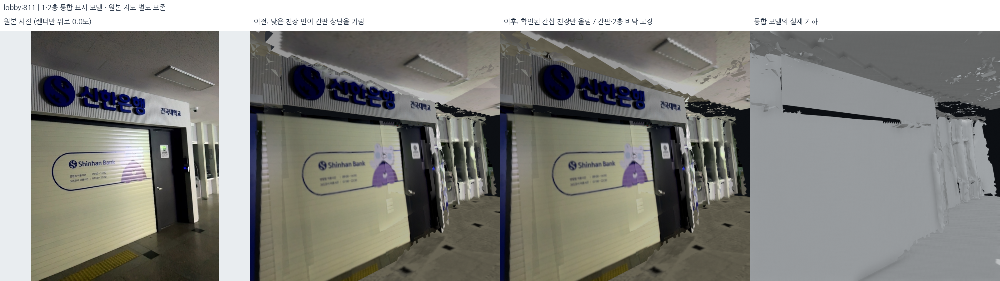
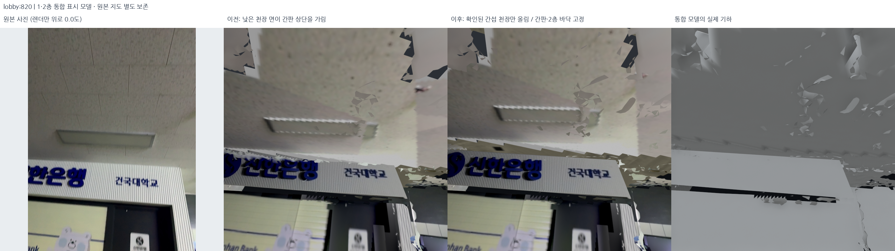
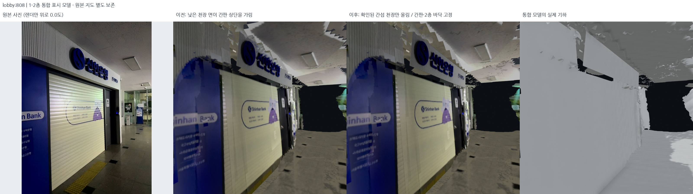
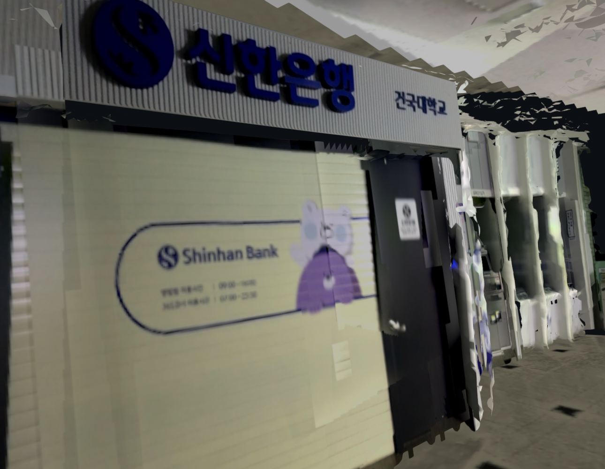
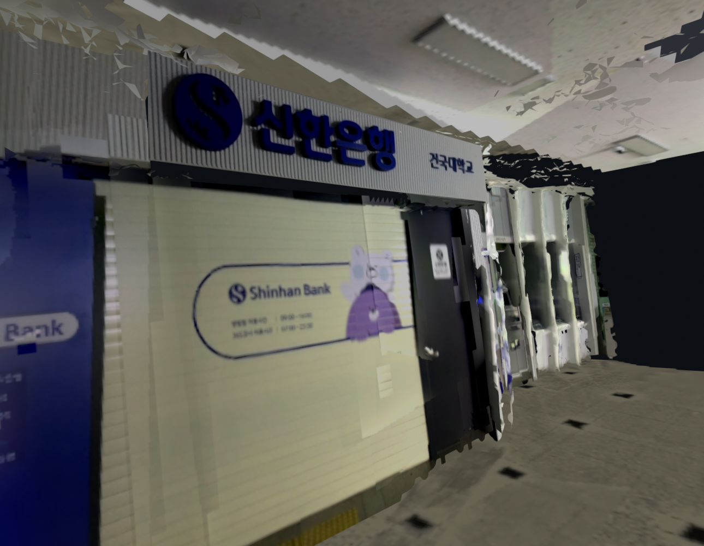
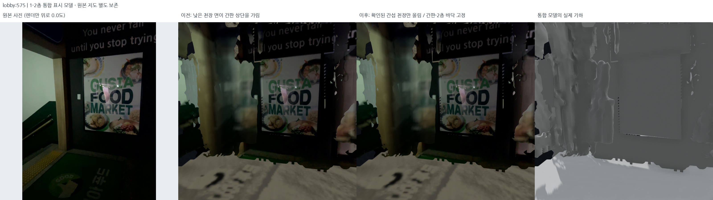
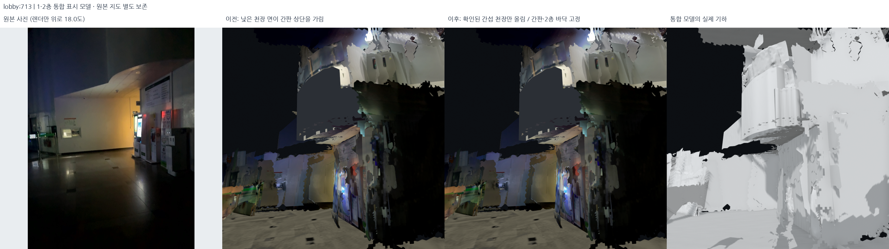
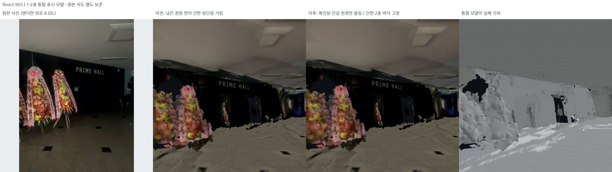

# 1층 천장의 간판 가림: 국소 보정 — 2026-10-19

## 문제와 적용 범위

1층 천장이 간판 상부를 가리는 문제가 관찰되었다. 원본 사진과
현재 GLB를 같은 카메라에서 직접 비교했다. **신한은행 상부 간판은 실제로 기존
낮은 천장과 옛 천장 조각에 가려지고 있었다.** 은행의 정면 #811과 옆면 #820/#808에서
이를 재현했다. 사진을 확대하거나 글자를 낮춰 붙인 것이 아니라 가리는 면을 고쳤다.

다른 검토 대상에는 천장이 아닌 벽 조각 가림과 원본 사진 자체의 잘림도 섞였다.
따라서 **1층 전체 천장을 일괄로 올리지 않았다.** foodmarket #575의 문구와
하층 화장실 표지 #14는 같은 천장 원인으로 분류하지 않았고 현재 상태를 유지했다.
이는 모든 미등록 간판을 전수 확인했다는 의미가 아니다.

현재 표시본: `outputs/student_union_lower_ceiling_clearance_v22/`.
선택한 v15 재질과 v18 경계 마감을 유지한다. 중앙 복층 로비에는 여전히
낮은 천장이 없고, 1층/2층 바닥과 원본 포즈는 움직이지 않는다.







## 원인

이전 은행 층간 닫힌 구조는 천장 관측 평면들의 대표 높이로 밑면을 만들었다.
그 표시 밑면은 z=1.756366m였고 별도로 원본 사진에서 복원한 간판의 상단은
z=1.883669m였다. 두 파생 결과 사이에 **간판 상단이 천장 아래에 있어야 한다는
표시 제약이 없었다.** 기존 낮은 관측 조각도 함께 남아 있었다.

이것은 새 SLAM 재최적화 결과가 아니라 표시 모델의 기하 간섭이다. 원본 지도와
카메라 포즈는 교체하지 않았다. 사진·depth 재구성 사이의 불확실성이 있으므로 아래
수정 높이를 실제 천장 실측 높이라고 부르지 않는다.

## 단계와 알고리즘

### 1. 원본 사진과 첫 교차면 확인

`inspect_lower_ceiling_signs.py`:

- 등록된 하층 의미 간판의 실제 3D 경계와 표시 카메라를 사용한다.
- 간판 면에 보낸 ray의 첫 교차면이 간판보다 앞에 있는지 검사한다.
- 교차면의 위치·법선으로 낮은 수평 천장과 다른 벽 조각을 구분한다.
- 이는 표시 모델의 가림 진단이지 OCR·측량·독립 정확도 평가가 아니다.
- 수치는 원인 확인에만 사용했다. 실제 정면/양옆 렌더를 보아 최종 표시를 선택했다.

### 2. 기존 닫힌 층 구조의 밑면만 위로 — v19

`clear_lower_ceiling_signs.py`, `lower_ceiling_sign_clearance.json`:

- 원래 은행 `bank_slab_mask.npz`의 **동일한 XY 격자 꼭짓점**과 기존 밑면 높이를
  동시에 만족하는 정점만 선택한다. 가까운 일반 벽·간판 정점을 임의로 선택하지 않는다.
- 간판 상단 + 최소 8cm 보기용 여유를 2cm 단위로 올림하여 밑면 z=1.98m로 설정했다.
  약 22cm 상승이며 실제 건물 높이의 재측량 값이 아니다.
- 윗면인 2층 바닥 z=2.60m는 고정. 기존 측면의 아래 끝점만 같은 높이로 바뀌므로
  층 구조를 다시 벌리거나 XY 바깥으로 확장하지 않는다.
- 전체 X/Y, 다른 정점, 모든 재질/UV/사진 바이트와 간판 좌표는 그대로다.

이 단계만으로는 이전 낮은 천장 조각이 남아 글자 일부를 계속 가렸다. 그래서 v19를
최종 수정으로 선언하지 않았다.

### 3. 낮은 천장 중복 정리와 간판 앞 유한 영역 정리 — v20 / v22

`clean_lower_ceiling_overlaps.py`:

- v20: 원래 은행 천장 사진 마스크 안, 이전 높이 ±22cm, 새 천장보다 낮은 수평
  조각만 선택했다. 대부분 좋아졌지만 옆 시점의 글자 위 흰 조각이 남아 채택 보류.
- v22: `lower_ceiling_overlap_cleanup_v2.json`은 기존 사진 시점 811/820/808에서
  간판 면으로 보낸 ray의 **모든 교차**를 확인한다. 간판 앞에 교차하고 간판 평면에서
  35cm 이내인 유한 간섭 조각만 추가로 정리한다. 간판의 높이 범위도 제한한다.
- 수동 의미 사진을 사용하는 primitive는 제거 대상에서 명시적으로 제외했다.
  원본 은행 간판·문·창 사진, 다른 의미 객체를 지우는 방식이 아니다.
- 로비의 옛 천장/간판 앞 조각 506개 삼각형을 제거했다. 다른 4세션 제거는 0이다.
  남은 모든 삼각형의 XYZ와 기존 binary/UV/사진은 정확히 동일하다.
- 중간 v21은 확장한 필터와 기존 수평면 전용 보존 assertion이 맞지 않아 생성 중단했다.
  기본 표시로 사용하지 않았고, 보호 사진/유한 영역 조건에 맞춰 검사를 수정한 v22를
  실제 출력 검사와 렌더로 확인했다. v20 당시 처리 코드 snapshot도 출력 폴더에 보존했다.

### 4. 로컬 뷰어의 좁은 기본 화각도 별도로 수정

마지막 네이티브 화면을 직접 보니, 기하 수정 뒤에도 은행 로고 위가 **화면 밖**으로
잘려 있었다. `view_local_roadview.py`는 원본 사진 시점으로 이동할 때 방향만 바꾸고
개요 화면의 55도 렌즈를 그대로 쓰고 있었다. 오프스크린 증거 렌더는 원래부터 RGB K를
사용했으므로 이는 별개의 **로컬 카메라 투영 문제**였다.

`photo_view_intrinsics()`는 원본 720×960 RGB K를 실제 장면 패널에 contain-fit한다.
`scale=min(view_width/720, view_height/960)`로 초점거리를 조정하고 주점을 중앙 여백만큼
이동한다. 원본 시야를 자르는 crop-to-fill이나 임의 확대를 하지 않는다. 이 수정은
은행뿐 아니라 사진 시점으로 보는 모든 구간에 적용된다. 원본 사진/3D/포즈에는 영향이 없다.

아래 두 네이티브 장면은 **같은 수정 기하의 화각 전후**다. 이를 천장을 올린 기하
개선의 증거로 섞어 계산하지 않는다. 위의 6개 기하 전후 그림은 처음부터 같은 RGB K를 썼다.





## 실제 화면 판정과 남은 것

최종 정면과 양옆 렌더에서 파란 **신한은행 글자 위쪽이 보이는 것**을 직접 확인했다.
foodmarket, 1층 화장실/층 경계, 2층 PRIME HALL 쪽의 비교 렌더도 함께 저장했다.
천장 자체의 기존 관측 파편과 외곽 결손은 일부 남아 있다. 모든 간판의 모든 픽셀이
항상 완전히 보인다거나 1층 전체가 완성됐다고 주장하지 않는다.

최종 ray 진단에도 극소수 잔여 교차가 있어 0으로 만들기 위해 추가 삭제하지 않았다.
이는 **수치를 0으로 만드는 대신 실제 화면을 우선한 선택**이다. 다른 하층 간판의
비천장 가림까지 이번 천장 보정의 성과로 계산하지 않았다.







## 보존 검사와 로컬 비교

각 단계가 실제 GLB와 PLY를 비교해 XY/비대상 XYZ, floor·2F 높이, 이미지/UV/재질,
선택 필터 밖 원본 binary 보존을 검사한다. ray 진단 JSON 4단계와 렌더 카메라/원본
사진 해시도 함께 저장했다. 이 보존 검사는 외관 합격이나 실제 층고 정확도의 대용이 아니다.
최종 전체 코드 검사 503개와 실제 로컬 5세션 로딩을 확인했다.

- [실제 출력 보존 기록](../assets/lower-ceiling-clearance-20261019/geometry_audit.json)
- [실제 로컬 5세션 로딩](../assets/lower-ceiling-clearance-20261019/delivery_audit.json)
- [전후 카메라와 사진 해시](../assets/lower-ceiling-clearance-20261019/manifest.json)
- v22 manifest SHA-256:
  `442aece905b897f265044d17d2e8da3e7c014fb9a5b9ce5c6056f271cbc20d1d`.

```bash
PYTHONPATH=outputs/surface_runtime/packages:src OPENBLAS_NUM_THREADS=1 OMP_NUM_THREADS=2 \
  /usr/bin/python3 -s src/clear_lower_ceiling_signs.py --output outputs/reproduced_clearance_v19

# 다음 설정은 저장된 기존 v19를 source로 쓴다. 새 재현본을 연결하려면
# source_bundle을 새 경로로 지정한 별도 설정을 --config로 전달한다.
PYTHONPATH=outputs/surface_runtime/packages:src OPENBLAS_NUM_THREADS=1 OMP_NUM_THREADS=2 \
  /usr/bin/python3 -s src/clean_lower_ceiling_overlaps.py \
  --config config/lower_ceiling_overlap_cleanup_v2.json --output outputs/reproduced_clearance_v22

bash scripts/view_local_roadview.sh --start-view bank
```

로컬 메뉴 **Before: low bank ceiling / sign clipping (v18)**가 수정 전이다.
기본 모드는 수정 후이며 은행 간판이 화면 위로 잘리지 않도록 초기 pitch도 0도로
둔다. 카메라 변경을 기하 개선으로 세지 않기 위해 전후 증거 렌더는 모두 같은 pitch다.
원본 데이터와 선택 지도를 유지했다.
