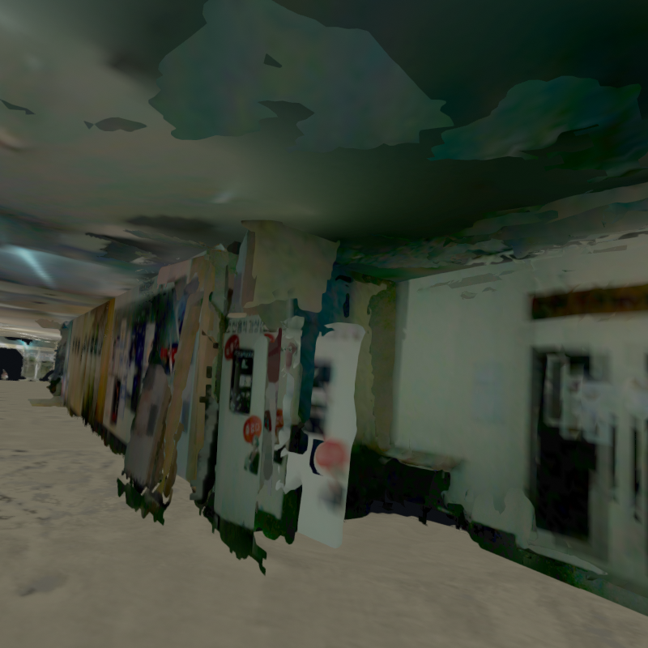
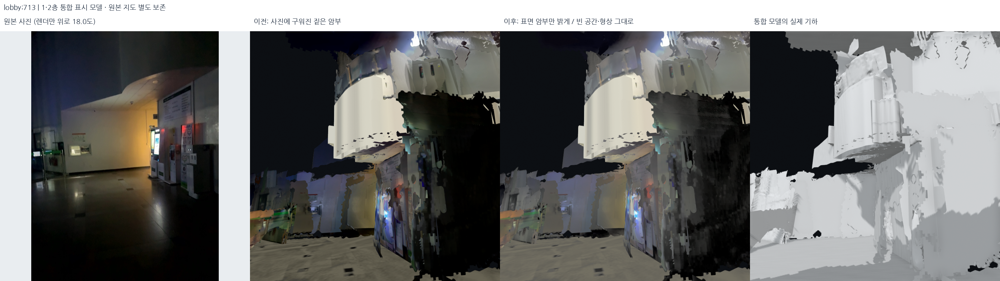
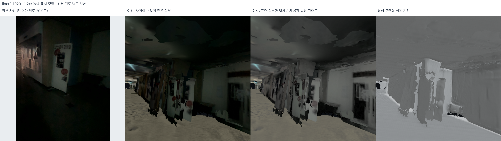
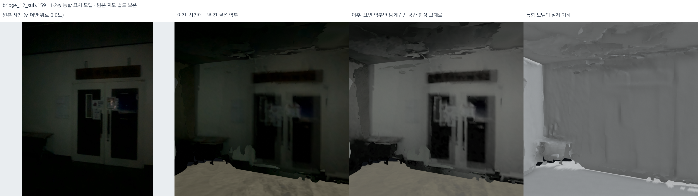
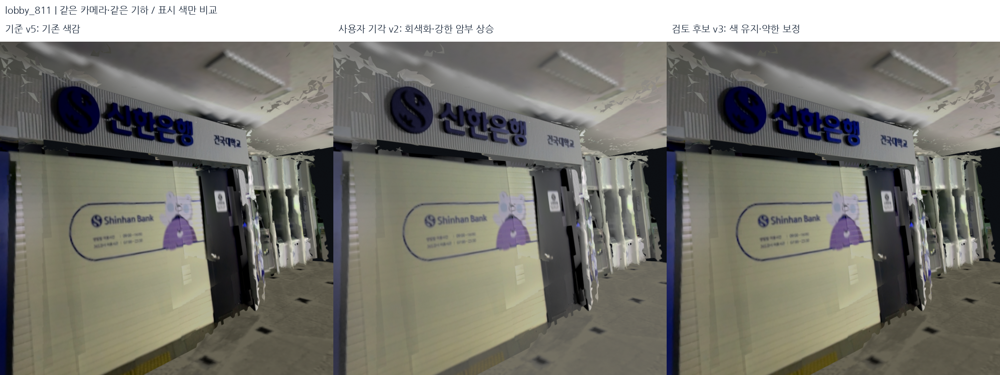
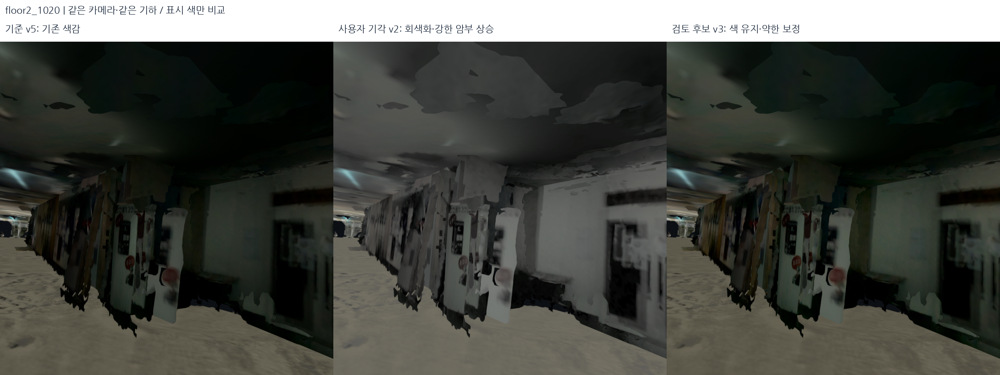
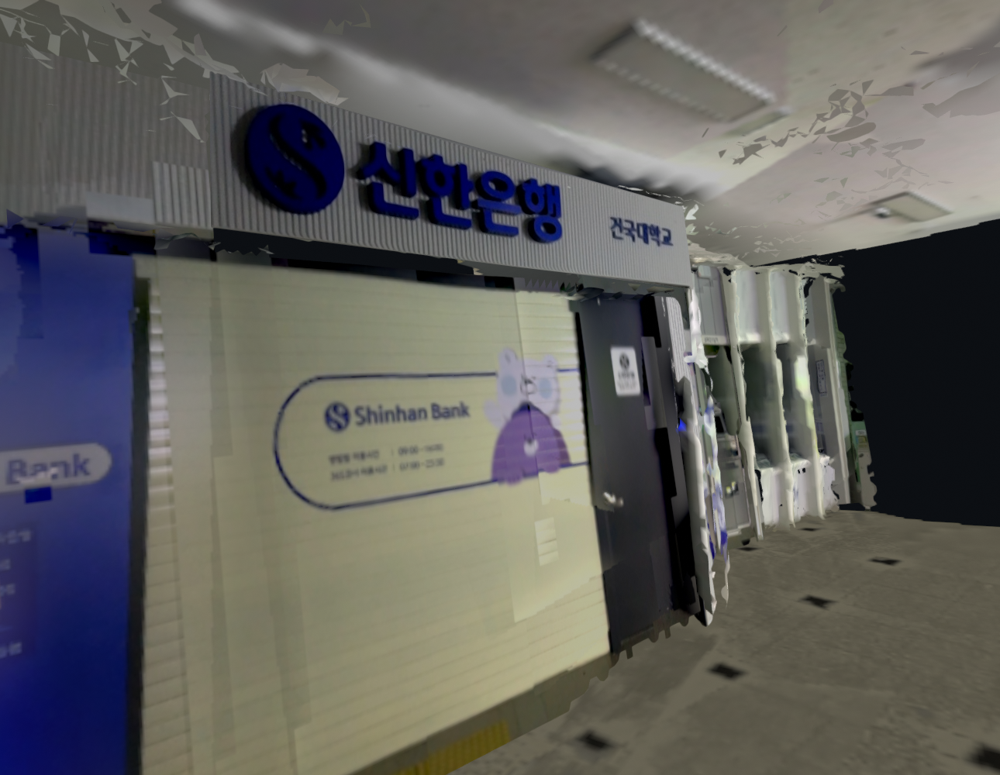

# 암부 밝기 보완과 웹 로드뷰·외부 3D 캠퍼스 인계 — 2026-10-19

## 암부 보정과 표시 구조

어두운 관측 표면의 색을 보정하고, 사람 시점의 사진 안내와 캠퍼스 배경을 연결할 구조를 정리했다. 이 문서의 실행 결과는 밝기 파생본이며 당시 웹과 보행 경로는 설계 단계였다. 후속 구현은 [웹 문서](../../web/README.md)에 있다.

캠퍼스 배경은 공개 지도 데이터를 사용하고 학생회관 실내는 직접 수집한 센서 지도로 구성한다. 외부 화면의 게임 모델은 지도 데이터 출처에 포함하지 않는다.

## 1. 암부 원인과 첫 후보 실패

현재 native표시는 원본 사진/정점의 색이 구워진 unlit표면이다. 장면 조명을
추가하는 것만으로 이 색이 밝아지지는 않는다. 실제 면이 없는 검은 빈칸과,
표면은 있지만 색이 어두운 부분을 구별해야 한다.

입력은 승인된 `outputs/student_union_closed_ceiling_material_v5`다. 포즈·형상·
원본사진은 그대로 두고 다섯 세션의 활성 사진 texture325개와 baked colour
stream14개를 같은 규칙으로 처리했다. 이는 독립 원본사진325장이라는 뜻은 아니다.

v1은 선형RGB의 휘도 gain을 세 채널에 곱했다. 실제 로비713·2층1020·서브계단159
렌더를 보니 어두운 표면은 보이지만 **초록/붉은 저조도 색 노이즈도 증폭**됐다.
따라서 기본 표시로 채택하지 않았다. v1의 출력·실행 소스/config snapshot을
`outputs/student_union_shadow_visibility_v1/`에 보존했다.



## 2. 두 번째 후보 — 시각 검토에서 기각: 중성 밝기 추가로 색감 소실·노이즈 노출

코드 [lift_display_shadows.py](../../src/lift_display_shadows.py),
설정 [display_shadow_lift.json](../../config/display_shadow_lift.json).

1. PNG의 sRGB를 선형RGB로 바꾸고 glTF `COLOR_0`는 원래 선형색으로 읽는다.
2. 휘도 `Y = 0.2126 R + 0.7152 G + 0.0722 B`를 계산한다.
3. `g = min(8, 1 + 0.18*(1-Y)^3/(Y+0.018))`로 어두운 부분만 큰 밝기 보정을 준다.
4. `d = min(Y*(g-1), 1-max(R,G,B))`, `RGB' = RGB + d`를 사용한다.
   같은 양을 세 채널에 추가해 **선형 채널 차이를 증폭하지 않는다**. 어두운 색의
   채도는 낮아질 수 있지만, v1처럼 색 노이즈까지 gain배로 키우지 않는다.
5. 공간 blur/대비평준화/CLAHE/생성형 채움은 하지 않았다. 픽셀 위치·alpha·UV,
   텍스트 윤곽·돌 무늬를 섞거나 새로운 문양을 만들지 않는다. 밝은 부분의 변화는 작다.
6. 완전한RGB0과 렌더 배경은 그대로다. **기하가 없는 빈 공간을 새 표면처럼 밝히지
   않는다.** 이미0으로 잘린 관측 색의 실제 세부를 복구한 것도 아니다.

출력은 `outputs/student_union_shadow_visibility_v2/`다. 선택 지도/DB를 바꾸지 않고
GLB 활성 색 참조만 새 PNG/색buffer로 연결했다. 원본 binary prefix를 보존했다.
바닥/간판도 표시 색이 밝아질 수 있지만 **원본 RGB사진 pack은 전혀 수정하지 않았다.**
표시 atlas 색 불변을 주장했던 과거 v5 감사와 이번 색 변경 감사는 구별한다.

**색 노이즈와 채도 손실 때문에 시각 검토에서 기각했다.** 선형 채널의 절대 차이를 보존한다는 것은
채도 보존이 아니다. RGB에 같은 밝기 `d`를 더하면 상대적인 색 차이는 작아져
어두운 색이 회색으로 밀린다. 게다가 최대 gain8의 큰 밝기 상승은 원래 보이지 않던
텍스처 잡음과 거친 형상을 드러냈다. 숫자 감사 통과를 외관 합격으로 간주하면 안 된다.
이 후보는 기본 창에서 내리고 승인된 v5 색감으로 먼저 복귀했다. 실패 출력/설정/
실행 소스 snapshot도 남겨 둔다. 아래 v2 비교는 **실패의 기록**이지 최종 채택본이 아니다.

## 3. 기각 v2의 실제 전후와 보존 검사

원본RGB / 같은카메라의 이전표시 / 암부보완 / 회색기하를 저장했다. 원본사진은
원래 시선이며 렌더에만 제목의 pitch가 적용됐다. 중앙 전후 두 칸은 같은 카메라다.







독립 출력 검사 [audit_display_shadows.py](../../src/audit_display_shadows.py)는 실제
5GLB의 원본binary prefix, POSITION/NORMAL/UV/index/재질배치, PLY해시를 대조한다.
픽셀크기·alpha·완전검정 보존, 실제 색이 어두워지지 않는지, 정점의 선형 색 차이가
보존되는지도 검사한다. 이 검사는 외관 합격을 대신하지 않는다.

밝아졌어도 파편·가려진 부분·잘린색·저해상도·원래 조명 경계는 남는다. 측량 정확도,
텍스처 relighting의 정답이나 길찾기 승인이 아니다. 시각 검토에서 기각하여 웹의 기본
색감으로 그대로 넘기지 않는다.

## 3-1. 수정 후보 v3: 기존 색감에서 다시 시작하고 약하게 보완

입력은 **v2가 아니라 승인된 재질 v5**다. v2에 saturation을 다시 올리는 방법은
잘못 늘어난 노이즈까지 재강조하므로 사용하지 않는다.
[설정](../../config/display_shadow_colour.json), [색 보정 코드](../../src/refine_shadow_colour.py).

1. 어두운 텍스처에서만 Y/Cr/Cb별 5픽셀 bilateral filter를 적용한다. 휘도 강도0.35,
   색 성분0.75이며 밝은 곳, 큰 글자/색 경계, alpha/검정 경계는 보호한다.
2. 원본과의 변화는 필터 단계에서 채널당 최대6/255로 제한한다. 행 단위 처리에는
   8픽셀 halo를 사용해 계산 조각의 경계가 생기지 않게 한다.
3. 선형 휘도 `Y`, `s=max(0,1-Y/0.2)^2`, `q=Y/(Y+0.004)`를 사용해
   `g=min(2.2, 1+1.6*s*q, 1/max(R,G,B))`, `RGB'=g*RGB`로 약하게 올린다.
   같은 gain을 곱하므로 **필터 후 RGB의 색 비율**은 유지되고 회색을 더하지 않는다.
   거의 검게 잘린 센서 바닥은 `q`로 크게 올리지 않으며 `Y≥0.2`는 원래 색 그대로다.
4. 정점색은 영상 이웃 관계가 없으므로 공간 필터 없이 같은 약한 gain만 적용한다.
5. 출력 `outputs/student_union_shadow_colour_v3/`도 포즈/기하/UV/원본사진은 바꾸지 않는다.

이는 미세한 실제 질감도 줄일 수 있는 **보기용 절충 후보**다. 깊이·메시 파편이나
다중 프레임의 원래 조명 불일치를 이 필터로 해결했다고 하지 않는다. 노이즈를 없애려고
단색화하거나 암부를 다시 대폭 밝히지 않는다. 기하 보존, 선형 색 비율, 필터 강도,
밝은 픽셀/alpha/검정 보존을 테스트하고 실제 간판·바닥·복도 렌더로 별도 검토한다.
bilateral의 경계 보존 원리는 [OpenCV 공식 문서](https://docs.opencv.org/4.x/d4/d13/tutorial_py_filtering.html)를 참고했다.

실제 v5/v2/v3 렌더를 같은 카메라로 나란히 저장했다. 기준 v5 렌더가 두 실행에서
픽셀 단위로 같은지도 확인해 시점 차이를 색감 개선으로 잘못 읽지 않게 했다.
코드 [compare_shadow_candidates.py](../../src/compare_shadow_candidates.py).





실제 화면에서는 v3의 은행 짙은 파랑과 바닥 색이 기준에 가깝고, v2처럼 회색으로
뜬 표면이 줄었다. 2층 어두운 복도는 v2보다 어둡게 남겨 노이즈 노출을 줄이는
절충이다. 천장 파편/거친 벽은 여전히 보인다. 모든 어두운 면이 깨끗하게 복원된
것도, v3의 최종 표시 채택을 의미하는 것도 아니다.

다섯 세션 GLB를 로컬 창에 함께 열었다. 현재 메뉴는 **REVIEW: retained colour /
mild shadow lift**, 원래 색 비교 메뉴는 **Before shadow lift: accepted materials
(v5)**다. 기본창 경로는 `config/current_local_view.json`에서 읽어 설정/실제 표시가
어긋나지 않게 했다. [실제 파일·원본 지도 보존 검사](../assets/shadow-colour-20261019/delivery_audit.json),
[색·기하 출력 검사](../assets/shadow-colour-20261019/shadow_audit.json).

통합 테스트는 **527개 통과**했다. 추가 검사는 색 비율/과도한 gain 방지, 실제 잡음
표본의 제한적 억제, 강한 글자 경계/밝은 픽셀/alpha/검정 보존, 실제 GLB 출력과
행 halo 처리의 일치까지 포함한다. 수치 검사는 외관에 대한 사용자 승인을 대신하지 않는다.



## 4. 사람 시점 로드뷰: 웹의 일과 데이터 준비의 일

웹/로컬은 운영체제 구분이 아니다. **최종 이용자 UI**를 웹에서 만들면 되며 그 웹도
Ubuntu에서 개발/실행할 수 있다. ROS2/RViz가 최종 사용자 브라우저에 필요한 것은 아니다.

| 웹에서 만들 동작 | 그 전에 준비하거나 검증할 데이터 |
| --- | --- |
| 눈높이 기본1.60m·수평 시선·드래그 회전 | 실제 보행 바닥과 계단 중심선, 카메라/지도 축 변환 |
| 앞으로/뒤로·화살표·부드러운 이동 | 승인된 보행edge와 벽 통과/계단/출입문 검사 |
| 실제 사진과3D 전환·미니맵·층/POI 선택 | 기존1,199사진의 K·pose·방향·출처. perspective를360으로 늘리지 않음 |
| 캠퍼스 외부 건물 선택→학생회관 내부 | 외부모델 이용 권한·정확한 출입구portal·실내외 좌표배치 |
| 모바일 빠른 로딩 | 구역/층별 분할·중복색/미사용buffer제거·LOD·texture압축·필요사진만 요청 |

현재 GLB는 원본binary와 이력을 보존한 검토본이라 전체가GB급이다. 이를 모바일에
한 번에 싣지 않는다. 눈높이/회전 UI는 지금 시작할 수 있고, 실제 안내는 graph검증
뒤 켠다. 촬영순서1,194edge와 세션간근접후보1,357개는 보행 경로가 아니다.

## 5. 외부 3D 건물 안에 우리의 학생회관 넣기

첨부화면의 정확한 제작자·데이터 원출처는 **미확인**이다. 비슷해 보인다는 이유로
S-Map/브이월드/Google/학교제작모델 중 하나라고 단정하거나 게임asset을 가져오지 않았다.

확인 가능한 유사 구조는 서울시 **S-Map**이다. 공식 가이드에3D건물/배경,
주변건물투명화·실내지도·층선택이 설명돼 있다. 이는 **사진 게임의 출처라는 뜻이나
모델을 자유 다운로드/재배포할 수 있다는 뜻이 아니다.** 실제 도입 시 제공형식/
API·이용조건·표시/배포 권한을 확인해야 한다.
[S-Map 공식 사용가이드](https://smap.seoul.go.kr/guide/guide.html).

**기존 지도의 3D 메시를 쓰자는 사용자 제안은 가능하다.** OpenStreetMap의 2D 건물
윤곽 자체와 완성된 3D 모델은 다르지만, 이를 3D Tiles로 제공하는 **Cesium OSM
Buildings**가 있다. 건물별 숨김이 가능하고 공식 튜토리얼도 기존 건물을 숨긴 뒤
자체 3D 모델을 배치하는 과정을 제공한다. 따라서 외부 캠퍼스 레이어를 처음부터
직접 재구성하지 않고 그 안에 학생회관 실내를 표시하는 1차 접근으로 적합하다.
[공식 건물 레이어](https://cesium.com/platform/cesium-ion/content/cesium-osm-buildings/),
[공식 개별 건물 대체 예제](https://cesium.com/learn/cesiumjs-learn/cesiumjs-interactive-building/).

다만 이것이 게임처럼 사진 질감까지 갖춘 동일한 캠퍼스 메시라는 뜻은 아니다.
OSM에 높이가 없으면 추정 높이일 수 있어 **건국대의 실제 건물 포함 여부·형상·높이
품질은 현장 레이어를 열어 별도 확인**해야 한다. 공개 화면을 볼 수 있는 것과
데이터를 추출해 자체 서버로 재배포하는 권한도 다르다. Cesium 제공 레이어는 약관과
표기를 지켜 스트리밍으로 사용하며, OSM Buildings 같은 Asset Depot 자료는 ion의
archive/export 대상으로 내려받을 수 없다고 명시돼 있다. 우리 GLB를 그 서비스에
업로드해야만 한다고 단정하거나 실제로 업로드하지 않았다.
[공식 다운로드·내보내기 제한](https://cesium.com/learn/ion/cesium-ion-archives-and-exports/).

구현 구조는 다음처럼 분리한다.

1. 캠퍼스 외관/지형은 가벼운 **외부 맥락 계층**으로 표시한다.
2. 학생회관만 선택했을 때 지붕·외피를 숨기거나 반투명/층별cutaway로 바꾼다.
3. 같은 위치에 우리의 내부GLB와 원본사진 anchor를 배치한다.
4. 실외문과 실내문을 공통portal로 연결한다. 외관건물 전체를 지워 내부가 항상
   노출되게 하거나, 반대로 외피가 내부사진을 가리게 하지 않는다.
5. GNSS기반 거친 배치(보고정확도중앙14.25m, fit잔차2.97m)는 실측정답이 아니다.
   서로 떨어진 실제문/모서리 기준점으로scale1의 이동/방향을 검증한다. 수직datum도
   따로 결정한다. 보기좋게 실내를 비균등 scale로 늘려 끼우지 않는다.

현재 내부 좌표는 미터/Z-up이며 사진은 OpenCV광학축이다. Three.js기본Y-up을
사용하면 전체 scene에 `(x,y,z)→(x,z,-y)`를 **한 번만** 적용하고 카메라/경로에도
동일 적용한다. 광학카메라의+Z앞/+Y아래와 WebGL카메라의−Z앞/+Y위도 별도변환한다.
이 변환과 지리좌표배치를 구별한다. 참고: [Three.js 공식 문서](https://threejs.org/docs/).

## 6. Ubuntu에서 남은 작업, 다음 단계의 우선순위

**웹 표시 프로토타입은 지금 시작 가능**하다. 모든 정합이 완벽해질 때까지 UI개발을
멈출 필요는 없다. 그러나 실제 길찾기/공개서비스까지 끝났다고 해서는 안 된다.

1. 웹용 경량묶음: 층/구역 mesh와texture정리, 원본/검토본은 보존.
2. 계단·로비·외부문 anchor와 호실/POI graph를 검토해 보행 전이 승인.
3. 지리좌표/외부외피와실내정합, 문폭·통로폭·층간연결 검증. 현재J04국소회귀도 남음.
4. 외곽공유스무딩 후보의 닫힘 독립검사. 이번밝기만으로 해결된 게 아니다.
5. 얼굴·번호판/촬영 및배포권한, 외부3D자료권리·API도메인/키 설정.
6. ROS2/RViz 재현은 연구검증용으로 유지하고, 사용자 UI는웹에서 구현.

이 작업들이 Ubuntu에서 편한 이유는 현재 처리환경/원본이 여기 있기 때문이다.
기술적으로 반드시Ubuntu만 가능한 것은 아니다. 웹사이트 생성,
외부모델 다운로드/업로드·공개배포·

## 재현

```bash
PYTHONPATH=outputs/surface_runtime/packages:src OPENBLAS_NUM_THREADS=1 OMP_NUM_THREADS=2 \
  /usr/bin/python3 -s src/lift_display_shadows.py --output outputs/reproduced_shadow_visibility

PYTHONPATH=outputs/surface_runtime/packages:src OPENBLAS_NUM_THREADS=1 OMP_NUM_THREADS=2 \
  /usr/bin/python3 -s src/audit_display_shadows.py --bundle outputs/reproduced_shadow_visibility \
  --output outputs/reproduced_shadow_visibility/shadow_audit.json

# 시각 검토에서 기각 v2 대신 색 유지/약한 보정 후보 v3 재현
PYTHONPATH=outputs/surface_runtime/packages:src OPENBLAS_NUM_THREADS=1 OMP_NUM_THREADS=2 \
  /usr/bin/python3 -s src/lift_display_shadows.py --config config/display_shadow_colour.json \
  --output outputs/reproduced_shadow_colour_v3
```
