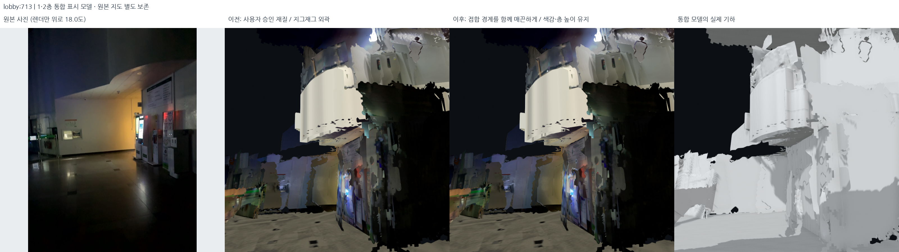
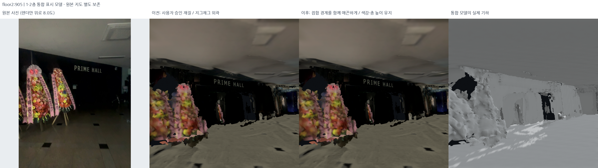

# 공유 외곽선 마감 후보 — 실행됨, 기본 표시로 미채택

## 외곽 경계의 문제

선택한 색감을 유지하면서 수집·확장 과정의 지그재그 경계를 정리하는 후보를 계산했다. 이전 v16은 맞닿은 바닥 패치를 각각 줄여 새 틈을 만들었다.
따라서 같은 XY 기둥에 있는 바닥·천장·설비층 옆면을 함께 움직이는 후보를 만들었다.

## 실제 실행

- 입력: `outputs/student_union_closed_ceiling_material_v5/` — 승인한 표시본.
- 후보: `outputs/student_union_shared_contours_v1/`.
- 설정: [shared_contour_finish.json](../../config/shared_contour_finish.json).
- 코드: [smooth_shared_contours.py](../../src/smooth_shared_contours.py).
- 외곽 셀 루프의 방향으로 바깥 경계와 내부 구멍을 구별한다. 내부 구멍은 고정한다.
- Ramer–Douglas–Peucker 계열 `approxPolyDP` 허용치 12cm로 큰 모서리를 유지하는
  거친 외곽을 찾고, 원래 정점은 해당 선분 방향으로 최대 5.5cm만 옮긴다.
- 같은 XY 격자 기둥의 모든 높이와 세션에 같은 이동을 적용한다. 개구부 20cm,
  의미 사진 영역 12cm 보호. 계단 보호 영역도 유지한다.
- 남은 비수평 원본 경계는 법선 일관성 0.95 이상에서만 7회 제한 이동한다.
  누적 상한 6.5cm. 뒤집힘·면적 급감은 기둥 전체를 되돌린다.
- 새 삼각형/제거 삼각형 0개, GLB에서는 POSITION만 변경한다. 원본 지도 포즈를
  재최적화한 것이 아니며 Z를 맞추는 작업도 아니다.

## 실제 전후 그림과 현재 판정

9개 원본 카메라 시점의 비교판을 생성했다. 로비 713·516·811·840,
2층 905·781·810·1020·892다. 그림의 원본 RGB와 렌더의 명시한 pitch는 구별한다.
실제 비교판을 보니 큰 외관은 거의 같고, 미관측 큰 파편이나 조명 경계까지 해결한
결과는 아니다. **최종 닫힘·공유 접합 독립 검사를 아직 완료하지 않아 기본 포인터를
바꾸지 않았다.** 4개 국소 단위 테스트 통과는 지도 전체의 닫힘/외관 합격과 다르다.

승인본은 계속 `student_union_closed_ceiling_material_v5`다. 후보의 세션별 이동 정점
수는 floor2 18,739 / lobby 22,879 / bridge_12_sub 3,113 / bridge_out1f 2,030 /
outside 9,592개다. 0이 아닌 이동 수는 개선된 경계 수나 품질 점수가 아니다.
새 시각자료는 전체 README 파일 색인에도 포함했다. 미완료를 성공으로 해당 실행 기록과 구분한다.

## 다음 승인 조건

1. 실제 상부 바닥 + 천장 밑면 + 측면을 합친 새 기하의 경계/비다양체 재검사.
2. 원본 RGB/UV/재질·의미 사진·수평 높이·보호 개구부 불변 검사.
3. 접합부 확대와 사람 눈높이 카메라에서 새 틈/뒤집힘이 없는지 육안 판정.
4. 통과한 경우에만 표시 포인터 변경. 길찾기 기하로 내보내지는 않는다.
