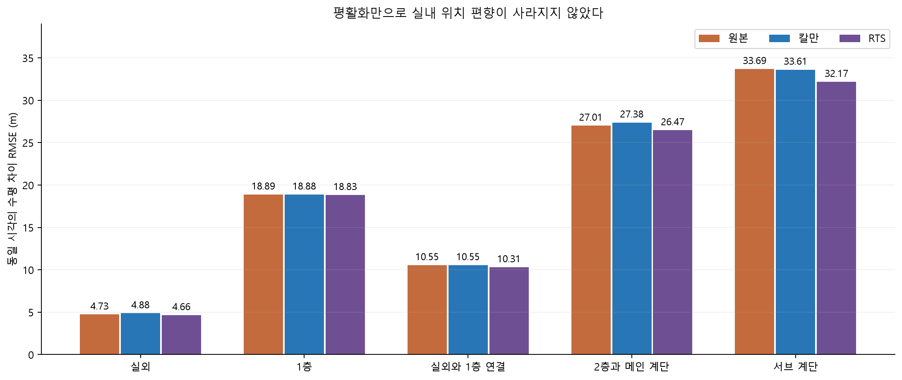

# 실내외 GNSS와 SLAM 지도 위치 대조

실내 수신은 기존 칼만과 RTS 처리 후에도 SLAM 지도 위치와 큰 차이가 남았다. 원본 GNSS, 칼만과 RTS를 동시각으로 비교한 1층 수평 차이 RMSE는 18.89 / 18.88 / 18.83m, 2층과 메인 계단은 27.01 / 27.38 / 26.47m였다. 위치가 부드러워진다는 이유로 실내 측위가 해결되었다고 해석할 수 없다.

이 값은 **GNSS, SLAM, 세션 배치와 지리 정합의 차이를 합친 상대 지표**다. SLAM을 독립 측량 정답으로 취급하지 않는다.

## 입력과 시간 대응

원본 DB 다섯 개를 SQLite 읽기 전용으로 열었다. 전후 SHA256이 같음을 확인했다. `Node.gps`의 48바이트를 시각, 경도, 위도, 고도, 보고 반경과 방향의 6개 float64로 해석했다. 원시 위성 관측량이 아니라 iOS 위치 서비스의 좌표다.

| 촬영 구간 | DB 노드 | 유효 GPS 저장 행 | 고유 측정 시각 | SLAM 시각 대응 |
| --- | ---: | ---: | ---: | ---: |
| 실외 | 354 | 354 | 338 | 337 |
| 1층 | 958 | 956 | 294 | 294 |
| 실외와 1층 연결 | 134 | 130 | 74 | 74 |
| 2층과 메인 계단 | 1,218 | 1,216 | 332 | 332 |
| 서브 계단 | 211 | 207 | 61 | 61 |
| 합계 | 2,875 | 2,863 | 1,099 | 1,098 |

같은 GNSS 시각이 여러 노드에 저장된 경우 한 번만 사용했다. 저장 노드 시각이 아닌 **위치 측정 시각**에서 SLAM 위치를 선형 보간했다. 촬영 범위 밖의 실외 첫 관측 한 개는 대응하지 않았고, 보간 양 끝 사이가 5초를 넘는 경우도 대응하지 않도록 했다. 촬영 중 우회와 재방문이 있으므로 최단경로를 위치의 정답으로 쓰지 않았다.

## 기준 위치의 출처

Windows 이관 ZIP에는 최종 선택 포즈 CSV가 없다. 웹 제작 때 사용한 절차를 그대로 복원했다.

1. DB `Admin.opt_poses`를 읽는다.
2. 세션 포트폴리오의 `O_FULL display_gauge`와 선택 지도의 강체 세션 배치를 적용한다.
3. 최종 렌더 사진 기준점의 위치 차이를 노드 번호에 따라 선형 보간한다.
4. 공개 웹의 사진 위치 189개 모두와 대조한다.

최대 위치 차이는 0.0000814m였다. 이는 **웹 위치를 재현했다는 코드 일관성 검사**이지, SLAM 정확도가 0.1mm라는 의미가 아니다. 이 비교 기준은 웹 위치 복원본이며 원래 선택 CSV의 2,251개 최적화 포즈와 같다고 주장하지 않는다. 독립적인 전체 최종 포즈 평가에는 원래 CSV가 필요하다.

## 글로벌 좌표와 SLAM 좌표

WGS84 위경도를 ECEF로 변환한 뒤 기준점의 ENU에 투영했다. 저장 고도의 기준이 확인되지 않아 높이는 이 수평 변환에 넣지 않았다. 변환은 [PROJ의 지리 좌표와 topocentric 변환 설명](https://proj.org/en/stable/operations/conversions/topocentric.html)과 같은 순서다.

```text
origin latitude  = 37.542051336731454 deg
origin longitude = 127.07786742632618 deg

R = [-0.1686777435, -0.9856712529
      0.9856712529, -0.1686777435]
t = [6.9320307273, -2.3947700791] m
display offset = [2, -2] m

ENU = R * mapXY + t + display offset
mapXY = transpose(R) * (ENU - t - display offset)
scale = 1
```

계산용 Python과 운영 웹의 GNSS 변환 차이는 최대 1.42×10⁻⁹m, 캠퍼스 ENU와 GNSS ENU의 동일 입력 차이는 0이었다. 위경도 내보내기용 근사 역변환의 왕복 차이는 이번 범위에서 최대 0.0663m였다. 축 뒤집힘이나 배율 차이를 발견하지 못했다. **변환식이 일치한다는 사실은 지리 정합의 절대 정확성을 보증하지 않는다.**

동 2m, 남 2m의 화면 배치 이동을 제거했을 때 원본 대조 RMSE는 1층 18.86→16.89m, 2층 27.01→26.68m였다. 2.83m 화면 이동만으로 실내 차이를 설명할 수 없다.

실외 337개 대응으로만 같은 강건 SE(2)를 다시 계산한 진단 yaw는 102.15°였다. 첫 절반과 뒤 절반을 각각 사용하면 92.28°와 114.38°로 달라졌다. 보행 범위가 지도 X 18.43m, Y 14.32m인 짧은 기록에서 지리 배치가 안정적으로 결정되었다고 보기 어렵다. 이는 상관된 동일 기록의 민감도 시험이며 독립 검증이나 신뢰구간이 아니다. 후보 변환을 운영 지도에 적용하지 않았다.


## 기존 필터와 후보정

운영 웹과 같은 `GnssFilter`와 `rtsSmooth`를 사용했다. iOS DB의 보고 반경은 신뢰수준이 불명확하여 보수적으로 반경 자체를 σ로 사용했다. 브라우저 위치의 95% 반경과 구분한다. 설정은 σa=1.2m/s², NIS χ²(2,99%)=9.21034, 최대 보고 반경 50m, 재초기화 공백 15초다.

| 구간 | 공통 시각 | 원본 RMSE | 칼만 RMSE | RTS RMSE | 원본 중앙값 / P90 |
| --- | ---: | ---: | ---: | ---: | ---: |
| 실외 | 337 | 4.73m | 4.88m | 4.66m | 4.36 / 6.90m |
| 1층 | 293 | 18.89m | 18.88m | 18.83m | 18.18 / 26.62m |
| 실외와 1층 연결 | 74 | 10.55m | 10.55m | 10.31m | 9.99 / 12.18m |
| 2층과 메인 계단 | 332 | 27.01m | 27.38m | 26.47m | 24.36 / 36.14m |
| 서브 계단 | 61 | 33.69m | 33.61m | 32.17m | 19.23 / 52.47m |

1층 보고 반경 50m 초과 한 개는 필터 기록이 없어 공통 비교에서 빠진다. 중앙값과 P90은 원본 전체 대응 시각의 지표이고 RMSE는 각 행의 공통 시각이다. 2층 세 개와 서브 계단 한 개는 속도 게이트에서 거부됐다. 위 칼만 RMSE는 이 시각의 내부 예측도 포함한다. UI의 마지막 정상 위치 유지에 대한 지표는 `summary.json`에 따로 기록했다.





## 길과 층의 대조

12cm 보행 격자와의 최근접 거리를 계산했다. 평가할 층은 SLAM 높이에서 참조한 것이며 GNSS로 알아낸 층이 아니다. SLAM 카메라 높이가 바닥+1.5m와 0.65m 이내인 시각만 층별 보행면 평가에 사용했다. 계단 중간과 실외는 해당 평가에서 따로 취급한다.

GNSS가 보행면 근처에 있으면서 실제 동시각 기준 위치와 10m 이상 떨어지는 표본도 있다. 따라서 최근접 복도로 좌표를 강제로 옮겨 놓는 것만으로 현재 복도를 확인했다고 할 수 없다. 1층과 2층은 같은 XY를 공유할 수도 있다.


3차원 그림의 GNSS 점 Z에는 비교용으로 동시각 SLAM 높이를 넣었다. GNSS가 층을 알아냈다는 결과가 아니다.

## 카메라를 켜지 않는 웹 측위의 다음 설계

지도 제작 때의 카메라와 LiDAR 사용은 유지한다. 방문자는 카메라 없이 웹만 사용하고, 입구에서 시작 위치를 한 번 선택하는 조건으로 구분했다. 현재 운영 기능은 실외 위치 표시와 수동 입구 확인 후의 경로 안내다. 자동 실내 PDR나 GNSS/IMU EKF를 구현 완료한 상태는 아니다.

다음 후보는 브라우저 가속도와 회전 이벤트의 보행 모델, GNSS 관측을 결합하는 PDR-aided EKF와 복도 지도 제약이다. 위치, 방향, 보폭 계수와 방향 편향을 상태로 두고 걸음마다 비선형 이동 예측을 한다. GNSS는 품질 및 혁신 검사 후 사용하고 실내에서는 편향된 관측이 추정을 끌고 가지 않게 제한한다. 지도는 벽 통과와 불가능한 층 이동을 제한하며 목적지 경로를 위치 관측처럼 쓰지 않는다.

이것은 연속 가속도를 이중 적분하는 완전한 strapdown GNSS/INS ESKF와 다르다. 일반 IMU 기반 ESKF의 자세와 오차 상태 구성은 [Solà의 원 논문](https://arxiv.org/abs/1711.02508)을 참조한다. 현재 다섯 DB에는 새 GNSS/INS 시험에 필요한 고속 가속도·각속도 연속 기록이 없다. 새 방문자의 웹 센서 로그를 동시 수집해야 한다. ARKit의 저장 자세나 중력 제약을 원시 IMU라고 바꿔 부르지 않는다.

Safari 웹은 건강 앱 HealthKit 저장소를 직접 읽는 API를 제공하지 않는다. [Apple HealthKit 권한 문서](https://developer.apple.com/documentation/healthkit/authorizing-access-to-health-data)는 앱의 capability와 권한 구성을 요구한다. 웹에서는 걸음을 별도로 검출해야 한다. [Device Orientation and Motion 표준](https://www.w3.org/TR/orientation-event/)은 HTTPS와 사용자 권한, 보이는 문서에서의 이벤트 전달을 규정한다. 화면 잠금이나 다른 앱 전환 후에도 연속 수신된다고 가정하지 않는다. 휴대폰 방향과 보행 방향의 차이, 보폭, 층 판정은 별도 실험 대상이다.

## 웹 비교 화면과 재현

[배포 비교 화면](https://folded-city-atlas-subin11111s-projects.vercel.app/gnss-audit.html)에서 다섯 실측 기록, 동일 시각의 기준 위치, 위경도와 XY를 비교한다. 로컬 주소는 `/gnss-audit.html`이다. 운영 사이트에 배포한 커밋부터 제공된다.


```sh
python web/scripts/audit-gnss-slam.py --data /path/to/data \
  --development /path/to/student_union_development_fast_20261019.zip \
  --out docs/assets/gnss-slam-audit-20261020
node web/scripts/analyze-gnss-slam.mjs
python web/scripts/diagnose-georeference.py
python web/scripts/plot-gnss-slam.py
node --test web/test_gnss_audit.mjs
```

그림은 Matplotlib에서 실측 JSON과 보행 지도를 읽어 작성했다. 장면 생성이나 미관측 영역의 영상 합성은 사용하지 않았다. `[2D local / global]` 전환은 동일 점들의 좌표 표현만 바꾼다.

[수치 원장](../assets/gnss-slam-audit-20261020/summary.json) / [고유 시각 CSV](../assets/gnss-slam-audit-20261020/unique-fixes.csv) / [지리 정합 민감도](../assets/gnss-slam-audit-20261020/registration-sensitivity.json) / [브라우저 검사](../assets/gnss-slam-audit-20261020/browser-verification.json)
