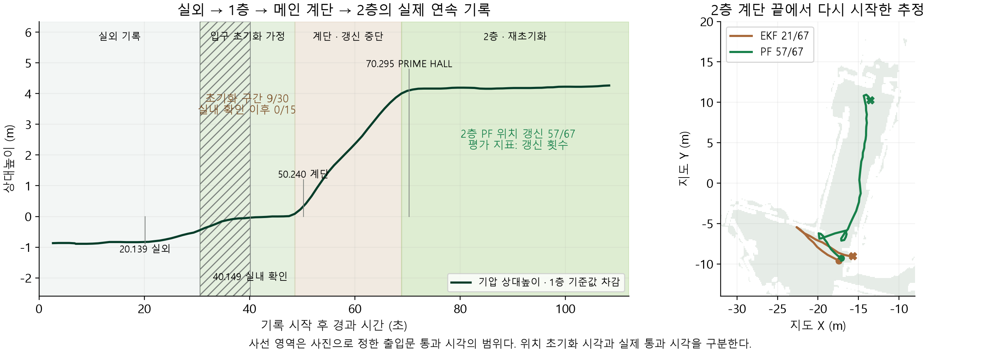

# 지도 보조 파티클 보행 추정

## 입력과 비교 범위

10월 20일 Sensor Logger로 수집한 112초 기록을 사용했다. 실외에서 입구로 들어와 메인 계단을 오른 뒤 2층 복도를 이동한 자료다. 원본 ZIP SHA256은 `26e85c7bfb8cbbf7986b83d67b3aa249b7332b8224648cd1f6195bb4381f525e`다. 실내 지도, 보행 격자와 장소 좌표는 이동시키지 않았다. 지도 파일의 해시는 [집계 JSON](../assets/map-pdr-20261021/comparison.json)에 기록했다.

원본 비보정 가속도는 g에서 m/s²로, 각속도는 rad/s에서 deg/s로 변환했다. 중력 스트림은 이미 m/s²라 다시 배율을 곱하지 않았다. NWU 자세 회전행렬로 예측한 기기 중력 방향과 실제 중력 스트림의 각도 차이는 중앙값 0°, P90 0.026°였다. 전치 행렬을 쓰면 중앙값 71.7°로 커져 회전 방향을 대조하는 데 사용했다.

재생의 입구 초기화 시각은 30.617초로 두었다. 그러나 이 시각의 사진은 아직 출입문 앞이며 40.149초 사진에서 실내 로비가 확인된다. 실제 문 통과 시각은 두 사진 사이에 있다. 계단 시작은 기압 상승이 이어지는 48.576초로 정했다. 2층 시작은 66초, 기압 상승 구간이 끝나는 68.842초, PRIME HALL 사진의 70.295초를 각각 시험했다. 사용자가 실제 버튼을 누른 기록이 아니라 시작 조건에 대한 가정이다. 2층에서는 메인 계단 끝 좌표를 다시 초기화했다. 한 번의 입구 초기화로 층을 자동 인식했다고 해석하지 않는다.

## 방법

`walking-sensors.js`의 시간 기반 걸음 검출은 공통이다. 상대 자세 전방, 중력 투영 각속도 적분, 각속도 적분에 계단 방향 확인을 추가한 세 전처리를 비교했다. 마지막 조건은 사용자가 계단 방향까지 확인했다는 추가 가정이라 배포 기본으로 삼지 않았다.

`gravity-heading.js`는 중력 방향의 각속도만 적분한다. 정지 조건에서 작은 바이어스를 추정하고, 250ms 이상 수신이 끊기면 적분을 멈춘다. 기기가 기울어지는 회전을 평면 회전으로 그대로 넣지 않는다. 브라우저 회전율이 없으면 상대 자세 방식으로 대체한다.

`map-particle-filter.js`의 입자는 `[x, y, yaw, 방향 드리프트, 보폭 배율]`을 가진다. 걸음마다 방향과 길이를 표본화한 뒤 전체 선분의 벽 통과와 대각선 모서리 통과를 검사한다. 살아남은 입자는 국소 보행 가능 셀 비율로 약하게 가중하고 systematic resampling을 수행한다. 분산이 크면 입자 수를 늘리고 분산이 작을 때 줄인다. 평균이 벽 안에 놓일 수 있어 표시점은 평균에 가까운 실제 입자로 선택한다. 직전 표시점에서 벽을 가로지르는 가설 전환도 거부한다.

APF_PDR의 지도 제약, 드리프트와 보폭 가설이라는 구성을 참고했다. 원본 MATLAB의 cross-entropy 기반 적응 조건과 동일한 구현은 아니다. 코드와 데이터는 목적지, 계획 경로, 정답 궤적 또는 GNSS 편향 피팅을 입력으로 받지 않는다.

## 설정 비교

5개 추정기, 3개 방향 처리, 3개 시작 시각, 4개 시드 `193, 893, 20261021, 872341`로 180개 조합을 계산했다. 같은 기록을 여러 조건으로 처리했으므로 독립 사용자나 반복 수집 180회의 결과가 아니다. EKF는 시드와 무관해 같은 조건이 중복된다. 시작 시각에 따라 2층의 걸음 후보는 65, 67, 71회다.

중력 투영 각속도 전처리의 12개 조건에서 계산한 중앙값이다. 안내 가능 갱신은 실제 위치 갱신과 모델 불확실성 7m 이하를 함께 만족한 횟수다. 7m는 운영 대기 기준이지 측량으로 보정한 확률 반경이 아니다.

| 방법 | 입자 설정 | 갱신 거부 중앙값 | 안내 가능 갱신 중앙값 | 안내 가능 갱신 최솟값 |
| --- | --- | ---: | ---: | ---: |
| 보행 EKF와 벽 제약 | 단일 상태 | 46 | 21 | 18 |
| 고정 입자 PF | 384 | 5.5 | 54 | 15 |
| 적응형 PF | 256–768 | 0 | 61 | 51 |
| 넓은 방향 사전 PF | 256–768 | 0 | 61 | 53 |
| 고밀도 적응형 PF | 768–2,048 | 0 | 67 | 57 |


고밀도 설정은 이 기록의 12개 조건에서 안내 가능 갱신의 중앙값과 최솟값이 가장 컸다. 한 걸음 계산 시간의 중앙값은 데스크톱 실행에서 약 2.9ms였다. iPhone 실행 시간으로 대체하지 않는다. 연산량과 민감도 결과를 보고 고밀도 설정을 선택했으며, 성능을 높이는 시드를 따로 골라 배포하지 않았다.

## 배포 기본값의 결과

기본 시드 872341, 2층 시작 68.842초를 그대로 제시한다. 이 조건의 2층은 EKF 21/67회, PF 57/67회 위치 갱신이었다. PF의 미갱신 10회와 불확실성 초과 4개 시점도 그대로 남겼다. 1층으로 분류했던 30.617–48.576초는 입구 접근 일부를 포함하며 9/30회 갱신이었다. 실내가 사진으로 확인되는 40.149초 이후의 후보 15회에서는 위치 갱신이 없었다. 이 수치는 갱신 동작의 집계이며 위치 정확도나 도달 성공률이 아니다.



원본 ZIP을 다시 읽어 약 100.3Hz 각속도, 기압 101개 표본과 사진 11장을 대조하였다. 기록은 실외에서 2층까지 112.01초 동안 이어지지만 기존 보행 비교는 30.617초 이전을 건너뛰며 48.576–68.842초의 계단에서도 걸음 기반 위치 갱신을 멈춘다. 1층 42–47초와 2층 75–99초의 기압 상대높이 중앙값 차이는 4.183m였다. 이는 층간 이동을 뒷받침하며 평면 위치의 독립 정답은 아니다. [원본 해시와 구간별 집계](../assets/map-pdr-20261021/recording-scope.json)


PF의 남은 입자를 마지막 시점부터 역추적하면 미래 제약까지 반영한 계보 궤적을 얻는다. 이는 경로를 매끈하게 잇는 보간이 아니라 살아남은 가설의 조상 위치다. 실시간에서는 미래를 사용할 수 없어 후보정 궤적을 배포 위치로 넣지 않는다. 배포본은 계보를 저장하지 않으며 위치 재현 JSON도 읽지 않는다.


벽 통과와 2m 초과 표시점 점프는 모두 0회였지만 이를 0m 측위 정확도로 읽을 수 없다. 지도 제약이 그런 이동을 차단하는 구조이기 때문이다. 독립 위치 정답과 실측 보수가 없어 위치 RMSE와 보폭 정확도를 산출하지 않았다. 같은 지도에서 설정을 선택하고 비교한 결과라 별도 기록에 대한 일반화도 남아 있다.

## 실제 웹 표시


저장 센서에서 계산한 PF 위치를 실제 웹의 지도와 방향 표시로 재생했다. 캡처용 주입은 테스트 응답에만 적용하며 배포 소스에는 재생 전역 변수를 넣지 않는다. 사용자 위치 입력은 실시간 브라우저 센서다. 위치 추정과 별도로 A* 경로를 계산하며, 현재 층 XY를 전달한 재경로 API도 HTTP 200과 경로 생성을 확인했다. [브라우저 확인 기록](../assets/map-pdr-20261021/browser-verification.json)

## 재현

공개된 파생 입력은 걸음 후보, 두 방향 처리값과 시각이다. 원 가속도·각속도와 실측 GNSS 스트림을 배포 사이트의 재생 입력으로 사용하지 않는다.

```sh
node web/scripts/compare-map-pdr.mjs
python scripts/plot_map_pdr.py
cd web
node --test test_indoor_position.mjs test_map_particle_filter.mjs
```

원 ZIP에서 다시 전처리할 때는 `scripts/prepare_map_pdr_inputs.py --help`의 입력 형식을 사용한다. 각속도 적분과 걸음 검출은 미래 표본을 쓰지 않는다. 계보 역추적만 후보정이다. [선택 조건](../assets/map-pdr-20261021/selection.json)과 [파생 관측](../assets/map-pdr-20261021/observations.json)을 함께 보관한다.

## 참고

Ai, M., Hokmabadi, I. A. S. and Zhao, X. A Novel Smartphone PDR Framework Based on Map-Aided Adaptive Particle Filter with a Reduced State Space. ISPRS IJGI, 14(12), 476, 2025. [논문](https://www.mdpi.com/2220-9964/14/12/476), [공식 코드 기준 커밋](https://github.com/IlyarAbadi/APF_PDR/tree/8865d26f2ddb7438ae8db154115d1c42e8756d6e).
