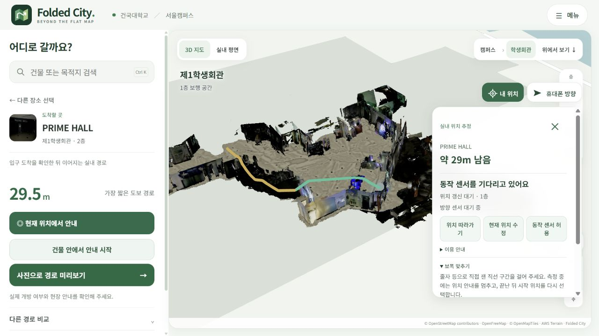

# 실측 로그로 분리한 걸음 검출, 방향축과 지도 배치

## 비교 조건

학생회관 밖에서 들어와 1층 로비와 메인 계단을 거쳐 2층을 걸은 112초 Sensor Logger 기록을 사용했다. 가속도 입력은 약 100.3Hz다. 같은 기록을 60, 50, 30Hz로 줄여 기존 검출기와 수정 검출기에 각각 넣었다. 비교 기준 코드는 `2197ceca91d97e8890d5354482c82b5747fcfc9c`로 고정했다.

OSM–SLAM 배치, ENU 추가 이동 동 2m·남 2m, 층 높이, 보행 격자와 장소 좌표는 바꾸지 않았다. 네 파일의 SHA-256은 [집계 원장](../assets/walking-sensors-20261021/summary.json)에 남겼다. 원 ZIP의 SHA-256은 `26e85c7bfb8cbbf7986b83d67b3aa249b7332b8224648cd1f6195bb4381f525e`다. 원 센서 파일과 새 사진은 이 자료에 포함하지 않았다.

## 1. 입력 빈도에 따라 달라지던 걸음 후보

| 입력 | 기존 검출 | 수정 검출 |
| --- | ---: | ---: |
| 원 기록 약 100Hz | 146 | 174 |
| 60Hz | 160 | 174 |
| 50Hz | 162 | 174 |
| 30Hz | 164 | 173 |

기존 코드는 수신 이벤트 간격에 따라 피크 상태가 달라졌다. 수정 코드는 받은 표본 사이를 50Hz로 재표본화한 뒤 인과적 필터와 한 주기의 양·음 피크를 사용한다. 미래 표본을 미리 보거나 누락 구간을 외삽하지 않는다. 검출 횟수 범위는 18회에서 1회로 줄었다. 실제 걸음 수를 별도로 세지 않았으므로 174회가 정답이라는 뜻은 아니다. 기본 보폭 계수도 이 횟수에 맞춰 조절하지 않았다.

## 2. 세워 든 휴대폰의 전방

수집 당시 휴대폰은 걷는 방향을 향했지만 화면 위쪽 축은 상당 시간 수직에 가까웠다. 위쪽 축을 바닥에 투영한 길이가 작으면 그 축의 방위각이 크게 흔들릴 수 있다. W3C의 ZXY 회전행렬에서 평평한 자세의 화면 위쪽과 세운 자세의 후면 카메라 방향을 나누어 사용했다.

Safari 상대 자세의 임의 초기 yaw는 입구 안쪽을 향한 사용자 확인으로 맞춘다. 다른 장소에서는 유효한 나침반 기준을 잡은 뒤 상대 회전을 사용한다. 이번 재생에서는 네이티브 NWU 쿼터니언을 정규화하고 ENU로 바꾼 뒤 임의의 yaw 37°를 더해 상대 ZXY 입력을 만들었다. 입력의 초기 yaw를 알고 있다고 가정해 보행 방향을 맞추지 않았다. 이 변환은 Safari에서 새로 수집한 기록과는 구분한다.

## 3. 같은 지도에서 끝까지 재생한 결과

| 입력 구성 | 위치 갱신 허용 | 벽 제약 거부 |
| --- | ---: | ---: |
| 기존 검출 + 네이티브 나침반 가정 | 40 | 29 |
| 수정 검출 + 같은 나침반 가정 | 25 | 70 |
| 수정 검출 + 입구 방향 기준 | 34 | 61 |

입구 시작은 30.617초, 계단 이동 중 평면 갱신 정지는 48.576–70.295초, 2층 승강장 재설정은 70.295초로 두었다. 이 시각은 실제 버튼 누름 기록이 아니라 사진과 구간을 참고한 재생 조건이다. 특히 70.295초 사진은 이미 PRIME HALL 부근이므로 승강장의 정확한 도착 시각을 제공하지 않는다. 그림에 나타난 궤적을 실제 걸은 정답 경로로 쓰지 않는다.

걸음 검출만 수정하면 기존 방향 오차에 더 많은 이동을 입력하게 되어 벽 거부가 늘었다. 입구 방향 기준을 추가해도 61회가 남았다. 따라서 이번 결과의 성과는 시간 처리와 축 처리의 교정이며, 실내 위치 정확도의 향상률은 제시하지 않는다. 개인 보폭, 휴대폰과 보행 방향 차이, 재생 시작 시각 및 보행면의 영향을 다음 비교에서 분리해야 한다. 위 횟수는 보행 모듈 자체의 재생 집계이며, 제품 화면은 연속 거부가 쌓이면 사용자에게 현재 위치 수정을 요청한다.

새 사진 11장도 기존 RGB-D 사진 후보와 특징 대응을 시도했다. 상위 후보에서 충분한 대응을 얻지 못해 위치 관측으로 수락한 사진은 0장이다. 흐린 사진을 강제로 정합하거나 PRIME HALL의 기존 장소 좌표를 새 사진의 카메라 좌표로 간주해 보폭을 맞추지 않았다.

## 4. 동 2m·남 2m 이동의 영향

입구에서 시작점을 확인한 로컬 보행 재생은 추가 ENU 이동을 없애도 궤적 차이가 **0m**였다. 지리 이동은 지도와 지리 위치 사이의 배치를 바꾸지만 이 보행 추정의 내부 상대 이동을 고치지 않는다.

기존 동시각 GNSS–SLAM 비교에서는 추가 이동을 없앨 때 1층 RMSE가 18.86m에서 16.89m, 2층·계단이 27.01m에서 26.68m로 변했다. 서브계단 구간은 33.69m에서 34.11m로 오히려 커졌다. 이 값은 독립 기준점 대비 절대 측위 오차가 아니라 두 자료 사이의 상대 차이다. 이번 수정에서 운영 지도와 오프셋은 유지했다.

## 확인한 구현과 다음 측정

- Node 회귀 시험 67개, Python 경로·사진·배포 시험 30개를 통과했다.
- 임의의 상대 yaw, 세운 자세, 평평한 자세, 수신 지연, 센서 공백, 벽 통과 거부, 보폭 설정 후 재시작을 시험했다.
- 제품 화면에서 PRIME HALL 선택 → 입구 확인 → 29.5m 실내 경로 API 응답 → 센서 미수신 대기를 확인했다. 걸음이 없는 보폭 측정을 완료하자 설정을 저장하지 않고 현재 위치 선택으로 돌아왔다. 데스크톱의 화면 시험은 아이폰 센서 수신 시험을 대신하지 않는다.

위 화면은 센서 이벤트가 들어오지 않는 데스크톱 상태다. 거리는 계산된 경로 길이이며 실제로 그만큼 걸어 추적에 성공한 사진이 아니다. 서버에서 지도 자료와 `walking-sensors.js`를 정상 제공했고 입구 경로 요청은 HTTP 200으로 응답했다. 위치 계산에는 별도의 외부 API나 인증 키를 추가하지 않았다.

개인 보폭은 실제로 잰 직선 구간에서 맞춘다. 이후 Safari에서 센서 이벤트와 출입문·계단 도착 시각을 함께 기록하고, 구간 끝의 위치 차이를 비교할 수 있다. 추천 경로나 목적지 위치를 보행 관측으로 넣지 않는다.

## 구현 근거

- [W3C Device Orientation and Motion](https://www.w3.org/TR/orientation-event/): ZXY 회전행렬과 후면 방향 벡터.
- [Apple DeviceOrientationEvent](https://developer.apple.com/documentation/webkitjs/deviceorientationevent): 상대 자세 및 나침반 속성.
- [WebKit iOS motion manager](https://github.com/WebKit/WebKit/blob/main/Source/WebCore/platform/ios/WebCoreMotionManager.mm): 상대 자세와 나침반 자료의 분리.
- [Sensor Logger coordinate conventions](https://github.com/tszheichoi/awesome-sensor-logger/blob/main/COORDINATES.md): 네이티브 센서 좌표 및 단위.

구현 파일은 `web/public/walking-sensors.js`, `indoor-position.js`, `location-controller.js`다. 원본이 있는 로컬 분석 폴더의 `prepare_attitude_replay_20261021.py` → `compare_walking_revisions_20261021.mjs` → `plot_walking_tuning_20261021.py` 순서로 입력 변환, 고정 기준 비교와 그림을 만들었다. 집계 자료에 소스 해시를 함께 저장했다.
