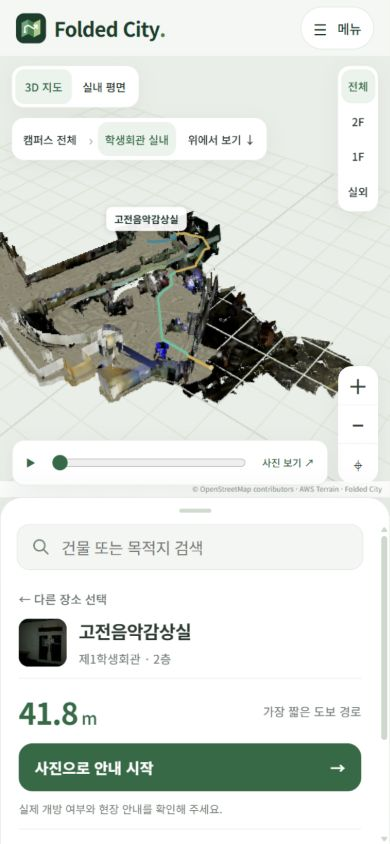

# Folded City 웹 지도

센서로 제작한 제1학생회관 지도에서 목적지를 검색하고, 층간 경로와 실제 사진을 확인하는 웹 클라이언트다. RGB-D 처리와 지도 최적화는 오프라인에서 수행하고 웹은 저장된 지도와 보행 데이터를 사용한다.

[서비스](https://folded-city-atlas.vercel.app/) / [그림으로 보는 연구](https://folded-city-atlas.vercel.app/research.html) / [전체 연구 보고서](../README.md) / [연구 과정](../README_HISTORY.md)


## 실행

저장소 루트에서 `web`으로 이동한다. Node.js와 Python이 필요하며 배포 기준은 Node.js 24와 Python 3.12다.

```sh
cd web
npm ci
npm run build
npm test
python -X utf8 server.py --port 8767
```

`http://127.0.0.1:8767/`에서 실행한다. 경로와 사진 안내에 Python API를 사용하므로 정적 파일 서버만으로는 전체 기능이 동작하지 않는다. 포트는 `--port`로 바꿀 수 있다.

| 명령 | 역할 |
| --- | --- |
| `npm run build` | 고정 버전 MapLibre 자산 준비, 필수 데이터와 배포 설정 검사 |
| `npm test` | Node.js 및 Python 회귀 검사 |
| `python server.py --port 8767` | 로컬 UI와 API 실행 |
| `npm run pack:vercel` | 별도 배포 파일 묶음 생성 |

빌드 명령에서 센서 DB 해독, SLAM, 사진 보정과 모델 생성은 실행하지 않는다.

## 사용 흐름

메뉴의 ‘그림으로 보는 연구’는 웹 안내 페이지다. 이론·수식·실험·모델과 실행 설정을 포함한 확장 보고서는 저장소의 메인 README에 모두 수록한다.

데스크톱은 기본 드래그로 회전하며 ‘이동’으로 평행 이동을 선택할 수 있다. ‘N’은 북쪽을 맞춘다. 터치는 한 손가락 이동, 두 손가락 회전을 사용한다. 실내 개요 화면에서도 OSM 배경을 유지한다.

목적지를 선택한 뒤 ‘현재 위치에서 안내’를 누르면 HTTPS의 위치 권한을 받아 연속 수신을 시작한다. 정확도가 나쁘거나 수신이 끊기면 자동 진행 안내를 멈추고 입구는 사용자가 확인한다. 남은 거리와 시간은 등록 구간만 계산하며 미등록 입구 연결 간격을 더한 전체 최단시간으로 표시하지 않는다. 실내 PDR/EKF와 자동 층 추정은 아직 연결하지 않았다.

배경지도는 교내 경계 없이 전 세계를 이동하고 확대 및 축소할 수 있다. OpenFreeMap이 제공하는 OSM 기반 벡터 타일 위에 교내 48동의 3D 건물을 별도 레이어로 표시한다. `캠퍼스 전체`를 누르면 건국대학교로 돌아온다. 교외 건물은 평면 윤곽으로 표시한다.

제1학생회관을 선택하고 목적지를 검색하면 경로와 대안을 보여 준다. 사진 안내는 지도 안의 가상 위치에서 이동 방향을 선택하는 방식이다. 배경지도 열람 범위가 전역으로 넓어진 것과 실내 경로 데이터의 범위는 별개다. 실내 안내는 촬영하고 연결을 등록한 학생회관에서 제공한다.


<table>
  <tr><th>경로 확인</th><th>사진 안내</th></tr>
  <tr>
    <td width="50%"></td>
    <td width="50%"></td>
  </tr>
</table>

모바일 목록은 `sheet-controller.js`에서 세 높이로 조절한다. 드래그와 방향키, Home/End를 지원하고 펼친 목록 안에서 스크롤한다. 지도와 카메라 구도도 표시 영역에 맞춰 갱신한다. 접힌 목록은 `inert`로 처리한다.

사진은 화면 채우기를 기본으로 하고 원본 비율, 밝기, 3D와 확대를 보기 설정에서 선택한다. 연구 수치와 사진 검사 도구는 메뉴의 프로젝트 정보에 있다.

### 캠퍼스 지형과 외관

실내 보기의 배경지도는 고도 0의 평면이다. 실내 모델에는 1층 기준 높이 −1.55m를 평면의 0.08m 위에 두는 공통 표시 변환을 적용한다. 2층만 선택해도 이 기준은 바뀌지 않아 4.15m의 층간 차이가 유지된다. 교내 지형용 lift를 실내에도 적용해 약 12.18m 떠 보이던 문제를 이 변환으로 수정했다. 원본 SLAM, GNSS와 A*의 XYZ·계단 길이는 변경하지 않는다. 이 표시 정합은 절대 표고 측량이 아니다.


공개 고도 격자의 호숫가에 5m 간격으로 최대 62m 높이 차이가 있었다. `campus-terrain.js`는 표시 단계에서 급상승을 완화하고 수면 아래에도 연속 지형을 그린다. 도로와 녹지도 같은 표시 고도를 사용한다. 원본 고도와 실내 SLAM 좌표, GNSS 정합, 보행 격자는 바뀌지 않는다. 이 배경을 측량 지형으로 사용할 수는 없다.

`campus-appearance.js`에는 직접 촬영한 학생회관 입구와 건축 자료로 확인한 도서관, 신공학관의 참고 자료와 재질을 기록했다. 적갈색 계열의 입구 기둥, 화강석, 회청색 유리를 구분한 절차적 재질이며 사진을 외벽 전체에 투영한 모델은 아니다. 외관을 확인하지 못한 건물은 중립 재질로 남긴다.

[수정 전후와 재생 확인](../docs/assets/campus-render-20261020/README.md)

## 구성

| 파일 또는 디렉터리 | 역할 |
| --- | --- |
| `public/` | UI, 사진, GLB와 지도 JSON |
| `public/world-map.js` | MapLibre 전역 배경과 Three.js 교내 레이어 |
| `public/world-registration.js` | 기존 미터 좌표의 WGS84 및 Web Mercator 표시 변환 |
| `navigation.py` | 층별 8방향 격자 A*, 모서리 관통 방지와 정책 |
| `walk.py` | 가상 이동, 추천 경로와 층간 전이 |
| `photo_library.py` | 위치, 방향, 영역과 보행 거리 기반 사진 검색 |
| `server.py` | 로컬 서버와 공통 요청 처리 |
| `api/dispatch.py` | Vercel Python Function 진입점 |
| `scripts/check-deploy.mjs` | 배포 구성 검사 |
| `tests/mobile-preview.html` | 로컬 모바일 레이아웃 확인 |

앱 전용 API 키나 외부 데이터베이스는 사용하지 않는다. 탐색 상태는 요청의 위치와 방향, 목적지, 정책으로 전달하고 사용자 이동 이력을 서버 디스크에 저장하지 않는다.

## 지도 데이터

| 파일 | 내용 |
| --- | --- |
| `public/data/navigation.json` | 층별 격자와 문, 계단, 승강장 연결 |
| `public/data/catalog.json` | 장소 ID, 별칭, 접근점과 근거 사진 |
| `public/data/photo_library.json` | 원본 RGB 2,875장의 메타데이터 |
| `public/data/photo_regions.json` | 사진의 연결 영역과 보행 지도 해시 |
| `public/data/photo_audit.json` | 해독 결과와 지도 대응 후보 2,398장 |
| `public/data/photo_colour_processing.json` | 암부 처리 설정과 원본 보존 정보 |
| `public/data/campus_provenance.json` | OSM, 지형과 좌표 변환 출처 |
| `public/models/` | 최종 표시 모델의 GLB 5개, 총 약 165 MB |
| `public/photos_full/` | 원본 JPEG |
| `public/photos_corrected/` | 밝기 보정 파생본 |
| `public/photo_thumbs/` | 사진 목록 축소판 |

`graph.json`은 촬영 관계이며 길찾기에 사용하지 않는다. 사진 대응은 보행 지도 해시를 확인하므로 지도를 바꾸면 접근점과 사진 영역도 함께 갱신해야 한다. 초기 부분 사진 묶음 `photos.json`과 과거 `provenance.json`의 수량은 전체 사진 원장과 다르다.

## API

모든 API는 GET이며 JSON을 반환한다. 로컬과 배포에서 같은 경로를 사용한다.

| 경로 | 입력 | 응답 |
| --- | --- | --- |
| `/api/health` | 없음 | 서버 상태와 런타임 |
| `/api/route` | `start`, `end`, `policy`, 선택 `mode`, `avoidStairs` | 좌표, 구간, 거리와 정책별 대안 |
| `/api/walk/start` | `place`, `goal`, `policy` | 시작 위치, 주변 사진과 선택지 |
| `/api/walk/options` | `node`, `yaw`, `goal`, `policy` | 이동 선택지, 남은 거리와 사진 |
| `/api/walk/move` | 위 입력과 `choice` | 이동 결과와 중간 전이 |

```sh
curl "http://127.0.0.1:8767/api/health"
curl "http://127.0.0.1:8767/api/route?start=outside_start&end=classical_music&policy=shortest"
curl "http://127.0.0.1:8767/api/walk/start?place=outside_start&goal=classical_music&policy=sub_stairs"
```

PowerShell에서는 `curl.exe` 또는 `Invoke-RestMethod`를 사용할 수 있다.

### 경로 정책

| 값 | 사용 연결 |
| --- | --- |
| `shortest` | 도보 계단 연결 중 거리 최소 |
| `main_stairs` | 층 이동에 메인 계단 사용 |
| `sub_stairs` | 층 이동에 서브계단 사용 |
| `elevator` | 계단 대신 등록 승강장 후보 연결 사용 |

`avoidStairs=1`은 엘리베이터 후보 정책을 사용한다. `mode=verified`는 현장 확인 완료 연결만 요구하며 현재 데이터에서는 연결이 부족해 `found:false`가 나올 수 있다. `node`는 `층:행:열`, `yaw`는 라디안이며 다음 이동의 값은 응답에서 받는다.

현재 외부 출발점에서 고전음악감상실까지의 응답 핵심 값은 다음과 같다.

```json
{
  "found": true,
  "distance_m": 41.8,
  "algorithm": "A*",
  "policy": "shortest",
  "recording_trajectory_used": false,
  "field_verified": false,
  "grid_resolution_m": 0.12
}
```

전체 응답의 일부이며 지도와 출발점이 바뀌면 거리도 달라진다. 계단과 승강장의 거리는 지도 모델에서 계산하며 엘리베이터 대기시간은 포함하지 않는다.

## 현재 위치와 헤딩

**내 위치 → 위치 권한 허용 → 목적지 선택 → 등록 실외 보행로 안내 → 입구 도착 확인 → 실내 경로** 순서로 사용한다. 방향 버튼을 누르면 기기 방향 접근 권한을 별도로 요청한다. API의 `heading`은 이동 방향이고 나침반과 같지 않다. 속도가 없거나 정지 상태이면 위치 차이로 헤딩을 만들지 않는다.

| 표시 | 의미 |
| --- | --- |
| 파란 점 | 정확도 가중 칼만 보정 위치 |
| 주황 점과 원 | 마지막 수락 원 수신 위치와 보고 반경 |
| 부채꼴 | 나침반 또는 이동 방향, 화면에서 출처 구분 |
| 회색 위치 | 10초 이상 정상 수신 없음 |
| 합성 GNSS 재현 | 고정 seed의 시험 입력, 실제 수신 아님 |
| 저장 로그 재생 | 과거 수신 재생, 현재 위치 아님 |

GNSS 필터와 지도 정합은 별개다. 브라우저의 95% 반경에서 등방성 Gaussian을 가정해 R을 구성하며, 기존 iOS DB는 신뢰수준이 명시되지 않은 반경으로 별도 처리한다. 15초 초과 공백은 새 구간으로 나누고 RTS는 구간 내부의 후보정에만 사용한다. 원본 데이터는 보존한다.

현재 OSM 도로와 학생회관 접근 지점은 약 37.24m 떨어져 있어 마지막 연결을 자동 생성하지 않는다. 임의의 직선을 보행로로 표시하지 않고 현장에서 입구를 확인한 뒤 실내 안내로 넘긴다. 실외 경로는 접근 태그를 거른 도로 그래프의 Dijkstra이며, 기존 실내 A*와 독립적이다.

현재 위치는 브라우저 메모리에서만 처리하며 서버로 전송하지 않는다. **메뉴 → 프로젝트 정보 → 학생회관 실측 GNSS 기록**에서 다섯 계측 구간, 내보내기와 불러오기를 사용할 수 있다. 기본 구간은 실외 338개이며 합성 자료는 별도 접힌 필터 시험 항목에 있다. HTTPS가 아닌 원격 HTTP에서는 현재 위치 권한을 사용할 수 없다.

[학생회관 실측 GNSS 바로 재생](https://folded-city-atlas-subin11111s-projects.vercel.app/?recording=outside)

`?recording=outside`는 위치 권한 없이 과거 계측 데이터를 불러온다. `lobby`, `bridge_out1f`, `floor2`, `bridge_12_sub`도 지원한다. 파일명과 원본 DB SHA256을 재생 및 내보내기에 보존하며, 원본 궤적과 칼만 처리 궤적을 각각 주황·파랑으로 그린다. 수집 기록 재생에는 OSM 목적지 경로를 얹지 않는다.


[이론과 실행 방법](../docs/experiments/2026-10-20-gnss-navigation.md) / [화면 및 수치](../docs/assets/gnss-navigation-20261020/README.md)

## Vercel

| 설정 | 값 |
| --- | --- |
| Root Directory | `web` |
| Production Branch | `main` |
| Framework | Other |
| Install | `npm ci` |
| Build | `npm run build` |
| Output | `public` |
| Python | 3.12 |
| Function | `api/dispatch.py` |
| Region | `icn1` |

정적 파일은 CDN에서, API는 Python Function에서 제공한다. `vercel.json`에서 5개 API를 dispatch로 재작성하고 함수에는 필요한 Python과 JSON만 포함한다. GLB와 사진은 함수 묶음에서 분리한다. API는 `no-store`, 정적 자산은 재검증 가능한 캐시를 사용한다.

저장소가 공개되어도 Vercel의 접근 보호 설정은 별개다. 인증이 필요한 배포는 소유자 브라우저나 인증된 Vercel 도구로 확인한다. 로컬 `.env*`, `.vercel/`과 자격증명은 Git에 넣지 않는다.

## 검사와 운영 범위

Node.js 25개, Python 29개의 회귀 검사에서 A*/Dijkstra 비교, 벽과 층간 이동, 사진 대응, GNSS 필터, UI 연결과 HTTP 요청을 확인한다. 위치 권한, 헤딩 이벤트, 이상치, 로그 저장 및 불러오기, 실내 경로 API 연결의 브라우저 시나리오도 수행했다. 실제 iPhone Safari의 센서와 현장 정확도는 브라우저 모의 시험과 다르다.

`/gnss-audit.html`은 다섯 실측 로그와 동시각 웹 지도 위치를 대조하는 화면이다. 메뉴의 프로젝트 정보에서도 연다. SLAM XY와 글로벌 ENU, 원본 위경도, 칼만과 RTS를 함께 표시한다. 이는 과거 촬영의 상대 위치 차이 검사이며 새 방문자의 실내 자동 측위가 아니다. [분석 방법과 수치](../docs/experiments/2026-10-20-gnss-slam-comparison.md)에 기준 포즈의 출처와 원래 선택 CSV 부재를 기록했다.

현재 지도는 촬영 구역을 대상으로 한다. 학생식당은 1층 진입 지점까지이고 사진은 촬영 시점의 원근 영상이다. 실외 현재 위치는 휴대폰 OS 위치 API로 표시하며, 실내 층별 자동 측위와 승강기 운행 확인은 제공하지 않는다.

사진에는 인물과 내부 게시물이 포함될 수 있다. 공개와 재사용 범위를 정할 때 이미지 자체의 권한 및 비식별 상태도 확인해야 한다. `noindex`는 검색 노출 설정이며 접근 제어 기능이 아니다.

## 문제 해결

| 증상 | 확인할 내용 |
| --- | --- |
| API 404 | `python server.py`로 실행했는지 |
| 배포가 로그인으로 이동 | Vercel 접근 보호 설정 |
| 실내 모델 로딩 지연 | 연결 상태, WebGL과 GLB 전송 오류 |
| 특정 방향의 사진 없음 | 촬영 범위와 영역 조건. 3D 보기 또는 다른 방향 선택 |
| 지도 변경 후 사진 오류 | `navigation.json` 해시와 사진 영역의 일치 여부 |
| 식당이 1층에 표시 | 지하 식당으로 내려가는 진입 지점 |
| 승강장 경로가 짧게 표시 | 수직 이동 거리 기반이며 대기시간 미포함 |
